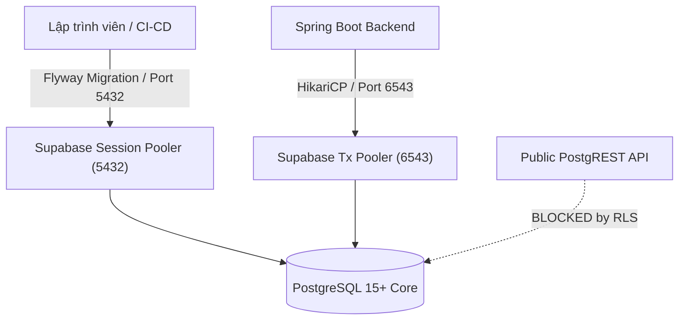

# Phase 01: Database & Supabase Infrastructure — Pattern Map

**Mapped:** 2026-11-10  
**Phase:** 01 — Database & Supabase Infrastructure  
**Files analyzed:** 7  
**Analogs found:** 2 / 7 (5 Greenfield)  

---

## 1. File Classification

| New / Modified File | Role | Data Flow | Closest Analog | Match Quality |
|---|---|---|---|---|
| `.gitignore` | `config` | `file-I/O` | `.gitignore` (root project file) | Exact (file update) |
| `.env.example` | `config` | `file-I/O` | No analog (greenfield) | Greenfield |
| `docs/SUPABASE_SETUP.md` | `documentation` | `file-I/O` | `docs/README.md` & `docs/ARCHITECTURE_DECISIONS.md` | Role-match |
| `backend/src/main/resources/db/migration/V1__initial_schema.sql` | `migration` | `transform` (DDL) | No analog (greenfield) | Greenfield |
| `backend/src/main/resources/db/migration/V2__seed_demo_data.sql` | `migration` | `batch` (DML) | No analog (greenfield) | Greenfield |
| `backend/scripts/verify-schema.sql` | `utility` / `test` | `request-response` | No analog (greenfield) | Greenfield |
| `backend/scripts/test-db-connection.ps1` | `utility` / `test` | `request-response` | No analog (greenfield) | Greenfield |

---

## 2. Pattern Assignments (Existing Analogs)

### 2.1 `.gitignore` (Role: config, Data Flow: file-I/O)

**Analog:** [`.gitignore`](file:///C:/Users/Admin/Desktop/Project-Mobile/.gitignore) (lines 1–11)

#### Existing Pattern (Lines 1–11):
```gitignore
*.iml
.gradle
/local.properties
.idea/
.DS_Store
/build
/captures
.externalNativeBuild
.cxx
local.properties
```

#### Diff / Expansion Pattern for Phase 1:
The existing `.gitignore` covers standard Android Studio and Gradle artifacts. Phase 1 introduces root and backend environment configurations containing confidential Supabase credentials (database password, service role key).

The pattern to apply is **explicit exclusion of all `.env*` variants with negation override for public templates**:
```gitignore
# -----------------------------------------------------------------------------
# Environment & Secret Configurations (ADR-007 Zero-Leakage Policy)
# -----------------------------------------------------------------------------
.env
.env.local
.env.*
*.env
!.env.example
```

**Key Invariants:**
1. Block `.env`, `.env.local`, and any named environment files.
2. Whitelist `!.env.example` to ensure safe credential placeholders remain tracked in Git.

---

### 2.2 `docs/SUPABASE_SETUP.md` (Role: documentation, Data Flow: file-I/O)

**Analog:** [`docs/README.md`](file:///C:/Users/Admin/Desktop/Project-Mobile/docs/README.md) (lines 1–25) and [`docs/ARCHITECTURE_DECISIONS.md`](file:///C:/Users/Admin/Desktop/Project-Mobile/docs/ARCHITECTURE_DECISIONS.md) (lines 1–40, 73–77)

#### Heading & Metadata Banner Pattern:
From `docs/README.md` lines 1–6:
```markdown
# UTEChat — [Tiêu đề tài liệu]

> **Trạng thái:** [ĐÃ CHỐT / HOÀN TẤT] [Ngày]  
> **Tài liệu tham chiếu:** [ERD.md](ERD.md), [ARCHITECTURE_DECISIONS.md](ARCHITECTURE_DECISIONS.md)  
> **Quy ước:** ...
```

#### GitHub-Style Alert Callouts:
From `docs/ERD.md` lines 5–22 and `docs/ARCHITECTURE_DECISIONS.md` lines 73–77:
```markdown
> [!NOTE]
> Supabase chỉ đóng vai trò PostgreSQL Database được quản trị (ADR-007). Backend Spring Boot là nguồn sự thật duy nhất.

> [!WARNING]
> Tuyệt đối KHÔNG commit service role key hoặc database password lên GitHub repository!

> [!IMPORTANT]
> Port 5432 (Session Mode) dành riêng cho Flyway DDL Migrations. Port 6543 (Transaction Mode) dành cho HikariCP với prepareThreshold=0.
```

#### Mermaid Flowchart Pattern:
From `docs/ARCHITECTURE_DECISIONS.md` lines 8–39:
```markdown

```

#### Concrete Section Structure for `docs/SUPABASE_SETUP.md`:
1. **Tổng quan kiến trúc CSDL & Phân quyền (Supabase M2 Model, ADR-007).**
2. **Hướng dẫn khởi tạo Supabase Project (Region `ap-southeast-1` Singapore).**
3. **Chiến lược kết nối & Dual-Port Architecture (Port 5432 DDL vs Port 6543 Runtime).**
4. **Cấu hình môi trường (`.env` local) & Hướng dẫn bảo mật.**
5. **Hướng dẫn chạy Flyway Migration (V1 Initial Schema, V2 Seed Data).**
6. **Kiểm tra và nghiệm thu (Xác thực 13 bảng, RLS Status, PostgREST Blocked Check).**
7. **Bảng tài khoản thử nghiệm chuẩn (5 Demo Accounts, passwords, phone numbers).**
8. **Khắc phục sự cố thường gặp (Prepared statement S_1 error, advisory lock timeout).**

---

## 3. Greenfield Canonical Patterns (No Analog Found)

### 3.1 `.env.example` (Role: config, Data Flow: file-I/O)

**Status:** Greenfield (No analog in repo).  
**Standard Pattern:** POSIX-compliant key-value environment template with structured comment blocks, port differentiation, and explicit dummy placeholders.

```bash
# =============================================================================
# UTEChat — Environment Configuration Template
# Phase 1: Database & Supabase Infrastructure (ADR-007)
# 
# HƯỚNG DẪN:
# 1. Sao chép tệp này thành .env: cp .env.example .env
# 2. Điền đầy đủ thông tin từ Supabase Project Dashboard (Settings -> Database)
# 3. TUYỆT ĐỐI KHÔNG COMMIT TỆP .env LÊN GIT!
# =============================================================================

# -----------------------------------------------------------------------------
# 1. Supabase Project Credentials
# -----------------------------------------------------------------------------
SUPABASE_PROJECT_ID=your-project-ref-id
SUPABASE_URL=https://your-project-ref-id.supabase.co
SUPABASE_ANON_KEY=your-supabase-anon-public-key
SUPABASE_SERVICE_ROLE_KEY=your-supabase-service-role-secret-key

# -----------------------------------------------------------------------------
# 2. PostgreSQL Direct / Session Pooler Connection (Port 5432)
# BẮT BUỘC dành cho Flyway DDL Migrations (Hỗ trợ pg_advisory_lock)
# -----------------------------------------------------------------------------
DB_HOST=aws-0-ap-southeast-1.pooler.supabase.com
DB_PORT_SESSION=5432
DB_NAME=postgres
DB_USER=postgres.your-project-ref-id
DB_PASSWORD=your-super-secure-database-password

FLYWAY_URL=jdbc:postgresql://${DB_HOST}:${DB_PORT_SESSION}/${DB_NAME}?sslmode=require

# -----------------------------------------------------------------------------
# 3. PostgreSQL Transaction Pooler Connection (Port 6543)
# BẮT BUỘC dành cho Spring Boot HikariCP Runtime
# LƯU Ý: prepareThreshold=0 là tham số bắt buộc để tránh lỗi prepared statement cache
# -----------------------------------------------------------------------------
DB_PORT_TRANSACTION=6543
SPRING_DATASOURCE_URL=jdbc:postgresql://${DB_HOST}:${DB_PORT_TRANSACTION}/${DB_NAME}?sslmode=require&prepareThreshold=0
SPRING_DATASOURCE_USERNAME=${DB_USER}
SPRING_DATASOURCE_PASSWORD=${DB_PASSWORD}
```

---

### 3.2 `backend/src/main/resources/db/migration/V1__initial_schema.sql` (Role: migration, Data Flow: transform / DDL)

**Status:** Greenfield (No analog in repo).  
**Standard Pattern:** Flyway Versioned Migration (`V<Version>__<Description>.sql`), PostgreSQL 15+ native DDL, strictly ordered foreign-key dependency tree, CHECK invariants, partial indexes, and RLS lockdown.

#### A. Header & Extensions
```sql
-- =============================================================================
-- Migration: V1__initial_schema.sql
-- Description: Core 13 Tables + Demo SMS Outbox for UTEChat V1
-- Reference: docs/ERD.md, docs/ARCHITECTURE_DECISIONS.md (ADR-001, ADR-003, ADR-007)
-- =============================================================================

CREATE EXTENSION IF NOT EXISTS "pgcrypto";
```

#### B. Table Creation Order (Foreign Key Dependency DAG)
To prevent foreign key dependency deadlocks:
1. `users` (independent root)
2. `user_devices` (depends on `users`)
3. `otp_challenges` (independent phone-based challenges)
4. `auth_sessions` (depends on `users` with nullable FK during registration)
5. `auth_throttles` (independent throttle scopes)
6. `contact_requests` (depends on `users` as requester and addressee)
7. `contacts` (composite PK `(owner_id, contact_user_id)`, depends on `users`)
8. `conversations` (depends on `users` as creator)
9. `conversation_members` (composite PK `(conversation_id, user_id)`, depends on `conversations`, `users`)
10. `attachments` (depends on `users` as uploader)
11. `calls` (depends on `conversations`, `users` as caller and callee)
12. `messages` (depends on `conversations`, `users`, `attachments`, `calls`)
13. `sync_events` (depends on `users`)
14. `demo_sms_outbox` (independent demo SMS log)

#### C. Canonical Table Patterns & Invariants
```sql
-- 1. users
CREATE TABLE users (
    id UUID PRIMARY KEY DEFAULT gen_random_uuid(),
    phone_e164 VARCHAR(20) UNIQUE,
    display_name VARCHAR(100) NOT NULL,
    avatar_url VARCHAR(500),
    password_hash VARCHAR(255) NOT NULL,
    discoverable BOOLEAN NOT NULL DEFAULT TRUE,
    allow_messages_from_non_contacts BOOLEAN NOT NULL DEFAULT TRUE,
    status VARCHAR(20) NOT NULL DEFAULT 'ACTIVE',
    created_at TIMESTAMPTZ NOT NULL DEFAULT NOW(),
    deleted_at TIMESTAMPTZ,
    CONSTRAINT chk_users_status CHECK (status IN ('ACTIVE', 'LOCKED', 'DELETED')),
    CONSTRAINT chk_users_phone_format CHECK (phone_e164 IS NULL OR phone_e164 ~ '^\+[1-9][0-9]{7,14}$')
);
CREATE INDEX idx_users_phone ON users(phone_e164) WHERE phone_e164 IS NOT NULL;

-- 5. auth_throttles (ADR-003)
CREATE TABLE auth_throttles (
    id UUID PRIMARY KEY DEFAULT gen_random_uuid(),
    scope_type VARCHAR(20) NOT NULL,
    scope_key_hash VARCHAR(64) NOT NULL,
    purpose VARCHAR(20) NOT NULL,
    failure_count INT NOT NULL DEFAULT 0,
    window_started_at TIMESTAMPTZ NOT NULL DEFAULT NOW(),
    locked_until TIMESTAMPTZ,
    updated_at TIMESTAMPTZ NOT NULL DEFAULT NOW(),
    CONSTRAINT chk_auth_throttles_scope_type CHECK (scope_type IN ('PHONE', 'DEVICE', 'PHONE_DEVICE')),
    CONSTRAINT chk_auth_throttles_purpose CHECK (purpose IN ('PASSWORD_LOGIN', 'OTP_VERIFY', 'PASSWORD_RESET')),
    CONSTRAINT uq_auth_throttles_scope UNIQUE (scope_type, scope_key_hash, purpose)
);

-- 6. contact_requests (Anti-conflict bidirectional invariant)
CREATE TABLE contact_requests (
    id UUID PRIMARY KEY DEFAULT gen_random_uuid(),
    requester_id UUID NOT NULL REFERENCES users(id) ON DELETE CASCADE,
    addressee_id UUID NOT NULL REFERENCES users(id) ON DELETE CASCADE,
    status VARCHAR(20) NOT NULL DEFAULT 'PENDING',
    created_at TIMESTAMPTZ NOT NULL DEFAULT NOW(),
    responded_at TIMESTAMPTZ,
    CONSTRAINT chk_contact_requests_no_self CHECK (requester_id <> addressee_id),
    CONSTRAINT chk_contact_requests_status CHECK (status IN ('PENDING', 'ACCEPTED', 'REJECTED', 'CANCELED'))
);
CREATE UNIQUE INDEX idx_contact_requests_pending_pair 
ON contact_requests (LEAST(requester_id, addressee_id), GREATEST(requester_id, addressee_id)) 
WHERE status = 'PENDING';

-- 9. conversation_members (Monotonic watermark invariant)
CREATE TABLE conversation_members (
    conversation_id UUID NOT NULL REFERENCES conversations(id) ON DELETE CASCADE,
    user_id UUID NOT NULL REFERENCES users(id) ON DELETE CASCADE,
    role VARCHAR(20) NOT NULL DEFAULT 'MEMBER',
    visible_from_message_id BIGINT NOT NULL DEFAULT 0,
    last_delivered_message_id BIGINT NOT NULL DEFAULT 0,
    last_read_message_id BIGINT NOT NULL DEFAULT 0,
    muted BOOLEAN NOT NULL DEFAULT FALSE,
    joined_at TIMESTAMPTZ NOT NULL DEFAULT NOW(),
    left_at TIMESTAMPTZ,
    CONSTRAINT pk_conversation_members PRIMARY KEY (conversation_id, user_id),
    CONSTRAINT chk_conversation_members_role CHECK (role IN ('ADMIN', 'MEMBER')),
    CONSTRAINT chk_watermarks_monotonic CHECK (last_delivered_message_id >= last_read_message_id)
);

-- 12. messages (Deduplication & Cursor Pagination)
CREATE TABLE messages (
    id BIGSERIAL PRIMARY KEY,
    conversation_id UUID NOT NULL REFERENCES conversations(id) ON DELETE CASCADE,
    sender_id UUID NOT NULL REFERENCES users(id) ON DELETE CASCADE,
    client_id UUID NOT NULL,
    type VARCHAR(20) NOT NULL,
    text VARCHAR(4000),
    attachment_id UUID REFERENCES attachments(id) ON DELETE SET NULL,
    call_id UUID REFERENCES calls(id) ON DELETE SET NULL,
    system_event VARCHAR(50),
    system_params TEXT,
    latitude DOUBLE PRECISION,
    longitude DOUBLE PRECISION,
    created_at TIMESTAMPTZ NOT NULL DEFAULT NOW(),
    CONSTRAINT chk_messages_type CHECK (type IN ('TEXT', 'IMAGE', 'AUDIO', 'VIDEO', 'FILE', 'LOCATION', 'SYSTEM', 'CALL')),
    CONSTRAINT uq_messages_client UNIQUE (sender_id, client_id)
);
CREATE INDEX idx_messages_conversation_id_desc ON messages (conversation_id, id DESC);

-- 13. sync_events (JSONB payload & User cursor)
CREATE TABLE sync_events (
    id BIGSERIAL PRIMARY KEY,
    user_id UUID NOT NULL REFERENCES users(id) ON DELETE CASCADE,
    event_type VARCHAR(50) NOT NULL,
    entity_type VARCHAR(50) NOT NULL,
    entity_id VARCHAR(100) NOT NULL,
    payload_json JSONB NOT NULL,
    created_at TIMESTAMPTZ NOT NULL DEFAULT NOW(),
    CONSTRAINT chk_sync_events_event_type CHECK (event_type IN ('MESSAGE_CREATED', 'CONVERSATION_UPDATED', 'CONTACT_REQUEST_CREATED', 'CONTACT_REQUEST_UPDATED', 'CONTACT_UPDATED', 'RECEIPT_UPDATED', 'CALL_UPDATED', 'DEVICE_REVOKED')),
    CONSTRAINT chk_sync_events_entity_type CHECK (entity_type IN ('MESSAGE', 'CONVERSATION', 'CONTACT_REQUEST', 'CONTACT', 'RECEIPT', 'CALL', 'DEVICE'))
);
CREATE INDEX idx_sync_events_user_cursor ON sync_events (user_id, id);
CREATE INDEX idx_sync_events_created ON sync_events (created_at);
```

#### D. Row Level Security Lockdown Pattern (ADR-007)
```sql
-- =============================================================================
-- Row Level Security (RLS) Lockdown
-- Default Deny on all tables. NO POLICIES CREATED.
-- Blocks PostgREST anon/authenticated API completely.
-- Spring Boot connects via 'postgres' role with BYPASSRLS attribute.
-- =============================================================================

ALTER TABLE users ENABLE ROW LEVEL SECURITY;
ALTER TABLE user_devices ENABLE ROW LEVEL SECURITY;
ALTER TABLE otp_challenges ENABLE ROW LEVEL SECURITY;
ALTER TABLE auth_sessions ENABLE ROW LEVEL SECURITY;
ALTER TABLE auth_throttles ENABLE ROW LEVEL SECURITY;
ALTER TABLE contact_requests ENABLE ROW LEVEL SECURITY;
ALTER TABLE contacts ENABLE ROW LEVEL SECURITY;
ALTER TABLE conversations ENABLE ROW LEVEL SECURITY;
ALTER TABLE conversation_members ENABLE ROW LEVEL SECURITY;
ALTER TABLE attachments ENABLE ROW LEVEL SECURITY;
ALTER TABLE calls ENABLE ROW LEVEL SECURITY;
ALTER TABLE messages ENABLE ROW LEVEL SECURITY;
ALTER TABLE sync_events ENABLE ROW LEVEL SECURITY;
ALTER TABLE demo_sms_outbox ENABLE ROW LEVEL SECURITY;
```

---

### 3.3 `backend/src/main/resources/db/migration/V2__seed_demo_data.sql` (Role: migration, Data Flow: batch / DML)

**Status:** Greenfield (No analog in repo).  
**Standard Pattern:** Idempotent DML insertions using fixed UUIDs and `ON CONFLICT DO NOTHING`.

#### A. Deterministic Identifiers & Hash Standard
- Standard BCrypt Hash for `Password123!`:
  `$2a$10$7EqJtq98hPqEX7fNZaFWoO.iU9pI6ZkJjC34kFpU80k7o0w63qO.S`
- Fixed User UUIDs:
  - Alice: `11111111-1111-1111-1111-111111111111` (`+84901111001`)
  - Bob: `22222222-2222-2222-2222-222222222222` (`+84901111002`)
  - Charlie: `33333333-3333-3333-3333-333333333333` (`+84901111003`)
  - David: `44444444-4444-4444-4444-444444444444` (`+84901111004`, `allow_messages_from_non_contacts = false`)
  - Eve: `55555555-5555-5555-5555-555555555555` (`+84901111005`, blocked by Alice)

#### B. Idempotent Insertion Pattern
```sql
-- 1. Insert Demo Users
INSERT INTO users (id, phone_e164, display_name, password_hash, allow_messages_from_non_contacts, status)
VALUES
    ('11111111-1111-1111-1111-111111111111', '+84901111001', 'Alice Nguyễn', '$2a$10$7EqJtq98hPqEX7fNZaFWoO.iU9pI6ZkJjC34kFpU80k7o0w63qO.S', true, 'ACTIVE'),
    ('22222222-2222-2222-2222-222222222222', '+84901111002', 'Bob Trần', '$2a$10$7EqJtq98hPqEX7fNZaFWoO.iU9pI6ZkJjC34kFpU80k7o0w63qO.S', true, 'ACTIVE'),
    ('33333333-3333-3333-3333-333333333333', '+84901111003', 'Charlie Lê', '$2a$10$7EqJtq98hPqEX7fNZaFWoO.iU9pI6ZkJjC34kFpU80k7o0w63qO.S', true, 'ACTIVE'),
    ('44444444-4444-4444-4444-444444444444', '+84901111004', 'David Phạm', '$2a$10$7EqJtq98hPqEX7fNZaFWoO.iU9pI6ZkJjC34kFpU80k7o0w63qO.S', false, 'ACTIVE'),
    ('55555555-5555-5555-5555-555555555555', '+84901111005', 'Eve Hoàng', '$2a$10$7EqJtq98hPqEX7fNZaFWoO.iU9pI6ZkJjC34kFpU80k7o0w63qO.S', true, 'ACTIVE')
ON CONFLICT (id) DO NOTHING;

-- 2. Insert Friendships and Blocked Relationships
INSERT INTO contacts (owner_id, contact_user_id, blocked)
VALUES
    ('11111111-1111-1111-1111-111111111111', '22222222-2222-2222-2222-222222222222', false),
    ('22222222-2222-2222-2222-222222222222', '11111111-1111-1111-1111-111111111111', false),
    ('11111111-1111-1111-1111-111111111111', '33333333-3333-3333-3333-333333333333', false),
    ('33333333-3333-3333-3333-333333333333', '11111111-1111-1111-1111-111111111111', false),
    ('22222222-2222-2222-2222-222222222222', '33333333-3333-3333-3333-333333333333', false),
    ('33333333-3333-3333-3333-333333333333', '22222222-2222-2222-2222-222222222222', false),
    ('11111111-1111-1111-1111-111111111111', '55555555-5555-5555-5555-555555555555', true)
ON CONFLICT (owner_id, contact_user_id) DO NOTHING;

-- 3. Insert Pending Friend Request (Bob -> David)
INSERT INTO contact_requests (id, requester_id, addressee_id, status)
VALUES ('cccccccc-0001-0000-0000-000000000001', '22222222-2222-2222-2222-222222222222', '44444444-4444-4444-4444-444444444444', 'PENDING')
ON CONFLICT (id) DO NOTHING;
```

---

### 3.4 `backend/scripts/verify-schema.sql` (Role: utility / test, Data Flow: request-response)

**Status:** Greenfield (No analog in repo).  
**Standard Pattern:** Pure, read-only diagnostic SQL script with explicit `PASS` / `FAIL` evaluation columns.

```sql
-- =============================================================================
-- Verification: verify-schema.sql
-- Runs automated schema health check against Supabase PostgreSQL
-- Safe and idempotent (read-only queries).
-- =============================================================================

-- 1. Check Table Count (Must find exactly 13 core + 1 demo table)
SELECT 
    COUNT(*) AS total_tables,
    CASE 
        WHEN COUNT(*) >= 14 THEN 'PASS: All 13 core tables + 1 demo table present'
        ELSE 'FAIL: Expected 14 tables'
    END AS status
FROM information_schema.tables 
WHERE table_schema = 'public' 
  AND table_name IN (
    'users', 'user_devices', 'otp_challenges', 'auth_sessions', 'auth_throttles',
    'contact_requests', 'contacts', 'conversations', 'conversation_members',
    'attachments', 'calls', 'messages', 'sync_events', 'demo_sms_outbox'
  );

-- 2. Verify Row Level Security is Enabled on 100% of tables
SELECT 
    c.relname AS table_name,
    CASE 
        WHEN c.relrowsecurity THEN 'PASS: RLS Enabled' 
        ELSE 'FAIL: RLS Disabled' 
    END AS rls_status
FROM pg_class c
JOIN pg_namespace n ON n.oid = c.relnamespace
WHERE n.nspname = 'public' 
  AND c.relkind = 'r'
ORDER BY c.relname;

-- 3. Verify Composite and Partial Indexes Exist
SELECT 
    indexname,
    tablename,
    CASE 
        WHEN indexname IS NOT NULL THEN 'PASS: Index present'
        ELSE 'FAIL: Missing index'
    END AS status
FROM pg_indexes
WHERE schemaname = 'public'
  AND indexname IN (
    'idx_messages_conversation_id_desc',
    'idx_sync_events_user_cursor',
    'idx_contact_requests_pending_pair',
    'idx_users_phone',
    'idx_auth_throttles_scope'
  );

-- 4. Verify Critical Privacy Column in users
SELECT 
    column_name, 
    data_type, 
    is_nullable,
    column_default,
    CASE 
        WHEN column_name = 'allow_messages_from_non_contacts' AND data_type = 'boolean' THEN 'PASS'
        ELSE 'FAIL'
    END AS status
FROM information_schema.columns
WHERE table_schema = 'public' 
  AND table_name = 'users' 
  AND column_name = 'allow_messages_from_non_contacts';

-- 5. Verify Seed Data Record Counts
SELECT 
    (SELECT COUNT(*) FROM users) AS user_count,
    (SELECT COUNT(*) FROM contacts WHERE blocked = false) AS accepted_friend_links,
    (SELECT COUNT(*) FROM contacts WHERE blocked = true) AS blocked_links,
    (SELECT COUNT(*) FROM conversations) AS conversation_count,
    (SELECT COUNT(*) FROM messages) AS message_count,
    (SELECT COUNT(*) FROM sync_events) AS sync_event_count;
```

---

### 3.5 `backend/scripts/test-db-connection.ps1` (Role: utility / test, Data Flow: request-response / network-I/O)

**Status:** Greenfield (No analog in repo).  
**Standard Pattern:** PowerShell script with robust parameter handling (`-Quick`, `-Full`), secure `.env` parsing, TCP port verification via `Test-NetConnection`, and RLS REST API blocking validation.

```powershell
<#
.SYNOPSIS
    Automated Database Connection and RLS Lockdown Verification for UTEChat.
.DESCRIPTION
    Tests TCP connectivity on Port 5432 and Port 6543, validates network latency,
    and verifies that the public Supabase PostgREST Data API is blocked by RLS.
.PARAMETER Quick
    Runs quick TCP connection and port check only (< 3s).
.PARAMETER Full
    Runs complete suite including REST RLS denial check and SQL latency query.
.PARAMETER EnvFile
    Path to environment configuration file (defaults to .env).
#>

[CmdletBinding()]
param (
    [switch]$Quick,
    [switch]$Full,
    [string]$EnvFile = ".env"
)

$ErrorActionPreference = "Stop"

function Write-Step {
    param([string]$Message, [string]$Status)
    if ($Status -eq "PASS") {
        Write-Host "  [OK] $Message" -ForegroundColor Green
    } elseif ($Status -eq "FAIL") {
        Write-Host "  [FAIL] $Message" -ForegroundColor Red
    } elseif ($Status -eq "WARN") {
        Write-Host "  [WARN] $Message" -ForegroundColor Yellow
    } else {
        Write-Host "  --> $Message" -ForegroundColor Cyan
    }
}

# 1. Load .env file safely
if (-not (Test-Path $EnvFile)) {
    Write-Step "Environment file '$EnvFile' not found. Please create it from .env.example." "FAIL"
    exit 1
}

$envVars = @{}
Get-Content $EnvFile | ForEach-Object {
    $line = $_.Trim()
    if ($line -and -not ($line.StartsWith("#"))) {
        $parts = $line.Split('=', 2)
        if ($parts.Length -eq 2) {
            $envVars[$parts[0].Trim()] = $parts[1].Trim()
        }
    }
}

$dbHost = $envVars["DB_HOST"]
if (-not $dbHost) {
    # Extract host from SPRING_DATASOURCE_URL if DB_HOST is omitted
    if ($envVars["SPRING_DATASOURCE_URL"] -match "jdbc:postgresql://([^:/]+)") {
        $dbHost = $matches[1]
    }
}

Write-Host "`n=== Phase 01: Supabase Infrastructure Verification ===" -ForegroundColor Cyan
Write-Host "Target Host: $dbHost"

# 2. Test Port 5432 (Session Mode / Flyway)
Write-Step "Testing Port 5432 (Session Pooler / DDL Migration)..." "INFO"
$tcp5432 = Test-NetConnection -ComputerName $dbHost -Port 5432 -InformationLevel Quiet
if ($tcp5432) {
    Write-Step "Port 5432 is open and reachable." "PASS"
} else {
    Write-Step "Cannot connect to Port 5432. Check firewall or Supabase status." "FAIL"
}

# 3. Test Port 6543 (Transaction Mode / Spring Boot HikariCP)
Write-Step "Testing Port 6543 (Transaction Pooler / App Runtime)..." "INFO"
$tcp6543 = Test-NetConnection -ComputerName $dbHost -Port 6543 -InformationLevel Quiet
if ($tcp6543) {
    Write-Step "Port 6543 is open and reachable." "PASS"
} else {
    Write-Step "Cannot connect to Port 6543." "FAIL"
}

if ($Quick) {
    Write-Host "`nQuick check completed." -ForegroundColor Green
    exit 0
}

# 4. Verify PostgREST Data API is BLOCKED by RLS (ADR-007)
$supaUrl = $envVars["SUPABASE_URL"]
$anonKey = $envVars["SUPABASE_ANON_KEY"]

if ($supaUrl -and $anonKey) {
    Write-Step "Verifying PostgREST Data API is BLOCKED by RLS..." "INFO"
    $headers = @{
        "apikey" = $anonKey
        "Authorization" = "Bearer $anonKey"
    }
    
    try {
        $response = Invoke-RestMethod -Uri "$supaUrl/rest/v1/users?select=count" -Headers $headers -Method Get -TimeoutSec 5
        # If RLS is enabled with NO POLICIES, it returns empty array [] or count = 0
        if ($response.Count -eq 0 -or $response -eq $null -or ($response | ConvertTo-Json) -eq "[]") {
            Write-Step "PostgREST API returned 0 records with anon key. RLS default-deny is WORKING!" "PASS"
        } else {
            Write-Step "PostgREST API returned data with anon key! RLS policy leak detected!" "FAIL"
        }
    } catch {
        # HTTP 401 or 403 or 404 is also valid denial
        $statusCode = $_.Exception.Response.StatusCode.value__
        if ($statusCode -in @(401, 403, 404)) {
            Write-Step "PostgREST API denied access (HTTP $statusCode). RLS lockdown VERIFIED!" "PASS"
        } else {
            Write-Step "Unexpected HTTP response: $statusCode" "WARN"
        }
    }
}

Write-Host "`nAll verification checks passed!" -ForegroundColor Green
```

---

## 4. Shared Patterns & Cross-Cutting Conventions

### 4.1 Row Level Security & Access Control Isolation (ADR-007)
- **Constraint:** RLS enabled on 100% of tables (`ALTER TABLE <table> ENABLE ROW LEVEL SECURITY;`).
- **Policy:** **Zero policies created.** Default deny prevents PostgREST from exposing any table via public anon/authenticated keys.
- **Backend Access:** Spring Boot connects via JDBC using the administrative role (`postgres`) which has `BYPASSRLS`.
- **Prohibited Command:** NEVER execute `ALTER TABLE ... FORCE ROW LEVEL SECURITY` as it forces RLS even on the table owner and breaks backend access.

### 4.2 Supavisor Connection Pooling & Driver Configuration
- **Port 5432 (Session Mode):**
  - Dedicated to Flyway migrations.
  - Supports `pg_advisory_lock` for migration synchronization.
  - JDBC URL: `jdbc:postgresql://<host>:5432/postgres?sslmode=require`.
- **Port 6543 (Transaction Mode):**
  - Dedicated to Spring Boot HikariCP connection pool.
  - **Mandatory Parameter:** `prepareThreshold=0` prevents `PSQLException: ERROR: prepared statement "S_1" does not exist` across transaction pool switches.
  - JDBC URL: `jdbc:postgresql://<host>:6543/postgres?sslmode=require&prepareThreshold=0`.

### 4.3 Flyway Naming and Execution Conventions
- **Directory:** `backend/src/main/resources/db/migration/`
- **Naming format:** `V<Version>__<Description>.sql` (e.g. `V1__initial_schema.sql`, `V2__seed_demo_data.sql`).
- **Strict rules:** Double underscore separator, uppercase `V`, monotonic integer versions, no trailing semicolon omissions.

### 4.4 Invariant Enforcement at the Database Layer
- **Phone Format:** `CHECK (phone_e164 IS NULL OR phone_e164 ~ '^\+[1-9][0-9]{7,14}$')`
- **No Self-Friending / Calling:** `CHECK (requester_id <> addressee_id)`, `CHECK (owner_id <> contact_user_id)`
- **Monotonic Watermarks:** `CHECK (last_delivered_message_id >= last_read_message_id)`
- **Race Condition Prevention:** Partial unique index `idx_contact_requests_pending_pair` on `(LEAST(requester_id, addressee_id), GREATEST(requester_id, addressee_id)) WHERE status = 'PENDING'`.

---

## 5. Metadata

- **Analog search scope:** Root (`.gitignore`), `docs/` (`README.md`, `ARCHITECTURE_DECISIONS.md`, `ERD.md`), `app/` (`build.gradle.kts`, `AndroidManifest.xml`).
- **Files scanned:** 12 tracked repository files + planning artifacts.
- **Pattern extraction date:** 2026-11-10.
- **Consuming Agent:** `gsd-planner` for Phase 01 PLAN.md generation.
