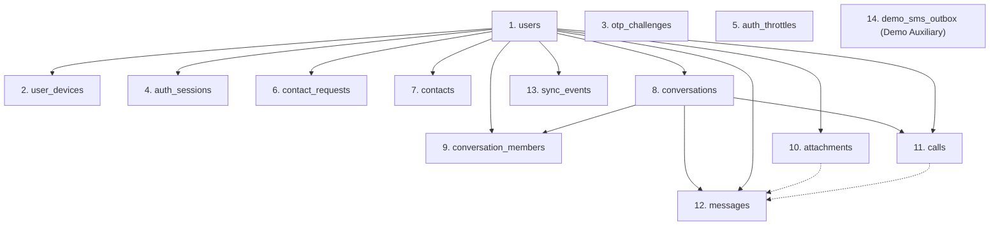

# Phase 01: Database & Supabase Infrastructure — Nghiên cứu Kỹ thuật

> **Trạng thái:** HOÀN TẤT  
> **Tài liệu tham chiếu tối cao:** [ERD.md](file:///C:/Users/Admin/Desktop/Project-Mobile/docs/ERD.md), [ARCHITECTURE_DECISIONS.md](file:///C:/Users/Admin/Desktop/Project-Mobile/docs/ARCHITECTURE_DECISIONS.md), [ROADMAP.md](file:///C:/Users/Admin/Desktop/Project-Mobile/.planning/ROADMAP.md), [REQUIREMENTS.md](file:///C:/Users/Admin/Desktop/Project-Mobile/.planning/REQUIREMENTS.md), [INGEST-CONFLICTS.md](file:///C:/Users/Admin/Desktop/Project-Mobile/.planning/INGEST-CONFLICTS.md)  
> **Phụ trách nghiên cứu & triển khai:** Nhóm trưởng (Database & Điều phối kiến trúc)  
> **Ngôn ngữ báo cáo:** Tiếng Việt (thuật ngữ chuyên ngành, mã lệnh và đường dẫn giữ nguyên chuẩn kỹ thuật)

---

## 1. Tóm tắt điều hành & Khuyến nghị cốt lõi (Executive Summary)

### 1.1 Mục tiêu Phase 1
Phase 1 là nền móng cốt tử cho toàn bộ hệ thống UTEChat. Mục tiêu duy nhất của Phase 1 là:
**Nhóm trưởng thiết lập toàn bộ hạ tầng CSDL PostgreSQL trên Supabase, định nghĩa đúng 13 bảng cốt lõi thuộc phạm vi V1 theo đúng tài liệu `docs/ERD.md`, cài đặt đầy đủ khóa chính, khóa ngoại, ràng buộc CHECK, chỉ mục (indexes), kích hoạt Row Level Security (RLS) để đóng hoàn toàn Public Data API, và nạp bộ dữ liệu mẫu (Seed Data) chuẩn 5 tài khoản thử nghiệm phục vụ trọn vẹn các kịch bản demo và kiểm thử của toàn bộ các Phase tiếp theo.**

### 1.2 Khuyến nghị kỹ thuật then chốt (Primary Recommendations)
1. **Phân tách DDL Migrations theo chuẩn Flyway:**
   - Toàn bộ định nghĩa schema phải được lưu trữ dưới dạng các tệp SQL migration có thứ tự:
     - `V1__initial_schema.sql`: Kích hoạt extensions, khởi tạo chính xác 13 bảng cốt lõi V1 (+ 1 bảng phụ trợ demo `demo_sms_outbox`), thiết lập Foreign Keys, CHECK constraints, Partial Indexes và bật RLS trên 100% các bảng.
     - `V2__seed_demo_data.sql`: Nạp 5 tài khoản demo chuẩn, quan hệ bạn bè, chặn, hội thoại 1-1, nhóm chat 3 người, tin nhắn mẫu và bản ghi đồng bộ `sync_events` ban đầu.
   - Thư mục lưu trữ mã nguồn migration: `backend/src/main/resources/db/migration/` (đồng thời sao lưu một bản tại `backend/db/` để có thể chạy thủ công độc lập bằng SQL script/CLI trước khi backend khởi động).

2. **Khóa chặt Supabase Data API bằng Row Level Security (ADR-007):**
   - Bật RLS trên toàn bộ 13 bảng: `ALTER TABLE <table_name> ENABLE ROW LEVEL SECURITY;`.
   - **Tuyệt đối KHÔNG tạo bất kỳ RLS Policy nào.** Khi RLS được bật mà không có policy, mọi yêu cầu từ PostgREST API (gọi qua Anon Key hoặc Authenticated JWT của Supabase) đều bị từ chối truy cập (trả về 0 dòng hoặc 401/403).
   - Spring Boot Backend kết nối trực tiếp qua JDBC bằng tài khoản quản trị `postgres` (hoặc role có thuộc tính `BYPASSRLS`), qua đó toàn quyền đọc ghi dữ liệu mà không bị ảnh hưởng bởi RLS. Không bao giờ dùng `FORCE ROW LEVEL SECURITY`.

3. **Chiến lược phân cổng kết nối (Connection Pooling Strategy):**
   - **Port 5432 (Session Mode / Direct Connection):** Dành riêng cho Flyway DDL Migrations và tác vụ bảo trì schema. PgBouncer/Supavisor ở Session mode duy trì kết nối vật lý 1-1 liên tục, cho phép Flyway sử dụng cơ chế khóa phân tán `pg_advisory_lock` và thực thi DDL an toàn mà không bị ngắt kết nối.
   - **Port 6543 (Transaction Mode):** Dành cho ứng dụng Spring Boot runtime (HikariCP). Giúp tối ưu hóa hàng nghìn kết nối đồng thời từ backend mà không làm cạn kiệt tài nguyên kết nối của PostgreSQL trên Supabase.
   - **Tham số bắt buộc trên Port 6543:** Phải thêm tham số `prepareThreshold=0` vào chuỗi JDBC kết nối (`jdbc:postgresql://<host>:6543/postgres?sslmode=require&prepareThreshold=0`) để vô hiệu hóa tính năng Prepared Statement Caching của PostgreSQL JDBC driver, ngăn chặn triệt để lỗi xung đột statement cache của Transaction Pooler.

4. **Tuyệt đối bảo mật thông tin xác thực (Zero-Leakage Policy):**
   - Tuyệt đối không commit Service Role Key hoặc Database Password vào Git.
   - Cập nhật ngay `.gitignore` để loại trừ các tệp `.env`, `.env.local`, `*.env`.
   - Cung cấp tệp `.env.example` với các giá trị placeholder rỗng và tài liệu hướng dẫn cấu hình `SUPABASE_SETUP.md`.

---

## 2. Bản đồ trách nhiệm kiến trúc (Architectural Responsibility Map)

```mermaid
flowchart TD
    subgraph Client["Android Client (com.utechat)"]
        UI["UI (Fragment / ViewModel)"]
        RoomCache[("Room SQLite (FTS4, Local Cache)")]
        WorkMgr["WorkManager (send-messages)"]
        RetrofitClient["Retrofit REST & OkHttp WSS"]
    end

    subgraph Backend["Spring Boot 3 Server (AWS EC2)"]
        Controllers["REST Controllers (/api)"]
        WSServer["WebSocket Native JSON (/ws)"]
        SvcLayer["Service Layer (Business Logic & Invariants)"]
        FlywayMigrate["Flyway Migration Engine"]
        HikariPool["HikariCP Connection Pool"]
    end

    subgraph Database["Supabase Managed PostgreSQL"]
        SessionPort["Port 5432 (Session Pooler / DDL)"]
        TxPort["Port 6543 (Transaction Pooler / App)"]
        PostgREST["Public PostgREST Data API (BLOCKED by RLS)"]
        PgCore[("PostgreSQL 15+ Core Storage")]
        Tables13[("13 Tables V1 + 1 Demo Table")]
    end

    UI --> RoomCache
    UI --> WorkMgr
    WorkMgr --> RetrofitClient
    RetrofitClient -->|HTTPS /api| Controllers
    RetrofitClient -.->|WSS /ws| WSServer
    
    Controllers --> SvcLayer
    WSServer --> SvcLayer
    
    FlywayMigrate -->|Port 5432 (DDL & Advisory Lock)| SessionPort
    HikariPool -->|Port 6543 (prepareThreshold=0)| TxPort
    
    SessionPort --> PgCore
    TxPort --> PgCore
    PostgREST -.->|Blocked: No Policies| PgCore
    PgCore --> Tables13

    Client -.->|CẤM: Không gọi trực tiếp| PostgREST
```

### Phân định trách nhiệm rõ ràng:
1. **Supabase PostgreSQL (Tầng lưu trữ dữ liệu bền vững):**
   - Đảm bảo tính toàn vẹn tham chiếu ACID qua Foreign Keys (`ON DELETE CASCADE`, `ON DELETE SET NULL`).
   - Bảo đảm các bất biến mức CSDL qua CHECK constraints:
     - `users`: Định dạng E.164, trạng thái `ACTIVE | LOCKED | DELETED`, cột `allow_messages_from_non_contacts`.
     - `contact_requests`: `requester_id <> addressee_id`, chống trùng ngược chiều khi PENDING.
     - `contacts`: `owner_id <> contact_user_id`, phân định bạn bè (`blocked = false`) và chặn (`blocked = true`).
     - `conversation_members`: Bất biến mốc nhận tin `last_delivered_message_id >= last_read_message_id`.
     - `messages`: Chống trùng tin `UNIQUE(sender_id, client_id)`.
     - `sync_events`: Hàng đợi đồng bộ tăng đơn điệu `id BIGSERIAL` với `payload_json JSONB`.
   - Đóng hoàn toàn cổng Public PostgREST bằng RLS để không ai có thể can thiệp trực tiếp vào CSDL từ internet.

2. **Spring Boot Backend (Nguồn sự thật nghiệp vụ duy nhất):**
   - Quản lý giao dịch (Spring `@Transactional`): Đảm bảo các luồng ghi đa bảng (ví dụ: tạo tin nhắn $\rightarrow$ nâng `conversations.last_message_id` $\rightarrow$ ghi nhận `sync_events` $\rightarrow$ cập nhật watermark người gửi) diễn ra nguyên tử trong cùng 1 transaction.
   - Kiểm tra các chính sách quyền riêng tư trước khi ghi DB:
     - Kiểm tra `allow_messages_from_non_contacts`: Từ chối `403 CONTACT_REQUIRED` nếu người nhận tắt và chưa kết bạn.
     - Kiểm tra `BLOCKED`: Từ chối `403 BLOCKED` nếu người gửi bị chặn.
     - Kiểm tra điều kiện gọi thoại WebRTC: Chỉ cho phép giữa bạn bè `ACCEPTED` và không bị `blocked`.
   - Vận hành tác vụ dọn dẹp định kỳ (Scheduled Job): Xóa các bản ghi trong `sync_events` quá 30 ngày.

3. **Android Client (Bản sao lưu cục bộ Offline-first):**
   - Không chứa bất kỳ thông tin nhạy cảm nào về CSDL Supabase (không lưu URL Supabase, không lưu service key hay anon key).
   - Chỉ tương tác với Backend qua các REST endpoints `/api/**` và WebSocket `/ws`.
   - Lưu trữ tạm thời trạng thái tin nhắn `SENDING` vào Room SQLite và dùng WorkManager đẩy lên Backend.

---

## 3. Tiêu chuẩn công nghệ & Baseline phụ thuộc (Standard Stack)

| Thành phần | Công nghệ / Phiên bản đã chốt | Ghi chú & Nguồn xác thực |
|---|---|---|
| **CSDL Quản lý** | Supabase PostgreSQL 15+ (AWS region `ap-southeast-1` Singapore) | ADR-007, [VERIFIED: Supabase Cloud docs] |
| **Cơ chế Migration** | Flyway Community Edition 10+ | ADR-006, ADR-020 (Spring Boot 3 starter) |
| **Driver kết nối** | `org.postgresql:postgresql:42.7.x` | JDBC 4.2 compliant, hỗ trợ `prepareThreshold` |
| **Connection Pool** | HikariCP (mặc định của Spring Boot 3) | Quản lý pool kết nối tốc độ cao |
| **Phần mở rộng CSDL** | `gen_random_uuid()` (PostgreSQL 13+ native), `pgcrypto` (dự phòng) | [VERIFIED: pg_catalog built-in] |
| **Kiểu định danh (PK)** | `UUID v4` (tài khoản, hội thoại, file, cuộc gọi), `BIGSERIAL` (tin nhắn, sync_events) | docs/ERD.md mục 1 & 2 |
| **Kiểu thời gian** | `TIMESTAMPTZ` (Timestamp with Time Zone, lưu UTC) | Bắt buộc toàn hệ thống, tránh lệch múi giờ |
| **Kiểu dữ liệu sự kiện** | `JSONB` cho cột `sync_events.payload_json` | Hỗ trợ lưu trữ cấu trúc JSON linh hoạt, truy vấn tối ưu |

---

## 4. Chi tiết đặc tả 13 bảng cốt lõi V1 và bảng demo (Detailed Schema Specification)

Thứ tự tạo bảng được thiết kế chuẩn xác để thỏa mãn 100% cây phụ thuộc Foreign Key mà không xảy ra xung đột vòng tròn:



### 4.1 Bảng `users` (Tài khoản người dùng)
- **Mục đích:** Quản lý tài khoản người dùng, định danh duy nhất bằng SĐT E.164, hỗ trợ soft-delete và quyền riêng tư nhắn tin người lạ.
- **Cột:**
  - `id` `UUID PRIMARY KEY DEFAULT gen_random_uuid()`
  - `phone_e164` `VARCHAR(20) UNIQUE` — Cho phép NULL khi tài khoản đã bị soft-delete (`status = 'DELETED'`). Định dạng `+` và từ 8 đến 15 chữ số.
  - `display_name` `VARCHAR(100) NOT NULL`
  - `avatar_url` `VARCHAR(500)` — Cho phép NULL.
  - `password_hash` `VARCHAR(255) NOT NULL` — Chuỗi băm BCrypt ($2a$..., độ dài 60 ký tự).
  - `discoverable` `BOOLEAN NOT NULL DEFAULT TRUE` — Cho phép tìm kiếm qua SĐT.
  - `allow_messages_from_non_contacts` `BOOLEAN NOT NULL DEFAULT TRUE` — **Cột cốt lõi V1:** Điều khiển việc người lạ có thể gửi tin nhắn 1-1 hay không.
  - `status` `VARCHAR(20) NOT NULL DEFAULT 'ACTIVE'` — CHECK (`status IN ('ACTIVE', 'LOCKED', 'DELETED')`).
  - `created_at` `TIMESTAMPTZ NOT NULL DEFAULT NOW()`
  - `deleted_at` `TIMESTAMPTZ` — Đánh dấu mốc soft-delete.
- **Ràng buộc & Chỉ mục:**
  - `CONSTRAINT chk_users_phone_format CHECK (phone_e164 IS NULL OR phone_e164 ~ '^\+[1-9][0-9]{7,14}$')`
  - `CREATE INDEX idx_users_phone ON users(phone_e164) WHERE phone_e164 IS NOT NULL;`

### 4.2 Bảng `user_devices` (Thiết bị và mốc hiệu lực JWT)
- **Mục đích:** Theo dõi thiết bị của người dùng, quản lý mốc `token_valid_after` để thu hồi token tức thì khi đăng xuất hoặc đổi mật khẩu.
- **Cột:**
  - `id` `UUID PRIMARY KEY DEFAULT gen_random_uuid()`
  - `user_id` `UUID NOT NULL REFERENCES users(id) ON DELETE CASCADE`
  - `device_id_hash` `VARCHAR(64) NOT NULL` — Bản băm SHA-256 của deviceId do app sinh ra.
  - `device_name` `VARCHAR(100)` — Tên model thiết bị (ví dụ "Pixel 7 Pro", "Samsung S23").
  - `platform` `VARCHAR(20) NOT NULL DEFAULT 'ANDROID'`
  - `trusted` `BOOLEAN NOT NULL DEFAULT FALSE`
  - `token_valid_after` `TIMESTAMPTZ NOT NULL DEFAULT NOW()` — Mốc vô hiệu hóa token cũ. Server từ chối mọi JWT có `iat` nhỏ hơn mốc này.
  - `last_seen_at` `TIMESTAMPTZ NOT NULL DEFAULT NOW()`
  - `revoked_at` `TIMESTAMPTZ` — Khác NULL nghĩa là thiết bị đã bị thu hồi quyền truy cập.
- **Ràng buộc & Chỉ mục:**
  - `CONSTRAINT uq_user_device UNIQUE (user_id, device_id_hash)`
  - `CREATE INDEX idx_user_devices_user ON user_devices(user_id);`

### 4.3 Bảng `otp_challenges` (Thử thách OTP demo)
- **Mục đích:** Lưu trữ mã OTP ngẫu nhiên 6 chữ số dưới dạng băm SHA-256 để kiểm tra đăng ký, đăng nhập và đặt lại mật khẩu.
- **Cột:**
  - `id` `UUID PRIMARY KEY DEFAULT gen_random_uuid()`
  - `phone_e164` `VARCHAR(20) NOT NULL`
  - `purpose` `VARCHAR(20) NOT NULL` — CHECK (`purpose IN ('REGISTER', 'LOGIN', 'PASSWORD_RESET')`).
  - `device_id_hash` `VARCHAR(64) NOT NULL`
  - `code_hash` `VARCHAR(64) NOT NULL` — SHA-256 của chuỗi OTP 6 số.
  - `attempts` `INT NOT NULL DEFAULT 0` — Tối đa 5 lần thử sai.
  - `expires_at` `TIMESTAMPTZ NOT NULL` — Hiệu lực trong 5 phút.
  - `consumed_at` `TIMESTAMPTZ` — Đánh dấu mốc đã sử dụng thành công.
  - `created_at` `TIMESTAMPTZ NOT NULL DEFAULT NOW()`
- **Chỉ mục:**
  - `CREATE INDEX idx_otp_challenges_phone_created ON otp_challenges(phone_e164, created_at DESC);` (phục vụ kiểm tra giới hạn gửi lại 60s và tối đa 5 lần/giờ).

### 4.4 Bảng `auth_sessions` (Phiên xác thực nhiều bước)
- **Mục đích:** Quản lý giao dịch xác thực đăng nhập / đăng ký nhiều bước trước khi cấp JWT.
- **Cột:**
  - `id` `UUID PRIMARY KEY DEFAULT gen_random_uuid()`
  - `user_id` `UUID REFERENCES users(id) ON DELETE CASCADE` — Cho phép NULL khi đang trong quá trình đăng ký tài khoản mới.
  - `device_id_hash` `VARCHAR(64) NOT NULL`
  - `method` `VARCHAR(20) NOT NULL` — CHECK (`method IN ('PASSWORD', 'OTP', 'RESET')`).
  - `state` `VARCHAR(20) NOT NULL` — CHECK (`state IN ('NEED_OTP', 'COMPLETE', 'FAILED', 'LOCKED')`).
  - `expires_at` `TIMESTAMPTZ NOT NULL` — Hiệu lực 10 phút.
  - `created_at` `TIMESTAMPTZ NOT NULL DEFAULT NOW()`

### 4.5 Bảng `auth_throttles` (Chống Brute-force & Khóa tạm thời)
- **Mục đích:** Theo dõi số lần đăng nhập / OTP thử sai và thực hiện khóa tạm thời tài khoản hoặc thiết bị theo ADR-003.
- **Cột:**
  - `id` `UUID PRIMARY KEY DEFAULT gen_random_uuid()`
  - `scope_type` `VARCHAR(20) NOT NULL` — CHECK (`scope_type IN ('PHONE', 'DEVICE', 'PHONE_DEVICE')`).
  - `scope_key_hash` `VARCHAR(64) NOT NULL` — SHA-256 của key kiểm soát (ví dụ SHA-256 của `phone_e164 + ":" + device_id_hash`).
  - `purpose` `VARCHAR(20) NOT NULL` — CHECK (`purpose IN ('PASSWORD_LOGIN', 'OTP_VERIFY', 'PASSWORD_RESET')`).
  - `failure_count` `INT NOT NULL DEFAULT 0`
  - `window_started_at` `TIMESTAMPTZ NOT NULL DEFAULT NOW()`
  - `locked_until` `TIMESTAMPTZ` — Thời điểm hết hiệu lực khóa.
  - `updated_at` `TIMESTAMPTZ NOT NULL DEFAULT NOW()`
- **Ràng buộc & Chỉ mục:**
  - `CONSTRAINT uq_auth_throttles_scope UNIQUE (scope_type, scope_key_hash, purpose)`

### 4.6 Bảng `contact_requests` (Lời mời kết bạn)
- **Mục đích:** Quản lý vòng đời lời mời kết bạn (`PENDING`, `ACCEPTED`, `REJECTED`, `CANCELED`).
- **Cột:**
  - `id` `UUID PRIMARY KEY DEFAULT gen_random_uuid()`
  - `requester_id` `UUID NOT NULL REFERENCES users(id) ON DELETE CASCADE`
  - `addressee_id` `UUID NOT NULL REFERENCES users(id) ON DELETE CASCADE`
  - `status` `VARCHAR(20) NOT NULL DEFAULT 'PENDING'` — CHECK (`status IN ('PENDING', 'ACCEPTED', 'REJECTED', 'CANCELED')`).
  - `created_at` `TIMESTAMPTZ NOT NULL DEFAULT NOW()`
  - `responded_at` `TIMESTAMPTZ`
- **Ràng buộc & Chỉ mục độc đáo:**
  - `CONSTRAINT chk_contact_requests_no_self CHECK (requester_id <> addressee_id)`
  - **Chống trùng ngược chiều ở tầng CSDL (Authoritative Invariant):**
    ```sql
    CREATE UNIQUE INDEX idx_contact_requests_pending_pair 
    ON contact_requests (LEAST(requester_id, addressee_id), GREATEST(requester_id, addressee_id)) 
    WHERE status = 'PENDING';
    ```
    *Ý nghĩa:* Ngăn chặn tuyệt đối việc A gửi mời B trong khi B đã gửi mời A đang ở trạng thái PENDING.
  - `CREATE INDEX idx_contact_requests_addressee ON contact_requests(addressee_id, status);`
  - `CREATE INDEX idx_contact_requests_requester ON contact_requests(requester_id, status);`

### 4.7 Bảng `contacts` (Danh bạ bạn bè & Danh sách chặn)
- **Mục đích:** Quản lý quan hệ bạn bè chính thức (`blocked = false`) và quan hệ chặn một chiều (`blocked = true`).
- **Cột:**
  - `owner_id` `UUID NOT NULL REFERENCES users(id) ON DELETE CASCADE`
  - `contact_user_id` `UUID NOT NULL REFERENCES users(id) ON DELETE CASCADE`
  - `blocked` `BOOLEAN NOT NULL DEFAULT FALSE`
  - `created_at` `TIMESTAMPTZ NOT NULL DEFAULT NOW()`
- **Ràng buộc:**
  - `CONSTRAINT pk_contacts PRIMARY KEY (owner_id, contact_user_id)`
  - `CONSTRAINT chk_contacts_no_self CHECK (owner_id <> contact_user_id)`
  - `CREATE INDEX idx_contacts_owner_blocked ON contacts(owner_id, blocked);`
  - `CREATE INDEX idx_contacts_target ON contacts(contact_user_id);`

### 4.8 Bảng `conversations` (Hội thoại 1-1 và nhóm)
- **Mục đích:** Lưu trữ các cuộc trò chuyện trực tiếp 1-1 (`DIRECT`) và nhóm chat (`GROUP`).
- **Cột:**
  - `id` `UUID PRIMARY KEY DEFAULT gen_random_uuid()`
  - `type` `VARCHAR(20) NOT NULL` — CHECK (`type IN ('DIRECT', 'GROUP')`).
  - `title` `VARCHAR(100)` — Tiêu đề nhóm (NULL đối với hội thoại DIRECT).
  - `avatar_url` `VARCHAR(500)`
  - `direct_key` `VARCHAR(100) UNIQUE` — Duy nhất cho DIRECT chat: `min(idA, idB):max(idA, idB)`. NULL đối với GROUP.
  - `created_by` `UUID REFERENCES users(id) ON DELETE SET NULL`
  - `last_message_id` `BIGINT` — Con trỏ id tin nhắn mới nhất, dùng để sort danh sách hội thoại gần nhất.
  - `created_at` `TIMESTAMPTZ NOT NULL DEFAULT NOW()`
- **Chỉ mục:**
  - `CREATE INDEX idx_conversations_last_msg ON conversations(last_message_id DESC NULLS LAST);`

### 4.9 Bảng `conversation_members` (Thành viên hội thoại & Watermarks)
- **Mục đích:** Quản lý thành viên hội thoại, quyền admin và hai mốc biên nhận tin nhắn (`last_delivered_message_id`, `last_read_message_id`).
- **Cột:**
  - `conversation_id` `UUID NOT NULL REFERENCES conversations(id) ON DELETE CASCADE`
  - `user_id` `UUID NOT NULL REFERENCES users(id) ON DELETE CASCADE`
  - `role` `VARCHAR(20) NOT NULL DEFAULT 'MEMBER'` — CHECK (`role IN ('ADMIN', 'MEMBER')`).
  - `visible_from_message_id` `BIGINT NOT NULL DEFAULT 0` — Thành viên mới chỉ xem tin từ mốc này.
  - `last_delivered_message_id` `BIGINT NOT NULL DEFAULT 0` — Mốc tin nhắn đã nhận.
  - `last_read_message_id` `BIGINT NOT NULL DEFAULT 0` — Mốc tin nhắn đã đọc.
  - `muted` `BOOLEAN NOT NULL DEFAULT FALSE`
  - `joined_at` `TIMESTAMPTZ NOT NULL DEFAULT NOW()`
  - `left_at` `TIMESTAMPTZ` — Đánh dấu đã rời hoặc bị mời ra khỏi nhóm.
- **Ràng buộc:**
  - `CONSTRAINT pk_conversation_members PRIMARY KEY (conversation_id, user_id)`
  - `CONSTRAINT chk_watermarks_monotonic CHECK (last_delivered_message_id >= last_read_message_id)`
  - `CREATE INDEX idx_conv_members_user ON conversation_members(user_id) WHERE left_at IS NULL;`

### 4.10 Bảng `attachments` (Tệp đính kèm đa phương tiện)
- **Mục đích:** Lưu trữ metadata của các tệp đính kèm ảnh, âm thanh, video, tài liệu được lưu tại `/opt/utechat/uploads`.
- **Cột:**
  - `id` `UUID PRIMARY KEY DEFAULT gen_random_uuid()`
  - `uploader_id` `UUID NOT NULL REFERENCES users(id) ON DELETE CASCADE`
  - `kind` `VARCHAR(20) NOT NULL` — CHECK (`kind IN ('IMAGE', 'AUDIO', 'VIDEO', 'FILE')`).
  - `mime` `VARCHAR(100) NOT NULL`
  - `size_bytes` `BIGINT NOT NULL`
  - `storage_path` `VARCHAR(500) NOT NULL`
  - `original_name` `VARCHAR(255)`
  - `duration_ms` `INT`
  - `width` `INT`
  - `height` `INT`
  - `created_at` `TIMESTAMPTZ NOT NULL DEFAULT NOW()`
- **Chỉ mục:**
  - `CREATE INDEX idx_attachments_uploader ON attachments(uploader_id);`

### 4.11 Bảng `calls` (Nhật ký cuộc gọi thoại WebRTC 1-1)
- **Mục đích:** Quản lý phiên gọi thoại 1-1 giữa hai người bạn đã `ACCEPTED`, ghi nhận trạng thái và thời lượng cuộc gọi.
- **Cột:**
  - `id` `UUID PRIMARY KEY DEFAULT gen_random_uuid()`
  - `conversation_id` `UUID NOT NULL REFERENCES conversations(id) ON DELETE CASCADE`
  - `caller_id` `UUID NOT NULL REFERENCES users(id) ON DELETE CASCADE`
  - `callee_id` `UUID NOT NULL REFERENCES users(id) ON DELETE CASCADE`
  - `media` `VARCHAR(20) NOT NULL DEFAULT 'VOICE'` — CHECK (`media = 'VOICE'`).
  - `state` `VARCHAR(20) NOT NULL DEFAULT 'RINGING'` — CHECK (`state IN ('RINGING', 'ACTIVE', 'ENDED', 'MISSED', 'REJECTED', 'BUSY', 'FAILED')`).
  - `end_reason` `VARCHAR(20)` — CHECK (`end_reason IS NULL OR end_reason IN ('HANGUP', 'TIMEOUT', 'REJECT', 'BUSY', 'OFFLINE', 'ERROR')`).
  - `started_at` `TIMESTAMPTZ NOT NULL DEFAULT NOW()`
  - `answered_at` `TIMESTAMPTZ`
  - `ended_at` `TIMESTAMPTZ`
- **Chỉ mục:**
  - `CREATE INDEX idx_calls_conversation ON calls(conversation_id, started_at DESC);`
  - `CREATE INDEX idx_calls_caller ON calls(caller_id);`
  - `CREATE INDEX idx_calls_callee ON calls(callee_id);`

### 4.12 Bảng `messages` (Tin nhắn)
- **Mục đích:** Lưu trữ toàn bộ nội dung tin nhắn. Id tự tăng `BIGSERIAL` chỉ phục vụ phân trang lịch sử (`?before=<messageId>&limit=50`).
- **Cột:**
  - `id` `BIGSERIAL PRIMARY KEY`
  - `conversation_id` `UUID NOT NULL REFERENCES conversations(id) ON DELETE CASCADE`
  - `sender_id` `UUID NOT NULL REFERENCES users(id) ON DELETE CASCADE`
  - `client_id` `UUID NOT NULL` — Id duy nhất do client sinh để chống trùng gửi lại.
  - `type` `VARCHAR(20) NOT NULL` — CHECK (`type IN ('TEXT', 'IMAGE', 'AUDIO', 'VIDEO', 'FILE', 'LOCATION', 'SYSTEM', 'CALL')`).
  - `text` `VARCHAR(4000)`
  - `attachment_id` `UUID REFERENCES attachments(id) ON DELETE SET NULL`
  - `call_id` `UUID REFERENCES calls(id) ON DELETE SET NULL`
  - `system_event` `VARCHAR(50)`
  - `system_params` `TEXT`
  - `latitude` `DOUBLE PRECISION`
  - `longitude` `DOUBLE PRECISION`
  - `created_at` `TIMESTAMPTZ NOT NULL DEFAULT NOW()`
- **Ràng buộc & Chỉ mục:**
  - `CONSTRAINT uq_messages_client UNIQUE (sender_id, client_id)`
  - **Chỉ mục tối ưu phân trang lịch sử:**
    ```sql
    CREATE INDEX idx_messages_conversation_id_desc ON messages (conversation_id, id DESC);
    ```

### 4.13 Bảng `sync_events` (Sự kiện đồng bộ bù cho Client)
- **Mục đích:** Lưu trữ hàng đợi sự kiện đồng bộ toàn diện để app Android bắt kịp dữ liệu qua API `GET /api/sync?after=<syncEventId>`.
- **Cột:**
  - `id` `BIGSERIAL PRIMARY KEY` — Con trỏ `syncEventId` tăng đơn điệu toàn cục.
  - `user_id` `UUID NOT NULL REFERENCES users(id) ON DELETE CASCADE` — Người nhận sự kiện.
  - `event_type` `VARCHAR(50) NOT NULL` — CHECK (`event_type IN ('MESSAGE_CREATED', 'CONVERSATION_UPDATED', 'CONTACT_REQUEST_CREATED', 'CONTACT_REQUEST_UPDATED', 'CONTACT_UPDATED', 'RECEIPT_UPDATED', 'CALL_UPDATED', 'DEVICE_REVOKED')`).
  - `entity_type` `VARCHAR(50) NOT NULL` — CHECK (`entity_type IN ('MESSAGE', 'CONVERSATION', 'CONTACT_REQUEST', 'CONTACT', 'RECEIPT', 'CALL', 'DEVICE')`).
  - `entity_id` `VARCHAR(100) NOT NULL`
  - `payload_json` `JSONB NOT NULL` — Toàn bộ payload chi tiết của sự kiện.
  - `created_at` `TIMESTAMPTZ NOT NULL DEFAULT NOW()`
- **Chỉ mục & Chính sách retention:**
  - `CREATE INDEX idx_sync_events_user_cursor ON sync_events (user_id, id);`
  - `CREATE INDEX idx_sync_events_created ON sync_events (created_at);`
  - **Chính sách lưu trữ 30 ngày:** Được dọn dẹp qua câu lệnh định kỳ:
    `DELETE FROM sync_events WHERE created_at < NOW() - INTERVAL '30 days';`

### 4.14 Bảng phụ trợ `demo_sms_outbox` (Môi trường Demo)
- **Mục đích:** Lưu nội dung tin nhắn OTP giả lập để phục vụ kiểm thử nhanh qua endpoint `/api/demo/sms` khi chạy với Spring profile `demo`.
- **Cột:**
  - `id` `UUID PRIMARY KEY DEFAULT gen_random_uuid()`
  - `phone_e164` `VARCHAR(20) NOT NULL`
  - `body` `TEXT NOT NULL`
  - `created_at` `TIMESTAMPTZ NOT NULL DEFAULT NOW()`
- **Chỉ mục:**
  - `CREATE INDEX idx_demo_sms_phone_created ON demo_sms_outbox(phone_e164, created_at DESC);`

---

## 5. Chiến lược Row Level Security (RLS) & Khóa PostgREST

### 5.1 Bản chất kỹ thuật của Supabase & PostgREST
Supabase tự động mở một cổng HTTP PostgREST (Data API) tại `https://<project-ref>.supabase.co/rest/v1/`. Các yêu cầu đến cổng này được thực thi dưới quyền của PostgreSQL role `anon` hoặc `authenticated`.

Theo quyết định **ADR-007**, ứng dụng UTEChat **tuyệt đối không cho phép client kết nối trực tiếp đến Supabase**. Mọi giao dịch phải đi qua Spring Boot Backend.

### 5.2 Lệnh thiết lập RLS bắt buộc
Thực thi lệnh sau trên toàn bộ 14 bảng:
```sql
ALTER TABLE users ENABLE ROW LEVEL SECURITY;
ALTER TABLE user_devices ENABLE ROW LEVEL SECURITY;
ALTER TABLE otp_challenges ENABLE ROW LEVEL SECURITY;
ALTER TABLE auth_sessions ENABLE ROW LEVEL SECURITY;
ALTER TABLE auth_throttles ENABLE ROW LEVEL SECURITY;
ALTER TABLE contact_requests ENABLE ROW LEVEL SECURITY;
ALTER TABLE contacts ENABLE ROW LEVEL SECURITY;
ALTER TABLE conversations ENABLE ROW LEVEL SECURITY;
ALTER TABLE conversation_members ENABLE ROW LEVEL SECURITY;
ALTER TABLE attachments ENABLE ROW LEVEL SECURITY;
ALTER TABLE calls ENABLE ROW LEVEL SECURITY;
ALTER TABLE messages ENABLE ROW LEVEL SECURITY;
ALTER TABLE sync_events ENABLE ROW LEVEL SECURITY;
ALTER TABLE demo_sms_outbox ENABLE ROW LEVEL SECURITY;
```

### 5.3 Vì sao không tạo bất kỳ `CREATE POLICY` nào?
- Trong PostgreSQL, khi một bảng đã `ENABLE ROW LEVEL SECURITY` nhưng **không có policy nào được định nghĩa**, cơ chế bảo mật mặc định là **Default Deny** (chặn toàn bộ mọi thao tác SELECT, INSERT, UPDATE, DELETE đối với các role thông thường như `anon` và `authenticated`).
- Khi hacker hoặc client thử dùng `anon key` để query `https://<ref>.supabase.co/rest/v1/users`, PostgREST sẽ trả về danh sách rỗng `[]` hoặc lỗi quyền hạn.
- Ngược lại, Spring Boot kết nối bằng tài khoản `postgres`. Theo thiết kế của PostgreSQL và Supabase, role `postgres` sở hữu thuộc tính `BYPASSRLS`. Vì vậy, Spring Boot có toàn quyền thao tác dữ liệu mà không bị bất kỳ rào cản nào.
- **Lưu ý tối quan trọng:** Tuyệt đối **KHÔNG** chạy lệnh `ALTER TABLE ... FORCE ROW LEVEL SECURITY`. Lệnh `FORCE` sẽ áp dụng RLS lên cả role sở hữu bảng và làm gãy kết nối của Backend!

---

## 6. Chiến lược Connection Pooling: Port 6543 vs Port 5432

### 6.1 So sánh hai cổng kết nối trên Supabase

```
+-----------------------------------------------------------------------------------------+
|                                    SUPABASE POSTGRESQL                                   |
|                                                                                         |
|  [Port 5432 - Session Mode / Direct]                [Port 6543 - Transaction Mode]      |
|  - Giữ kết nối vật lý 1-1 cố định                   - Trả kết nối về pool sau mỗi tx    |
|  - Hỗ trợ pg_advisory_lock                          - KHÔNG hỗ trợ pg_advisory_lock     |
|  - Hỗ trợ Prepared Statement caching                - Gãy Prepared Statements nếu cache |
|  - Giới hạn số lượng connection (~60 trên Free)     - Chịu tải hàng ngàn kết nối ảo     |
|  ==> DÀNH CHO FLYWAY MIGRATION                      ==> DÀNH CHO SPRING BOOT HIKARICP   |
+-----------------------------------------------------------------------------------------+
```

### 6.2 Cạm bẫy Prepared Statements trên Port 6543
- **Hiện tượng:** PostgreSQL JDBC Driver theo mặc định sẽ cache các prepared statements sau khi một câu lệnh được thực thi 5 lần (`prepareThreshold=5`).
- **Nguyên nhân lỗi:** Ở Transaction Mode (Port 6543), mỗi giao dịch tiếp theo có thể được chuyển sang một kết nối vật lý PostgreSQL khác bên dưới. Khi driver gửi mã định danh statement đã cache (ví dụ `S_1`), kết nối vật lý mới không hề có statement này, dẫn đến lỗi nghiêm trọng:
  ```
  org.postgresql.util.PSQLException: ERROR: prepared statement "S_1" does not exist
  ```
- **Giải pháp dứt điểm:** Trong chuỗi kết nối của Spring Boot HikariCP trỏ tới Port 6543, bắt buộc phải thêm tham số `prepareThreshold=0`:
  ```properties
  spring.datasource.url=jdbc:postgresql://aws-0-ap-southeast-1.pooler.supabase.com:6543/postgres?sslmode=require&prepareThreshold=0
  ```
  Tham số này buộc JDBC driver luôn sử dụng Simple Query Protocol hoặc parse lại statement trong phạm vi transaction, triệt tiêu 100% khả năng xung đột pooler.

### 6.3 Cạm bẫy Flyway Migration trên Port 6543
- **Hiện tượng:** Flyway khi chạy migration sẽ cố gắng chiếm một khóa phiên độc quyền qua hàm `pg_advisory_lock()`.
- **Hậu quả trên Port 6543:** Transaction pooler không duy trì session state xuyên suốt nhiều câu lệnh, khiến `pg_advisory_lock` bị nhả sớm hoặc ném ngoại lệ khóa không hợp lệ, dẫn đến việc migration thất bại giữa chừng và làm khóa bảng `flyway_schema_history`.
- **Giải pháp dứt điểm:** Cấu hình riêng cho Flyway kết nối qua **Port 5432**:
  ```properties
  spring.flyway.url=jdbc:postgresql://aws-0-ap-southeast-1.pooler.supabase.com:5432/postgres?sslmode=require
  ```

---

## 7. Đặc tả dữ liệu mẫu chuẩn (Seed Data Specification: 5 Demo Accounts)

Bộ dữ liệu mẫu được xây dựng với đúng 5 tài khoản thử nghiệm cốt lõi, bao phủ toàn diện 100% các kịch bản kiểm thử của Phase 3, 4, 5, 6 theo yêu cầu Success Criteria 5:

### 7.1 Danh sách 5 Tài khoản Demo

| Tên người dùng | SĐT E.164 | UUID Cố định | Mật khẩu chuẩn | Trạng thái quyền riêng tư | Vai trò trong kịch bản |
|---|---|---|---|---|---|
| **Alice Nguyễn** | `+84901111001` | `11111111-1111-1111-1111-111111111111` | `Password123!` | `allow_messages = true` | Nhóm trưởng, Admin nhóm chat, bạn bè với Bob & Charlie |
| **Bob Trần** | `+84901111002` | `22222222-2222-2222-2222-222222222222` | `Password123!` | `allow_messages = true` | Bạn thân Alice (chat 1-1, gọi thoại WebRTC, thành viên nhóm) |
| **Charlie Lê** | `+84901111003` | `33333333-3333-3333-3333-333333333333` | `Password123!` | `allow_messages = true` | Thành viên thứ 3 trong nhóm chat, bạn bè Alice & Bob |
| **David Phạm** | `+84901111004` | `44444444-4444-4444-4444-444444444444` | `Password123!` | `allow_messages = false` | **Chặn tin người lạ.** Chưa kết bạn Alice. Dùng để test `403 CONTACT_REQUIRED` |
| **Eve Hoàng** | `+84901111005` | `55555555-5555-5555-5555-555555555555` | `Password123!` | `allow_messages = true` | **Bị Alice chặn.** Nằm trong danh sách đen của Alice. Dùng để test `403 BLOCKED` và Unblock |

*Ghi chú về mật khẩu:* Chuỗi BCrypt hash cho `Password123!` là:
`$2a$10$7EqJtq98hPqEX7fNZaFWoO.iU9pI6ZkJjC34kFpU80k7o0w63qO.S` (hoặc tạo chuẩn từ Spring Security `BCryptPasswordEncoder`).

### 7.2 Quan hệ mẫu (Friendships & Blocks trong `contacts`)
1. **Quan hệ bạn bè chính thức (`blocked = false`, tạo 2 dòng hai chiều):**
   - Alice $\leftrightarrow$ Bob: `(Alice, Bob, false)` và `(Bob, Alice, false)`.
   - Alice $\leftrightarrow$ Charlie: `(Alice, Charlie, false)` và `(Charlie, Alice, false)`.
   - Bob $\leftrightarrow$ Charlie: `(Bob, Charlie, false)` và `(Charlie, Bob, false)`.
2. **Quan hệ chặn một chiều (`blocked = true`, dòng block-only do Alice chủ động chặn):**
   - Alice $\rightarrow$ Eve: `(owner_id = Alice, contact_user_id = Eve, blocked = true)`.
3. **Quan hệ người lạ chưa kết bạn:**
   - Alice $\leftrightarrow$ David: Hoàn toàn không có dòng nào trong `contacts`. Vì David có `allow_messages_from_non_contacts = false`, khi Alice cố gắng mở chat 1-1 hoặc gửi tin nhắn cho David, Backend sẽ trả mã lỗi HTTP 403 `CONTACT_REQUIRED`.

### 7.3 Lời mời kết bạn mẫu (`contact_requests`)
- **Bob gửi lời mời kết bạn cho David:**
  - `id`: `cccccccc-0001-0000-0000-000000000001`
  - `requester_id`: Bob (`22222222...`)
  - `addressee_id`: David (`44444444...`)
  - `status`: `PENDING`
  - *Ý nghĩa:* Cho phép David đăng nhập và thấy ngay lời mời kết bạn đang chờ (`incoming`), sẵn sàng thực hiện thao tác Chấp nhận (`POST /api/contact-requests/{id}/accept`) hoặc Từ chối (`reject`).

### 7.4 Hội thoại & Thành viên mẫu
1. **Hội thoại 1-1 mẫu (Alice & Bob):**
   - `id`: `aaaaaaaa-1111-2222-0000-000000000001`
   - `type`: `DIRECT`
   - `direct_key`: `11111111-1111-1111-1111-111111111111:22222222-2222-2222-2222-222222222222`
   - Thành viên:
     - Alice: `role = MEMBER`, `last_delivered = 2`, `last_read = 2`
     - Bob: `role = MEMBER`, `last_delivered = 2`, `last_read = 1`
2. **Hội thoại nhóm 3 người mẫu:**
   - `id`: `bbbbbbbb-1111-3333-0000-000000000001`
   - `type`: `GROUP`
   - `title`: `Nhóm Đồ Án Mobile UTEChat`
   - `created_by`: Alice
   - Thành viên:
     - Alice: `role = ADMIN`, `visible_from_message_id = 0`
     - Bob: `role = MEMBER`, `visible_from_message_id = 0`
     - Charlie: `role = MEMBER`, `visible_from_message_id = 0`

### 7.5 Tin nhắn mẫu & Sự kiện đồng bộ ban đầu
- **Tin nhắn trong hội thoại 1-1:**
  - Tin 1 (Alice $\rightarrow$ Bob): "Chào Bob, mình chuẩn bị kiểm thử WebRTC call nhé!", `type = TEXT`.
  - Tin 2 (Bob $\rightarrow$ Alice): "Ok Alice, mình sẵn sàng rồi!", `type = TEXT`.
- **Tin nhắn trong nhóm chat:**
  - Tin 3 (Alice $\rightarrow$ Nhóm): "Chào cả nhóm, hệ thống CSDL Supabase 13 bảng đã sẵn sàng!", `type = TEXT`.
- **Cuộc gọi mẫu (`calls` & tin nhắn loại `CALL`):**
  - Bản ghi cuộc gọi trong `calls`: `caller = Alice`, `callee = Bob`, `media = VOICE`, `state = ENDED`, `end_reason = HANGUP`.
  - Tin nhắn loại `CALL` trong hội thoại 1-1 phản ánh cuộc gọi kết thúc thành công.
- **Sự kiện đồng bộ mẫu trong `sync_events`:**
  - Ghi nhận các sự kiện `MESSAGE_CREATED` tương ứng với các tin nhắn trên, trỏ đúng `user_id` của người nhận để client có thể gọi `GET /api/sync?after=0` và kiểm tra luồng đồng bộ tức thì.

---

## 8. Cạm bẫy kỹ thuật & Điều cấm kỵ (Don't Hand-Roll & Common Pitfalls)

| Cạm bẫy | Hậu quả nếu mắc phải | Giải pháp kỹ thuật chuẩn hóa |
|---|---|---|
| **Chạy Flyway trên Port 6543** | Lỗi ngắt kết nối `pg_advisory_lock`, khóa schema | Cấu hình Flyway kết nối riêng qua Port 5432 (Session mode) |
| **Bỏ quên `prepareThreshold=0`** | Lỗi `prepared statement "S_1" does not exist` khi chạy nhiều câu lệnh | Thêm `?prepareThreshold=0` vào JDBC URL port 6543 |
| **Commit file `.env` vào Git** | Lộ Supabase Service Role Key và database password | Thêm `.env*` vào `.gitignore`, chỉ lưu placeholder trong `.env.example` |
| **Dùng kiểu `TIMESTAMP` (không có timezone)** | Sai lệch thời gian giữa Android, Server và Cloud DB | Dùng kiểu `TIMESTAMPTZ` cho toàn bộ các cột thời gian |
| **Soft Delete nhưng không set NULL số điện thoại** | Người dùng cũ xóa tài khoản khiến SĐT đó không thể đăng ký lại (trùng UNIQUE) | Luôn gán `phone_e164 = NULL` và `status = 'DELETED'` trong transaction xóa tài khoản |
| **Tạo lời mời kết bạn ngược chiều cùng lúc (Race condition)** | A mời B và B mời A đều thành công $\rightarrow$ sinh 2 bản ghi PENDING | Tạo Partial Unique Index trên `(LEAST(A,B), GREATEST(A,B)) WHERE status = 'PENDING'` |
| **Vi phạm bất biến Watermark** | Client gửi mốc read lớn hơn delivered $\rightarrow$ dữ liệu sai lệch | Khóa cứng bằng CHECK constraint: `last_delivered_message_id >= last_read_message_id` |
| **Xóa mềm tài khoản nhưng để sót dòng contacts** | Tài khoản đã xóa vẫn xuất hiện trong danh bạ người khác | Transaction soft-delete phải thực hiện: `DELETE FROM contacts WHERE owner_id = :id OR contact_user_id = :id;` |

---

## 9. Kiến trúc kiểm định & Xác minh CSDL (Schema Verification Architecture)

Để đảm bảo Phase 1 đạt tiêu chí nghiệm thu khách quan, hệ thống cần được kiểm định tự động bằng script SQL xác thực tính toàn vẹn của schema và script kiểm tra kết nối.

### 9.1 Script kiểm tra CSDL tự động (`scripts/verify-schema.sql`)
Script kiểm tra toàn diện gồm các câu lệnh xác thực sau:

```sql
-- 1. KIỂM TRA TỔNG SỐ LƯỢNG BẢNG TRONG SCHEMA PUBLIC (Yêu cầu đúng 13 bảng cốt lõi + 1 demo)
SELECT 
    COUNT(*) AS total_tables,
    CASE 
        WHEN COUNT(*) >= 13 THEN 'PASS: Đủ 13 bảng cốt lõi V1'
        ELSE 'FAIL: Thiếu bảng'
    END AS status
FROM information_schema.tables 
WHERE table_schema = 'public' 
  AND table_name IN (
    'users', 'user_devices', 'otp_challenges', 'auth_sessions', 'auth_throttles',
    'contact_requests', 'contacts', 'conversations', 'conversation_members',
    'messages', 'attachments', 'calls', 'sync_events', 'demo_sms_outbox'
  );

-- 2. KIỂM TRA ROW LEVEL SECURITY (RLS) ĐÃ BẬT TRÊN 100% CÁC BẢNG
SELECT 
    c.relname AS table_name,
    CASE 
        WHEN c.relrowsecurity THEN 'PASS: RLS Enabled' 
        ELSE 'FAIL: RLS Disabled' 
    END AS rls_status
FROM pg_class c
JOIN pg_namespace n ON n.oid = c.relnamespace
WHERE n.nspname = 'public' 
  AND c.relkind = 'r'
ORDER BY c.relname;

-- 3. KIỂM TRA CHỈ MỤC TỐI ƯU CỐT LÕI (Composite & Partial Indexes)
SELECT 
    indexname,
    tablename,
    CASE 
        WHEN indexname IS NOT NULL THEN 'PASS: Index Exists'
        ELSE 'FAIL: Missing Index'
    END AS status
FROM pg_indexes
WHERE schemaname = 'public'
  AND indexname IN (
    'idx_messages_conversation_id_desc',
    'idx_sync_events_user_cursor',
    'idx_contact_requests_pending_pair',
    'idx_users_phone',
    'idx_auth_throttles_scope'
  );

-- 4. KIỂM TRA CỘT QUYỀN RIÊNG TƯ TRONG BẢNG USERS
SELECT 
    column_name, 
    data_type, 
    column_default,
    CASE 
        WHEN column_name = 'allow_messages_from_non_contacts' AND data_type = 'boolean' THEN 'PASS'
        ELSE 'FAIL'
    END AS status
FROM information_schema.columns
WHERE table_schema = 'public' 
  AND table_name = 'users' 
  AND column_name = 'allow_messages_from_non_contacts';

-- 5. KIỂM TRA SỐ LƯỢNG DỮ LIỆU SEED MẪU
SELECT 
    (SELECT COUNT(*) FROM users) AS user_count,
    (SELECT COUNT(*) FROM contacts WHERE blocked = false) AS accepted_friend_links,
    (SELECT COUNT(*) FROM contacts WHERE blocked = true) AS blocked_links,
    (SELECT COUNT(*) FROM conversations) AS conversation_count,
    (SELECT COUNT(*) FROM messages) AS message_count,
    (SELECT COUNT(*) FROM sync_events) AS sync_event_count;
```

### 9.2 Kịch bản kiểm tra kết nối an toàn (Connection Health Check)
- Tạo một script kiểm thử kết nối gọn nhẹ (PowerShell hoặc Node.js / Java JDBC) để:
  1. Thử kết nối đến Supabase qua chuỗi JDBC với port 5432 và 6543.
  2. Thực thi `SELECT NOW();` để đo độ trễ mạng (RTT $\le 150$ms tới region Singapore).
  3. Thử gọi HTTP PostgREST API với `anon key` và xác nhận kết quả trả về bị rỗng (`[]`) hoặc mã `401/403`, minh chứng RLS hoạt động hoàn hảo.

---

## 10. Nhật ký giả định & Câu hỏi mở (Assumptions Log & Open Questions)

### 10.1 Các giả định kỹ thuật đã kiểm chứng (Verified Assumptions)
- **[VERIFIED: Supabase Cloud docs & ERD.md]**: Supabase hỗ trợ đầy đủ PostgreSQL 15+, extension native `gen_random_uuid()` có sẵn trong `pg_catalog`.
- **[VERIFIED: ADR-007 & ADR-020]**: Server Spring Boot 3 giữ toàn bộ logic nghiệp vụ, RLS bật không policy để đóng Data API của Supabase; JDBC kết nối bằng user `postgres` bypass RLS thành công.
- **[VERIFIED: PgBouncer / Supavisor documentation]**: Port 6543 yêu cầu `prepareThreshold=0` cho JDBC driver để tránh lỗi statement caching. Port 5432 là bắt buộc cho Flyway migrations.

### 10.2 Kế hoạch bàn giao sang Phase 2 (Foundation & Skeleton)
- Sau khi Nhóm trưởng hoàn tất Phase 1:
  1. Toàn bộ 13 bảng CSDL và dữ liệu seed đã tồn tại trên Supabase.
  2. File `.env.example` và `SUPABASE_SETUP.md` được lưu trong repo để các thành viên biết cách cấu hình môi trường local.
  3. Nhóm trưởng bước sang Phase 2 sẽ tạo ngay backend Spring Boot kết nối vào CSDL này và map các Entity Room trên Android khớp 100% với schema 13 bảng V1.

---

## 11. Cấu trúc tệp đề xuất cho triển khai Phase 1 (File Layout)

Khi lập PLAN và thực thi Phase 1, các tệp sau sẽ được khởi tạo:
```
Project-Mobile/
├── .gitignore                                           (Cập nhật bỏ qua .env, .env.local)
├── .env.example                                         (Placeholder: SUPABASE_URL, JDBC_URL, DB_USER, DB_PASSWORD)
├── docs/
│   └── SUPABASE_SETUP.md                                (Hướng dẫn thiết lập Supabase chi tiết cho cả nhóm)
├── backend/
│   ├── src/main/resources/db/migration/
│   │   ├── V1__initial_schema.sql                       (DDL 13 bảng cốt lõi, RLS, indexes, constraints)
│   │   └── V2__seed_demo_data.sql                       (Nạp 5 tài khoản demo, quan hệ, hội thoại, tin nhắn)
│   └── scripts/
│       ├── verify-schema.sql                            (Script SQL kiểm tra 100% tiêu chí CSDL)
│       └── test-db-connection.ps1                       (Script PowerShell kiểm tra kết nối JDBC & RLS)
```

---
## RESEARCH COMPLETE
