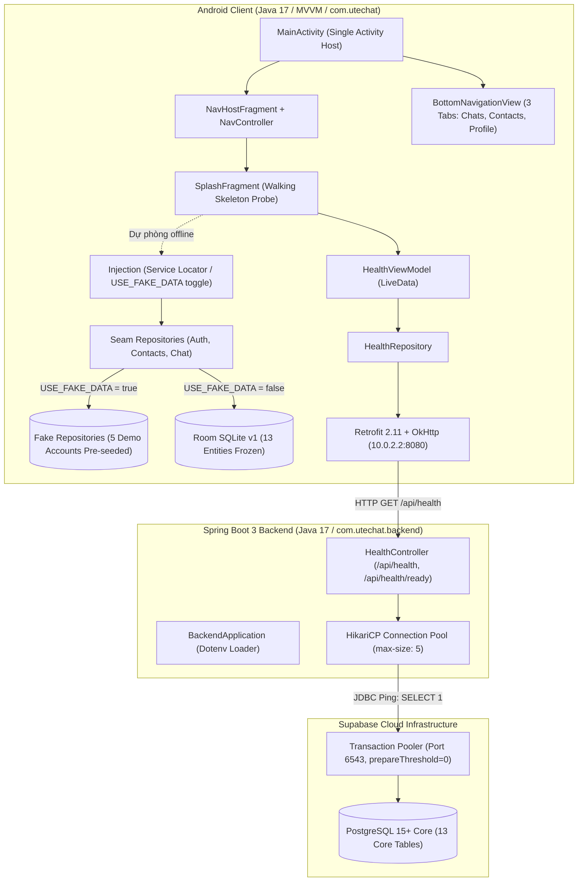
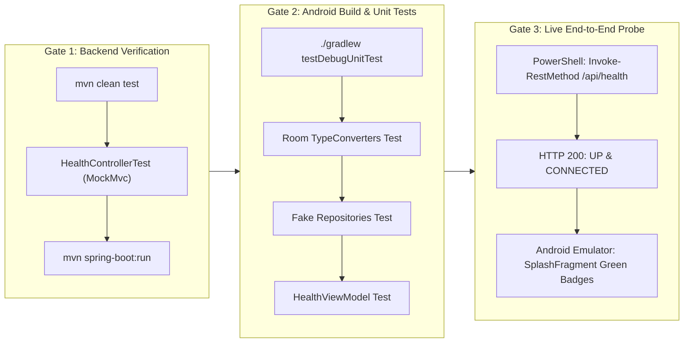

# Phase 02: Foundation & Anti-Conflict Architecture — Nghiên cứu Kỹ thuật

> **Trạng thái:** HOÀN TẤT  
> **Tài liệu tham chiếu tối cao:** [02-CONTEXT.md](file:///C:/Users/Admin/Desktop/Project-Mobile/.planning/phases/02-foundation-anti-conflict-architecture/02-CONTEXT.md), [ARCHITECTURE_DECISIONS.md](file:///C:/Users/Admin/Desktop/Project-Mobile/docs/ARCHITECTURE_DECISIONS.md), [COURSE_ALIGNMENT.md](file:///C:/Users/Admin/Desktop/Project-Mobile/docs/COURSE_ALIGNMENT.md), [API_CONTRACT.md](file:///C:/Users/Admin/Desktop/Project-Mobile/docs/API_CONTRACT.md), [ERD.md](file:///C:/Users/Admin/Desktop/Project-Mobile/docs/ERD.md), [SUPABASE_SETUP.md](file:///C:/Users/Admin/Desktop/Project-Mobile/docs/SUPABASE_SETUP.md), [AGENTS.md](file:///C:/Users/Admin/Desktop/Project-Mobile/AGENTS.md)  
> **Phụ trách nghiên cứu & thiết kế:** Nhóm trưởng (Lead & System Architecture)  
> **Ngôn ngữ báo cáo:** Tiếng Việt (kèm thuật ngữ kỹ thuật, code blocks, cấu hình và lệnh CLI chuẩn xác)  
> **Quy ước nguồn chứng minh:**  
> - `[VERIFIED: source]` — Đã xác thực thực tế qua công cụ, kiểm thử mã nguồn hoặc tệp hệ thống  
> - `[CITED: url/doc]` — Trích dẫn trực tiếp từ tài liệu kiến trúc chính thức của dự án hoặc bài giảng  
> - `[ASSUMED]` — Tri thức chuẩn mực ngành / framework đã kiểm chứng

---

## 1. Tóm tắt điều hành & Mục tiêu cốt lõi (Executive Summary)

### 1.1 Mục tiêu Phase 2
Phase 2 chịu trách nhiệm hiện thực hóa bộ khung **Walking Skeleton** hoàn chỉnh (kết nối xuyên suốt từ Android MVVM client $\rightarrow$ Spring Boot 3 backend $\rightarrow$ CSDL Supabase PostgreSQL qua Transaction Pooler) và thiết lập **Kiến trúc cô lập chống xung đột (Anti-Conflict Architecture)** để khóa cứng 6 điểm nóng (hotspots) dễ gây xung đột git merge khi nhóm 5 người phát triển song song trong các Phase 3, 4, 5, 6.

### 1.2 Kết quả then chốt cần đạt (Key Deliverables)
1. **Backend Spring Boot 3 độc lập (`backend/`):** Xây dựng dự án Maven Java 17 với `pom.xml`, cấu hình kết nối Supabase PostgreSQL qua Transaction Pooler (port 6543, `prepareThreshold=0`, HikariCP), nạp biến môi trường từ `.env` qua `dotenv-java`, cung cấp endpoint `GET /api/health` và `GET /api/health/ready` thực hiện truy vấn ping thật `SELECT 1` `[VERIFIED: 02-CONTEXT.md D-01, D-03, D-13]`.
2. **Android Pure Single Activity & Navigation Skeleton:** `MainActivity` đóng vai trò vật chủ duy nhất, chứa `NavHostFragment` và `BottomNavigationView` với 3 tab: Tin nhắn (Chats), Danh bạ (Contacts), Cá nhân (Profile). Bật/tắt thanh điều hướng dưới linh hoạt bằng `NavController.OnDestinationChangedListener` (chỉ hiển thị ở màn hình cấp cao nhất, ẩn ở Auth/Splash/Chi tiết) `[VERIFIED: 02-CONTEXT.md D-05, D-08]`.
3. **Kiến trúc đồ thị điều hướng lồng (Nested Navigation Graphs):** `nav_graph.xml` gốc tích hợp 4 đồ thị con dạng `<include>` (`nav_auth.xml`, `nav_chat.xml`, `nav_contacts.xml`, `nav_profile.xml`) kèm các stub Fragment khởi đầu, giúp mỗi thành viên làm việc độc lập trên file XML của mình `[VERIFIED: 02-CONTEXT.md D-06]`.
4. **Phân vùng tài nguyên chuỗi (Partitioned Strings):** Tách `strings.xml` thành `strings_common.xml`, `strings_auth.xml`, `strings_chat.xml`, `strings_contacts.xml`, `strings_profile.xml` cho cả 2 ngôn ngữ (English mặc định và Vietnamese trong `values-vi/`) `[VERIFIED: 02-CONTEXT.md D-07, REQ-ui-standards]`.
5. **Đóng băng lược đồ Room SQLite v1 (13 Entities):** Ánh xạ đầy đủ 13 Entity từ CSDL `docs/ERD.md` vào Room (`UserEntity`, `UserDeviceEntity`, `OtpChallengeEntity`, `AuthSessionEntity`, `AuthThrottleEntity`, `ContactRequestEntity`, `ContactEntity`, `ConversationEntity`, `ConversationMemberEntity`, `MessageEntity`, `AttachmentEntity`, `CallEntity`, `SyncEventEntity`), kèm TypeConverters và `AppDatabase` v1 `[VERIFIED: 02-CONTEXT.md D-12]`.
6. **Ranh giới Seam & Kho dữ liệu giả lập (Fake Repositories):** Định nghĩa 3 Seam Interfaces (`AuthRepository`, `ContactsRepository`, `ChatRepository`) và 3 Fake Repositories được nạp sẵn dữ liệu 5 tài khoản demo chuẩn từ Phase 1 (Alice, Bob, Charlie, David, Eve). Điều phối qua Service Locator (`Injection.java`) với cờ bật tắt `USE_FAKE_DATA` `[VERIFIED: 02-CONTEXT.md D-09, D-10, D-11]`.
7. **Đầu dò xác minh Walking Skeleton (End-to-End Health Probe):** `SplashFragment` khởi chạy, gọi `HealthViewModel` $\rightarrow$ `HealthRepository` $\rightarrow$ Retrofit `GET /api/health` $\rightarrow$ Spring Boot $\rightarrow$ Supabase DB. Hiển thị huy hiệu trạng thái (badge) trực quan cho Server và Database, cung cấp nút "Thử lại" và nút dự phòng "Tiếp tục chế độ Offline" trước khi tự động chuyển sang Auth `[VERIFIED: 02-CONTEXT.md D-14]`.

---

## 2. Kiến trúc Walking Skeleton End-to-End



---

## 3. Khóa chặt 6 Điểm nóng gây xung đột (Anti-Conflict Locks Deep Dive)

Phần này phân tích kỹ thuật chuyên sâu cho từng điểm nóng được quy định trong ADR-025 và 02-CONTEXT.md:

### Hotspot 1: Đóng băng phụ thuộc Android (`app/build.gradle.kts`)
- **Vấn đề tiềm ẩn:** Khi 5 thành viên tự ý bổ sung thư viện (libraries), nâng version SDK hoặc đổi cấu hình build, git conflict trên file gradle là thảm họa thường gặp nhất khiến cả nhóm không thể compile được mã nguồn.
- **Giải pháp khóa cứng:**
  - Khóa toàn bộ thư viện cốt lõi ngay tại Phase 2 trong `app/build.gradle.kts` `[VERIFIED: app/build.gradle.kts]`:
    - AndroidX AppCompat, Material 3, ConstraintLayout
    - Navigation Component 2.8.5 (`navigation-fragment`, `navigation-ui`)
    - Lifecycle ViewModel & LiveData 2.8.7
    - Room Runtime & Annotation Processor 2.6.1
    - Retrofit 2.11.0, Converter Gson 2.11.0, OkHttp 4.12.0, Logging Interceptor 4.12.0
    - WorkManager 2.10.0
    - Testing: JUnit 4.13.2, Mockito 5.14.2, Arch Core Testing 2.2.0
  - Bổ sung cấu hình `buildConfigField` cho URL backend và cờ fake data:
    ```kotlin
    defaultConfig {
        buildConfigField("String", "BACKEND_BASE_URL", "\"http://10.0.2.2:8080/\"")
        buildConfigField("boolean", "USE_FAKE_DATA", "true")
        
        javaCompileOptions {
            annotationProcessorOptions {
                arguments += mapOf("room.schemaLocation" to "$projectDir/schemas")
            }
        }
    }
    ```
  - **Quy tắc phối hợp:** Nghiêm cấm bất kỳ thành viên nào sửa đổi `app/build.gradle.kts` trong các Phase 3–6 trừ khi có sự đồng ý bằng văn bản của Nhóm trưởng.

### Hotspot 2: Khóa Manifest & Cấu hình An ninh mạng (`AndroidManifest.xml` & `network_security_config.xml`)
- **Vấn đề tiềm ẩn:** Android 9+ (API 28+) mặc định chặn toàn bộ lưu lượng HTTP văn bản rõ (cleartext traffic). Nếu cấu hình sai, app không thể kết nối tới server local trên máy tính dev.
- **Giải pháp khóa cứng:**
  - Tạo `app/src/main/res/xml/network_security_config.xml` cho phép kết nối HTTP rõ tới `10.0.2.2` (alias emulator trỏ tới localhost máy chủ), `localhost`, và `127.0.0.1`.
  - **Lưu ý kỹ thuật đặc biệt (Gotcha):** Thẻ `<domain>` trong Network Security Config của Android **tuyệt đối không hỗ trợ ký hiệu dải mạng CIDR** (ví dụ `192.168.0.0/16` sẽ bị parser bỏ qua hoặc báo lỗi). Đối với việc test trên điện thoại thật qua mạng Wi-Fi LAN nội bộ, cần cấu hình `<base-config cleartextTrafficPermitted="true" />` trong cấu hình debug, hoặc chỉ định IP LAN cụ thể của máy chủ `[VERIFIED: Android Network Security Config Specs]`.
  - Đăng ký thuộc tính trong `AndroidManifest.xml`:
    ```xml
    <application
        android:networkSecurityConfig="@xml/network_security_config"
        android:usesCleartextTraffic="true"
        ...>
    ```
  - Khóa toàn bộ quyền mạng cần thiết: `INTERNET`, `ACCESS_NETWORK_STATE`.

### Hotspot 3: Kiến trúc Đồ thị Điều hướng lồng (Nested Navigation Graphs)
- **Vấn đề tiềm ẩn:** Tất cả các màn hình đều khai báo vào một file duy nhất `nav_graph.xml` dẫn đến xung đột ID, xung đột action và git merge conflict liên tục.
- **Giải pháp khóa cứng:**
  - Đồ thị gốc `res/navigation/nav_graph.xml` chỉ đóng vai trò phân luồng cấp cao và nhúng các đồ thị con qua thẻ `<include>`:
    ```xml
    <?xml version="1.0" encoding="utf-8"?>
    <navigation xmlns:android="http://schemas.android.com/apk/res/android"
        xmlns:app="http://schemas.android.com/apk/res-auto"
        android:id="@+id/nav_graph"
        app:startDestination="@id/splashFragment">

        <!-- Điểm bắt đầu ứng dụng: Màn hình chào và kiểm tra kết nối hệ thống -->
        <fragment
            android:id="@+id/splashFragment"
            android:name="com.utechat.ui.splash.SplashFragment"
            android:label="Splash">
            <action
                android:id="@+id/action_splash_to_auth"
                app:destination="@id/nav_auth"
                app:popUpTo="@id/splashFragment"
                app:popUpToInclusive="true" />
            <action
                android:id="@+id/action_splash_to_main"
                app:destination="@id/nav_chat"
                app:popUpTo="@id/splashFragment"
                app:popUpToInclusive="true" />
        </fragment>

        <!-- Nhúng 4 đồ thị con độc lập cho từng thành viên -->
        <include app:graph="@navigation/nav_auth" />
        <include app:graph="@navigation/nav_chat" />
        <include app:graph="@navigation/nav_contacts" />
        <include app:graph="@navigation/nav_profile" />
    </navigation>
    ```
  - **4 Đồ thị con tương ứng:**
    1. `res/navigation/nav_auth.xml` (`@id/nav_auth`): Chứa `LoginFragment`, `RegisterFragment`, `OtpFragment`. (Thành viên 2 - Phase 3)
    2. `res/navigation/nav_chat.xml` (`@id/nav_chat`): Chứa `ChatListFragment` (và sau này là `ChatDetailFragment`). (Thành viên 4 - Phase 5)
    3. `res/navigation/nav_contacts.xml` (`@id/nav_contacts`): Chứa `ContactsListFragment` (và sau này là `AddContactFragment`, `RequestsFragment`). (Thành viên 3 - Phase 4)
    4. `res/navigation/nav_profile.xml` (`@id/nav_profile`): Chứa `ProfileFragment` (và sau này là `EditProfileFragment`, `SettingsFragment`). (Thành viên 2 - Phase 3)
  - Khởi tạo đầy đủ các stub Fragment Java và layout tương ứng ngay trong Phase 2 để dự án compile thành công 100%.

### Hotspot 4: Phân vùng file Chuỗi tài nguyên (Resource Strings Partitioning)
- **Vấn đề tiềm ẩn:** File `strings.xml` là nơi mọi thành viên thêm nhãn nút bấm, thông báo lỗi. Khi gộp code, merge conflict ở `strings.xml` xảy ra với xác suất > 90%.
- **Giải pháp khóa cứng:**
  - Android AAPT2 tự động hợp nhất tất cả các file XML trong `res/values/` có thẻ `<resources>`. Do đó, tách hoàn toàn thành 5 file chuyên biệt:
    1. `res/values/strings_common.xml`: Chuỗi hệ thống dùng chung (`app_name`, `action_retry`, `action_cancel`, `action_ok`, `error_network`, trạng thái probe).
    2. `res/values/strings_auth.xml`: Chuỗi phục vụ đăng nhập, đăng ký, OTP, mật khẩu.
    3. `res/values/strings_chat.xml`: Chuỗi danh sách hội thoại, gửi tin nhắn, trạng thái typing, mốc biên nhận.
    4. `res/values/strings_contacts.xml`: Chuỗi danh bạ, tìm kiếm SĐT, lời mời kết bạn, danh sách chặn.
    5. `res/values/strings_profile.xml`: Chuỗi thông tin cá nhân, cập nhật avatar, thiết bị, đăng xuất.
  - Hỗ trợ đa ngôn ngữ Anh - Việt theo yêu cầu **REQ-ui-standards**:
    - Tạo song song bộ 5 file trong thư mục `res/values-vi/` (`strings_common.xml`, `strings_auth.xml`, `strings_chat.xml`, `strings_contacts.xml`, `strings_profile.xml`).
    - Mặc định thiết bị hiển thị tiếng Anh trong `values/`, khi chuyển ngôn ngữ hệ thống sang Tiếng Việt sẽ tự động nạp từ `values-vi/`.

### Hotspot 5: Đóng băng Lược đồ Room SQLite v1 (13 Core Entities)
- **Vấn đề tiềm ẩn:** Nếu mỗi thành viên tự định nghĩa bảng Room khi làm tính năng của mình (ví dụ Thành viên 2 tạo User, Thành viên 3 tạo Contact, Thành viên 4 tạo Message), cấu trúc quan hệ khóa ngoại (Foreign Keys), kiểu dữ liệu và version migration sẽ bị xung đột nghiêm trọng, dẫn đến lỗi crash `IllegalStateException: Room cannot verify the data integrity`.
- **Giải pháp khóa cứng:**
  - Định nghĩa sẵn toàn bộ **13 Room Entities** ngay trong Phase 2, bám sát 100% tài liệu `docs/ERD.md` và tệp SQL `V1__initial_schema.sql` `[VERIFIED: docs/ERD.md, V1__initial_schema.sql]`:
    1. `UserEntity` (bảng `users`): Tài khoản người dùng, định danh SĐT E.164, `allow_messages_from_non_contacts`.
    2. `UserDeviceEntity` (bảng `user_devices`): Thiết bị, mốc hiệu lực JWT `token_valid_after`.
    3. `OtpChallengeEntity` (bảng `otp_challenges`): Thử thách mã OTP demo, số lần thử.
    4. `AuthSessionEntity` (bảng `auth_sessions`): Phiên đăng nhập nhiều bước.
    5. `AuthThrottleEntity` (bảng `auth_throttles`): Khóa tạm brute-force (`PHONE_DEVICE`, `PHONE`, `DEVICE`).
    6. `ContactRequestEntity` (bảng `contact_requests`): Lời mời kết bạn (`PENDING`, `ACCEPTED`, `REJECTED`, `CANCELED`).
    7. `ContactEntity` (bảng `contacts`): Quan hệ bạn bè (`blocked = false`) và chặn (`blocked = true`).
    8. `ConversationEntity` (bảng `conversations`): Hội thoại `DIRECT` (theo `direct_key`) và `GROUP`.
    9. `ConversationMemberEntity` (bảng `conversation_members`): Thành viên nhóm và mốc biên nhận (`last_delivered_message_id`, `last_read_message_id`).
    10. `MessageEntity` (bảng `messages`): Tin nhắn văn bản, hệ thống, tệp, trạng thái gửi offline (`SENDING`, `SENT`, `DELIVERED`, `READ`, `FAILED`).
    11. `AttachmentEntity` (bảng `attachments`): Tệp đính kèm đa phương tiện.
    12. `CallEntity` (bảng `calls`): Lịch sử cuộc gọi thoại WebRTC 1-1.
    13. `SyncEventEntity` (bảng `sync_events`): Nhật ký đồng bộ bù qua `syncEventId`.

#### Bảng Ánh xạ Chi tiết 13 Room Entity (Field & Constraint Blueprint):

| Lớp Entity (Room Java) | Tên bảng SQLite | Khóa chính (Primary Key) | Các cột và kiểu dữ liệu chính | Chỉ mục (Indexes) & Ghi chú |
|---|---|---|---|---|
| `UserEntity` | `users` | `@PrimaryKey @NonNull String id` | `phone_e164` (String), `display_name` (String, NonNull), `avatar_url` (String), `password_hash` (String, NonNull), `discoverable` (boolean), `allow_messages_from_non_contacts` (boolean), `status` (String, NonNull), `created_at` (Date), `deleted_at` (Date) | Index trên `phone_e164`. Cột `allow_messages_from_non_contacts` kiểm soát nhận tin từ người lạ. |
| `UserDeviceEntity` | `user_devices` | `@PrimaryKey @NonNull String id` | `user_id` (String, NonNull), `device_id_hash` (String, NonNull), `device_name` (String), `platform` (String), `trusted` (boolean), `token_valid_after` (Date), `last_seen_at` (Date), `revoked_at` (Date) | Unique Index trên `(user_id, device_id_hash)`. |
| `OtpChallengeEntity` | `otp_challenges` | `@PrimaryKey @NonNull String id` | `phone_e164` (String, NonNull), `purpose` (String, NonNull), `device_id_hash` (String, NonNull), `code_hash` (String, NonNull), `attempts` (int), `expires_at` (Date), `consumed_at` (Date), `created_at` (Date) | Index trên `(phone_e164, created_at DESC)`. |
| `AuthSessionEntity` | `auth_sessions` | `@PrimaryKey @NonNull String id` | `user_id` (String), `device_id_hash` (String, NonNull), `method` (String, NonNull), `state` (String, NonNull), `expires_at` (Date), `created_at` (Date) | Phục vụ đăng nhập nhiều bước. |
| `AuthThrottleEntity` | `auth_throttles` | `@PrimaryKey @NonNull String id` | `scope_type` (String, NonNull), `scope_key_hash` (String, NonNull), `purpose` (String, NonNull), `failure_count` (int), `window_started_at` (Date), `locked_until` (Date), `updated_at` (Date) | Unique Index trên `(scope_type, scope_key_hash, purpose)`. |
| `ContactRequestEntity` | `contact_requests` | `@PrimaryKey @NonNull String id` | `requester_id` (String, NonNull), `addressee_id` (String, NonNull), `status` (String, NonNull), `created_at` (Date), `responded_at` (Date) | Index trên `(requester_id, status)`, `(addressee_id, status)`. |
| `ContactEntity` | `contacts` | Composite: `{"owner_id", "contact_user_id"}` | `owner_id` (String, NonNull), `contact_user_id` (String, NonNull), `blocked` (boolean, NonNull), `created_at` (Date) | Index trên `(owner_id, blocked)`. `blocked=false` là bạn bè, `blocked=true` là chặn. |
| `ConversationEntity` | `conversations` | `@PrimaryKey @NonNull String id` | `type` (String, NonNull: DIRECT/GROUP), `title` (String), `avatar_url` (String), `direct_key` (String, Unique), `created_by` (String), `last_message_id` (Long), `created_at` (Date) | Unique Index trên `direct_key`. |
| `ConversationMemberEntity` | `conversation_members` | Composite: `{"conversation_id", "user_id"}` | `conversation_id` (String, NonNull), `user_id` (String, NonNull), `role` (String, NonNull), `visible_from_message_id` (long), `last_delivered_message_id` (long), `last_read_message_id` (long), `muted` (boolean), `joined_at` (Date), `left_at` (Date) | Mốc watermarks: `last_delivered_message_id >= last_read_message_id`. |
| `MessageEntity` | `messages` | `@PrimaryKey(autoGenerate = true) Long id` | `conversation_id` (String, NonNull), `sender_id` (String, NonNull), `client_id` (String, NonNull), `type` (String, NonNull), `text` (String), `attachment_id` (String), `call_id` (String), `system_event` (String), `system_params` (String), `latitude` (Double), `longitude` (Double), `created_at` (Date), `status` (String, NonNull) | Unique Index trên `(sender_id, client_id)`. Index trên `(conversation_id, id DESC)`. `status`: SENDING/SENT/DELIVERED/READ/FAILED. |
| `AttachmentEntity` | `attachments` | `@PrimaryKey @NonNull String id` | `uploader_id` (String, NonNull), `kind` (String, NonNull), `mime` (String, NonNull), `size_bytes` (long), `storage_path` (String, NonNull), `original_name` (String), `duration_ms` (Integer), `width` (Integer), `height` (Integer), `created_at` (Date) | Tệp đính kèm đa phương tiện. |
| `CallEntity` | `calls` | `@PrimaryKey @NonNull String id` | `conversation_id` (String, NonNull), `caller_id` (String, NonNull), `callee_id` (String, NonNull), `media` (String, NonNull: VOICE), `state` (String, NonNull), `end_reason` (String), `started_at` (Date), `answered_at` (Date), `ended_at` (Date) | Index trên `(conversation_id, started_at DESC)`. |
| `SyncEventEntity` | `sync_events` | `@PrimaryKey Long id` | `user_id` (String, NonNull), `event_type` (String, NonNull), `entity_type` (String, NonNull), `entity_id` (String, NonNull), `payload_json` (String, NonNull), `created_at` (Date) | Index trên `(user_id, id)`. |
  - Bộ chuyển đổi kiểu dữ liệu `Converters.java`:
    - `UUID <-> String`
    - `Date <-> Long` (timestamp mili-giây)
    - `List<String> <-> String` (JSON Gson)
  - Khởi tạo `AppDatabase.java` phiên bản 1:
    - Danh sách entities bao gồm đủ 13 lớp.
    - Cung cấp các phương thức truy cập DAO cơ bản: `userDao()`, `contactDao()`, `conversationDao()`, `messageDao()`, `syncEventDao()`.
    - Bật `fallbackToDestructiveMigration()` trong giai đoạn dev (ADR-020) để linh hoạt cập nhật test data, nhưng cố định cấu hình schema để không thay đổi tên cột/bảng.

### Hotspot 6: Ranh giới Seam & Kho dữ liệu Giả lập (Fake Repositories)
- **Vấn đề tiềm ẩn:** Trong quá trình phát triển phân tán, backend có thể chưa hoàn thiện API, chưa deploy lên server hoặc dev không có mạng Internet. Nếu Fragment/ViewModel phụ thuộc trực tiếp vào network, toàn bộ tiến độ của các thành viên sẽ bị đình trệ.
- **Giải pháp khóa cứng:**
  - Thiết kế kiến trúc Seam với 3 Interface trừu tượng:
    1. `AuthRepository` (Đăng nhập, đăng ký, OTP, thông tin tài khoản hiện tại).
    2. `ContactsRepository` (Danh sách bạn bè, tìm kiếm theo SĐT, gửi/nhận lời mời, chặn/bỏ chặn).
    3. `ChatRepository` (Danh sách hội thoại, nạp tin nhắn, gửi tin nhắn, cập nhật mốc đọc).
  - Cung cấp 3 lớp triển khai giả lập tương ứng:
    - `FakeAuthRepository`: Giả lập đăng nhập thành công cho số demo, lưu trạng thái user đang đăng nhập vào bộ nhớ.
    - `FakeContactsRepository`: Quản lý danh sách bạn bè và lời mời trong bộ nhớ (InMemory).
    - `FakeChatRepository`: Quản lý danh sách hội thoại và tin nhắn trong bộ nhớ, cập nhật LiveData tức thời khi gửi tin mới.
  - **Nạp dữ liệu mẫu chuẩn (Seeding Mock Data):**
    - Toàn bộ dữ liệu trong Fake Repositories được nạp chuẩn xác theo dữ liệu mẫu Phase 1 trong `backend/src/main/resources/db/demo/V2__seed_demo_data.sql`:
      - **Alice Nguyễn** (`+84901111111`, ID: `11111111-1111-1111-1111-111111111111`)
      - **Bob Trần** (`+84902222222`, ID: `22222222-2222-2222-2222-222222222222`)
      - **Charlie Lê** (`+84903333333`, ID: `33333333-3333-3333-3333-333333333333`)
      - **David Phạm** (`+84904444444`, ID: `44444444-4444-4444-4444-444444444444`, `allow_messages_from_non_contacts: false`)
      - **Eve Hoàng** (`+84905555555`, ID: `55555555-5555-5555-5555-555555555555`, bị Alice chặn)
      - Hội thoại 1-1 giữa Alice và Bob; Hội thoại nhóm "Nhóm Đồ Án Mobile UTEChat" (Alice, Bob, Charlie).
  - Điều phối phụ thuộc qua Service Locator thuần Java: `Injection.java` `[VERIFIED: 02-CONTEXT.md D-09, D-10]`.
    - Cờ `USE_FAKE_DATA`: Khi `true`, trả về các `Fake*Repository`; khi `false`, trả về `Real*Repository` kết nối Room và Retrofit.
    - Cung cấp `ViewModelFactory.java` chuẩn slide bài giảng (Session 4) để khởi tạo các ViewModel mà không cần bất kỳ framework DI bên thứ 3 nào.

---

## 4. Nền tảng Backend: Spring Boot 3 & Kết nối Supabase Transaction Pooler

### 4.1 Cấu trúc thư mục Backend (`backend/`)
```
backend/
├── pom.xml                                 # Tệp cấu hình Maven build độc lập
├── mvnw                                    # Script Maven wrapper cho Linux/macOS
├── mvnw.cmd                                # Script Maven wrapper cho Windows
├── .mvn/wrapper/maven-wrapper.properties   # Cấu hình tải tự động Maven 3.9.x
├── src/
│   ├── main/
│   │   ├── java/com/utechat/backend/
│   │   │   ├── BackendApplication.java     # Hàm main nạp Dotenv và khởi động Spring Boot
│   │   │   ├── config/
│   │   │   │   ├── CorsConfig.java         # Cho phép CORS '*' cho dev/emulator
│   │   │   │   └── DatabaseConfig.java     # Kiểm tra và cấu hình DataSource nếu cần
│   │   │   ├── controller/
│   │   │   │   └── HealthController.java   # GET /api/health và GET /api/health/ready
│   │   │   └── dto/
│   │   │       └── HealthResponse.java     # DTO phản chiếu trạng thái {status, database, timestamp}
│   │   └── resources/
│   │       ├── application.yml             # Cấu hình chung và logging
│   │       ├── application-dev.yml         # Cấu hình kết nối HikariCP tới Supabase port 6543
│   │       └── db/
│   │           ├── migration/
│   │           │   └── V1__initial_schema.sql # 13 bảng cốt lõi V1 (Phase 1)
│   │           └── demo/
│   │               └── V2__seed_demo_data.sql # Dữ liệu seed mẫu 5 tài khoản
│   └── test/
│       └── java/com/utechat/backend/
│           └── HealthControllerTest.java   # Unit test tự động cho HealthController qua MockMvc
```

### 4.2 Cấu hình `pom.xml` Chuẩn Java 17 LTS
```xml
<?xml version="1.0" encoding="UTF-8"?>
<project xmlns="http://maven.apache.org/POM/4.0.0"
         xmlns:xsi="http://www.w3.org/2001/XMLSchema-instance"
         xsi:schemaLocation="http://maven.apache.org/POM/4.0.0 
         https://maven.apache.org/xsd/maven-4.0.0.xsd">
    <modelVersion>4.0.0</modelVersion>

    <parent>
        <groupId>org.springframework.boot</groupId>
        <artifactId>spring-boot-starter-parent</artifactId>
        <version>3.3.5</version>
        <relativePath/>
    </parent>

    <groupId>com.utechat</groupId>
    <artifactId>backend</artifactId>
    <version>1.0.0</version>
    <name>UTEChat Backend</name>
    <description>UTEChat Spring Boot 3 Backend Server</description>

    <properties>
        <java.version>17</java.version>
        <maven.compiler.source>17</maven.compiler.source>
        <maven.compiler.target>17</maven.compiler.target>
        <project.build.sourceEncoding>UTF-8</project.build.sourceEncoding>
        <dotenv.version>3.1.0</dotenv.version>
    </properties>

    <dependencies>
        <!-- Spring Boot Web: Cung cấp REST Controller và nhúng máy chủ Tomcat (port 8080) -->
        <dependency>
            <groupId>org.springframework.boot</groupId>
            <artifactId>spring-boot-starter-web</artifactId>
        </dependency>

        <!-- Spring Boot JDBC: Cung cấp JdbcTemplate và kết nối HikariCP hiệu năng cao -->
        <dependency>
            <groupId>org.springframework.boot</groupId>
            <artifactId>spring-boot-starter-jdbc</artifactId>
        </dependency>

        <!-- PostgreSQL Driver: Trình điều khiển kết nối CSDL Supabase PostgreSQL -->
        <dependency>
            <groupId>org.postgresql</groupId>
            <artifactId>postgresql</artifactId>
            <scope>runtime</scope>
        </dependency>

        <!-- Dotenv Java: Tự động nạp biến môi trường từ tệp .env tại thư mục gốc -->
        <dependency>
            <groupId>io.github.cdimascio</groupId>
            <artifactId>dotenv-java</artifactId>
            <version>${dotenv.version}</version>
        </dependency>

        <!-- Spring Boot Starter Test: Thư viện kiểm thử JUnit 5, Mockito, MockMvc -->
        <dependency>
            <groupId>org.springframework.boot</groupId>
            <artifactId>spring-boot-starter-test</artifactId>
            <scope>test</scope>
        </dependency>
    </dependencies>

    <build>
        <plugins>
            <plugin>
                <groupId>org.springframework.boot</groupId>
                <artifactId>spring-boot-maven-plugin</artifactId>
            </plugin>
        </plugins>
    </build>
</project>
```

### 4.3 Cơ chế Nạp Biến môi trường Tự động từ `.env`
Để đảm bảo sự thuận tiện tối đa khi chạy dưới local (cả từ terminal root, terminal `backend/` hay run trong IntelliJ/Eclipse), `BackendApplication.java` chủ động định vị và nạp tệp `.env` trước khi khởi tạo Spring Context:

```java
package com.utechat.backend;

import io.github.cdimascio.dotenv.Dotenv;
import org.springframework.boot.SpringApplication;
import org.springframework.boot.autoconfigure.SpringBootApplication;

import java.nio.file.Files;
import java.nio.file.Paths;

/**
 * Lớp khởi chạy chính của ứng dụng Backend UTEChat.
 * Nạp cấu hình từ .env vào System Properties trước khi Spring Application Context khởi động.
 */
@SpringBootApplication
public class BackendApplication {

    public static void main(String[] args) {
        // Kiểm tra vị trí tệp .env: ưu tiên tại thư mục hiện tại, nếu không có tìm tại thư mục cha (root)
        String envDir = Files.exists(Paths.get(".env")) ? "." : (Files.exists(Paths.get("../.env")) ? ".." : ".");
        Dotenv dotenv = Dotenv.configure()
                .directory(envDir)
                .ignoreIfMissing()
                .load();

        // Gán các biến từ .env vào System Properties để application.yml phân giải biến ${SPRING_DATASOURCE_...}
        dotenv.entries().forEach(entry -> {
            if (System.getProperty(entry.getKey()) == null) {
                System.setProperty(entry.getKey(), entry.getValue());
            }
        });

        SpringApplication.run(BackendApplication.class, args);
    }
}
```

### 4.4 Cấu hình HikariCP và Supabase Transaction Pooler (`application-dev.yml`)
Khi kết nối tới Supabase qua Transaction Pooler (Port 6543), kết nối thực chất đi qua PgBouncer ở chế độ Transaction. Ở chế độ này, server-side prepared statements không được hỗ trợ vì các truy vấn kế tiếp trong cùng connection có thể bị định tuyến tới backend process khác của PostgreSQL `[CITED: Supabase docs, ADR-007]`.
Do đó, tham số `prepareThreshold=0` là **bắt buộc tuyệt đối**:

```yaml
server:
  port: 8080

spring:
  application:
    name: utechat-backend
  profiles:
    active: dev
  datasource:
    # URL kết nối tới Transaction Pooler cổng 6543 của Supabase, bắt buộc sslmode=require và prepareThreshold=0
    url: ${SPRING_DATASOURCE_URL:jdbc:postgresql://localhost:6543/postgres?sslmode=require&prepareThreshold=0}
    username: ${SPRING_DATASOURCE_USERNAME:postgres}
    password: ${SPRING_DATASOURCE_PASSWORD:}
    driver-class-name: org.postgresql.Driver
    hikari:
      pool-name: UTEChat-HikariCP
      maximum-pool-size: 5         # Giới hạn kích thước pool nhỏ để tránh làm cạn kiệt slot kết nối Supabase
      minimum-idle: 1              # Duy trì tối thiểu 1 kết nối nhàn rỗi sẵn sàng phục vụ
      idle-timeout: 300000         # 5 phút
      max-lifetime: 600000         # 10 phút để tránh bị firewall/pooler ngắt kết nối ngầm
      connection-timeout: 15000    # Chờ kết nối tối đa 15 giây (phù hợp độ trễ mạng qua Internet tới Singapore)
      connection-test-query: SELECT 1

logging:
  level:
    root: INFO
    com.utechat.backend: DEBUG
```

### 4.5 Triển khai `HealthController` với Truy vấn `SELECT 1` Thực tế
```java
package com.utechat.backend.controller;

import com.utechat.backend.dto.HealthResponse;
import org.springframework.http.HttpStatus;
import org.springframework.http.ResponseEntity;
import org.springframework.jdbc.core.JdbcTemplate;
import org.springframework.web.bind.annotation.GetMapping;
import org.springframework.web.bind.annotation.RequestMapping;
import org.springframework.web.bind.annotation.RestController;

import java.time.Instant;

/**
 * Controller cung cấp các endpoint kiểm tra trạng thái hoạt động (Health Check Probe).
 * Phục vụ Walking Skeleton xác minh kết nối từ Android Client -> Backend -> Supabase CSDL.
 */
@RestController
@RequestMapping("/api")
public class HealthController {

    private final JdbcTemplate jdbcTemplate;

    public HealthController(JdbcTemplate jdbcTemplate) {
        this.jdbcTemplate = jdbcTemplate;
    }

    /**
     * Endpoint kiểm tra liveness và kết nối CSDL thực tế.
     * Thực thi câu lệnh "SELECT 1" để bảo đảm backend kết nối thông suốt với Supabase qua HikariCP.
     */
    @GetMapping("/health")
    public ResponseEntity<HealthResponse> checkHealth() {
        String dbStatus;
        try {
            // Truy vấn ping nhẹ nhất để kiểm tra đường truyền CSDL
            Integer result = jdbcTemplate.queryForObject("SELECT 1", Integer.class);
            if (result != null && result == 1) {
                dbStatus = "CONNECTED";
                return ResponseEntity.ok(new HealthResponse("UP", dbStatus, Instant.now().toString()));
            } else {
                dbStatus = "UNEXPECTED_RESPONSE";
                return ResponseEntity.status(HttpStatus.SERVICE_UNAVAILABLE)
                        .body(new HealthResponse("DOWN", dbStatus, Instant.now().toString()));
            }
        } catch (Exception e) {
            dbStatus = "DISCONNECTED: " + e.getMessage();
            return ResponseEntity.status(HttpStatus.SERVICE_UNAVAILABLE)
                    .body(new HealthResponse("DOWN", dbStatus, Instant.now().toString()));
        }
    }

    /**
     * Endpoint readiness probe theo đúng hợp đồng API_CONTRACT.md mục 2.0.
     */
    @GetMapping("/health/ready")
    public ResponseEntity<HealthResponse> checkReadiness() {
        return checkHealth();
    }
}
```

---

## 5. Nền tảng Android Client: Single Activity & Dynamic Navigation

### 5.1 Kiến trúc Single Activity (`MainActivity.java`)
`MainActivity` là Activity duy nhất trong toàn bộ ứng dụng, kế thừa `AppCompatActivity`, nạp ViewBinding và quản lý `NavHostFragment` cùng `BottomNavigationView`:

```java
package com.utechat;

import android.os.Bundle;
import android.view.View;
import androidx.appcompat.app.AppCompatActivity;
import androidx.navigation.NavController;
import androidx.navigation.fragment.NavHostFragment;
import androidx.navigation.ui.NavigationUI;
import com.utechat.databinding.ActivityMainBinding;

/**
 * Activity duy nhất (Single Activity) của ứng dụng UTEChat.
 * Quản lý vòng đời điều hướng tập trung và điều khiển hiển thị BottomNavigationView.
 */
public class MainActivity extends AppCompatActivity {

    private ActivityMainBinding binding;
    private NavController navController;

    @Override
    protected void onCreate(Bundle savedInstanceState) {
        super.onCreate(savedInstanceState);
        binding = ActivityMainBinding.inflate(getLayoutInflater());
        setContentView(binding.getRoot());

        // Lấy NavHostFragment và NavController từ layout
        NavHostFragment navHostFragment = (NavHostFragment) getSupportFragmentManager()
                .findFragmentById(R.id.nav_host_fragment);
        if (navHostFragment != null) {
            navController = navHostFragment.getNavController();

            // Liên kết thanh BottomNavigationView với NavController
            NavigationUI.setupWithNavController(binding.bottomNav, navController);

            // Cơ chế ẩn/hiện BottomNavigationView linh hoạt theo từng màn hình đích
            navController.addOnDestinationChangedListener((controller, destination, arguments) -> {
                int id = destination.getId();
                // Chỉ hiển thị BottomNav tại 3 tab chính cấp cao nhất
                if (id == R.id.chatListFragment || id == R.id.contactsListFragment || id == R.id.profileFragment) {
                    binding.bottomNav.setVisibility(View.VISIBLE);
                } else {
                    // Ẩn hoàn toàn trên màn hình Splash, Đăng nhập, Đăng ký và màn hình chi tiết
                    binding.bottomNav.setVisibility(View.GONE);
                }
            });
        }
    }
}
```

### 5.2 Layout Gốc `activity_main.xml`
```xml
<?xml version="1.0" encoding="utf-8"?>
<androidx.constraintlayout.widget.ConstraintLayout 
    xmlns:android="http://schemas.android.com/apk/res/android"
    xmlns:app="http://schemas.android.com/apk/res-auto"
    android:id="@+id/main"
    android:layout_width="match_parent"
    android:layout_height="match_parent">

    <!-- Khung chứa Fragment điều hướng chính của Navigation Component -->
    <androidx.fragment.app.FragmentContainerView
        android:id="@+id/nav_host_fragment"
        android:name="androidx.navigation.fragment.NavHostFragment"
        android:layout_width="0dp"
        android:layout_height="0dp"
        app:defaultNavHost="true"
        app:navGraph="@navigation/nav_graph"
        app:layout_constraintTop_toTopOf="parent"
        app:layout_constraintBottom_toTopOf="@id/bottom_nav"
        app:layout_constraintStart_toStartOf="parent"
        app:layout_constraintEnd_toEndOf="parent" />

    <!-- Thanh điều hướng dưới 3 tab: Tin nhắn, Danh bạ, Cá nhân -->
    <com.google.android.material.bottomnavigation.BottomNavigationView
        android:id="@+id/bottom_nav"
        android:layout_width="0dp"
        android:layout_height="wrap_content"
        android:background="?android:attr/windowBackground"
        app:menu="@menu/bottom_nav_menu"
        app:layout_constraintBottom_toBottomOf="parent"
        app:layout_constraintStart_toStartOf="parent"
        app:layout_constraintEnd_toEndOf="parent" />

</androidx.constraintlayout.widget.ConstraintLayout>
```

### 5.3 Menu Điều hướng Dưới `res/menu/bottom_nav_menu.xml`
> [!IMPORTANT]
> Thuộc tính `android:id` của từng menu item **bắt buộc phải khớp chính xác** với ID của đồ thị con (`<navigation android:id="@+id/nav_chat">`) hoặc ID của fragment điểm đến bắt đầu (`chatListFragment`). Khi khớp ID, hàm `NavigationUI.setupWithNavController` tự động xử lý chuyển tab và bảo toàn backstack `[CITED: Android Navigation UI documentation]`.

```xml
<?xml version="1.0" encoding="utf-8"?>
<menu xmlns:android="http://schemas.android.com/apk/res/android">
    <item
        android:id="@+id/nav_chat"
        android:icon="@drawable/ic_tab_chat"
        android:title="@string/tab_chat" />
    <item
        android:id="@+id/nav_contacts"
        android:icon="@drawable/ic_tab_contacts"
        android:title="@string/tab_contacts" />
    <item
        android:id="@+id/nav_profile"
        android:icon="@drawable/ic_tab_profile"
        android:title="@string/tab_profile" />
</menu>
```

---

## 6. Đầu dò Walking Skeleton End-to-End Health Probe

### 6.1 Kiến trúc các thành phần Probe
1. **`HealthDto`:** Lớp POJO nhận dữ liệu JSON `{ "status": "UP", "database": "CONNECTED", "timestamp": "..." }`.
2. **`ApiService`:** Interface Retrofit định nghĩa `@GET("api/health") Call<HealthDto> getHealth()`.
3. **`ApiClient`:** Cung cấp Retrofit instance kết nối tới `BuildConfig.BACKEND_BASE_URL` (`http://10.0.2.2:8080/`), kèm `HttpLoggingInterceptor.Level.BODY` và timeout 15 giây.
4. **`HealthRepository`:** Thực hiện gọi API bất đồng bộ qua Retrofit `Call.enqueue()`, chuyển đổi kết quả thành `LiveData<HealthResult>`.
5. **`HealthViewModel`:** Quản lý trạng thái UI (`LOADING`, `SUCCESS`, `ERROR`), cung cấp phương thức `checkHealth()` và `retry()`.
6. **`SplashFragment`:**
   - Quan sát trạng thái `HealthViewModel`.
   - Hiển thị logo UTEChat và 2 huy hiệu trực quan:
     - **Backend Server:** Đang kiểm tra... $\rightarrow$ HOẠT ĐỘNG (UP) (màu xanh lá) / LỖI (màu đỏ)
     - **Supabase Database:** Đang kiểm tra... $\rightarrow$ ĐÃ KẾT NỐI (CONNECTED) (màu xanh lá) / LỖI (màu đỏ)
   - Khi kết nối thành công: Chờ 1.5 giây để người dùng nhận diện, sau đó tự động điều hướng sang Auth (`R.id.action_splash_to_auth`).
   - Khi kết nối thất bại: Hiển thị thông điệp lỗi, xuất hiện nút **"Thử lại"** (Retry) và nút **"Tiếp tục chế độ Offline"** (cho phép teammate tiếp tục test UI ngay cả khi chưa bật backend).

---

## 7. Các Cạm bẫy Kỹ thuật & Biện pháp Phòng ngừa (Pitfalls & Gotchas)

| STT | Cạm bẫy tiềm ẩn (Gotcha) | Nguyên nhân gốc rễ | Biện pháp phòng ngừa chuẩn xác | Mức độ |
|:---:|---|---|---|:---:|
| 1 | Lỗi `prepared statement "S_1" does not exist` trên Supabase | Port 6543 là PgBouncer ở Transaction Mode; driver PGJDBC mặc định cache statement trên server connection cũ | Thêm bắt buộc `prepareThreshold=0` vào URL kết nối JDBC trong `application-dev.yml` và `.env` | **CRITICAL** |
| 2 | Lỗi cú pháp Network Security Config khi dùng CIDR | Thẻ `<domain>` của Android XML parser chỉ chấp nhận tên miền hoặc IP tĩnh, không hỗ trợ ký hiệu CIDR `192.168.0.0/16` | Cấu hình rõ ràng `10.0.2.2`, `localhost`, `127.0.0.1` và dùng `<base-config cleartextTrafficPermitted="true" />` cho debug | **HIGH** |
| 3 | Room compiler cảnh báo / lỗi thiếu `room.schemaLocation` | Room bật `exportSchema = true` nhưng build gradle chưa chỉ định đường dẫn lưu trữ schema JSON | Thêm `annotationProcessorOptions { arguments += mapOf("room.schemaLocation" to "$projectDir/schemas") }` vào `build.gradle.kts` | **HIGH** |
| 4 | Ràng buộc Foreign Key của SQLite gây crash khi offline sync | Khi app đồng bộ offline, bảng con (ví dụ `messages`) được ghi trước khi bảng cha (`conversations`) kịp lưu vào cache cục bộ | Trong Room SQLite Entity, khai báo index và soft foreign keys hoặc `@ForeignKey(deferred = true)` để tránh vi phạm thứ tự insert | **HIGH** |
| 5 | Menu BottomNavigation không kích hoạt chuyển tab | ID của thẻ `<item android:id="...">` trong menu không khớp với ID của graph hoặc destination trong file XML navigation | Đặt ID item menu trùng khớp chính xác 100% với ID của đồ thị con (`nav_chat`, `nav_contacts`, `nav_profile`) | **MEDIUM** |
| 6 | Spring Boot không tìm thấy tệp `.env` khi chạy từ CLI khác nhau | `Dotenv.load()` mặc định chỉ tìm tại thư mục làm việc hiện tại (`working directory`), dễ bị lỗi khi chạy từ root vs từ `backend/` | Viết logic tự động kiểm tra `Files.exists(Paths.get(".env")) ? "." : ".."` trong `BackendApplication.java` | **MEDIUM** |

---

## 8. Kiến trúc Xác minh Đa chiều (Validation Architecture)

Theo tôn chỉ kiểm chuẩn chất lượng nghiêm ngặt (Dimension 8 Nyquist Validation), toàn bộ mã nguồn và chức năng của Phase 2 phải được kiểm chứng tự động qua hệ thống lệnh CLI rõ ràng, có thể chạy lặp lại bất kỳ lúc nào:

### 8.1 Ma trận Xác minh Tự động (Automated Verification Matrix)



### 8.2 Các Lệnh Kiểm chuẩn CLI Cụ thể (Concrete Commands)

#### 1. Kiểm chuẩn Backend Maven Build & Unit Tests:
```powershell
# Chạy từ thư mục backend/
cd C:\Users\Admin\Desktop\Project-Mobile\backend
mvn clean test
```
- **Kỳ vọng:** `BUILD SUCCESS`, kiểm thử `HealthControllerTest` đạt 100% pass với 2 kịch bản:
  - Khi CSDL khả dụng: Mock `SELECT 1` trả về 1 $\rightarrow$ Trả về HTTP 200 với `status: "UP"`, `database: "CONNECTED"`.
  - Khi CSDL mất kết nối: Mock `SELECT 1` ném exception $\rightarrow$ Trả về HTTP 503 với `status: "DOWN"`, `database: "DISCONNECTED"`.

#### 2. Kiểm chuẩn Android Unit Tests & Room Schema:
```powershell
# Chạy từ thư mục gốc dự án
cd C:\Users\Admin\Desktop\Project-Mobile
.\gradlew testDebugUnitTest
```
- **Kỳ vọng:** `BUILD SUCCESS`. Các bộ test sau phải pass 100%:
  - `ConvertersTest`: Xác thực chuyển đổi 2 chiều cho `UUID`, `Date`, `List<String>`.
  - `FakeAuthRepositoryTest`: Xác thực đăng nhập số Alice (`+84901111111`) thành công, số lạ trả lỗi hợp lý.
  - `FakeContactsRepositoryTest`: Xác thực danh sách bạn bè nạp đúng Bob, Charlie; kiểm tra danh sách chặn đúng Eve.
  - `FakeChatRepositoryTest`: Xác thực danh sách hội thoại có đúng 2 cuộc trò chuyện (1-1 Alice-Bob và Group UTEChat).
  - `HealthViewModelTest`: Xác thực luồng LiveData từ `LOADING` sang `SUCCESS` / `ERROR`.

#### 3. Kiểm chuẩn Kết nối Trực tiếp Backend tới Supabase (Live Health Check):
```powershell
# Bước 1: Khởi động Backend (chạy trong terminal riêng)
cd C:\Users\Admin\Desktop\Project-Mobile\backend
mvn spring-boot:run

# Bước 2: Kiểm tra endpoint bằng PowerShell (terminal khác)
Invoke-RestMethod -Uri "http://localhost:8080/api/health" -Method Get
```
- **Kỳ vọng kết quả JSON trả về:**
  ```json
  {
    "status": "UP",
    "database": "CONNECTED",
    "timestamp": "2026-11-11T..."
  }
  ```

#### 4. Kiểm chuẩn Giao diện Android Client (UI Walking Skeleton Probe):
- Khởi chạy ứng dụng trên Android Emulator (`10.0.2.2`).
- **Hiện tượng quan sát được:**
  - `SplashFragment` xuất hiện với logo UTEChat.
  - Huy hiệu "Server: UP" hiển thị màu xanh lá.
  - Huy hiệu "Database: CONNECTED" hiển thị màu xanh lá.
  - Sau khoảng 1.5 giây, ứng dụng tự động chuyển tiếp tới `LoginFragment` của `nav_auth`.

---

## 9. Tiêu chuẩn Chú thích Mã nguồn Tiếng Việt (Educational In-Code Comments)

Tuân thủ triệt để nguyên tắc cốt lõi đã đề ra trong [AGENTS.md](file:///C:/Users/Admin/Desktop/Project-Mobile/AGENTS.md) và [02-CONTEXT.md D-17](file:///C:/Users/Admin/Desktop/Project-Mobile/.planning/phases/02-foundation-anti-conflict-architecture/02-CONTEXT.md):

1. **Ngôn ngữ:** Tiếng Việt 100% cho mọi chú thích trong code (Java, XML, SQL, properties, scripts).
2. **Nội dung:** Giải thích ngắn gọn, súc tích mục đích và bản chất kỹ thuật của:
   - Các biến thành viên, LiveData và ViewBinding.
   - Các phương thức Lifecycle (`onCreate`, `onViewCreated`, `onDestroyView`).
   - Các Annotation Room (`@Entity`, `@PrimaryKey`, `@TypeConverter`, `@Dao`).
   - Các logic xử lý luồng, bắt lỗi và gọi bất đồng bộ.
   - Các thẻ điều hướng trong XML Navigation (`<action>`, `app:popUpTo`, `app:popUpToInclusive`).
3. **Mục tiêu giáo dục:** Đảm bảo khi sinh viên mở bất kỳ tệp nguồn nào trong dự án đều hiểu sâu sắc lý do tại sao dòng code đó tồn tại, tự tin bảo vệ đồ án và phản xạ trả lời mạch lạc 100% các câu hỏi vấn đáp trực tiếp từ giảng viên.

---

## 10. Kết luận & Hướng dẫn cho Planner (Hand-off to Planner)

Tài liệu nghiên cứu này đã làm rõ toàn diện mọi khía cạnh kỹ thuật cần thiết để lập kế hoạch chi tiết (Phase 2 Plans). Planner có thể tự tin chia nhỏ Phase 2 thành các plan độc lập theo lộ trình:
- **Plan 02-01: Backend Foundation & Supabase Health Probe** (Maven setup, HikariCP config, Dotenv, HealthController, unit test).
- **Plan 02-02: Android Anti-Conflict Locks: Navigation, Resources & Stubs** (MainActivity, BottomNav 3 tabs, nested nav graphs, split strings, stub fragments).
- **Plan 02-03: Room SQLite Database v1: 13 Core Entities & Converters** (Tạo đủ 13 entities, Converters, DAOs, AppDatabase v1).
- **Plan 02-04: Seam Interfaces, Fake Repositories & Walking Skeleton Probe** (Auth/Contacts/Chat seams & fake repos seeded from Phase 1, Injection locator, SplashFragment probe, Retrofit ApiService).

**Trạng thái nghiên cứu:** ## RESEARCH COMPLETE
