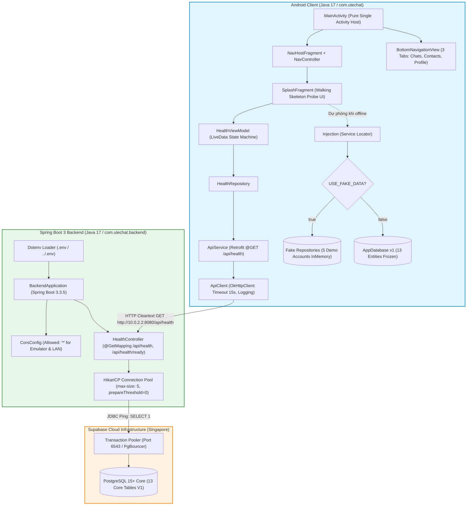

# Kiến trúc Khung Đi bộ Toàn diện: Walking Skeleton Architecture

> **Dự án:** UTEChat — Ứng dụng Nhắn tin & Gọi thoại Đa nền tảng  
> **Giai đoạn:** Phase 02 — Nền tảng & Kiến trúc Chống Xung đột (Foundation & Anti-Conflict Architecture)  
> **Tài liệu tham chiếu:** [ARCHITECTURE_DECISIONS.md](file:///c:/Users/Admin/Desktop/Project-Mobile/docs/ARCHITECTURE_DECISIONS.md), [COURSE_ALIGNMENT.md](file:///c:/Users/Admin/Desktop/Project-Mobile/docs/COURSE_ALIGNMENT.md), [API_CONTRACT.md](file:///c:/Users/Admin/Desktop/Project-Mobile/docs/API_CONTRACT.md), [ERD.md](file:///c:/Users/Admin/Desktop/Project-Mobile/docs/ERD.md), [SUPABASE_SETUP.md](file:///c:/Users/Admin/Desktop/Project-Mobile/docs/SUPABASE_SETUP.md), [AGENTS.md](file:///c:/Users/Admin/Desktop/Project-Mobile/AGENTS.md)  
> **Ngôn ngữ quy chuẩn:** Tiếng Việt (kèm thuật ngữ kỹ thuật tiêu chuẩn quốc tế)

---

## 1. Khái niệm & Mục tiêu của Walking Skeleton

### 1.1 Walking Skeleton là gì?
**Walking Skeleton** (Bộ khung biết đi) là một triển khai tối giản nhưng hoàn chỉnh xuyên suốt toàn bộ các tầng kiến trúc của hệ thống phần mềm — từ giao diện người dùng phía client, qua tầng mạng và tầng dịch vụ backend, xuống tới cơ sở dữ liệu lưu trữ đám mây.

Trong dự án UTEChat, Walking Skeleton không chỉ là một ứng dụng "Hello World" đơn giản, mà là một lát cắt kiến trúc mỏng (tracer bullet) kết nối thực tế 3 thực thể độc lập:
1. **Android Client:** Viết bằng Java 17, áp dụng mô hình kiến trúc MVVM (Model - View - ViewModel) với LiveData, ViewBinding, Navigation Component, Room SQLite và Retrofit.
2. **Spring Boot 3 Backend:** Máy chủ Java 17 độc lập được quản lý bằng Maven bên trong thư mục `backend/`, kết nối thông suốt với PostgreSQL qua HikariCP.
3. **Supabase Cloud Database:** Cơ sở dữ liệu PostgreSQL 15+ trên hạ tầng Supabase (khu vực Singapore), kết nối qua Transaction Pooler (cổng 6543) với cơ chế bảo mật RLS Default Deny.

### 1.2 Vai trò cốt lõi trong quy trình phân chia 5 thành viên
Walking Skeleton giải quyết triệt để 2 thách thức lớn nhất của đồ án nhóm:
- **Triệt tiêu rủi ro tích hợp muộn (Late Integration Risk):** Bằng cách thông luồng kết nối ngay từ Phase 2, nhóm bảo đảm không có bất ngờ nào về giao thức mạng, chứng chỉ SSL, cấu hình pooler hay định dạng JSON khi các thành viên bắt đầu làm việc song song từ Phase 3 đến Phase 6.
- **Tạo nền tảng cho Kiến trúc chống xung đột (Anti-Conflict Architecture):** Khóa cứng toàn bộ các ranh giới tiếp xúc (boundaries) giữa các phân hệ, cho phép 4 thành viên phát triển các lát cắt dọc (Vertical Slices: Auth, Contacts, Chat, Media/Call) hoàn toàn độc lập mà không bao giờ gây xung đột mã nguồn (git merge conflict).

---

## 2. Sơ đồ Kiến trúc Toàn diện End-to-End



---

## 3. Khóa cứng 6 Điểm Nóng Xung Đột (Anti-Conflict Locks)

Để 5 sinh viên làm việc song song trên 5 nhánh git mà không bao giờ gặp xung đột merge (theo quy định tại [ADR-003](file:///c:/Users/Admin/Desktop/Project-Mobile/docs/ARCHITECTURE_DECISIONS.md) và [ADR-025](file:///c:/Users/Admin/Desktop/Project-Mobile/docs/ARCHITECTURE_DECISIONS.md)), Phase 2 đã áp dụng chính sách khóa cứng (Freeze & Isolate) tại 6 điểm nóng:

### Hotspot 1: Đóng băng Phụ thuộc Thư viện (`app/build.gradle.kts`)
- **Nguyên nhân xung đột:** Nhiều thành viên cùng thêm dependencies, đổi phiên bản SDK hoặc đổi cấu hình gradle.
- **Giải pháp khóa cứng:**
  - Định nghĩa sẵn toàn bộ thư viện cốt lõi ngay trong Phase 2: AndroidX AppCompat, Material 3, ConstraintLayout, Navigation Component 2.8.5, Lifecycle ViewModel/LiveData 2.8.7, Room 2.6.1, Retrofit 2.11.0, OkHttp 4.12.0, WorkManager 2.10.0, và testing libraries (JUnit 4, Mockito, Arch Core Testing).
  - Cố định biến môi trường ứng dụng trong `defaultConfig`:
    - `BACKEND_BASE_URL = "http://10.0.2.2:8080/"` (loopback trỏ về máy chủ dev từ Android Emulator).
    - `USE_FAKE_DATA = true` (cờ chuyển đổi nguồn dữ liệu).
    - `annotationProcessorOptions { arguments += mapOf("room.schemaLocation" to "$projectDir/schemas") }` để xuất lược đồ Room tự động.
  - **Quy tắc:** Cấm tuyệt đối chỉnh sửa `app/build.gradle.kts` trong các Phase 3-6.

### Hotspot 2: Khóa Manifest & An ninh Mạng (`AndroidManifest.xml` & `network_security_config.xml`)
- **Nguyên nhân xung đột:** Sửa quyền hạn, sửa Activity/Service hoặc cấu hình chặn HTTP rõ ràng.
- **Giải pháp khóa cứng:**
  - Khóa cấu hình `network_security_config.xml` cho phép kết nối HTTP rõ ràng tới `10.0.2.2`, `localhost`, `127.0.0.1` và cấu hình `<base-config cleartextTrafficPermitted="true">`.
  - Khóa `AndroidManifest.xml` với duy nhất `MainActivity`, đã đăng ký đầy đủ quyền `INTERNET`, `ACCESS_NETWORK_STATE` và liên kết với `networkSecurityConfig`.

### Hotspot 3: Kiến trúc Đồ thị Điều hướng lồng (Nested Navigation Graphs)
- **Nguyên nhân xung đột:** Mọi thành viên cùng khai báo màn hình vào một tệp `nav_graph.xml` duy nhất.
- **Giải pháp khóa cứng:**
  - Đồ thị gốc `nav_graph.xml` chỉ chứa `SplashFragment` và nhúng 4 đồ thị con thông qua thẻ `<include>`:
    1. `nav_auth.xml` (Thành viên 2 - Phase 3): Chứa `LoginFragment`, `RegisterFragment`, `OtpFragment`.
    2. `nav_chat.xml` (Thành viên 4 - Phase 5): Chứa `ChatListFragment`, `ChatDetailFragment`.
    3. `nav_contacts.xml` (Thành viên 3 - Phase 4): Chứa `ContactsListFragment`, `AddContactFragment`.
    4. `nav_profile.xml` (Thành viên 2 - Phase 3): Chứa `ProfileFragment`, `EditProfileFragment`.
  - Mỗi thành viên toàn quyền làm việc trên tệp XML đồ thị con của mình, tránh 100% xung đột merge XML.

### Hotspot 4: Phân vùng Tài nguyên Chuỗi Đa Ngôn Ngữ (`strings_*.xml`)
- **Nguyên nhân xung đột:** Tất cả cùng thêm chuỗi vào `strings.xml`.
- **Giải pháp khóa cứng:**
  - Tách tệp chuỗi thành 5 tệp độc lập theo phân hệ chức năng:
    - `strings_common.xml`: Chuỗi hệ thống, điều hướng, nút bấm chung, trạng thái kết nối.
    - `strings_auth.xml`: Chuỗi đăng nhập, đăng ký, OTP, mật khẩu.
    - `strings_chat.xml`: Chuỗi hội thoại, gửi tin nhắn, trạng thái typing.
    - `strings_contacts.xml`: Chuỗi danh bạ, tìm kiếm SĐT, kết bạn, chặn người dùng.
    - `strings_profile.xml`: Chuỗi thông tin cá nhân, quyền riêng tư, đăng xuất.
  - Hỗ trợ đa ngôn ngữ Anh - Việt theo yêu cầu **REQ-ui-standards**: Cung cấp song song bộ 5 tệp trong `res/values/` (mặc định Tiếng Anh) và `res/values-vi/` (bản địa hóa Tiếng Việt).

### Hotspot 5: Đóng băng Lược đồ CSDL Room SQLite v1 (13 Entities)
- **Nguyên nhân xung đột:** Mỗi thành viên tự tạo bảng Room khi làm tính năng của mình, dẫn đến lệch khóa ngoại, xung đột kiểu dữ liệu và lỗi crash `IllegalStateException: Room cannot verify the data integrity`.
- **Giải pháp khóa cứng:**
  - Định nghĩa sẵn toàn bộ **13 Room Entities** mapping 1-1 từ CSDL `docs/ERD.md`:
    `UserEntity`, `UserDeviceEntity`, `OtpChallengeEntity`, `AuthSessionEntity`, `AuthThrottleEntity`, `ContactRequestEntity`, `ContactEntity`, `ConversationEntity`, `ConversationMemberEntity`, `MessageEntity`, `AttachmentEntity`, `CallEntity`, `SyncEventEntity`.
  - Bộ chuyển đổi kiểu dữ liệu `Converters.java` xử lý chuẩn xác `Date`, `UUID`, `List<String>`.
  - Khởi tạo Singleton `AppDatabase.java` v1 có sẵn các DAO cơ bản và hỗ trợ `fallbackToDestructiveMigration()` trong giai đoạn dev.

### Hotspot 6: Ranh giới Seam & Kho Dữ liệu Giả lập (Fake Repositories)
- **Nguyên nhân xung đột:** Thành viên bị đình trệ công việc khi backend chưa xong, chưa deploy hoặc mất kết nối mạng.
- **Giải pháp khóa cứng:**
  - Thiết kế 3 Seam Interfaces trừu tượng: `AuthRepository`, `ContactsRepository`, `ChatRepository`.
  - Triển khai 3 lớp Fake tương ứng: `FakeAuthRepository`, `FakeContactsRepository`, `FakeChatRepository` được nạp sẵn dữ liệu chuẩn 5 tài khoản demo từ Phase 1 (Alice, Bob, Charlie, David, Eve).
  - Điều phối phụ thuộc qua Service Locator thuần Java `Injection.java` với cờ `BuildConfig.USE_FAKE_DATA`. Khi bật `true`, app chạy offline hoàn toàn mà không cần backend hay Internet.
  - Sử dụng `ViewModelFactory.java` chuẩn slide bài giảng Session 4 để khởi tạo ViewModel mà không cần bất kỳ framework DI bên thứ 3 nào (không dùng Dagger, Hilt hay Kapt).

---

## 4. Cơ chế Đầu dò Walking Skeleton End-to-End Probe

Màn hình chào `SplashFragment` đóng vai trò là đầu dò xác minh trực tiếp tình trạng sống của toàn bộ hệ thống (End-to-End Health Probe):

### 4.1 Luồng Dữ liệu Đầu dò
```
SplashFragment (onViewCreated)
       │
       ▼ Gọi viewModel.checkHealth()
HealthViewModel (ProbeStatus: LOADING)
       │
       ▼ Gọi healthRepository.checkHealth(callback)
HealthRepository
       │
       ▼ Thực thi apiService.getHealth().enqueue(...) qua OkHttpClient
Retrofit Client (http://10.0.2.2:8080/api/health)
       │
       ▼ Mạng nội bộ (HTTP GET)
Spring Boot HealthController (@GetMapping /api/health)
       │
       ▼ Thực thi jdbcTemplate.queryForObject("SELECT 1", Integer.class)
HikariCP DataSource (aws-1-ap-southeast-1.pooler.supabase.com:6543)
       │
       ▼ PostgreSQL Protocol qua SSL
Supabase PostgreSQL (Thực thi SELECT 1)
```

### 4.2 Phản hồi & Xử lý Trạng thái UI
- **Khi kết nối thành công (HTTP 200 `{status: "UP", database: "CONNECTED"}`):**
  - `HealthViewModel` chuyển trạng thái sang `ProbeStatus.SUCCESS`.
  - `SplashFragment` hiển thị 2 huy hiệu màu xanh lá:
    - **Máy chủ (Backend):** `HOẠT ĐỘNG` (UP)
    - **Cơ sở dữ liệu (Supabase):** `ĐÃ KẾT NỐI` (CONNECTED)
  - Sau độ trễ 1.5 giây để người dùng nhận diện, ứng dụng tự động điều hướng sang luồng xác thực (`action_splash_to_auth`), đồng thời giải phóng `SplashFragment` khỏi backstack (`popUpToInclusive="true"`).
- **Khi kết nối thất bại (Mất mạng, backend tắt, hoặc CSDL lỗi):**
  - `HealthViewModel` chuyển trạng thái sang `ProbeStatus.ERROR`.
  - `SplashFragment` hiển thị 2 huy hiệu màu đỏ: `LỖI KẾT NỐI` / `MẤT KẾT NỐI`.
  - Hiển thị 2 nút tương tác:
    - Nút **"Thử lại"** (`btn_retry`): Cho phép gọi lại đầu dò khi vừa khởi động lại backend.
    - Nút **"Tiếp tục chế độ Offline"** (`btn_continue_offline`): Cho phép sinh viên bỏ qua kiểm tra mạng để vào thẳng ứng dụng và tiếp tục test giao diện/logic với `Fake Repositories`.

---

## 5. Tiêu chuẩn Chú thích Mã nguồn Tiếng Việt (Educational In-Code Comments)

Tuân thủ nghiêm ngặt quy định tại [AGENTS.md](file:///c:/Users/Admin/Desktop/Project-Mobile/AGENTS.md) và [GEMINI.md](file:///c:/Users/Admin/Desktop/Project-Mobile/GEMINI.md):
- **100% Tiếng Việt:** Tất cả các tệp mã nguồn (Java, XML layout, navigation, menu, strings, Spring Boot, SQL, scripts) BẮT BUỘC phải có chú thích bằng Tiếng Việt.
- **Nội dung súc tích & bản chất:** Giải thích ngắn gọn mục đích của dòng code / khối lệnh, lý do thiết kế và vai trò trong hệ thống.
- **Mục tiêu giáo dục:** Chuẩn bị tối ưu cho buổi bảo vệ đồ án cuối kỳ. Khi giảng viên hỏi bất kỳ dòng code nào, sinh viên chỉ cần nhìn vào chú thích là có thể giải trình tự tin, mạch lạc và sửa code trực tiếp tại chỗ theo yêu cầu vấn đáp.

---

## 6. Hướng dẫn Khởi chạy & Kiểm chuẩn Nhanh (Developer Quickstart)

### 6.1 Khởi chạy Backend Spring Boot 3
```powershell
# Chạy từ thư mục backend/
cd C:\Users\Admin\Desktop\Project-Mobile\backend

# Chạy kiểm thử tự động
mvn clean test

# Khởi động máy chủ backend tại cổng 8080
mvn spring-boot:run
```

### 6.2 Kiểm tra Endpoint Health bằng CLI
```powershell
# Kiểm tra liveness & ping CSDL Supabase
Invoke-RestMethod -Uri "http://localhost:8080/api/health" -Method Get
```
Kỳ vọng kết quả JSON:
```json
{
  "status": "UP",
  "database": "CONNECTED",
  "timestamp": "2026-11-11T..."
}
```

### 6.3 Khởi chạy & Kiểm thử Ứng dụng Android
```powershell
# Chạy từ thư mục gốc dự án
cd C:\Users\Admin\Desktop\Project-Mobile

# Biên dịch mã nguồn Android
.\gradlew.bat compileDebugSources

# Chạy toàn bộ bộ kiểm thử đơn vị JVM
.\gradlew.bat testDebugUnitTest
```

---
*Tài liệu Walking Skeleton hoàn tất phục vụ triển khai Phase 2: Foundation & Anti-Conflict Architecture.*
