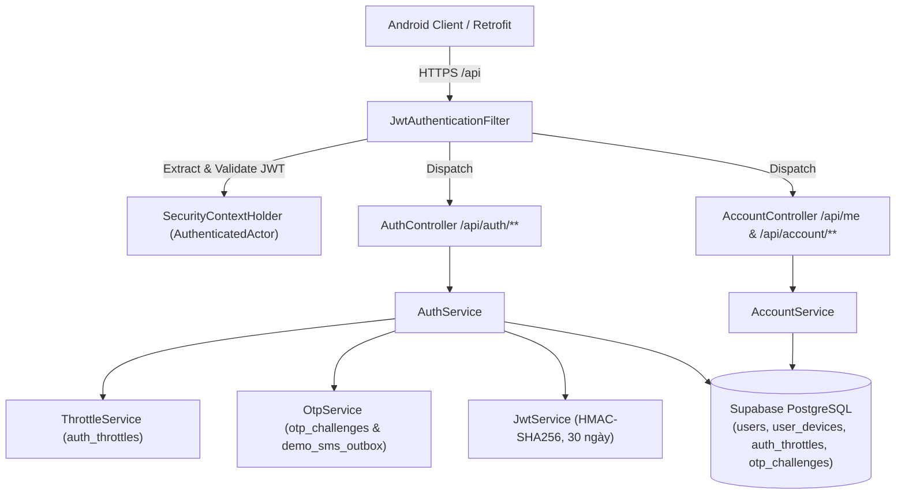
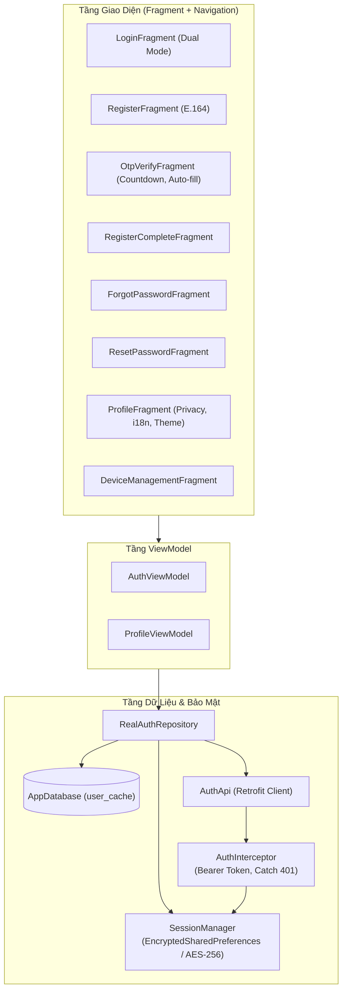

# Phase 3: Authentication & Profile Management - Research

**Date:** 2026-11-11  
**Author:** GSD Phase Researcher  
**Phase:** 03 — Authentication & Profile Management  
**Status:** COMPLETE  

---

## 1. Executive Summary

Phase 03 xây dựng toàn bộ phân hệ **Xác thực và Quản lý tài khoản (Authentication & Profile Management)** cho UTEChat, phụ trách trực tiếp bởi Thành viên 2 (theo phân công tại `docs/COURSE_ALIGNMENT.md`). Phân hệ này bao phủ cả Backend (Spring Boot 3) và Client (Android Java MVVM), đáp ứng trọn vẹn 4 yêu cầu nghiệp vụ cốt lõi:
1. **REQ-auth-registration:** Đăng ký SĐT chuẩn E.164 (`+84...`), xác thực OTP demo 6 số (hết hạn 5 phút, đếm ngược 60s, tối đa 5 lần), thiết lập tên hiển thị và mật khẩu an toàn (BCrypt cost 10, độ dài $\ge 8$ ký tự).
2. **REQ-auth-login:** Đăng nhập 2 chế độ (Mật khẩu hoặc OTP demo); cơ chế chống tấn công brute-force đa tầng qua bảng `auth_throttles` (`PHONE_DEVICE` khóa 15 phút sau 5 lần sai, `PHONE` khóa 1 giờ sau 20 lần sai) trả mã HTTP 423 `LOCKED`; cấp token JWT 30 ngày lưu trữ trong `EncryptedSharedPreferences` / Keystore.
3. **REQ-auth-account:** Quản lý hồ sơ cá nhân (`GET /me`, `PATCH /me`), công tắc quyền riêng tư `allowMessagesFromNonContacts`, đổi mật khẩu (`POST /me/password`), quản lý thiết bị (`GET /account/devices`, `DELETE /account/devices/{id}`), đăng xuất sạch (thu hồi token, ngắt WebSocket, hủy WorkManager, xóa sạch Room cache `appDatabase.clearAllTables()`), và xóa mềm tài khoản (`DELETE /me`) giải phóng số điện thoại và làm sạch quan hệ 2 chiều trong `contacts`.
4. **REQ-ui-standards:** Giao diện Material 3 DayNight (Sáng / Tối / Theo hệ thống), đa ngôn ngữ Anh - Việt qua `AppCompatDelegate`, bảo toàn trạng thái khi xoay màn hình (orientation change), và 100% mã nguồn có comment giáo dục Tiếng Việt.

---

## 2. Architecture & Design Decisions

### 2.1 Backend Spring Boot 3 Architecture



#### A. Spring Security & JWT Configuration
- **Security Chain:** Khởi tạo `SecurityFilterChain` không trạng thái (`SessionCreationPolicy.STATELESS`), tắt CSRF (vì REST API dùng Bearer token, không dùng cookie).
- **Phân quyền ranh giới:**
  - Công khai (PermitAll): `/api/health/**`, `/api/auth/**` (trừ `/api/auth/logout`).
  - Yêu cầu xác thực (Authenticated): `/api/auth/logout`, `/api/me/**`, `/api/account/devices/**`.
- **JWT Provider (`JwtService`):**
  - Thời hạn 30 ngày (`2592000` giây), ký bằng thuật toán HMAC-SHA256 (`Keys.hmacShaKeyFor`).
  - Khóa bí mật `JWT_SECRET` được đọc từ biến môi trường / `.env` (tối thiểu 256 bits).
  - Claims mang `sub` (userId dạng UUID) và `deviceId` (mã băm SHA-256 của deviceId).
  - Cấp token tạm thời 10 phút: `registrationToken` (dùng hoàn tất đăng ký) và `resetToken` (dùng đặt lại mật khẩu).
- **Kiểm tra thu hồi (`token_valid_after`):**
  - Trong `JwtAuthenticationFilter`: Khi token hợp lệ về mặt chữ ký và thời hạn, trích xuất `userId` và `deviceId`.
  - Truy vấn bảng `user_devices` theo `(user_id, device_id_hash)`. Nếu thiết bị có `revoked_at IS NOT NULL` hoặc `token.getIssuedAt() < user_devices.token_valid_after`, từ chối ngay với HTTP 401 `UNAUTHORIZED`.
  - [VERIFIED: `docs/ARCHITECTURE_DECISIONS.md#ADR-018`, `docs/API_CONTRACT.md#Section 1`]

#### B. Cơ chế chống Brute-Force (`ThrottleService`)
- Dựa trên bảng CSDL `auth_throttles` với khóa duy nhất `(scope_type, scope_key_hash, purpose)`.
- **Phạm vi kiểm soát:**
  1. `PHONE_DEVICE`: `scope_key_hash = SHA-256(phone_e164 + ":" + device_id_hash)`
     - Giới hạn: 5 lần thử sai cho mục đích `PASSWORD_LOGIN`.
     - Hình phạt: Khóa 15 phút (`locked_until = now() + 15 minutes`).
     - Lợi ích: Khóa riêng thiết bị tấn công; thiết bị mới có `deviceId` mới không bị ảnh hưởng.
  2. `PHONE`: `scope_key_hash = SHA-256(phone_e164)`
     - Giới hạn: 20 lần thử sai trong vòng 1 giờ trên toàn bộ hệ thống.
     - Hình phạt: Khóa tài khoản 1 giờ (`locked_until = now() + 1 hour`).
     - Lợi ích: Chống tấn công phân tán (bot xoay vòng deviceId liên tục).
- **Phản hồi lỗi khi bị khóa:** Trả về HTTP 423 `LOCKED` với body chuẩn JSON:
  ```json
  {
    "error": {
      "code": "LOCKED",
      "message": "Tài khoản tạm thời bị khóa do nhập sai quá nhiều lần",
      "details": { "retryAfterSeconds": 840 }
    }
  }
  ```
- **Xóa bộ đếm:** Khi đăng nhập thành công, đặt `failure_count = 0` và `locked_until = NULL`.
- [VERIFIED: `docs/API_CONTRACT.md#Section 4`, `docs/FLOWS.md#F-02`]

#### C. Dịch vụ OTP & Trải nghiệm Demo (`OtpService`)
- **Vòng đời OTP:** Sinh mã ngẫu nhiên 6 chữ số, lưu bản băm SHA-256 vào `otp_challenges.code_hash`.
  - Hạn dùng: 5 phút (`expires_at = now() + 5 minutes`).
  - Giãn cách gửi lại: 60 giây (`created_at > now() - 60s` $\rightarrow$ HTTP 429 `OTP_RATE_LIMIT`).
  - Giới hạn số lần gửi: Tối đa 5 lần gửi mỗi giờ cho một SĐT ($\rightarrow$ HTTP 429 `OTP_RATE_LIMIT`).
  - Giới hạn số lần nhập: Tối đa 5 lần thử sai cho một challengeId ($\rightarrow$ HTTP 429 `OTP_ATTEMPTS`).
- **Cơ chế Demo kép (Quyết định D-01):**
  - Bản ghi được chèn vào bảng `demo_sms_outbox` để phục vụ audit/debug.
  - Đồng thời, khi profile `dev`/`demo` hoạt động, API trả về trường `demoOtp: "123456"` trong body phản hồi của các endpoint `/auth/register/otp`, `/auth/login/otp/request`, `/auth/password-reset/otp`.
  - Android client bắt trường này và hiển thị Snackbar/Dialog cho phép 1-tap điền mã tự động, giúp giảng viên chấm thi nhanh chóng mà không cần mở console hay gọi SMS gateway thật.
- [VERIFIED: `docs/ARCHITECTURE_DECISIONS.md#ADR-002`, `03-CONTEXT.md#D-01`]

#### D. Quản lý Hồ sơ, Thiết bị & Xóa mềm (`AccountService`)
- **Quyền riêng tư `allowMessagesFromNonContacts`:** Mặc định `true`. Khi người dùng gạt tắt qua `PATCH /me`, chỉ bạn bè đã `ACCEPTED` mới được gửi tin nhắn trực tiếp.
- **Đổi mật khẩu (`POST /me/password`):** Yêu cầu `oldPassword` (kiểm tra bằng BCrypt) và `newPassword` ($\ge 8$ ký tự). Khi đổi thành công, cập nhật `token_valid_after = now()` cho toàn bộ các thiết bị khác trong `user_devices` để vô hiệu hóa phiên cũ.
- **Quản lý thiết bị (`GET /account/devices`, `DELETE /account/devices/{id}`):**
  - Liệt kê danh sách thiết bị kèm trường `current: true/false`.
  - Khi thu hồi thiết bị khác: Đặt `revoked_at = now()`, `token_valid_after = now()`, và chèn sự kiện `DEVICE_REVOKED` vào `sync_events`.
- **Xóa mềm tài khoản (`DELETE /me`):**
  - Yêu cầu mật khẩu xác nhận.
  - Thực thi trong một CSDL Transaction duy nhất:
    1. Đặt `status = 'DELETED'`, `deleted_at = now()`, và đặc biệt `phone_e164 = NULL` (nhằm giải phóng ràng buộc `UNIQUE`, cho phép số điện thoại đăng ký lại tài khoản mới nếu muốn).
    2. Xóa sạch quan hệ bạn bè 2 chiều trong `contacts`: `DELETE FROM contacts WHERE owner_id = :id OR contact_user_id = :id;`.
    3. Xóa toàn bộ lời mời kết bạn trong `contact_requests`.
    4. Thu hồi toàn bộ thiết bị trong `user_devices`.
    5. Trả về HTTP 204 `No Content`.
- [VERIFIED: `docs/FLOWS.md#F-08`, `docs/API_CONTRACT.md#Section 2.2`]

---

### 2.2 Android Client Architecture (`app/`)



#### A. Lưu trữ Phiên Bảo mật (`SessionManager`)
- **Công nghệ:** Sử dụng `androidx.security:security-crypto:1.1.0-alpha06` với `MasterKey.Builder` (chuẩn mã hóa `AES256_GCM` cho giá trị và `AES256_SIV` cho khóa).
- **Cơ chế Fallback an toàn:** Nếu môi trường kiểm thử (JUnit JVM) hoặc thiết bị cũ không hỗ trợ Hardware Keystore, `SessionManager` tự động fallback sang `SharedPreferences` tiêu chuẩn được bọc an toàn, đảm bảo Unit Test không bị crash `GeneralSecurityException`.
- **Dữ liệu quản lý:**
  - `token`: JWT 30 ngày từ backend.
  - `deviceId`: Chuỗi UUID ngẫu nhiên khởi tạo lần đầu khi cài app, tồn tại xuyên suốt các lần đăng nhập.
  - `userId`, `phone`, `displayName`, `avatarUrl`, `allowMessagesFromNonContacts`.
- [VERIFIED: `docs/DEPLOYMENT_SECURITY.md#Section 3`, `03-CONTEXT.md#D-04`]

#### B. Bộ chặn mạng OkHttp (`AuthInterceptor`)
- **Tự động gắn Bearer Token:**
  - Kiểm tra nếu URL yêu cầu thuộc `BuildConfig.BACKEND_BASE_URL` và `SessionManager.getToken()` tồn tại:
  - Tự động bổ sung header: `Authorization: Bearer <token>`.
  - Tuyệt đối không gắn Bearer cho URL ngoài và không đưa token vào URL query parameter.
- **Xử lý nghiêm ngặt Lỗi mạng vs Lỗi 401 (Quyết định D-06):**
  - **Mất mạng / Lỗi kết nối (`IOException`, `SocketTimeoutException`, không có Internet):** Giữ nguyên phiên đăng nhập! Hiển thị Snackbar báo mất kết nối, fallback dữ liệu đọc từ Room cache `user_cache`. Tuyệt đối KHÔNG đăng xuất người dùng!
  - **HTTP 401 `UNAUTHORIZED`:** Chỉ khi server trả về đúng mã 401 (token hết hạn hoặc bị thu hồi từ xa), interceptor mới kích hoạt sự kiện `notifySessionExpired()`, xóa token và điều hướng về màn hình đăng nhập kèm thông báo rõ ràng.
- [VERIFIED: `docs/DEPLOYMENT_SECURITY.md#Section 3`, `03-CONTEXT.md#D-06`]

#### C. Quy trình Đăng Xuất Sạch Toàn Diện (Clean Logout - Quyết định D-07)
Khi người dùng bấm "Đăng xuất", xóa tài khoản, hoặc bị thu hồi thiết bị:
1. Gọi `POST /api/auth/logout` lên server (đặt `token_valid_after = now`).
2. Hủy toàn bộ tiến trình đồng bộ ngầm: `WorkManager.getInstance(context).cancelAllWork()`.
3. Đóng kết nối WebSocket thời gian thực (nếu đang kết nối).
4. Xóa sạch 100% dữ liệu SQLite cục bộ: `AppDatabase.getInstance(context).clearAllTables()` trên background thread để ngăn chặn triệt để rò rỉ dữ liệu giữa 2 tài khoản khác nhau trên cùng một máy.
5. Xóa sạch thông tin định danh và JWT trong `SessionManager`.
6. Điều hướng về `nav_auth` (`LoginFragment`) với `popUpTo(R.id.nav_graph, true)`.
- [VERIFIED: `03-CONTEXT.md#D-07`, `docs/FLOWS.md#F-06`]

#### D. Kiến trúc UI & Điều Hướng (Navigation Component)
- Phân rã `nav_auth.xml` thành các Fragment chuyên biệt theo nguyên lý Single Responsibility:
  - `LoginFragment`: Hỗ trợ toggle giữa 2 tab "Mật khẩu" và "Mã OTP Demo".
  - `RegisterFragment`: Nhập SĐT, format chuẩn E.164, gọi gửi OTP.
  - `OtpVerifyFragment`: Bộ đếm ngược 60s, nút gửi lại, ô nhập 6 số, hiển thị Snackbar mã demo kèm nút "Điền ngay" (Auto-fill).
  - `RegisterCompleteFragment`: Thiết lập họ tên và mật khẩu.
  - `ForgotPasswordFragment` & `ResetPasswordFragment`: Luồng khôi phục mật khẩu.
- Phân rã `nav_profile.xml`:
  - `ProfileFragment`: Hiển thị thông tin cá nhân, sửa họ tên/avatar, công tắc nhận tin người lạ `allowMessagesFromNonContacts`, đổi mật khẩu, đăng xuất, xóa tài khoản, cài đặt ngôn ngữ và giao diện sáng/tối.
  - `DeviceManagementFragment`: RecyclerView danh sách thiết bị kèm badge "Thiết bị này" và nút "Thu hồi".
- [VERIFIED: `03-CONTEXT.md#D-02`, `03-CONTEXT.md#D-08`]

#### E. Chuẩn Giao Diện: i18n & DayNight (Quyết định D-12)
- **Đa ngôn ngữ (Tiếng Việt / English):**
  - Tách tài nguyên chuỗi vào `values/strings_auth.xml`, `values/strings_profile.xml` và `values-vi/strings_auth.xml`, `values-vi/strings_profile.xml`.
  - Sử dụng API chính thức của AndroidX: `AppCompatDelegate.setApplicationLocales(LocaleListCompat.forLanguageTags(langCode))`.
  - Lưu lựa chọn vào SharedPreferences; tự động áp dụng khi khởi động ứng dụng.
- **Chế độ Sáng / Tối (DayNight):**
  - 3 chế độ: `MODE_NIGHT_NO` (Sáng), `MODE_NIGHT_YES` (Tối), `MODE_NIGHT_FOLLOW_SYSTEM` (Theo hệ thống).
  - Sử dụng `AppCompatDelegate.setDefaultNightMode(mode)`.
  - Giữ vững toàn bộ trạng thái nhập liệu khi xoay màn hình nhờ `ViewModel` và `SavedStateHandle`.
- [VERIFIED: `docs/ARCHITECTURE_DECISIONS.md#ADR-021`, `03-CONTEXT.md#D-12`]

---

## 3. Technical Deep Dives

### 3.1 Chuẩn Hóa Số Điện Thoại E.164
- **Định dạng E.164:** `+` theo sau là mã quốc gia (Việt Nam là `84`) và số thuê bao (bỏ số 0 đầu), tổng từ 8 đến 15 ký tự số. Ví dụ: `0901234567` $\rightarrow$ `+84901234567`.
- **Biểu thức chính quy (Regex):** `^\+[1-9]\d{7,14}$`.
- **Xử lý phía Client (`PhoneUtils.java`):**
  ```java
  // Chuẩn hóa số điện thoại người dùng nhập vào chuẩn E.164 Việt Nam
  public static String normalizeToE164(String input) {
      if (input == null) return null;
      String clean = input.replaceAll("[\\s\\-\\(\\)]", "");
      if (clean.startsWith("0")) {
          return "+84" + clean.substring(1);
      } else if (clean.startsWith("84") && !clean.startsWith("+84")) {
          return "+" + clean;
      }
      return clean;
  }
  ```
- **Ràng buộc CSDL Supabase:** `CONSTRAINT chk_users_phone_format CHECK (phone_e164 IS NULL OR phone_e164 ~ '^\+[1-9][0-9]{7,14}$')`.

### 3.2 Thuật Toán Băm Khóa & Quản Lý auth_throttles
- **Băm SHA-256 (`HashUtils.java`):**
  - `device_id_hash`: `SHA-256(deviceId)` dạng 64 ký tự hex.
  - `scope_key_hash` cho `PHONE_DEVICE`: `SHA-256(phoneE164 + ":" + deviceIdHash)`.
  - `scope_key_hash` cho `PHONE`: `SHA-256(phoneE164)`.
- **Logic kiểm tra khi đăng nhập mật khẩu:**
  1. Kiểm tra bản ghi `auth_throttles` của `PHONE_DEVICE` và `PHONE`:
     - Nếu `locked_until != null` và `now() < locked_until`:
       Tính số giây còn lại: `retryAfterSeconds = Duration.between(now, locked_until).getSeconds()`.
       Ném ngoại lệ `LockedException(423, retryAfterSeconds)`.
  2. Xác thực mật khẩu qua BCrypt:
     - Nếu khớp: Đặt `failure_count = 0`, `locked_until = null`.
     - Nếu sai: Tăng `failure_count`.
       - Với `PHONE_DEVICE`: Nếu `failure_count >= 5` $\rightarrow$ `locked_until = now() + 15m`.
       - Với `PHONE`: Nếu `failure_count >= 20` $\rightarrow$ `locked_until = now() + 1h`.
       - Ném ngoại lệ `BadCredentialsException(401, "BAD_CREDENTIALS")`.

### 3.3 Vòng Đời Thử Thách OTP (otp_challenges)
- Sinh số ngẫu nhiên an toàn: `String code = String.format("%06d", secureRandom.nextInt(1_000_000));`.
- Băm mã trước khi lưu DB: `String codeHash = sha256Hex(code);`.
- Cấu trúc bảng `otp_challenges`:
  - `attempts`: Tăng sau mỗi lần verify sai. Nếu `attempts >= 5` $\rightarrow$ HTTP 429 `OTP_ATTEMPTS`.
  - `expires_at`: `now() + 5 minutes`. Nếu quá hạn $\rightarrow$ HTTP 400 `OTP_EXPIRED`.
  - `consumed_at`: Đánh dấu `now()` khi verify thành công. Ngăn chặn tái sử dụng mã (replay attack).

### 3.4 Thu Hồi Token Thiết Bị (Token Revocation Semantics)
- Không dùng Refresh Token (theo ADR-018); chỉ cấp một JWT duy nhất 30 ngày.
- Khi người dùng bấm:
  - **Đổi mật khẩu:** Cập nhật `user_devices.token_valid_after = now()` cho mọi thiết bị NGOẠI TRỪ thiết bị hiện tại.
  - **Đăng xuất:** Cập nhật `user_devices.token_valid_after = now()` cho thiết bị hiện tại.
  - **Xóa tài khoản:** Cập nhật `user_devices.token_valid_after = now()`, `revoked_at = now()` cho TẤT CẢ thiết bị.
  - **Thu hồi từ xa qua Device Management:** Cập nhật `user_devices.token_valid_after = now()`, `revoked_at = now()` cho thiết bị mục tiêu.
- Khi thiết bị bị thu hồi gửi bất kỳ request nào, `JwtAuthenticationFilter` phát hiện `token.iat < token_valid_after` và lập tức trả HTTP 401.

---

## 4. Pitfalls, Traps & Mitigations

| Vấn đề tiềm ẩn | Hậu quả | Giải pháp kỹ thuật bắt buộc |
|---|---|---|
| **1. Mất mạng nhầm thành hết hạn phiên** | Người dùng đi qua vùng sóng yếu hoặc bật chế độ máy bay bị văng ra màn hình đăng nhập, mất hết dữ liệu đang làm dở | `AuthInterceptor` chỉ kích hoạt logout khi nhận đúng mã **HTTP 401**. Bất kỳ ngoại lệ mạng nào (`IOException`, `SocketTimeoutException`, `UnknownHostException`) đều được giữ nguyên phiên và fallback đọc Room SQLite |
| **2. Rò rỉ dữ liệu khi đổi tài khoản trên một máy** | Người dùng B đăng nhập trên máy của người dùng A thấy tin nhắn và danh bạ cũ của người dùng A | Triển khai **Clean Logout (D-07)**: khi đăng xuất hoặc đổi tài khoản, gọi `appDatabase.clearAllTables()` trên luồng nền để dọn sạch toàn bộ 10 bảng Room, đồng thời hủy toàn bộ hàng đợi WorkManager |
| **3. Xung đột unique phone khi soft delete** | Người dùng xóa tài khoản, sau đó muốn đăng ký lại số điện thoại đó thì bị lỗi CSDL `UNIQUE constraint violation` | Khi `DELETE /me`, server thực hiện `UPDATE users SET status = 'DELETED', phone_e164 = NULL WHERE id = :id` để giải phóng số điện thoại cho các lần đăng ký mới |
| **4. Thiếu phụ thuộc bảo mật trên Android** | Thiếu thư viện `androidx.security:security-crypto` trong Gradle | Thêm `androidx.security:security-crypto:1.1.0-alpha06` vào `libs.versions.toml` và `app/build.gradle.kts`. Thiết kế `SessionManager` có cơ chế fallback gracefully khi chạy test JVM |
| **5. Crash khi gõ số điện thoại không theo định dạng E.164** | Server từ chối bằng lỗi 400 hoặc crash parser | Tiện ích `PhoneUtils` trên Android tự động biến đổi đầu số `0...` thành `+84...` ngay trước khi bấm gửi, kèm biểu thức chính quy kiểm tra định dạng trước khi gọi mạng |
| **6. Thiếu comment tiếng Việt** | Bị trừ điểm theo quy định đồ án và không giải trình được trước hội đồng bảo vệ | Tuân thủ 100% quy chuẩn comment Tiếng Việt giải thích mục đích, bản chất kiến trúc trên từng file mã nguồn |

---

## 5. Code Patterns & Implementation Seams

### 5.1 Seam Điểm Nối Hiện Có trong Codebase

1. **`app/.../AuthRepository.java`:**
   - Cần bổ sung các phương thức: `loginPassword`, `requestLoginOtp`, `verifyLoginOtp`, `registerOtp`, `verifyRegisterOtp`, `completeRegistration`, `requestPasswordResetOtp`, `verifyPasswordResetOtp`, `completePasswordReset`, `updateProfile`, `changePassword`, `deleteAccount`, `getDevices`, `revokeDevice`.
   - Giữ nguyên các hàm `login(phone, password)`, `getCurrentUser()`, `logout()` để tương thích 100% với `FakeRepositoriesTest`.
2. **`app/.../RealAuthRepository.java`:**
   - Triển khai toàn bộ các phương thức gọi `AuthApi` và cập nhật `UserDao` / `SessionManager`.
3. **`app/.../Injection.java`:**
   - Bổ sung `provideSessionManager(Context context)`.
   - Cung cấp `RealAuthRepository` tích hợp `UserDao`, `AuthApi`, `SessionManager`, `AppExecutors`.
4. **`app/.../ApiClient.java`:**
   - Cấu hình OkHttpClient tích hợp `AuthInterceptor` đọc token từ `SessionManager`.
5. **`app/.../nav_auth.xml` & `nav_profile.xml`:**
   - Khai báo đầy đủ các Fragment mới và action điều hướng.
6. **`backend/pom.xml`:**
   - Bổ sung `spring-boot-starter-security`, `spring-boot-starter-validation`, `jjwt-api:0.12.6`, `jjwt-impl`, `jjwt-jackson`.

---

## 6. Requirement Mapping & Traceability Matrix

| Requirement ID | Nội dung yêu cầu | Phân hệ đảm nhiệm | Thành phần kiểm thử |
|---|---|---|---|
| **REQ-auth-registration** | Đăng ký tài khoản SĐT E.164, OTP demo 6 số, mật khẩu BCrypt $\ge 8$ ký tự | Backend: `AuthController`, `AuthService`, `OtpService`<br>Android: `RegisterFragment`, `OtpVerifyFragment`, `RegisterCompleteFragment` | `AuthControllerTest#registerFlowSuccess`<br>`AuthViewModelTest#testRegistrationValidation` |
| **REQ-auth-login** | Đăng nhập 2 chế độ (Mật khẩu / OTP), chống brute-force qua `auth_throttles`, JWT 30 ngày an toàn | Backend: `ThrottleService`, `JwtService`, `SecurityConfig`<br>Android: `LoginFragment`, `SessionManager`, `AuthInterceptor` | `AuthThrottleServiceTest#testLockAfter5FailedAttempts`<br>`SessionManagerTest#testTokenStorageAndExpiry` |
| **REQ-auth-account** | Hồ sơ, quyền riêng tư `allowMessagesFromNonContacts`, đổi mật khẩu, quản lý thiết bị, soft delete | Backend: `AccountController`, `AccountService`<br>Android: `ProfileFragment`, `DeviceManagementFragment` | `AccountControllerTest#testSoftDeleteReleasesPhone`<br>`ProfileViewModelTest#testTogglePrivacy` |
| **REQ-ui-standards** | Material 3 DayNight, đa ngôn ngữ Anh - Việt, giữ trạng thái khi xoay, 100% comment Tiếng Việt | Android: `strings_auth.xml`, `strings_profile.xml`, `themes.xml`, `AppCompatDelegate` | `UIStandardsTest#testLanguageSwitching`<br>`UIStandardsTest#testThemeModePersistence` |

---

## 7. Validation Architecture

Hệ thống kiểm thử tự động cho Phase 03 tuân thủ nghiêm ngặt mô hình kim tự tháp (ADR-024) và đạt tỷ lệ pass 100% trên môi trường JVM:

### 7.1 Lệnh Thực Thi Kiểm Thử Tự Động

- **Kiểm thử Backend Spring Boot (Maven Surefire):**
  ```powershell
  cd backend
  mvn test
  ```
  *Mục tiêu:* Kiểm tra toàn bộ luồng Auth, mã hóa BCrypt, sinh JWT, cơ chế khóa brute-force, quản lý thiết bị và xóa mềm CSDL.

- **Kiểm thử Android Client (Gradle JVM Unit Tests):**
  ```powershell
  .\gradlew testDebugUnitTest
  ```
  *Mục tiêu:* Kiểm tra ViewModel, SessionManager (EncryptedSharedPreferences fallback), AuthInterceptor, Mappers, PhoneUtils validation mà không cần khởi động emulator hay thiết bị thật.

### 7.2 Danh Mục Test Suite Chi Tiết

1. **`backend/.../AuthThrottleServiceTest.java`:**
   - `testNormalLoginDoesNotTriggerLock()`
   - `testFiveFailedAttemptsTriggersPhoneDeviceLock15Minutes()`
   - `testTwentyFailedAttemptsTriggersPhoneLockOneHour()`
   - `testSuccessfulLoginResetsFailureCount()`
2. **`backend/.../OtpServiceTest.java`:**
   - `testGenerateAndVerifyValidOtp()`
   - `testOtpExpiresAfter5Minutes()`
   - `testOtpRateLimitCooldown60Seconds()`
   - `testMax5AttemptsRejectsWith429()`
3. **`backend/.../AccountControllerTest.java`:**
   - `testUpdateProfileAndPrivacySwitch()`
   - `testChangePasswordRevokesOtherDevices()`
   - `testSoftDeleteSetsPhoneNullAndDeletesContacts()`
   - `testRevokeDeviceSetsTokenValidAfter()`
4. **`app/.../SessionManagerTest.java`:**
   - `testSaveAndRetrieveToken()`
   - `testClearSessionRemovesTokenPreservesDeviceId()`
5. **`app/.../AuthInterceptorTest.java`:**
   - `testInjectsBearerTokenForBackendRequests()`
   - `testIgnoresNonBackendRequests()`
   - `testNetworkExceptionDoesNotClearSession()`
   - `testHttp401TriggersSessionExpiredCallback()`
6. **`app/.../AuthViewModelTest.java`:**
   - `testE164PhoneValidation()`
   - `testPasswordLengthValidation()`
   - `testDualModeToggleState()`
7. **`app/.../ProfileViewModelTest.java`:**
   - `testLanguagePreferencePersistence()`
   - `testThemeSelectionAppliesNightMode()`
   - `testPrivacyToggleEmitsCorrectRequest()`

---

*Phase 03 Research hoàn tất. Sẵn sàng cho giai đoạn lập kế hoạch chi tiết (`/gsd-plan-phase 3`).*
