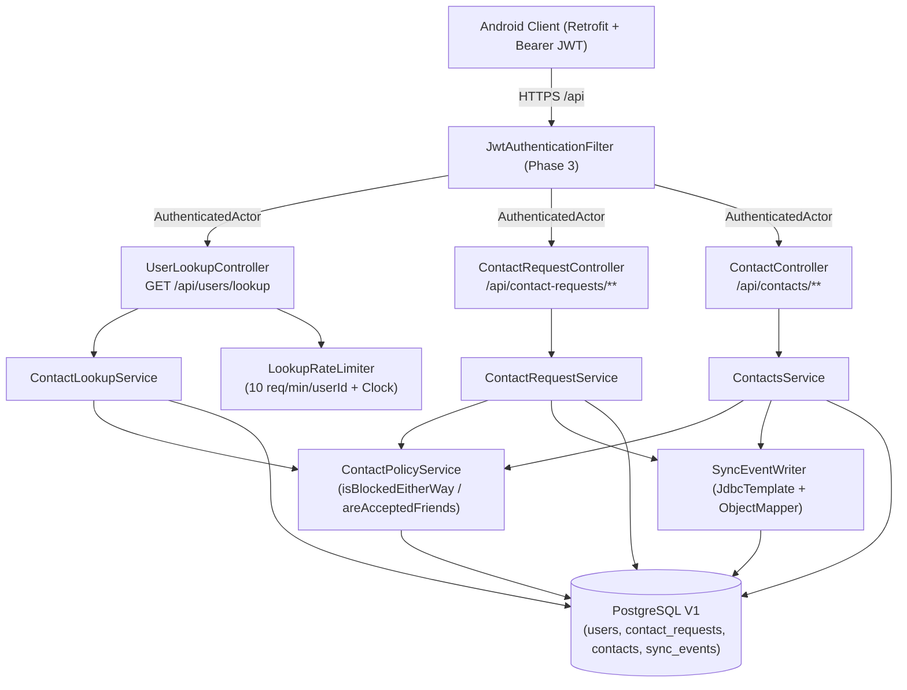
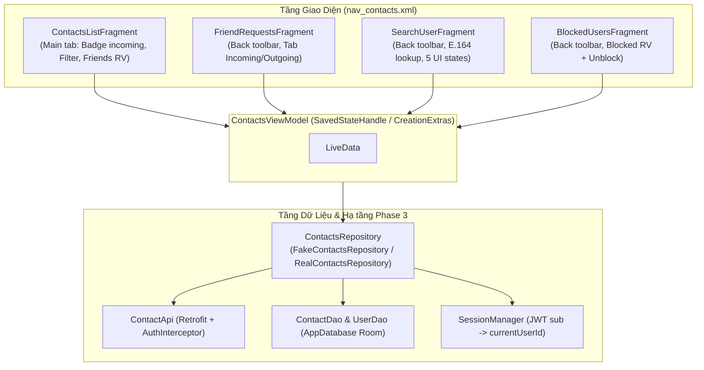

# Phase 4: Contacts & Friendships - Research

**Date:** 2026-11-17  
**Author:** GSD Phase Researcher  
**Phase:** 04 — Contacts & Friendships (`REQ-contacts-management`)  
**Status:** COMPLETE

---

## 1. Executive Summary

Phase 04 triển khai trọn vẹn phân hệ **Danh bạ & Kết bạn (Contacts & Friendships)** cho UTEChat (`REQ-contacts-management`, phụ trách bởi Thành viên 3 theo `.planning/REQUIREMENTS.md`), bao phủ đồng thời **Spring Boot 3 Backend REST API** và **Android Java 17 Client (MVVM + Room + Retrofit)**, tuân thủ toàn bộ 11 quyết định đã khóa (`D-01` đến `D-11`) trong `.planning/phases/04-contacts-friendships/04-CONTEXT.md`:

1. **Tìm kiếm người dùng theo SĐT E.164 (`GET /api/users/lookup?phone=`):** Khớp chính xác regex `^\+[1-9][0-9]{7,14}$`, giới hạn **10 lượt/phút/userId** bằng `LookupRateLimiter` riêng (kèm `Clock` có thể inject để unit test xác định), tự tìm chính mình trả `400 SELF`, không tồn tại / `status != 'ACTIVE'` / `discoverable = false` / bị chặn theo **bất kỳ chiều nào** trả `404 NOT_FOUND`, và trả về hợp đồng dữ liệu đủ để suy ra chính xác cả 5 trạng thái UI + `pendingRequestId`. [VERIFIED: `04-CONTEXT.md#D-04`, `docs/API_CONTRACT.md#2.3`, `V1__initial_schema.sql#L15`]
2. **Vòng đời Lời mời Kết bạn (`contact_requests`):** Gửi (`POST /api/contact-requests`), xem danh sách Đã nhận / Đã gửi (`GET /api/contact-requests`), chấp nhận (`POST /api/contact-requests/{id}/accept`), từ chối (`POST /api/contact-requests/{id}/reject`), hủy (`DELETE /api/contact-requests/{id}`) — khóa hàng bằng `SELECT ... FOR UPDATE`, tận dụng chỉ mục duy nhất `idx_contact_requests_pending_pair`, xử lý đồng thời gửi ngược chiều (`409 REQUEST_ALREADY_PENDING`), idempotency khi lặp thao tác và kiểm quyền chặt chẽ ở server. [VERIFIED: `04-CONTEXT.md#D-05,D-06,D-07`, `V1__initial_schema.sql#L60-L68,L171-L175`]
3. **Ngữ nghĩa Bạn bè & Chặn (`contacts`):** Lưu chặn **1 chiều dữ liệu** `(owner_id = A, contact_user_id = B, blocked = true)`, nhưng **cản tương tác 2 chiều theo chính sách** (`403 BLOCKED`). Hủy kết bạn xóa 2 dòng `(A,B)` và `(B,A)` trong 1 transaction; bỏ chặn khôi phục `blocked = false` **chỉ khi** còn dòng ngược `(B, A, blocked = false)`, ngược lại xóa hẳn dòng để về `STRANGER` (không bao giờ tự khôi phục quan hệ bạn bè đã unfriend). [VERIFIED: `04-CONTEXT.md#D-01`, `V1__initial_schema.sql#L69-L76`]
4. **Ranh giới Đồng bộ & Kiến trúc Android Offline-First:** Backend ghi `sync_events` trong cùng `@Transactional`; Android tái sử dụng hạ tầng Auth Phase 3 (`SessionManager`, `AuthInterceptor`, `clearAllTables()`), đọc offline từ Room (`ContactDao`, `UserDao`), ghi online qua REST + cập nhật Room ngay sau phản hồi thành công, và triển khai 4 màn hình trong `nav_contacts.xml` (`ContactsListFragment`, `FriendRequestsFragment`, `SearchUserFragment`, `BlockedUsersFragment`) với đúng 5 trạng thái UI (`STRANGER`, `OUTGOING_PENDING`, `INCOMING_PENDING`, `FRIEND`, `BLOCKED`), **ẩn hoàn toàn nút "Nhắn tin"** ở Phase 4. [VERIFIED: `04-CONTEXT.md#D-02,D-03,D-08,D-09,D-10,D-11`]

### 1.1 Hiện trạng Nhánh Mã nguồn & Nền Phase 3 trên `main`

- **Phase 3 đã hoàn thiện (`aaf3844`) và đã được merge vào `main`:**
  - **Backend Phase 3:** `Spring Security` stateless (`SecurityConfig`), `JwtAuthenticationFilter`, `AuthenticatedActor(UUID userId, String deviceIdHash)`, `ApiException`, `GlobalExceptionHandler` (`{ "error": { "code", "message", "details" } }`), `V3__account_deletion_grace.sql` + `AccountService` (`DELETE /me` hẹn 15 ngày rồi xóa `contacts` và `contact_requests` hai chiều), `AuthApiTest` dùng `EmbeddedPostgres` (`io.zonky.test:embedded-postgres:2.0.7`) + `JdbcTemplate` (KHÔNG dùng Spring Data JPA/Hibernate). [VERIFIED: `main` (`aaf3844`)]
  - **Android Phase 3:** `SessionManager` (Android Keystore AES-256-GCM + `getMeId()`, `isMeDiscoverable()`, `clearIfCurrent()`), `SessionEvents`, `AuthInterceptor` (gắn Bearer theo `BACKEND_HOST`, bắt `401` khi có token), `ApiClient`, `Injection` (`() -> DISK.execute(db::clearAllTables)`), `UserDao.findById(String id)`, `MainActivity` (lắng nghe `SessionEvents.expired()` và tự ẩn `bottomNav` trên các màn con không thuộc `{chatListFragment, contactsListFragment, profileFragment}`), `AuthValidator`, `AuthResult<T>`, và bộ style Figma DayNight (`Widget.UTEChat.Toolbar`, `Widget.UTEChat.Card`, `@color/ute_*`, `ic_arrow_back`). [VERIFIED: `main` (`aaf3844`)]
  - **Ranh giới không xung đột:** Phase 3 chỉ bổ sung `UserDao.findById(String id)` và giữ nguyên `AppDatabase.java` (`version = 1`), `ContactDao.java`, `ContactEntity.java`, `ContactRequestEntity.java`, `UserEntity.java`, `ContactsRepository.java`, `ContactApi.java`, `nav_contacts.xml`.
  - **Nhánh thực thi Phase 4 (`D-10`):** Xuất phát trực tiếp từ **`main`** (đã chứa trọn vẹn nền Phase 1 + 2 + 3), sử dụng ngay `AuthenticatedActor`, `GlobalExceptionHandler`, `SessionManager`, `AuthInterceptor`, `Injection.DISK`, `clearAllTables()` và `EmbeddedPostgres`. [VERIFIED: `04-CONTEXT.md#D-10`]

---

## 2. Architecture & Design Decisions

### 2.1 Backend Spring Boot 3 Architecture (`com.utechat.backend`)



#### A. Lựa chọn Tầng Dữ liệu: `JdbcTemplate` + `@Transactional` / `TransactionTemplate` (Không dùng JPA)
- Backend Phase 3 dùng thuần `spring-boot-starter-jdbc` + `JdbcTemplate` (không khai báo `spring-boot-starter-data-jpa` trong `backend/pom.xml`) để tương thích tối ưu với Supabase Transaction Pooler (`port 6543`, `prepareThreshold=0`) và kiểm soát chính xác câu SQL PostgreSQL (`LEAST/GREATEST`, `ON CONFLICT`, `FOR UPDATE`, `?::jsonb`, `RETURNING`). [VERIFIED: `feature/phase-3-auth:backend/pom.xml`, `GEMINI.md#L18`]
- Phase 4 **bắt buộc** giữ nhất quán kiến trúc `Controller → Service → JdbcTemplate` + constructor injection + immutable Java `record` DTOs theo `ADR-006` và Phase 3. [VERIFIED: `docs/ARCHITECTURE_DECISIONS.md#ADR-006`, `feature/phase-3-auth:backend/src/main/java/com/utechat/backend/dto/AuthDtos.java`]
- Bảo mật route: `SecurityConfig` (Phase 3) đã đặt `.anyRequest().authenticated()`, nên mọi endpoint `/api/users/lookup`, `/api/contact-requests/**`, `/api/contacts/**` mặc định yêu cầu JWT hợp lệ và nhận `@AuthenticationPrincipal AuthenticatedActor actor` (tuyệt đối không nhận `userId` của người gọi từ request body/query). [VERIFIED: `feature/phase-3-auth:backend/.../SecurityConfig.java#L24-L28`, `docs/API_CONTRACT.md#1`]

#### B. Tìm kiếm Chính xác SĐT E.164 & `LookupRateLimiter` (`D-04`, Focus 1)

1. **Validation & Bẫy `MissingServletRequestParameterException`:**
   - Endpoint: `GET /api/users/lookup?phone=<phoneE164>`.
   - Dùng `@RequestParam(value = "phone", required = false) String phone` thay vì `@RequestParam("phone")` bắt buộc, hoặc bổ sung `MissingServletRequestParameterException` vào `GlobalExceptionHandler`. Lý do: `GlobalExceptionHandler` ở Phase 3 chỉ bắt `ApiException`, `HttpMessageNotReadableException`, `MethodArgumentTypeMismatchException`, và `Exception` (trả `500 INTERNAL`). Nếu thiếu `?phone=`, Spring mặc định ném `MissingServletRequestParameterException` và rơi vào nhánh `500 INTERNAL`! [VERIFIED: `feature/phase-3-auth:backend/.../GlobalExceptionHandler.java#L19-L36`]
   - Kiểm tra `phone != null && phone.matches("^\\+[1-9][0-9]{7,14}$")` (trùng khớp với `chk_users_phone_format` trong `V1__initial_schema.sql#L15` và `AuthService.phone()` ở Phase 3). Sai định dạng trả `400 PHONE_INVALID`. [VERIFIED: `V1__initial_schema.sql#L15`, `feature/phase-3-auth:backend/.../AuthService.java#L202-L207`]
   - Lưu ý URL encoding: ký tự `+` trong query string HTTP nếu client không encode thành `%2B` sẽ bị decode thành khoảng trắng `' '`. Retrofit `@Query("phone")` tự encode `+` thành `%2B`, nhưng server tuyệt đối không tự ý chuyển `' '` thành `'+'` mà giữ đúng quy tắc strict `400 PHONE_INVALID`. [CITED: Retrofit `@Query` encoding standard]

2. **Tại sao KHÔNG dùng `auth_throttles` và Thiết kế `LookupRateLimiter`:**
   - Trong `V1__initial_schema.sql#L49-L59`, bảng `auth_throttles` khóa cứng `CHECK (scope_type IN ('PHONE', 'DEVICE', 'PHONE_DEVICE'))` và `CHECK (purpose IN ('PASSWORD_LOGIN', 'OTP_VERIFY', 'PASSWORD_RESET'))`. Schema V1 đã khóa (ADR-020), không có `purpose = 'LOOKUP'` hay `scope_type = 'USER'`. [VERIFIED: `V1__initial_schema.sql#L51-L53`, `04-CONTEXT.md#the_agent's_discretion`]
   - **Giải pháp chuẩn:** Tạo Spring `@Component` `LookupRateLimiter` theo thuật toán **Sliding Window Log** trên bộ nhớ theo từng `UUID userId` với `Clock` có thể inject:
     - Cung cấp bean `@Bean public Clock clock() { return Clock.systemUTC(); }` (hoặc constructor chính nhận `@Value("${app.lookup.max-requests:10}")`, `@Value("${app.lookup.window-seconds:60}")`, `Clock clock`).
     - Mỗi `userId` giữ một `ArrayDeque<Instant>` trong `ConcurrentHashMap<UUID, Deque<Instant>>`, đồng bộ hóa (synchronize) trên từng `Deque` của `userId` đó (không khóa chéo giữa các user khác nhau):
       1. `Instant now = clock.instant();`
       2. `Instant cutoff = now.minus(window);`
       3. Xóa các mốc cũ ở đầu hàng đợi có `!ts.isAfter(cutoff)` (tức `ts <= now - 60s`).
       4. Nếu `deque.size() >= maxRequests` (mặc định `10`): tính `Instant oldest = deque.peekFirst();`, `long retryAfterSeconds = Math.max(1L, (long) Math.ceil(Duration.between(now, oldest.plus(window)).toMillis() / 1000.0));` và ném:
          ```java
          throw new ApiException(HttpStatus.TOO_MANY_REQUESTS, "RATE_LIMITED",
                  "Too many phone lookup requests", Map.of("retryAfterSeconds", retryAfterSeconds));
          ```
       5. Nếu chưa vượt ngưỡng: `deque.addLast(now);`.
     - Để tránh rò rỉ bộ nhớ dài hạn trên server đơn nút (`ADR-019`), định kỳ dọn các bucket rỗng khi kích thước map vượt ngưỡng (ví dụ > `10_000` khóa) hoặc chạy dọn nhẹ trong `compute`.
     - **Lợi ích kiểm thử:** Với `Clock` giả lập (mutable/fixed `Clock`), unit test xác minh chính xác 10 lượt cho phép, lượt thứ 11 trả `429 RATE_LIMITED` + `retryAfterSeconds`, và dịch chuyển đồng hồ `+61s` cho phép tìm lại ngay mà **không cần `Thread.sleep`**.
     - *Ghi chú phạm vi V1:* Theo `ADR-019`, V1 chạy 1 instance Spring Boot duy nhất trên AWS EC2 nên `LookupRateLimiter` in-memory là hoàn toàn chính xác; chỉ khi mở rộng multi-instance ở V2 mới cần chuyển sang Redis. [VERIFIED: `docs/ARCHITECTURE_DECISIONS.md#ADR-019`]

3. **Thứ tự kiểm tra nghiệp vụ của `GET /api/users/lookup?phone=`:**
   1. Validate E.164 (`400 PHONE_INVALID`).
   2. Kiểm tra `lookupRateLimiter.checkAndRecord(actor.userId())` (`429 RATE_LIMITED` + `retryAfterSeconds`) — kiểm tra trước mọi truy vấn nặng để chống dò số hàng loạt.
   3. Truy vấn người dùng mục tiêu theo `phone_e164`: `SELECT id, display_name, avatar_url, discoverable, status FROM users WHERE phone_e164 = ?`.
      - Nếu không có row -> `404 NOT_FOUND`.
      - **Kiểm tra tự tìm mình TRƯỚC `discoverable` và `status`:** Nếu `target.id().equals(actor.userId())` -> `400 SELF` (tránh trường hợp người dùng tự tắt `discoverable = false` rồi gõ số mình lại nhận `404` thay vì `400 SELF`). [VERIFIED: `04-CONTEXT.md#D-04`]
      - Nếu `!"ACTIVE".equals(target.status())` (bao gồm `DELETED`, `LOCKED`) hoặc `!target.discoverable()` -> `404 NOT_FOUND` (không để lộ lý do trạng thái tài khoản). [VERIFIED: `04-CONTEXT.md#D-04`]
   4. Kiểm tra chặn 2 chiều (`ContactPolicyService.isBlockedEitherWay(actor.userId(), target.id())`):
      - Nếu `blocked = true` ở **bất kỳ chiều nào** (`A -> B` hoặc `B -> A`) -> **`404 NOT_FOUND`** (không để lộ người dùng tồn tại hay bị chặn qua công cụ tìm kiếm SĐT). [VERIFIED: `docs/FLOWS.md#L453`, Research Focus 1]
   5. Truy vấn trạng thái quan hệ hiện tại giữa `actor` và `target` để dựng response:
      - Kiểm tra bạn bè: `SELECT EXISTS (SELECT 1 FROM contacts WHERE owner_id = ? AND contact_user_id = ? AND blocked = FALSE)`.
      - Kiểm tra lời mời `PENDING`: `SELECT id, requester_id, addressee_id FROM contact_requests WHERE LEAST(requester_id, addressee_id) = LEAST(?, ?) AND GREATEST(requester_id, addressee_id) = GREATEST(?, ?) AND status = 'PENDING'`.

4. **Hợp đồng Response của Lookup (Hỗ trợ đầy đủ 5 trạng thái UI + Tương thích ngược `API_CONTRACT.md`):**
   - `docs/API_CONTRACT.md#2.3` liệt kê `{id, displayName, avatarUrl, isContact, hasPendingRequest}`, nhưng lưu ý Mục 7 của `API_CONTRACT.md`: *"Thêm trường mới vào JSON là tương thích ngược."* [VERIFIED: `docs/API_CONTRACT.md#L69,L232`]
   - Chỉ có `{isContact, hasPendingRequest}` là **chưa đủ** cho Android phân biệt `OUTGOING_PENDING` vs `INCOMING_PENDING` và lấy `requestId` để gọi `accept` / `reject` / `cancel` ngay trên màn Tìm kiếm! Do đó DTO `UserLookupResponse` trả về:
     ```json
     {
       "id": "22222222-2222-2222-2222-222222222222",
       "displayName": "Bob Trần",
       "avatarUrl": null,
       "isContact": false,
       "hasPendingRequest": true,
       "relationshipStatus": "INCOMING_PENDING",
       "pendingRequestId": "cccccccc-0001-0000-0000-000000000001",
       "pendingRequestDirection": "INCOMING"
     }
     ```
   - Quy tắc suy diễn từ server (`relationshipStatus`):
     - `isContact == true` -> `relationshipStatus = "FRIEND"`, `hasPendingRequest = false`, `pendingRequestId = null`, `pendingRequestDirection = null`.
     - `pendingRequest != null` & `pendingRequest.requesterId.equals(actor.userId())` -> `relationshipStatus = "OUTGOING_PENDING"`, `hasPendingRequest = true`, `pendingRequestId = pendingRequest.id`, `pendingRequestDirection = "OUTGOING"`.
     - `pendingRequest != null` & `pendingRequest.addresseeId.equals(actor.userId())` -> `relationshipStatus = "INCOMING_PENDING"`, `hasPendingRequest = true`, `pendingRequestId = pendingRequest.id`, `pendingRequestDirection = "INCOMING"`.
     - Còn lại -> `relationshipStatus = "STRANGER"`, `hasPendingRequest = false`, `pendingRequestId = null`, `pendingRequestDirection = null`.
     - (`BLOCKED` nằm trong cùng enum `RelationshipStatus` phía Android/Contract để chuyển đổi trực tiếp khi người dùng bấm `Chặn` ngay trên thẻ kết quả tìm kiếm hoặc mở từ danh sách chặn).

---

#### C. Ngữ nghĩa Chặn (1-way storage, 2-way policy), Hủy kết bạn & Bỏ chặn (`D-01`, Focus 2)

Bảng `contacts` trong `V1__initial_schema.sql#L69-L76`:
`PRIMARY KEY (owner_id, contact_user_id)`, `CHECK (owner_id <> contact_user_id)`, `blocked BOOLEAN NOT NULL DEFAULT FALSE`.

| Thao tác / Endpoint | Điều kiện & Logic SQL trong `@Transactional` | Ghi chú & Edge Cases |
|---|---|---|
| **Kiểm tra chính sách 2 chiều** (`ContactPolicyService`) | `SELECT EXISTS (SELECT 1 FROM contacts WHERE ((owner_id = ? AND contact_user_id = ?) OR (owner_id = ? AND contact_user_id = ?)) AND blocked = TRUE)` | Tái sử dụng cho `lookup` (`404`), `sendRequest` (`403 BLOCKED`), `acceptRequest` (`403 BLOCKED`), và Phase 5/6 (nhắn tin, gọi thoại). [VERIFIED: `04-CONTEXT.md#D-01`] |
| **Kiểm tra bạn bè** (`areAcceptedFriends`) | `SELECT EXISTS (SELECT 1 FROM contacts WHERE owner_id = ? AND contact_user_id = ? AND blocked = FALSE) AND NOT isBlockedEitherWay(a, b)` | Kiểm tra thêm `NOT isBlockedEitherWay` để nếu A chặn B (trong khi `(B, A, false)` vẫn giữ để nhớ lịch sử bạn bè), hàm kiểm tra bạn bè trả `false` cho chính sách tương tác! |
| **Chặn người dùng** (`POST /api/contacts/{userId}/block`) → `204` | 1. Kiểm tra `targetId != actorId` (`400 SELF`) và target `status = 'ACTIVE'` (`404 NOT_FOUND`).<br>2. Upsert **duy nhất 1 dòng** cho actor:<br>`INSERT INTO contacts (owner_id, contact_user_id, blocked) VALUES (?, ?, TRUE) ON CONFLICT (owner_id, contact_user_id) DO UPDATE SET blocked = TRUE`<br>(**TUYỆT ĐỐI KHÔNG** tạo dòng `(target, actor, true)`).<br>3. Hủy mọi lời mời `PENDING` giữa 2 bên trong cùng transaction:<br>`UPDATE contact_requests SET status = 'CANCELED', responded_at = now() WHERE ((requester_id = ? AND addressee_id = ?) OR (requester_id = ? AND addressee_id = ?)) AND status = 'PENDING' RETURNING ...`<br>4. Ghi `sync_events`: nếu vừa hủy lời mời `PENDING`, ghi `CONTACT_REQUEST_UPDATED` cho cả 2 phía; nếu trạng thái block của actor thực sự thay đổi (chưa blocked trước đó), ghi `CONTACT_UPDATED` cho `actorId`. | - Nếu đã chặn rồi -> trả `204` idempotent, không spam `sync_events`.<br>- Nếu vốn là bạn bè `(A,B,false)` + `(B,A,false)`, dòng `(B,A,false)` giữ nguyên để phân biệt khi A bỏ chặn sau này (`D-01`).<br>- `GET /api/contacts` của A lọc `owner_id = A AND blocked = FALSE`, nên B không xuất hiện trong danh sách bạn của A. [VERIFIED: `04-CONTEXT.md#D-01`, `docs/FLOWS.md#L182-L185`] |
| **Bỏ chặn** (`DELETE /api/contacts/{userId}/block`) → `204` | 1. Kiểm tra `targetId != actorId` (`400 SELF`).<br>2. Khóa kiểm tra dòng `(actorId, targetId, blocked = true)` (`FOR UPDATE`). Nếu không tồn tại hoặc `blocked = false` -> trả `204` idempotent (không ghi `sync_events`).<br>3. Kiểm tra dòng ngược bạn bè:<br>`SELECT EXISTS (SELECT 1 FROM contacts WHERE owner_id = ? AND contact_user_id = ? AND blocked = FALSE)` (với `owner_id = targetId, contact_user_id = actorId`).<br>4. Nếu **CÓ** (trước khi chặn họ là bạn bè chưa unfriend): `UPDATE contacts SET blocked = FALSE WHERE owner_id = ? AND contact_user_id = ?`.<br>5. Nếu **KHÔNG** (block-only người lạ, hoặc đã unfriend trước khi chặn): `DELETE FROM contacts WHERE owner_id = ? AND contact_user_id = ?`.<br>6. Ghi `sync_events` `CONTACT_UPDATED` cho `actorId`. | Đảm bảo đúng bất biến `D-01`: nếu A và B đã unfriend rồi A mới chặn B, thì khi A bỏ chặn, dòng ngược `(B, A, false)` không tồn tại nên xóa hẳn `(A, B)` về `STRANGER`, **không bao giờ tự khôi phục bạn bè đã hủy**. [VERIFIED: `04-CONTEXT.md#D-01`] |
| **Hủy kết bạn** (`DELETE /api/contacts/{userId}`) → `204` | 1. Kiểm tra `targetId != actorId` (`400 SELF`).<br>2. Xóa các dòng quan hệ bạn bè hai chiều giữa `{actorId, targetId}` trong 1 transaction:<br>`DELETE FROM contacts WHERE ((owner_id = ? AND contact_user_id = ?) OR (owner_id = ? AND contact_user_id = ?)) AND blocked = FALSE RETURNING owner_id, contact_user_id`<br>3. Nếu số dòng xóa > 0: ghi `sync_events` `CONTACT_UPDATED` (`removed: true`) cho **cả hai phía** (`actorId` và `targetId`).<br>4. Nếu 0 dòng: trả `204` idempotent (hoặc `404` nếu target user không tồn tại). | **Lưu ý điều kiện `AND blocked = FALSE`:** Trong trường hợp bình thường A & B là bạn (`blocked = false` ở cả 2 chiều), câu lệnh xóa sạch cả `(A, B)` và `(B, A)`. Nếu chẳng may A đang chặn B (`(A, B, true)`, `(B, A, false)`) mà B gọi `DELETE /api/contacts/{A}`, điều kiện `AND blocked = FALSE` xóa `(B, A)` nhưng **không để B vô tình xóa mất lệnh chặn `(A, B, true)` của A**! Sau đó nếu A bỏ chặn B, `(B, A, false)` không còn nên A & B về `STRANGER`. [VERIFIED: `04-CONTEXT.md#D-01`, `docs/API_CONTRACT.md#L77`] |
| **Lấy danh sách bạn bè / danh sách chặn** | `GET /api/contacts`: `SELECT u.id, u.phone_e164, u.display_name, u.avatar_url, c.blocked, c.created_at FROM contacts c JOIN users u ON u.id = c.contact_user_id WHERE c.owner_id = ? AND c.blocked = FALSE AND u.status = 'ACTIVE' ORDER BY u.display_name ASC`<br>`GET /api/contacts/blocked`: tương tự với `c.blocked = TRUE` (sắp xếp `c.created_at DESC`). | Dùng trực tiếp chỉ mục `idx_contacts_owner_blocked(owner_id, blocked)`. Trả timestamp ISO 8601 UTC (`Instant.toString()`). [VERIFIED: `V1__initial_schema.sql#L176`, `docs/API_CONTRACT.md#L75-L76`] |

---

#### D. Xử lý Đồng thời, Phân quyền & Idempotency trên `contact_requests` (`D-05`, `D-06`, `D-07`, Focus 3)

Chỉ mục nền tảng trong `V1__initial_schema.sql#L171-L173`:
```sql
CREATE UNIQUE INDEX idx_contact_requests_pending_pair
    ON public.contact_requests(LEAST(requester_id, addressee_id), GREATEST(requester_id, addressee_id))
    WHERE status = 'PENDING';
```
Chỉ mục này cho phép tồn tại nhiều bản ghi lịch sử `ACCEPTED` / `REJECTED` / `CANCELED` cho cùng cặp `{A, B}`, nhưng **CSDL PostgreSQL cưỡng chế tối đa 1 bản ghi `PENDING` duy nhất** bất kể chiều `A → B` hay `B → A`.

1. **Gửi lời mời (`POST /api/contact-requests`, body `{ "addresseeId": "<uuid>" }`):**
   - Kiểm tra `addresseeId` hợp lệ (`400 VALIDATION`), không tự gửi cho mình (`400 SELF`).
   - Lưu ý **Bẫy PostgreSQL Aborted Transaction** khi đua đồng thời `A → B` và `B → A` cùng lúc:
     - Nếu hai thread chạy song song cùng vượt qua bước `SELECT` và cùng `INSERT`, một thread thành công (`201`) và thread còn lại văng `DuplicateKeyException` (PostgreSQL SQLSTATE `23505`) từ `idx_contact_requests_pending_pair`.
     - Trong PostgreSQL, khi một câu lệnh SQL ném lỗi bên trong transaction, **toàn bộ transaction đó rơi vào trạng thái `aborted`** (`ERROR: current transaction is aborted, commands ignored until end of transaction block`). Nếu bắt `DuplicateKeyException` ngay bên trong cùng `@Transactional` rồi chạy `SELECT` lấy lời mời đang chờ của bên kia trên cùng connection, PostgreSQL sẽ ném lỗi 500!
     - **Giải pháp bắt buộc:** Tách bước ghi vào `TransactionTemplate` (hoặc hàm `@Transactional` riêng) và bắt `DuplicateKeyException` ở tầng **ngoài** transaction: khi bắt được `DuplicateKeyException` (transaction cũ đã rollback sạch), thực hiện một truy vấn đọc mới tìm bản ghi `PENDING` thắng cuộc theo `(LEAST, GREATEST)` và trả về `409 REQUEST_ALREADY_PENDING` kèm `details` đầy đủ (`existingRequestId`, `direction`, `requesterId`, `addresseeId`, `status`, `createdAt`).
   - Kiểm tra bên trong transaction trước `INSERT`:
     1. Target tồn tại và `status = 'ACTIVE'` -> else `404 NOT_FOUND`. (Cho phép gửi kể cả khi target đặt `allow_messages_from_non_contacts = false` hoặc `discoverable = false` theo `API_CONTRACT.md#L104`).
     2. `isBlockedEitherWay(actorId, addresseeId)` -> `403 BLOCKED`.
     3. Đã là bạn bè (`contacts` có `(actorId, addresseeId, blocked = false)`) -> `409 ALREADY_FRIENDS` (hoặc `VALIDATION` / `CONFLICT` — đề xuất dùng mã rõ ràng `ALREADY_FRIENDS` HTTP `409`).
     4. Kiểm tra đã có lời mời `PENDING` giữa cặp `{actorId, addresseeId}`:
        - Nếu `existing.requesterId == addresseeId` (lời mời ngược chiều `B → A`): ném `ApiException(HttpStatus.CONFLICT, "REQUEST_ALREADY_PENDING", ..., details)` với `direction = "INCOMING"`, `existingRequestId = existing.id`, giúp client chuyển ngay sang trạng thái `INCOMING_PENDING` để bấm Chấp nhận (`D-06`).
        - Nếu `existing.requesterId == actorId` (đã gửi trước đó): ném `409 REQUEST_ALREADY_PENDING` với `direction = "OUTGOING"`, `existingRequestId = existing.id`.
     5. `INSERT INTO contact_requests (requester_id, addressee_id, status) VALUES (?, ?, 'PENDING') RETURNING ...`.
     6. Ghi `sync_events` (`CONTACT_REQUEST_CREATED`) cho **cả hai** `requesterId` và `addresseeId`. Trả `201 Created`.

2. **Lấy danh sách lời mời (`GET /api/contact-requests`):**
   - Hỗ trợ query params tùy chọn theo `API_CONTRACT.md#2.3`:
     - `status`: `PENDING` (mặc định nếu bỏ trống), `ACCEPTED`, `REJECTED`, `CANCELED` (giá trị khác -> `400 VALIDATION`).
     - `type`: `incoming` (`addressee_id = actorId`), `outgoing` (`requester_id = actorId`), hoặc bỏ trống (cả 2 chiều). Giá trị khác -> `400 VALIDATION`.
   - Join `users req` và `users addr` (cả 2 phía phải `status = 'ACTIVE'`) và sắp xếp `created_at DESC`.
   - *Lưu ý riêng tư:* Summary người dùng trong `ContactRequestDto` chỉ gồm `{ id, displayName, avatarUrl }` (không lộ `phone` khi chưa kết bạn).

3. **Chấp nhận lời mời (`POST /api/contact-requests/{id}/accept`) — D-05, D-07:**
   - Parse `UUID` `{id}` (sai định dạng UUID -> `404 NOT_FOUND`, theo pattern `AccountController.revokeDevice` Phase 3). [VERIFIED: `feature/phase-3-auth:backend/.../AccountController.java#L54-L60`]
   - Bên trong `@Transactional`:
     1. `SELECT ... FROM contact_requests WHERE id = ? FOR UPDATE` — khóa bi quan cấp dòng. Không thấy -> `404 NOT_FOUND`.
     2. **Kiểm quyền (`D-05`):** Nếu `!req.addresseeId().equals(actor.userId())` (bao gồm cả trường hợp chính `requester` tự bấm accept hộ, hoặc người thứ 3) -> `403 FORBIDDEN`.
     3. **Kiểm tra trạng thái & Idempotency (`D-07`):**
        - Nếu `"CANCELED".equals(req.status()) || "REJECTED".equals(req.status())` -> `409 INVALID_STATE`.
        - Kiểm tra cả 2 user `ACTIVE` (`404 NOT_FOUND` nếu requester đã xóa) và **kiểm tra không bị chặn 2 chiều** (`isBlockedEitherWay`) -> `403 BLOCKED`.
        - Nếu `"ACCEPTED".equals(req.status())`: trả `200 OK` với `ContactRequestDto` hiện tại **ngay lập tức, KHÔNG ghi thêm `contacts` và KHÔNG ghi thêm `sync_events`**.
     4. Khi `"PENDING"`:
        - `UPDATE contact_requests SET status = 'ACCEPTED', responded_at = now() WHERE id = ?`.
        - Chèn/cập nhật 2 dòng bạn bè trong `contacts` theo **thứ tự UUID tăng dần** (`minId, maxId` rồi `maxId, minId`) để chống deadlock nếu có thao tác song song:
          ```sql
          INSERT INTO public.contacts (owner_id, contact_user_id, blocked)
          VALUES (?, ?, FALSE), (?, ?, FALSE)
          ON CONFLICT (owner_id, contact_user_id) DO UPDATE SET blocked = FALSE
          ```
        - Ghi `sync_events` cho **cả 2 phía** (`requesterId` và `addresseeId`):
          - `CONTACT_REQUEST_UPDATED` (`entity_type = 'CONTACT_REQUEST'`, `entity_id = req.id`).
          - `CONTACT_UPDATED` (`entity_type = 'CONTACT'`, `entity_id = otherUserId`).
        - Trả `200 OK` với `ContactRequestDto` mới (`status = "ACCEPTED"`, `respondedAt != null`).

4. **Từ chối (`POST /api/contact-requests/{id}/reject`) & Hủy (`DELETE /api/contact-requests/{id}`) — D-05:**
   - **Reject:** `SELECT ... FOR UPDATE` -> `404` nếu không tồn tại -> `403 FORBIDDEN` nếu `!addresseeId.equals(actorId)` -> nếu đã `REJECTED` trả `200` idempotent (0 `sync_events` mới) -> nếu `ACCEPTED` hoặc `CANCELED` trả `409 INVALID_STATE` -> nếu `PENDING` cập nhật `REJECTED, responded_at = now()`, ghi `CONTACT_REQUEST_UPDATED` cho cả 2 phía, trả `200`.
   - **Cancel (`DELETE`):** `SELECT ... FOR UPDATE` -> `404` nếu không tồn tại -> `403 FORBIDDEN` nếu `!requesterId.equals(actorId)` (người nhận không được hủy, phải dùng `/reject`) -> nếu đã `CANCELED` trả `204` idempotent (0 `sync_events` mới) -> nếu `ACCEPTED` hoặc `REJECTED` trả `409 INVALID_STATE` -> nếu `PENDING` cập nhật `CANCELED, responded_at = now()`, ghi `CONTACT_REQUEST_UPDATED` cho cả 2 phía, trả `204 No Content`.

---

#### E. Ranh giới Hợp đồng `sync_events` với Phase 5 (`D-08`)

`V1__initial_schema.sql#L151-L164` giới hạn `event_type` và `entity_type` bằng `CHECK` constraint; `AccountService` ở Phase 3 đã dùng `?::jsonb` (cụ thể `'{}'::jsonb`). Trong Phase 4, dùng `ObjectMapper.writeValueAsString(payload)` truyền vào `?::jsonb` cho các sự kiện sau:

| `event_type` | `entity_type` | `entity_id` | Người nhận (`user_id`) | Nội dung `payload_json` (JSONB `camelCase`) |
|---|---|---|---|---|
| `CONTACT_REQUEST_CREATED` | `CONTACT_REQUEST` | `requestId` | `requesterId` & `addresseeId` | `{ id, requester: {id, displayName, avatarUrl}, addressee: {id, displayName, avatarUrl}, status: "PENDING", createdAt, respondedAt: null }` |
| `CONTACT_REQUEST_UPDATED` | `CONTACT_REQUEST` | `requestId` | `requesterId` & `addresseeId` | Tương tự trên với `status` mới (`ACCEPTED` / `REJECTED` / `CANCELED`) và `respondedAt` |
| `CONTACT_UPDATED` | `CONTACT` | `otherUserId` | Cả 2 phía (accept, unfriend); chỉ `actor` (block, unblock) | `{ contactUserId, blocked, removed, user?: { id, phone, displayName, avatarUrl }, createdAt }` (`phone` chỉ đưa khi là bạn bè `blocked=false`, không đưa khi `removed=true` hoặc block người lạ) |

*Ghi chú phạm vi:* Phase 4 **chỉ ghi `sync_events` vào PostgreSQL trong transaction**; đẩy realtime WebSocket `/ws` (`contact_request.new`, `contact_request.updated`) và endpoint `GET /api/sync?after=<syncEventId>` thuộc **Phase 5**. [VERIFIED: `04-CONTEXT.md#D-08`]

---

### 2.2 Android Client Architecture (`app/`, Java 17 MVVM + Room + Retrofit)



#### A. Tái sử dụng Hạ tầng Phase 3 & Xử lý `currentUserId` Khi Cold-Start Offline (`D-10`, Focus 4)
- **Phát hiện quan trọng từ mã nguồn Phase 3 trên `main` (`aaf3844`):**
  - `SplashFragment` khi thấy `SessionManager.get().hasToken() == true` sẽ điều hướng thẳng vào `nav_chat` (offline-first, F-26). Lúc này `RealAuthRepository.getCurrentUser()` khởi tạo là `MutableLiveData<>(null)` và chỉ có giá trị nếu người dùng vừa đăng nhập hoặc nạp cache xong! [VERIFIED: `main:app/.../SplashFragment.java#L77-L81`, `RealAuthRepository.java#L35`]
  - Phase 3 (`57b8bff`) đã bổ sung `SessionManager.saveMe(userId, discoverable)` / `getMeId()` và `UserDao.findById(String id)`. Trong khi đó, `ContactRequestEntity` lưu `requesterId` và `addresseeId`, nên nếu người dùng **mở app khi mất mạng** (hoặc nâng cấp từ phiên cũ chưa có `me_id`), `ContactsListFragment` và `FriendRequestsFragment` cần biết chắc chắn `currentUserId` đồng bộ ngay để đếm badge Incoming (`addresseeId == currentUserId`) và chia 2 tab Incoming / Outgoing!
  - **Giải pháp sạch trên nền Phase 3:**
    - Bổ sung `SessionManager.getUserId()` ưu tiên trả `getMeId()` đã có ở Phase 3, fallback giải mã claim `sub` từ payload JWT qua `extractUserIdFromJwt` (chỉ dùng nội bộ phía client để định danh phiên hiển thị cache — tuyệt đối không thay thế xác thực server). Cách này vừa tái sử dụng 100% `me_id` của Phase 3 vừa tương thích ngược ngay cả với JWT cũ!
    - Trong `Injection.provideContactsRepository(Context)`: truyền một provider `() -> resolveCurrentUserId(...)` (ưu tiên `AuthRepository.getCurrentUser()` nếu có, fallback `SessionManager.get().getUserId()`). Tách thành interface/supplier thuần Java giúp `RealContactsRepositoryTest` và `ContactsViewModelTest` chạy trên JVM thuần mà không chạm vào `AndroidKeyStore`!

#### B. Cô lập Dữ liệu Theo Tài khoản & Chống Race Condition Khi Đăng xuất (`D-10`)
- Phase 3 dọn cache bằng `DISK.execute(db::clearAllTables)` trong `Injection.provideAuthRepository` (`RealAuthRepository#clearLocal`). [VERIFIED: `feature/phase-3-auth:app/.../Injection.java#L20-L23`]
- **Rủi ro race condition:** Nếu một request `GET /api/contacts` của user A đang chạy mạng đúng lúc user A bấm Đăng xuất, khi callback trả về 200ms sau trên `MainThread` rồi đẩy xuống một executor khác để ghi Room, dữ liệu của user A có thể bị ghi đè **sau** khi `clearAllTables()` vừa chạy xong, làm lộ danh bạ của user A sang user B!
- **Biện pháp bắt buộc trong `RealContactsRepository`:**
  1. Dùng chung một `DISK` single-thread executor từ `Injection` cho cả `clearAllTables()` lẫn thao tác ghi `ContactDao`/`UserDao` (đảm bảo thứ tự FIFO).
  2. Chụp `String ownerAtStart = currentUserIdProvider.get()` trước khi gửi call Retrofit; trong `onResponse` (và trước khi ghi Room trên `DISK`), kiểm tra `ownerAtStart != null && ownerAtStart.equals(currentUserIdProvider.get())` (và `hasToken`). Nếu user đã logout hoặc đổi tài khoản -> bỏ qua kết quả cũ!
  3. Mọi danh sách hiển thị (`friends`, `blockedUsers`, `requests`, `incomingPendingCount`) đều quan sát trực tiếp từ `LiveData` của `ContactDao` (Single Source of Truth), nên ngay khi `clearAllTables()` chạy, Room tự động phát danh sách rỗng `[]`.

#### C. Chiến lược Room DAO & Bảo toàn Schema `AppDatabase` Version 1
- `AppDatabase` giữ nguyên `version = 1` và `app/schemas/com.utechat.data.local.AppDatabase/1.json` (10 bảng theo `ERD.md`), **không** sửa cột bảng nên không cần nâng version/migration trong Phase 4. [VERIFIED: `AppDatabase.java#L13-L14`, `1.json`]
- Mở rộng `ContactDao` & `UserDao` (chỉ thêm `@Query` / `@Delete` / `@Transaction`, không đổi bảng):
  - Thêm POJO `ContactRequestWithUser` (`@Embedded public ContactRequestEntity request; public String requesterName; public String requesterAvatarUrl; public String addresseeName; public String addresseeAvatarUrl;`) với câu query `LEFT JOIN user_cache` cho `requesterId` và `addresseeId`, sắp xếp `ORDER BY cr.createdAt DESC`.
  - Thêm `@Query("SELECT COUNT(*) FROM contact_request WHERE addresseeId = :userId AND status = 'PENDING'") LiveData<Integer> getIncomingPendingCount(String userId);` để badge trên `ContactsListFragment` cập nhật reactive tức thì!
  - **Đồng bộ thay thế theo phân vùng (Reconciliation) & Bảo toàn `allowMessagesFromNonContacts`:**
    - `GET /api/contacts` chỉ trả về `{id, phone, displayName, avatarUrl, blocked, createdAt}` — **KHÔNG** trả `allowMessagesFromNonContacts`. Nếu gọi `@Upsert UserEntity` mới tạo mặc định `false`, ta sẽ vô tình ghi đè mất `allowMessagesFromNonContacts = true` đã cache trước đó!
    - Cách xử lý: Thêm hàm `UserDao.upsertPreservingPrivacy(List<UserEntity> incoming)` chạy trong `@Transaction`: gọi `findById(id)` (đã có từ Phase 3 trên `main`); nếu đã có thì chỉ cập nhật `phone`, `displayName`, `avatarUrl` (giữ nguyên `allowMessagesFromNonContacts`), nếu chưa có mới chèn với mặc định `true` (hoặc lấy giá trị được truyền vào).
    - Khi làm mới từ server:
      - `replaceFriends(List<ContactEntity> friends, List<UserEntity> users)`: `@Transaction` xóa `DELETE FROM contact WHERE blocked = 0`, chèn lại danh sách bạn bè mới -> bạn đã bị unfriend ở thiết bị khác biến mất sạch khỏi Room mà không đụng tới dòng `blocked = 1`.
      - `replaceBlocked(List<ContactEntity> blocked, List<UserEntity> users)`: `@Transaction` xóa `DELETE FROM contact WHERE blocked = 1`, chèn lại danh sách chặn mới.
      - `replacePendingRequests(List<ContactRequestEntity> requests, List<UserEntity> users)`: `@Transaction` xóa `DELETE FROM contact_request WHERE status = 'PENDING'` (hoặc `DELETE FROM contact_request`), chèn danh sách `PENDING` mới -> lời mời đã bị người kia hủy/từ chối biến mất sạch khỏi Room.

#### D. Mở rộng Seam `ContactsRepository`, `FakeContactsRepository` & `ContactApi`
- **Giữ tương thích ngược 100% cho `FakeRepositoriesTest`:** Giữ nguyên 3 chữ ký hiện có trong `ContactsRepository`:
  - `LiveData<List<UserEntity>> getFriends(String ownerId)`
  - `LiveData<List<UserEntity>> getBlockedUsers(String ownerId)`
  - `LiveData<UserEntity> searchByPhone(String phoneE164)`
  [VERIFIED: `ContactsRepository.java`, `FakeRepositoriesTest.java#L22-L29`]
- **Bổ sung DTO kết quả riêng cho Contacts (`ContactsResult<T>`):**
  - Khác với `AuthResult<T>` (chỉ có `data`, `errorCode`), thao tác danh bạ cần truyền thêm trường từ `error.details` của `GlobalExceptionHandler`:
    - `retryAfterSeconds` (cho `429 RATE_LIMITED` ở Lookup).
    - `existingRequestId`, `existingDirection` (cho `409 REQUEST_ALREADY_PENDING` ở Send Request).
  - Do đó tạo `ContactsResult<T>` (giữ `AuthResult<T>` của Phase 3 nguyên vẹn, không xung đột với `Auth`/`Profile`).
- **Danh sách method bổ sung cho `ContactsRepository`:**
  - `LiveData<List<ContactRequestWithUser>> getContactRequests(String ownerId)`
  - `LiveData<Integer> getIncomingPendingCount(String ownerId)`
  - `LiveData<ContactsResult<Boolean>> refreshFriends()`
  - `LiveData<ContactsResult<Boolean>> refreshBlockedUsers()`
  - `LiveData<ContactsResult<Boolean>> refreshContactRequests()`
  - `LiveData<ContactsResult<UserLookupResult>> lookupByPhone(String phoneE164)`
  - `LiveData<ContactsResult<ContactRequestEntity>> sendFriendRequest(String addresseeId)`
  - `LiveData<ContactsResult<Boolean>> acceptFriendRequest(String requestId)`
  - `LiveData<ContactsResult<Boolean>> rejectFriendRequest(String requestId)`
  - `LiveData<ContactsResult<Boolean>> cancelFriendRequest(String requestId)`
  - `LiveData<ContactsResult<Boolean>> unfriend(String userId)`
  - `LiveData<ContactsResult<Boolean>> blockUser(String userId)`
  - `LiveData<ContactsResult<Boolean>> unblockUser(String userId)`
- **`FakeContactsRepository`:** Khởi tạo dữ liệu khớp `V2__seed_demo_data.sql` (`Alice <-> Bob`, `Alice <-> Charlie`, `Bob <-> Charlie`, `Alice -> Eve` blocked, `Bob -> David` pending `cccccccc-0001-0000-0000-000000000001`), hỗ trợ thao tác bộ nhớ có phát `LiveData` mới để test UI ngay cả ở chế độ `USE_FAKE_DATA=true`, đồng thời giữ nguyên fixture ban đầu để `FakeRepositoriesTest#contactsRespectDirectionAndPrivacyFixture` pass 100%.

#### E. Kiến trúc 4 Màn hình (`nav_contacts.xml`) & Ma trận 5 Trạng thái UI (`D-02`, `D-03`, `D-09`, `D-11`)

- **`nav_contacts.xml`:**
  - `startDestination="@id/contactsListFragment"`
  - Destinations con: `friendRequestsFragment`, `searchUserFragment`, `blockedUsersFragment` với các `<action>` đi từ `contactsListFragment` (và tùy chọn từ `friendRequestsFragment` sang `searchUserFragment` nếu muốn).
  - `MainActivity.java` ở cả `planning` và `feature/phase-3-auth` đã cài đặt:
    `boolean topLevel = id == R.id.chatListFragment || id == R.id.contactsListFragment || id == R.id.profileFragment;` -> tự động **hiện `bottomNav` ở `ContactsListFragment`** và **ẩn `bottomNav` ở 3 màn hình con**. [VERIFIED: `MainActivity.java#L34-L35`]
  - Tất cả 3 màn con dùng `MaterialToolbar` style `@style/Widget.UTEChat.Toolbar` + `app:navigationIcon="@drawable/ic_arrow_back"` gọi `NavHostFragment.findNavController(this).navigateUp()`. [VERIFIED: `feature/phase-3-auth:app/.../fragment_devices.xml`, `themes.xml#L29-L39`]

- **Phân vai từng màn hình:**
  1. **`ContactsListFragment` (Màn chính tab Danh bạ):**
     - Toolbar tiêu đề `@string/title_contacts`, nút icon tìm kiếm (mở `SearchUserFragment`).
     - Hai thẻ/hàng lối tắt nổi bật phía trên danh sách bạn bè:
       - **Lời mời kết bạn** (`FriendRequestsFragment`) kèm badge số đỏ (`@color/ute_error`) chỉ hiển thị khi `incomingPendingCount > 0` (**chỉ đếm lời mời ĐÃ NHẬN còn `PENDING`**, không tính lời mời đã gửi!).
       - **Danh sách chặn** (`BlockedUsersFragment`).
     - Ô tìm kiếm/lọc cục bộ (`EditText` / `SearchView`) lọc nhanh trong danh sách bạn bè đã tải (giữ query trong `ContactsViewModel` / `SavedStateHandle` qua xoay màn hình).
     - `SwipeRefreshLayout` bọc `RecyclerView` bạn bè (`ListAdapter` + `DiffUtil`, tuyệt đối không `notifyDataSetChanged()`).
     - Mỗi item bạn bè: avatar chữ cái đầu (tái sử dụng `AuthValidator.initials(name)`), tên hiển thị, SĐT định dạng (`AuthValidator.displayPhone(phone)`), và nút/menu `Hủy kết bạn` / `Chặn` (có `MaterialAlertDialogBuilder` xác nhận). **TUYỆT ĐỐI ẨN nút "Nhắn tin"** ở Phase 4 (không để nút disabled, không hiện thông báo "Sẽ ghép ở Phase 5"). [VERIFIED: `04-CONTEXT.md#D-02`]
     - Khi mất mạng: vẫn hiển thị bạn bè từ Room cache, nếu kéo refresh lỗi mạng hiện banner/Snackbar lỗi mạng kèm nút "Thử lại" — không xóa danh sách hay đăng xuất (`D-09`).
  2. **`FriendRequestsFragment` (Màn Lời mời kết bạn):**
     - `MaterialToolbar` có nút Back + `TabLayout` 2 tab: **Đã nhận** (Incoming) và **Đã gửi** (Outgoing), giữ tab đang chọn trong `SavedStateHandle` khi xoay màn hình.
     - `SwipeRefreshLayout` + `RecyclerView` (`ListAdapter` + `DiffUtil`).
     - Hàng tab **Đã nhận** (`INCOMING_PENDING`): nút `Chấp nhận` (`POST /accept`), `Từ chối` (`POST /reject`), tùy chọn menu `Chặn`.
     - Hàng tab **Đã gửi** (`OUTGOING_PENDING`): nút `Hủy lời mời` (`DELETE /contact-requests/{id}`).
     - Empty state riêng cho từng tab.
  3. **`SearchUserFragment` (Màn Tìm kiếm theo SĐT):**
     - `MaterialToolbar` có nút Back.
     - Ô nhập SĐT chuẩn hóa trước khi gửi bằng helper `ContactsValidator.normalizeToE164(input)`: hỗ trợ cả số VN (`0901111111` -> `+84901111111`, tận dụng quy tắc `AuthValidator`) lẫn số E.164 quốc tế hợp lệ (`^\+[1-9][0-9]{7,14}$`). [VERIFIED: `feature/phase-3-auth:app/.../AuthValidator.java#L10-L16`, `04-CONTEXT.md#code_context`]
     - Thẻ kết quả hiển thị chính xác **5 trạng thái quan hệ (`RelationshipState`)** theo `D-02`:
       | Trạng thái (`RelationshipState`) | Điều kiện nhận diện | Nút / Thao tác hợp lệ duy nhất |
       |---|---|---|
       | `STRANGER` | Không phải bạn, không có request `PENDING`, không chặn | `Kết bạn` (chính) + `Chặn` (menu/phụ) |
       | `OUTGOING_PENDING` | `pendingRequestDirection == OUTGOING` | `Hủy lời mời` + `Chặn` |
       | `INCOMING_PENDING` | `pendingRequestDirection == INCOMING` | `Chấp nhận` + `Từ chối` + `Chặn` |
       | `FRIEND` | `isContact == true` | `Hủy kết bạn` + `Chặn` (**ẩn nút Nhắn tin**) |
       | `BLOCKED` | Người dùng bấm `Chặn` trên thẻ hoặc xem từ danh sách chặn | **Chỉ nút `Bỏ chặn`** |
     - Chuyển trạng thái ngay lập tức khi có sự kiện:
       - Gửi kết bạn (`STRANGER` -> `201` -> `OUTGOING_PENDING` với `request.id` mới; hoặc `409 REQUEST_ALREADY_PENDING` -> đọc `existingRequestId` & `existingDirection`, chuyển sang `INCOMING_PENDING` hoặc `OUTGOING_PENDING` kèm thông báo!).
       - Bấm `Chặn` trên thẻ -> chuyển ngay sang `BLOCKED` (chỉ còn nút `Bỏ chặn`).
       - Bấm `Bỏ chặn` trên thẻ -> gọi `unblock` rồi gọi lại `lookupByPhone` (nếu có mạng) hoặc cập nhật về `STRANGER`/`FRIEND` chính xác.
     - Hiển thị rõ ràng theo i18n (`strings_contacts.xml`): `400 SELF`, `404 NOT_FOUND` (gộp chung không lộ lý do), `429 RATE_LIMITED` (kèm `retryAfterSeconds`), và lỗi mạng `NETWORK` kèm nút thử lại.
  4. **`BlockedUsersFragment` (Màn Danh sách chặn):**
     - `MaterialToolbar` có nút Back, `SwipeRefreshLayout`, `RecyclerView` (`ListAdapter` + `DiffUtil`), mỗi hàng có nút `Bỏ chặn` (kèm `MaterialAlertDialogBuilder` xác nhận), và empty state khi danh sách trống.

- **Dependency & Tài nguyên Android cần thêm:**
  - `gradle/libs.versions.toml` & `app/build.gradle.kts`: hiện chưa có `androidx.swiperefreshlayout:swiperefreshlayout`. Cần bổ sung `swiperefreshlayout = "1.1.0"` vào `[versions]` và `[libraries]` của `libs.versions.toml` để dùng `SwipeRefreshLayout` theo `D-08` (tôn trọng ADR-025 quản lý qua Version Catalog). [VERIFIED: `gradle/libs.versions.toml#L1-L46`]
  - `TabLayout` đã nằm sẵn trong `com.google.android.material:material:1.10.0` (không cần thêm `viewpager2`).
  - Toàn bộ chuỗi giao diện chỉ đặt trong `app/src/main/res/values/strings_contacts.xml` và `app/src/main/res/values-vi/strings_contacts.xml`; **không** sửa file `strings_*.xml` của module khác (`ADR-025`). [VERIFIED: `docs/ARCHITECTURE_DECISIONS.md#ADR-025`, `04-CONTEXT.md#D-11`]

---

## 3. Pitfalls, Traps & Mitigations

| # | Bẫy kỹ thuật / Edge Case | Hậu quả nếu bỏ qua | Giải pháp bắt buộc |
|---|---|---|---|
| **1** | **PostgreSQL Aborted Transaction khi bắt `DuplicateKeyException` bên trong `@Transactional`** | Khi A & B gửi kết bạn đồng thời, `INSERT` thứ 2 vi phạm `idx_contact_requests_pending_pair` (SQLSTATE `23505`), PostgreSQL đánh dấu transaction `aborted`. Mọi câu `SELECT` sau đó trên cùng connection đều văng `500 PSQLException` thay vì trả `409 REQUEST_ALREADY_PENDING` | Bọc `INSERT` trong `TransactionTemplate` riêng; bắt `DuplicateKeyException` **bên ngoài** transaction (đã rollback sạch), rồi mới `SELECT` lấy bản ghi `PENDING` thắng cuộc để trả `409 REQUEST_ALREADY_PENDING` kèm `existingRequestId` và `direction` |
| **2** | **Dùng nhầm bảng `auth_throttles` cho Lookup rate limit** | `V1__initial_schema.sql#L51-L53` chặn `purpose` ngoài `('PASSWORD_LOGIN','OTP_VERIFY','PASSWORD_RESET')` -> ném lỗi SQL `chk` constraint | Dùng `LookupRateLimiter` in-memory chuyên biệt theo `UUID userId` với `Clock` có thể inject (10 lượt / 60s), trả `429 RATE_LIMITED` kèm `retryAfterSeconds` |
| **3** | **Bỏ sót trường hợp tự tìm mình khi tắt `discoverable` hoặc thiếu `?phone=`** | (a) Tự tìm số mình khi đặt `discoverable = false` trả `404` thay vì `400 SELF`; (b) Gọi `GET /api/users/lookup` thiếu `?phone=` rơi vào `500 INTERNAL` trong `GlobalExceptionHandler` | (a) Kiểm tra `target.id.equals(actor.userId())` **trước** khi kiểm tra `discoverable` và `status`; (b) Dùng `@RequestParam(value = "phone", required = false)` và kiểm tra regex `^\+[1-9][0-9]{7,14}$` để luôn trả `400 PHONE_INVALID` |
| **4** | **Unfriend xóa nhầm dòng chặn của đối phương** | A chặn bạn B (`(A,B,true)` và `(B,A,false)`). Nếu B gọi `DELETE /api/contacts/{A}` và server xóa mọi dòng không phân biệt `blocked`, lệnh chặn của A bị xóa mất! | `DELETE /api/contacts/{userId}` chỉ xóa với điều kiện `AND blocked = FALSE` (`DELETE FROM contacts WHERE ((owner_id = ? AND contact_user_id = ?) OR (owner_id = ? AND contact_user_id = ?)) AND blocked = FALSE`). Khi đó bạn bè bình thường xóa sạch cả 2 chiều, còn dòng chặn của người kia vẫn được bảo vệ |
| **5** | **Deadlock khi `accept` hoặc ghi nhiều dòng `contacts`** | Hai request song song cập nhật `(A,B)` và `(B,A)` theo thứ tự ngược chiều dễ gây PostgreSQL deadlock (`40P01`) | Luôn khóa `contact_requests` bằng `FOR UPDATE` trước, và khi upsert 2 dòng `contacts` luôn xếp thứ tự khóa chính `UUID` tăng dần (`minId` trước, `maxId` sau) |
| **6** | **Room ghi đè mất `allowMessagesFromNonContacts` trong `user_cache`** | `GET /api/contacts` không trả `allowMessagesFromNonContacts`. Nếu `RealContactsRepository` upsert `UserEntity` mới (mặc định `false`), cờ nhận tin người lạ của user đó trong cache bị reset sai thành `false`! | Dùng `UserDao.upsertPreservingPrivacy(...)` trong `@Transaction`: nếu `user_cache` đã có `id` đó thì chỉ cập nhật `phone`, `displayName`, `avatarUrl` |
| **7** | **Thiếu `currentUserId` khi mở app offline hoặc rò dữ liệu khi đổi tài khoản** | (a) Cold-start offline bỏ qua màn Login (`SplashFragment` -> `nav_chat`) làm `AuthRepository.getCurrentUser()` bằng `null`, không chia được tab Incoming/Outgoing; (b) Callback Retrofit trễ sau `clearAllTables()` ghi ngược dữ liệu tài khoản cũ vào Room | (a) Thêm `SessionManager.getUserId()` đọc claim `sub` từ JWT hiện có + `CurrentUserIdProvider` inject cho Repository; (b) Dùng chung single-thread `DISK` executor với `clearAllTables()` và đối chiếu `ownerAtStart.equals(currentUserIdProvider.get())` trước khi ghi Room |
| **8** | **Chữ ký `ContactsRepository` làm gãy `FakeRepositoriesTest`** | Sửa tham số/kiểu trả về của `getFriends(ownerId)`, `getBlockedUsers(ownerId)`, `searchByPhone(phoneE164)` sẽ làm test Phase 2 compile lỗi | Giữ nguyên 100% 3 phương thức hiện có + dữ liệu seed `FakeContactsRepository` ban đầu, chỉ **bổ sung thêm** phương thức mới cho Phase 4 |
| **9** | **Rò rỉ SĐT hoặc lỗi E.164/429 không rõ ràng trên UI** | Chặn bằng cách chỉ ẩn nút UI mà thiếu kiểm tra server, hoặc để `ContactRequestDto` lộ `phone` người gửi/nhận trước khi kết bạn | Mọi kiểm quyền (`addressee_id`, `requester_id`, `BLOCKED`) đều kiểm tra trong service/transaction backend; `UserSummaryDto` trong `contact_requests` không trả `phone` |
| **10** | **Không dùng `AuthInterceptor` xử lý mất mạng vs 401 đúng chuẩn** | Dùng `Snackbar` lặp lại khi xoay màn hình, hoặc tự ý logout khi mất mạng | Giữ nguyên `AuthInterceptor` Phase 3 (chỉ `401` khi có token mới hết phiên); lỗi mạng (`IOException`) giữ nguyên Room cache + hiện UI thử lại; dùng wrapper sự kiện một lần cho thông báo Snackbar |

---

## 4. Code Patterns & Implementation Seams

### 4.1 Điểm nối hiện có cần mở rộng / tích hợp

1. **Backend (`backend/src/main/java/com/utechat/backend/`):**
   - `config/TimeConfig.java` (mới): cung cấp `@Bean Clock clock() { return Clock.systemUTC(); }` cho `LookupRateLimiter` (dễ thay thế bằng mock/fixed `Clock` trong test).
   - `service/LookupRateLimiter.java` (mới): sliding window 10 req / 60s theo `UUID userId`.
   - `service/ContactPolicyService.java` (mới): `isBlockedEitherWay(UUID a, UUID b)`, `areAcceptedFriends(UUID a, UUID b)` — ranh giới sạch dùng lại cho Phase 5 & 6.
   - `service/SyncEventWriter.java` (mới): helper dùng `JdbcTemplate` + `ObjectMapper` ghi `sync_events` (`?::jsonb`) trong cùng transaction.
   - `service/ContactLookupService.java`, `service/ContactRequestService.java`, `service/ContactsService.java` (mới).
   - `controller/UserLookupController.java`, `controller/ContactRequestController.java`, `controller/ContactController.java` (mới).
   - `dto/ContactDtos.java` (mới): `UserLookupResponse`, `UserSummaryDto`, `ContactRequestDto`, `SendContactRequestBody`, `ContactDto`.
   - `exception/GlobalExceptionHandler.java` (trên nhánh tích hợp Phase 3): bổ sung xử lý `MissingServletRequestParameterException` → `400 VALIDATION` (hoặc xử lý tại `UserLookupController`).

2. **Android (`app/src/main/java/com/utechat/`):**
   - `data/session/SessionManager.java` (tích hợp từ Phase 3): bổ sung `getUserId()` đọc `sub` từ JWT payload.
   - `data/local/dao/UserDao.java` & `ContactDao.java`: giữ nguyên method cũ, bổ sung `ContactRequestWithUser`, `getIncomingPendingCount`, `upsertPreservingPrivacy`, `replaceFriends`, `replaceBlocked`, `replacePendingRequests`, các `@Query` đồng bộ phục vụ ghi/cập nhật từng dòng sau REST.
   - `data/remote/api/ContactApi.java`: khai báo đủ 11 endpoint theo `docs/API_CONTRACT.md#2.3`.
   - `data/remote/model/ContactDtos.java`: DTO Gson `camelCase` tách riêng khỏi Room `@Entity`.
   - `data/repository/ContactsRepository.java`, `ContactsResult.java`, `UserLookupResult.java`, `RelationshipState.java`: giữ 3 hàm Phase 2, thêm đầy đủ hàm Phase 4.
   - `data/repository/fake/FakeContactsRepository.java` & `data/repository/real/RealContactsRepository.java`: triển khai cả Fake (tương thích `FakeRepositoriesTest`) và Real (REST + Room reconciliation + guard đổi tài khoản).
   - `di/Injection.java`: cập nhật `provideContactsRepository(Context)` truyền `db.contactDao()`, `db.userDao()`, `ContactApi`, `CurrentUserIdProvider`, dùng chung `DISK` executor.
   - `ui/contacts/`: `ContactsValidator.java`, `ContactsErrors.java`, `ContactsViewModel.java`, `ContactsListFragment.java`, `FriendRequestsFragment.java`, `SearchUserFragment.java`, `BlockedUsersFragment.java`, `FriendsAdapter.java`, `ContactRequestsAdapter.java`, `BlockedUsersAdapter.java` (tất cả dùng `ListAdapter + DiffUtil`).
   - `res/navigation/nav_contacts.xml`, `res/layout/*.xml`, `res/values/strings_contacts.xml`, `res/values-vi/strings_contacts.xml`.

### 4.2 Ma trận Ánh xạ Yêu cầu (Traceability)

| Thành phần / Quyết định | Backend Implementation | Android Implementation |
|---|---|---|
| **D-04 (Lookup E.164 + 10/phút)** | `UserLookupController`, `ContactLookupService`, `LookupRateLimiter` | `SearchUserFragment`, `ContactsValidator`, `ContactApi.lookupUser` |
| **D-05, D-06, D-07 (Lời mời & Đồng thời)** | `ContactRequestController`, `ContactRequestService`, `idx_contact_requests_pending_pair`, `FOR UPDATE`, `TransactionTemplate` | `FriendRequestsFragment`, `SearchUserFragment`, `ContactRequestsAdapter`, `ContactsViewModel` |
| **D-01 (Chặn 1 chiều DB / 2 chiều chính sách, Unfriend, Unblock)** | `ContactsService`, `ContactPolicyService`, `ContactController` | `BlockedUsersFragment`, `BlockedUsersAdapter`, `ContactsListFragment` (menu/dialog), `SearchUserFragment` (5 states) |
| **D-02, D-03 (5 trạng thái UI, ẩn nút Nhắn tin, Badge incoming)** | `UserLookupResponse` (`relationshipStatus`, `pendingRequestId`, `pendingRequestDirection`) | `nav_contacts.xml`, `ContactsListFragment` (badge `incomingPendingCount`), `RelationshipState` |
| **D-08, D-09, D-10, D-11 (Sync boundary, Offline read, Phase 3 reuse, Java 17 + i18n)** | `SyncEventWriter` (`sync_events` JSONB), tái sử dụng `AuthenticatedActor` & `GlobalExceptionHandler` | `RealContactsRepository` + Room DAO reconciliation, tái sử dụng `SessionManager`/`AuthInterceptor`/`clearAllTables()`, `strings_contacts.xml` EN/VI |

---

## 5. Validation Architecture

Hệ thống kiểm thử tự động của Phase 4 tuân thủ kim tự tháp kiểm thử (`ADR-024`), chạy hoàn toàn trên JVM/EmbeddedPostgres mà không phụ thuộc Supabase mạng ngoài hay emulator Android, với 100% test case đi thẳng vào ranh giới đồng thời, phân quyền và cô lập dữ liệu:

### 5.1 Lệnh Chạy Kiểm Thử Bắt Buộc

- **Backend Spring Boot (JUnit 5 + MockMvc + Embedded PostgreSQL trên schema `V1__initial_schema.sql`):**
  ```powershell
  cd backend
  mvn test
  ```
  *(Hoặc chạy nhanh riêng Phase 4: `mvn test -Dtest=LookupRateLimiterTest,ContactsApiTest`)*

- **Android Client (JUnit 4 + Mockito + `InstantTaskExecutorRule` trên JVM):**
  ```powershell
  .\gradlew testDebugUnitTest
  ```
  *(Hoặc chạy nhanh riêng Phase 4: `.\gradlew testDebugUnitTest --tests "com.utechat.data.repository.FakeRepositoriesTest" --tests "com.utechat.data.repository.RealContactsRepositoryTest" --tests "com.utechat.ui.contacts.*" --tests "com.utechat.data.local.RoomConvertersTest"`)*

### 5.2 Danh mục Test Suite Chi Tiết

1. **`backend/src/test/java/com/utechat/backend/contacts/LookupRateLimiterTest.java`** *(JUnit 5 thuần với `Clock` giả lập xác định)*:
   - `allowsUpToTenRequestsPerMinuteAndBlocksEleventhWithRetryAfter()`: kiểm tra 10 lần liên tiếp thành công, lần thứ 11 ném `ApiException(429, "RATE_LIMITED")` có `details.retryAfterSeconds > 0`.
   - `slidingWindowFreesExpiredSlotsWhenClockAdvances()`: dịch `Clock` sang `t + 61s`, xác nhận slot cũ được giải phóng chính xác không cần `Thread.sleep`.
   - `isolatesLimitsPerUserId()`: user A chạm ngưỡng 10/phút không ảnh hưởng đến user B.

2. **`backend/src/test/java/com/utechat/backend/contacts/ContactsApiTest.java`** *(`@SpringBootTest` + `@AutoConfigureMockMvc` + `EmbeddedPostgres` khởi tạo `V1__initial_schema.sql`, theo đúng mẫu `AuthApiTest` Phase 3)*:
   - **Lookup (`D-04`):**
     - `lookupExactE164AndRejectsInvalidFormat()`: tìm đúng số trả `200`, sai E.164 / thiếu `?phone=` trả `400 PHONE_INVALID`.
     - `lookupSelfAlwaysReturns400SelfEvenWhenNotDiscoverable()`: tự tìm số mình kể cả khi đã tắt `discoverable = false` vẫn trả `400 SELF`.
     - `lookupHidesDeletedNonDiscoverableAndBlockedEitherWay()`: số không tồn tại / `DELETED` / `discoverable = false` / bị chặn bởi target (`B -> A`) / đã chặn target (`A -> B`) đều trả `404 NOT_FOUND`.
     - `lookupReturnsAllRelationshipStatesAndPendingRequestId()`: kiểm chứng `STRANGER`, `OUTGOING_PENDING`, `INCOMING_PENDING`, `FRIEND` kèm đúng `pendingRequestId` và `pendingRequestDirection`.
     - `lookupExceedingTenPerMinuteReturns429RateLimited()`: gọi 11 lần liên tiếp cùng user, lần 11 trả `429 RATE_LIMITED` với `retryAfterSeconds`.
   - **Quyền hạn & Vòng đời Lời mời (`D-05`):**
     - `sendRequestAllowedEvenWhenTargetDisablesNonContactMessages()`: B đặt `allowMessagesFromNonContacts = false`, A vẫn gửi kết bạn được (`201 PENDING`) và ghi `CONTACT_REQUEST_CREATED` cho cả A & B trong `sync_events`.
     - `acceptAndRejectOnlyAllowedForAddressee()`: requester A tự `accept`/`reject` -> `403 FORBIDDEN`; người thứ ba C `accept`/`reject`/`cancel` -> `403 FORBIDDEN`; người nhận B `cancel` (`DELETE`) -> `403 FORBIDDEN`.
     - `rejectAndCancelAreIdempotentAndDisallowInvalidStateTransitions()`: lặp `reject` trả `200`, lặp `cancel` trả `204` không sinh thêm `sync_events`; `accept` sau khi đã `CANCELED`/`REJECTED` trả `409 INVALID_STATE`; gửi lại lời mời mới sau `REJECTED`/`CANCELED` thành công `201`.
   - **Đồng thời & Idempotency Thật trên PostgreSQL (`D-06`, `D-07`):**
     - `concurrentMutualFriendRequestsProduceOnePendingAndOne409()`: dùng `ExecutorService` + `CountDownLatch`/`CyclicBarrier` bắn đồng thời `A -> B` và `B -> A`; đúng 1 bên nhận `201`, bên kia nhận `409 REQUEST_ALREADY_PENDING` có `details.existingRequestId`; CSDL chỉ có đúng 1 dòng `PENDING` cho cặp `{A, B}`.
     - `doubleAcceptIsIdempotentWithoutDuplicateContactsOrSyncEvents()`: gọi `accept` 2 lần (tuần tự và đồng thời 2 thread); cả 2 trả `200`, bảng `contacts` chỉ có đúng 2 dòng `(A,B,false)` và `(B,A,false)`, số dòng `sync_events` (`CONTACT_REQUEST_UPDATED`, `CONTACT_UPDATED`) không tăng ở lần lặp.
     - `acceptBlockedPairFailsWith403Blocked()`: có dòng block một bên -> `accept` và `send` đều trả `403 BLOCKED`.
   - **Chặn, Bỏ chặn & Hủy kết bạn (`D-01`):**
     - `blockStrangerCreatesSingleRowCancelsPendingAndBlocksBothWays()`: A chặn stranger B -> kiểm tra DB chỉ có đúng 1 dòng `(A,B,true)` (dòng `(B,A)` bằng 0), lời mời `PENDING` giữa A & B chuyển `CANCELED`, `GET /api/contacts/blocked` của A có B còn của B rỗng, B gửi kết bạn trả `403 BLOCKED`.
     - `unblockStrangerDeletesRowWhileUnblockFriendRestoresFalse()`: bỏ chặn stranger xóa sạch dòng khỏi `contacts` (`STRANGER`); bỏ chặn người vốn là bạn (`(B,A,false)` tồn tại) đặt `(A,B)` về `blocked = false`.
     - `unfriendDeletesBothRowsAndSubsequentBlockUnblockDoesNotRestoreFriendship()`: A hủy kết bạn B xóa cả `(A,B)` và `(B,A)` + ghi `CONTACT_UPDATED` cho cả 2; nếu A chặn B rồi bỏ chặn B sau đó -> trở về `STRANGER`, không tự khôi phục bạn bè.
     - `unfriendByOtherUserPreservesBlockersBlockRow()`: A chặn bạn B, B gọi `DELETE /api/contacts/{A}` -> xóa `(B,A,false)` nhưng giữ nguyên `(A,B,true)`.

3. **`app/src/test/java/com/utechat/data/repository/FakeRepositoriesTest.java`** *(Giữ nguyên pass 100%)*:
   - Bảo đảm `contactsRespectDirectionAndPrivacyFixture` không bị phá vỡ khi mở rộng `ContactsRepository` & `FakeContactsRepository`.

4. **`app/src/test/java/com/utechat/ui/contacts/ContactsValidatorTest.java`** *(JUnit 4 JVM)*:
   - Kiểm tra chuẩn hóa E.164 (`0901111111` -> `+84901111111`, `+84 901 111 111` -> `+84901111111`, số quốc tế `+14155551234`), từ chối chuỗi rỗng / sai độ dài / chứa chữ, và kiểm tra `ContactsErrors` ánh xạ đủ mã lỗi (`SELF`, `NOT_FOUND`, `BLOCKED`, `REQUEST_ALREADY_PENDING`, `INVALID_STATE`, `RATE_LIMITED`, `PHONE_INVALID`, `NETWORK`).

5. **`app/src/test/java/com/utechat/data/repository/RealContactsRepositoryTest.java`** *(JUnit 4 + Mockito + `InstantTaskExecutorRule` + Executor đồng bộ)*:
   - Parse chính xác `UserLookupResponse` cho cả 5 trạng thái và `pendingRequestId`, parse `retryAfterSeconds` khi gặp `429 RATE_LIMITED`, parse `existingRequestId` + `existingDirection` khi gặp `409 REQUEST_ALREADY_PENDING`.
   - Reconciliation Room cache (`replaceFriends`, `replaceBlocked`, `replacePendingRequests`) xóa bản ghi cũ đã bị unfriend/cancel và **bảo toàn `allowMessagesFromNonContacts`** trong `user_cache`.
   - Mất mạng (`onFailure` / `IOException`) trả lỗi `NETWORK` nhưng **không** xóa cache Room.
   - Khi `currentUserId` thay đổi (logout/đổi tài khoản trước khi callback về), callback cũ **không** được ghi vào `ContactDao`/`UserDao` (`D-10`).

6. **`app/src/test/java/com/utechat/ui/contacts/ContactsViewModelTest.java`** *(JUnit 4 + Mockito + `InstantTaskExecutorRule`)*:
   - `incomingPendingCount` chỉ đếm lời mời có `addresseeId == currentUserId && status == "PENDING"` (không đếm lời mời gửi đi).
   - Chia chính xác 2 danh sách tab Đã nhận vs Đã gửi và lọc tìm kiếm bạn bè nội bộ không phân biệt hoa thường.
   - Chuyển đổi chính xác 5 trạng thái UI trên `SearchUserFragment` (kể cả khi `sendRequest` nhận `409 REQUEST_ALREADY_PENDING` tự lật sang `INCOMING_PENDING`), và bảo toàn trạng thái query/tab qua `SavedStateHandle`.

---

*Phase 04 Research hoàn tất. Sẵn sàng cho giai đoạn lập kế hoạch chi tiết (`/gsd-plan-phase 4`).*
