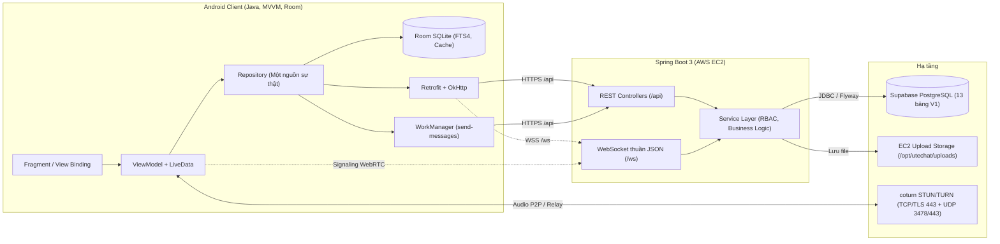

# UTEChat — Các quyết định kiến trúc (ADR)

> **Tên app:** "UTEChat" là tên tạm, đổi được. **Trạng thái tài liệu:** kiến trúc ĐÃ CHỐT ngày 2026-11-09 và hoàn thiện đồng bộ V1 ngày 2026-11-10. Toàn bộ kiến trúc nền tảng và 2 tính năng sáng tạo V1 đều ở trạng thái `ACCEPTED`. Các tính năng nâng cao (2FA TOTP, Thử thách bạn bè, UTE AI bot, Video call, FCM, E2EE) chỉ được ghi nhận ở mục Hướng phát triển tương lai (Future / V2), hoàn toàn không định nghĩa bảng, cột, endpoint hay flow triển khai trong V1.
> **Quy ước trạng thái:** `ACCEPTED` = đã chốt và áp dụng chính thức cho V1.

## 1. Tổng quan kiến trúc

### 4 nguyên tắc bất biến:
1. **Server là nguồn sự thật duy nhất** cho toàn bộ dữ liệu nghiệp vụ. Room trên Android chỉ là bản sao cục bộ (cache) phục vụ offline-first (ADR-009).
2. **Offline-first an toàn:** Khi mất mạng, tin nhắn vào hàng đợi Room với trạng thái `SENDING` và được WorkManager gửi tuần tự, server chống trùng nhờ `clientId`.
3. **Server tự lấy danh tính từ token:** App không bao giờ gửi `userId` để tự khai danh tính (ADR-018).
4. **Mọi quyền được kiểm tra ở tầng service**, không dựa vào việc ẩn nút trên giao diện.

## 2. Các ADR cốt lõi V1

### ADR-001 — Định danh chỉ bằng số điện thoại
**Status:** ACCEPTED
**Quyết định:** Tài khoản định danh duy nhất bằng số điện thoại, chuẩn hoá về dạng E.164 (`+84912345678`). Không đăng ký bằng email hay Google/OAuth.
**Hệ quả:** Cột `users.phone_e164` là `UNIQUE`. Mọi lookup bằng số phải chuẩn hoá trước. Tìm người mới chỉ khớp chính xác số để chống dò danh bạ.

### ADR-002 — OTP là OTP demo, không gửi SMS thật
**Status:** ACCEPTED
**Quyết định:** Server sinh OTP 6 số, lưu bản băm, và ghi nội dung tin vào bảng `demo_sms_outbox`. Chỉ khi chạy profile `demo` mới có endpoint `/api/demo/sms` để xem mã. Việc gửi nằm sau interface `OtpDelivery` để dễ dàng thay thế cổng SMS thật sau này.
**Hệ quả:** Profile `prod` không có endpoint xem OTP. Chính sách OTP: hết hạn 5 phút, sai tối đa 5 lần, gửi lại cách 60 giây, tối đa 5 lần gửi mỗi giờ mỗi số.

### ADR-003 — Hai cách đăng nhập và chống Brute-force (auth_throttles)
**Status:** ACCEPTED
**Quyết định:** Hỗ trợ 2 phương thức đăng nhập: (A) số điện thoại + mật khẩu, (B) số điện thoại + OTP demo. Thiết bị nhận diện bằng `deviceId` ngẫu nhiên do app tạo và lưu trong Keystore, server chỉ lưu bản băm. Kiểm soát tần suất và thử sai thông qua bảng `auth_throttles`.
**Chính sách khóa và bảo vệ khi mất thiết bị:**
- `PHONE_DEVICE`: Khóa theo cặp (SĐT, thiết bị) với `scope_key_hash = SHA-256(phone_e164 + ":" + device_id_hash)`. Đăng nhập mật khẩu sai 5 lần khóa 15 phút cho riêng thiết bị đó. Thiết bị mới có `deviceId` mới nên không bị kế thừa khóa cũ.
- `PHONE`: Khóa toàn tài khoản theo SĐT khi tổng số lần sai vượt ngưỡng lớn (20 lần/giờ). `PHONE` vẫn bảo vệ tài khoản khi mất thiết bị.
- Password reset bằng OTP phải thu hồi token của các thiết bị khác (`token_valid_after = now`).
- Người dùng sau khi đăng nhập lại có thể thu hồi thiết bị bị mất qua `/account/devices`.

### ADR-006 — Server là Spring Boot 3
**Status:** ACCEPTED
**Quyết định:** Spring Boot 3 (Java 21), Spring Web, Spring Security (JWT), Spring Data JPA, Spring WebSocket (WebSocket thuần JSON, không dùng STOMP), Bean Validation, Flyway migration. Phân lớp `Controller → Service → Repository`, DTO ở ranh giới web, constructor injection.
**Lý do:** Cùng ngôn ngữ Java với app Android, giúp cả nhóm dễ dàng đọc hiểu và phối hợp phát triển.

### ADR-007 — CSDL là PostgreSQL do Supabase quản lý (mô hình M2)
**Status:** ACCEPTED
**Quyết định:** Server Spring Boot giữ toàn bộ logic nghiệp vụ. Supabase chỉ làm CSDL PostgreSQL quản lý với đúng 13 bảng cốt lõi V1 theo `docs/ERD.md`. Không dùng Supabase Auth, Storage hay Realtime. App Android tuyệt đối không gọi trực tiếp Supabase.
**Bảo mật bắt buộc:** Bật Row Level Security (RLS) trên mọi bảng, không mở policy để đóng hoàn toàn Public Data API của Supabase. Server kết nối qua chuỗi JDBC với tài khoản quản trị từ biến môi trường.

### ADR-008 — Gửi bằng REST, nhận bằng WebSocket thuần JSON và đồng bộ sync_events
**Status:** ACCEPTED
**Quyết định:** Gửi tin nhắn và upload file qua REST (idempotent theo `clientId`, phù hợp cho hàng đợi WorkManager). Kênh WebSocket `/ws` (xác thực bằng JWT) dùng để đẩy tin mới, đẩy trạng thái đã nhận/đã đọc, báo "đang nhập", báo hiệu cuộc gọi WebRTC, thông báo thu hồi thiết bị. Khung WebSocket là JSON `{ "v": 1, "type": "...", "id": "uuid", "syncEventId": 1042, "payload": { ... } }`, tuyệt đối không dùng STOMP. Mọi sự kiện làm thay đổi dữ liệu đều mang `syncEventId` trỏ tới `sync_events.id`.
**Hệ quả:** Mất kết nối thì app tự động nối lại (backoff 1, 2, 4... tối đa 30s), sau đó gọi `GET /api/sync?after=<syncEventId>` để lấy toàn bộ sự kiện đã bỏ lỡ từ bảng `sync_events`. Client lưu `lastSyncEventId` trong Room và chỉ tăng cursor khi đã xử lý thành công event tương ứng. Xử lý event realtime và event qua `/sync` tuân thủ nguyên tắc idempotent.

### ADR-009 — Offline-first với Room và hàng đợi gửi WorkManager
**Status:** ACCEPTED
**Quyết định:** Mọi dữ liệu đọc ghi trên app đều đi qua Room SQLite. Khi gửi tin nhắn, app ghi vào Room với trạng thái `SENDING`, đưa vào hàng đợi `send-messages` của WorkManager. Khi có mạng, Worker gửi qua REST; thành công chuyển trạng thái `SENT`. Server kiểm tra `clientId` để chống trùng lặp.

### ADR-010 — Mốc biên nhận (Watermarks)
**Status:** ACCEPTED
**Quyết định:** Mỗi thành viên hội thoại có hai mốc: `last_delivered_message_id` và `last_read_message_id`. Một tin nhắn được coi là đã nhận/đã đọc nếu id của nó $\le$ mốc của người nhận. Cập nhật mốc `read` sẽ tự động nâng mốc `delivered`, sinh sự kiện `RECEIPT_UPDATED` mang `syncEventId`.
**Định nghĩa mốc:** `DELIVERED` nghĩa là ít nhất một thiết bị của người nhận đã lưu thành công tin nhắn vào dữ liệu cục bộ. `READ` nghĩa là người nhận đã đọc tin nhắn trên ít nhất một thiết bị.

### ADR-011 — Lưu file trên server, mở ngoài bằng FileProvider
**Status:** ACCEPTED
**Quyết định:** Upload qua `POST /api/media` (multipart), server lưu file vào `/opt/utechat/uploads` và trả về `mediaUrl` dạng `/api/media/{id}`. Client tải xuống qua `GET /api/media/{id}` với Header `Authorization: Bearer <token>`.
**Mở video và file ngoài app:** App dùng `FileProvider` làm phương án duy nhất. App tải/cache file về bộ nhớ tạm bằng token rồi chia sẻ `content://` qua `FileProvider` với cờ `FLAG_GRANT_READ_URI_PERMISSION`. Không dùng query ticket.
**Giới hạn:** Ảnh $\le$ 10 MB, voice $\le$ 10 MB (tối đa 5 phút), video file $\le$ 50 MB, tài liệu $\le$ 25 MB.

### ADR-012 — Chính sách thông báo tin mới
**Status:** ACCEPTED
**Quyết định:** V1 không dùng Firebase Cloud Messaging (FCM). Khi ứng dụng đang mở hoặc WebSocket còn kết nối, thông báo hiển thị tức thời qua `NotificationChannel` (`messages`) từ sự kiện WebSocket. Khi ứng dụng ở nền và WebSocket bị ngắt, `PeriodicWorkRequest` (15 phút) của WorkManager định kỳ gọi `/api/sync?after=<syncEventId>` để kiểm tra tin mới theo cơ chế **best-effort** (không cam kết tức thời).
**Giới hạn nền tảng:** Khi ứng dụng bị người dùng hoặc hệ điều hành force-stop hoàn toàn, Android đình chỉ mọi tiến trình nền, do đó không cam kết nhận được thông báo ngay lập tức. FCM chỉ được quy hoạch ở mục Future/V2.

### ADR-013 — Gọi thoại trong app bằng WebRTC 1-1
**Status:** ACCEPTED
**Quyết định:** Gọi thoại 1-1 bằng WebRTC là chức năng sáng tạo chính trong V1. Báo hiệu (Signaling) thực hiện qua WebSocket thuần JSON sẵn có. Server quản lý trạng thái cuộc gọi (`RINGING → ACTIVE → ENDED/MISSED/REJECTED/BUSY`) và ghi nhận tin nhắn hệ thống loại `CALL`. Dùng coturn cho STUN/TURN trên máy chủ EC2.
**Điều kiện cuộc gọi V1:** Chỉ được phép gọi thoại giữa hai người dùng đã có quan hệ bạn bè `ACCEPTED` và không bị `blocked`. Người lạ hoặc người bị chặn không được phép gọi điện (HTTP 403 `CONTACT_REQUIRED` hoặc `BLOCKED`).
**Giải pháp TURN TCP/TLS 443:** Cấp secondary IP cho máy chủ EC2 dành riêng cho coturn để chiếm trọn cổng TCP 443 và UDP 3478/443, vượt tường lửa Wi-Fi trường học khi demo; Nginx HTTPS chạy trên IP chính. Giữ nút `ACTION_DIAL` làm phương án dự phòng khi demo. Không làm video call trong V1.

### ADR-014 — Dịch tin nhắn bằng ML Kit on-device
**Status:** ACCEPTED
**Quyết định:** Nhấn giữ tin nhắn chọn "Dịch" là chức năng sáng tạo dự phòng trong V1. Dùng Google ML Kit Translation chạy on-device (Anh sang Việt và ngược lại). Gói ngôn ngữ (~30MB) được tải lần đầu, sau đó hoạt động hoàn toàn offline trên máy. Bản dịch lưu cục bộ trong bảng `message_translation` của Room, không gửi lên server.

### ADR-016 — Tìm kiếm offline bằng FTS4
**Status:** ACCEPTED
**Quyết định:** Tìm kiếm nội dung tin nhắn chạy hoàn toàn trên Room SQLite bằng bảng ảo FTS4 (`message_fts`). Cột `normalized_text` được chuẩn hóa loại bỏ dấu tiếng Việt kết hợp để hỗ trợ tìm kiếm cả tiếng Việt có dấu và không dấu tốc độ cao mà không cần server. Tìm người dùng mới chỉ qua SĐT chính xác trên server.

### ADR-017 — Tin nhắn mã hoá kênh truyền TLS/WSS (Cloud Chat)
**Status:** ACCEPTED
**Quyết định:** Tin nhắn được mã hoá khi truyền tải qua mạng bằng HTTPS và WSS; server lưu trữ dữ liệu bản rõ trong PostgreSQL theo mô hình Cloud Chat (tương tự Telegram). Mã hoá đầu cuối (E2EE) không thuộc phạm vi V1.
**Quy tắc triển khai bắt buộc:** [DEPLOYMENT_SECURITY.md](DEPLOYMENT_SECURITY.md) cụ thể hóa TLS, URL cấu hình, Bearer handshake WebSocket, proxy, media và secret. Áp dụng ngay từ các phase chức năng; kiểm thử hosted trước khi phát hành.

### ADR-018 — Danh tính từ token, phân quyền ở service
**Status:** ACCEPTED
**Quyết định:** Server trích xuất `AuthenticatedActor` (gồm `userId`, `deviceId`) từ JWT token. Một JWT duy nhất có thời hạn 30 ngày kèm `deviceId`, không dùng refresh token. Thu hồi thiết bị hoặc đăng xuất đặt `token_valid_after = now` để vô hiệu hóa token lập tức.

### ADR-019 — Một server chung trên AWS EC2
**Status:** ACCEPTED
**Quyết định:** Một máy chủ AWS EC2 Ubuntu 24.04 dùng chung cho cả nhóm: Nginx (reverse proxy HTTPS, WSS), Spring Boot chạy dưới dạng systemd service, coturn STUN/TURN, thư mục upload media. CSDL đặt tại Supabase. Triển khai tự động bằng GitHub Actions với liveness/readiness health check `/api/health/ready`.

### ADR-020 — Quản lý schema bằng migration và chiến lược Room
**Status:** ACCEPTED
**Quyết định:** Server tắt tự tạo bảng của ORM, quản lý schema chuẩn 13 bảng qua Flyway migration.
**Chiến lược Room Client:** Bật `exportSchema = true`. Trong giai đoạn phát triển (build variant Debug), cho phép sử dụng `fallbackToDestructiveMigration()` để linh hoạt thử nghiệm; trước ngày nộp bài và demo, toàn bộ migration Room cụ thể sẽ được hoàn thiện và khóa chặt.

### ADR-021 — Giao diện i18n, chế độ tối, xoay màn hình
**Status:** ACCEPTED
**Quyết định:** Chuỗi giao diện lưu trong `values/strings.xml` và `values-vi/strings.xml`, không viết cứng trong mã nguồn. Theme Material 3 DayNight. Xoay màn hình: ViewModel và `SavedStateHandle` giữ nguyên trạng thái danh sách cuộn, nội dung nháp và cuộc gọi.

### ADR-022 — Quy trình làm việc nhóm 5 người
**Status:** ACCEPTED
**Quyết định:** Nhóm trưởng phụ trách toàn bộ CSDL Supabase (Phase 1) và backend server, đồng thời giữ hợp đồng chung (`API_CONTRACT.md`, `ERD.md`). Bốn thành viên còn lại chia 4 mảng Android (Phase 3 đến Phase 6) phát triển độc lập trên các nhánh feature riêng biệt, sử dụng kiến trúc cô lập chống xung đột.

### ADR-023 — Kiến trúc Android bám sát slide bài giảng
**Status:** ACCEPTED
**Quyết định:**
- **Công nghệ:** Java, Views + XML, View Binding, `minSdk 26`, `compileSdk 35`, `targetSdk 35`, Gradle Kotlin DSL với Version Catalog (`gradle/libs.versions.toml`). Package chính thức: `com.utechat`.
- **Màn hình:** Single Activity (`MainActivity`) chứa `NavHostFragment`, điều hướng bằng Navigation Component, Safe Args chỉ truyền định danh ID, thanh điều hướng dưới `BottomNavigationView`.
- **Tầng kiến trúc:** UI (Fragment, ViewModel) và Data (Repository, Room, Retrofit). Không dùng Hilt/Dagger, không dùng Coroutine/Flow; bất đồng bộ dùng `AppExecutors` và `LiveData`.

### ADR-024 — Kiểm thử kim tự tháp bám slide
**Status:** ACCEPTED
**Quyết định:** Tập trung kiểm thử Unit Test JVM cho Room DAO, Repository, ViewModel, Crypto, Mappers sử dụng JUnit4 và Mockito. Lệnh `./gradlew testDebugUnitTest` phải đạt tỷ lệ pass 100%.

### ADR-025 — Kiến trúc chống xung đột cho nhóm 5 người
**Status:** ACCEPTED
**Quyết định:** Khóa 6 điểm nóng gây conflict: (1) Single Activity duy nhất, (2) Tách file chuỗi tài nguyên theo module (`strings_auth.xml`, `strings_contacts.xml`, v.v.), (3) Nested Navigation Graphs, (4) Chia nhỏ Retrofit API Interfaces, (5) Dựng sẵn các Entity Room, (6) Quy trình tiến độ bậc thang an toàn.

---

## 3. Hướng phát triển tương lai (Future / V2)

Các tính năng sau đây chỉ được ghi nhận như định hướng nâng cấp trong tương lai cho V2, **hoàn toàn không định nghĩa bảng, cột, endpoint hoặc flow triển khai trong V1**:

1. **Xác thực hai lớp (2FA TOTP & Backup Codes):** Bật tùy chọn trong cài đặt bảo mật, quét mã QR qua Google Authenticator và lưu mã dự phòng.
2. **Thử thách nhận diện bạn bè (Friend Challenge):** Thử thách chọn đúng 3 bạn bè trong bộ 15 người khi đăng nhập trên thiết bị lạ.
3. **Trợ lý ảo thông minh (AI Bot):** Tích hợp bot AI trả lời tự động qua API nhà cung cấp LLM bên ngoài (OpenAI/Gemini).
4. **Cuộc gọi video (Video Call):** Cuộc gọi video 1-1 và gọi video nhóm qua WebRTC.
5. **Thông báo đẩy khi tắt hẳn app (FCM):** Tích hợp Firebase Cloud Messaging để đánh thức thiết bị khi ứng dụng bị tắt hoàn toàn.
6. **Mã hoá đầu cuối (End-to-End Encryption - E2EE):** Mã hóa nội dung tin nhắn trực tiếp tại thiết bị đầu cuối với giao thức Signal hoặc tương đương.
7. **Tính năng xã hội mở rộng:** Gọi thoại/video nhóm đông người, biểu tượng cảm xúc (reactions), thu hồi tin nhắn, kênh phát sóng công khai (channels), đăng nhập mạng xã hội (Google, Facebook), tích hợp SMS thật qua cổng viễn thông.

---

## 4. Ghi chú bảo mật tổng hợp

| Hạng mục | Quy tắc V1 |
|---|---|
| Mật khẩu | $\ge$ 8 ký tự, băm BCrypt, không ghi log |
| Token | Một JWT 30 ngày kèm `deviceId`, vô hiệu hoá tức thì bằng `token_valid_after`, không có refresh token |
| Lưu token trên máy | Mã hoá bằng Keystore AES-256-GCM |
| OTP demo | Chỉ lưu bản băm SHA-256 trên server |
| Chống Brute-force | Bảng `auth_throttles` kiểm soát theo `PHONE_DEVICE` (`phone_e164 + ":" + device_id_hash`), `PHONE` và `DEVICE` |
| Quyền riêng tư | `allow_messages_from_non_contacts` kiểm soát nhận tin từ người lạ; chỉ bạn bè `ACCEPTED` mới được gọi thoại WebRTC hoặc thêm vào nhóm |
| Giới hạn tần suất | Tra cứu số điện thoại (10 lượt/phút), gửi tin (30 tin/10s), upload (20 tệp/phút) |
| Thông báo lỗi | Chung chung khi đăng nhập sai, không làm lộ số điện thoại có tồn tại hay không |
| HTTPS / WSS | Release/hosted bắt buộc HTTPS/WSS với chứng chỉ hợp lệ; HTTP chỉ cho Debug nội bộ (localhost, emulator, IP LAN được cấu hình), theo DEPLOYMENT_SECURITY.md |
