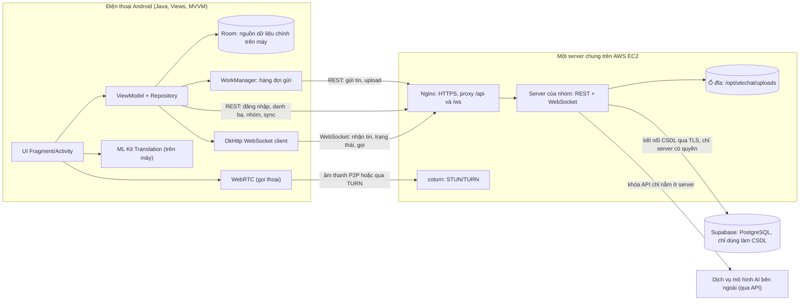

# UTEChat — Quyết định kiến trúc (ADR)

> **Tên app:** "UTEChat" là tên tạm, đổi được. **Trạng thái tài liệu:** kiến trúc ĐÃ CHỐT ngày 2026-11-09. Các ADR còn `PROPOSED` là lựa chọn công nghệ, quyết sau.
> **Quy ước trạng thái:** `ACCEPTED` = người phụ trách đã xác nhận trong buổi bàn. `PROPOSED` = đề xuất, nhóm chưa xác nhận, có thể đổi trước khi code.
> Tài liệu này có quyền cao nhất. Khi `FLOWS.md`, `ERD.md`, `API_CONTRACT.md` mâu thuẫn với một ADR `ACCEPTED`, ADR thắng. Mâu thuẫn chưa có quyết định thì **dừng và hỏi**, không tự đoán.

## 1. Tổng quan kiến trúc

**Nguyên tắc xuyên suốt**
1. **Màn hình chỉ đọc từ Room.** Mạng chỉ làm nhiệm vụ cập nhật Room (offline-first, ADR-009).
2. **Gửi bằng REST, nhận bằng WebSocket.** REST có `clientId` chống trùng và đi qua hàng đợi WorkManager. WebSocket đẩy sự kiện và mang tin báo hiệu cuộc gọi (ADR-008).
3. **Server tự lấy danh tính từ token.** App không bao giờ gửi `userId` để nói "tôi là ai" (ADR-018).
4. **Mọi quyền được kiểm tra ở tầng service**, không dựa vào việc ẩn nút trên giao diện.

## 2. Các ADR

### ADR-001 — Định danh chỉ bằng số điện thoại
**Status:** ACCEPTED
**Quyết định:** Tài khoản định danh bằng số điện thoại, chuẩn hoá về dạng E.164 (`+84912345678`). `0912…`, `84912…`, `+84912…` là cùng một người. Không đăng ký bằng email hay Gmail.
**Hệ quả:** Cột `users.phone_e164` là `UNIQUE`. Mọi lookup bằng số phải chuẩn hoá trước. Tìm người mới **chỉ khớp chính xác** số (không tìm một phần) để không dò được danh sách người dùng.

### ADR-002 — OTP là OTP demo (giả lập), không gửi SMS thật
**Status:** ACCEPTED
**Quyết định:** Server sinh OTP 6 số, lưu bản băm, và ghi nội dung tin vào bảng `demo_sms_outbox`. Chỉ khi chạy profile `demo` mới có màn hình hoặc endpoint "Hộp thư SMS giả" để xem mã. Việc gửi nằm sau interface `OtpDelivery` để sau này cắm nhà cung cấp SMS thật mà không đổi luồng.
**Hệ quả:** Báo cáo phải ghi rõ OTP là mô phỏng. Profile `prod` không có endpoint xem OTP. Chính sách OTP: hết hạn 5 phút, sai tối đa 5 lần, gửi lại cách 60 giây, tối đa 5 lần gửi mỗi giờ mỗi số.

### ADR-003 — Hai cách đăng nhập và thiết bị tin cậy
**Status:** ACCEPTED
**Quyết định:** Có hai cách đăng nhập: (A) số điện thoại + mật khẩu, (B) số điện thoại + OTP. Thiết bị tin cậy vào thẳng. Thiết bị lạ phải qua các bước bổ sung theo `FLOWS.md` mục F-02 đến F-04. Thiết bị nhận diện bằng một `deviceId` ngẫu nhiên do app tạo và lưu mã hoá bằng Keystore, server chỉ lưu bản băm.
**Hệ quả:** Gỡ cài đặt rồi cài lại sẽ thành thiết bị lạ. Sau khi vào thành công, thiết bị tự được ghi nhận tin cậy, người dùng xoá trong danh sách thiết bị. Đặt lại mật khẩu thu hồi mọi thiết bị khác.

### ADR-004 — 2FA bằng TOTP kèm mã dự phòng
**Status:** DEFERRED_TO_V2 (Thiết kế kiến trúc giữ nguyên, hoãn triển khai sang v2)
**Quyết định:** 2FA là tuỳ chọn, bật trong cài đặt. Dùng TOTP chuẩn RFC 6238 (SHA-1, 6 số, 30 giây, cho lệch ±1 nhịp). Phát 8 mã dự phòng dùng một lần lúc bật. Khoá TOTP mã hoá AES-GCM trước khi lưu, khoá mã hoá lấy từ biến môi trường. Mã dự phòng chỉ lưu bản băm.
**Hệ quả:** 2FA chỉ áp dụng cho đường đăng nhập bằng mật khẩu trên thiết bị lạ. Đăng nhập bằng OTP không cần 2FA (đã chốt). Phải nói rõ đánh đổi này trong báo cáo.

### ADR-005 — Bước nhận diện bạn bè trên thiết bị lạ
**Status:** DEFERRED_TO_V2 (Thiết kế kiến trúc giữ nguyên, hoãn triển khai sang v2)
**Quyết định:** Sau khi qua OTP hoặc 2FA trên thiết bị lạ, nếu tài khoản có **từ 3 bạn** (3 bản ghi trong `contacts`) thì hiện 15 người (3 bạn thật + 12 mồi, trộn ngẫu nhiên, chỉ hiện tên hiển thị) và người dùng chọn đúng 3 bạn. Tài khoản mới hoặc dưới 3 bạn bỏ qua bước này. Chỉ **3 lần thử**, mỗi lần sai sinh bộ 15 người mới, mỗi bộ hiệu lực 2 phút. Sai 3 lần thì khoá bước này 15 phút và báo vào các thiết bị tin cậy.
**Hệ quả:** Đáp án lưu bản băm trên server. Mồi lấy từ người dùng không phải bạn, không bị chặn, không phải bot, và cho phép hiện hồ sơ. Nếu hệ thống có ít hơn 12 mồi hợp lệ thì **bỏ qua bước** (và ghi nhận trong log). Môi trường demo phải nạp đủ tài khoản mồi. Đây là xác thực dựa trên hiểu biết, yếu và làm lộ tên bạn bè cho người đã nhập đúng mật khẩu hoặc OTP: nêu rõ trong báo cáo.

### ADR-006 — Server là Spring Boot
**Status:** PROPOSED
**Quyết định:** Spring Boot 3 (Java 21), Spring Web, Spring Security (JWT), Spring Data JPA, Spring WebSocket (WebSocket thuần, không STOMP), Bean Validation, Flyway. Phân lớp `Controller → Service (interface + Impl) → Repository`, DTO ở ranh giới web, constructor injection.
**Lý do:** Cùng ngôn ngữ Java với app Android, nên người làm app đọc hiểu được server.
**Chưa chốt:** ngôn ngữ và framework server do nhóm chọn theo khả năng của các thành viên. Phương án thay thế: Node.js (Express). App không đổi gì vì chỉ phụ thuộc `API_CONTRACT.md`.

### ADR-007 — CSDL là PostgreSQL do Supabase quản lý (mô hình M2)
**Status:** ACCEPTED (người phụ trách chọn ngày 2026-11-09)
**Quyết định:** Server của nhóm giữ **toàn bộ logic** (đăng nhập, OTP demo, thiết bị tin cậy, chat, nhóm, cuộc gọi). **Supabase chỉ dùng làm CSDL PostgreSQL.** Không dùng Supabase Auth, Realtime, Storage hay Edge Functions. App **không** nói chuyện với Supabase, chỉ nói chuyện với server qua `API_CONTRACT.md`. Kiểu `uuid` cho khoá người dùng, hội thoại, thiết bị, `bigint` tự tăng cho `messages.id`.
**Lý do:** Không phải tự cài và vận hành CSDL trên AWS, có bảng điều khiển để xem dữ liệu khi làm và demo, vẫn giữ "back end riêng" như rubric và slide yêu cầu.
**Bảo mật bắt buộc:**
- Supabase mở sẵn một API dữ liệu công khai cho mọi bảng. Phải **bật Row Level Security trên mọi bảng mà không tạo policy nào** (hoặc tắt Data API), để khoá `anon` không đọc được gì.
- Server kết nối bằng **chuỗi kết nối PostgreSQL** (TLS) lấy từ biến môi trường. **Không** để chuỗi kết nối, mật khẩu CSDL hay khoá `service_role` trong app, trong Git hay trong log.
- Chọn region Supabase gần EC2 (ví dụ Singapore) để giảm độ trễ.
**Hệ quả:** Quản lý schema bằng Flyway (hoặc công cụ migration của framework server), mỗi thay đổi là file `V<số>__<mô_tả>.sql`, **không sửa file đã chạy**. Gói miễn phí có giới hạn dung lượng và có thể tạm dừng project khi lâu không dùng: kiểm tra trước ngày demo và xem điều khoản hiện hành. Dữ liệu nằm ở bên thứ ba: ghi vào báo cáo.

### ADR-008 — Gửi bằng REST, nhận bằng WebSocket thuần
**Status:** PROPOSED
**Quyết định:** Gửi tin và upload qua REST (idempotent theo `clientId`, tiện cho hàng đợi WorkManager). WebSocket `/ws` (xác thực bằng JWT) dùng để: đẩy tin mới, đẩy trạng thái đã nhận/đã đọc, báo "đang nhập", báo hiệu cuộc gọi, thông báo thu hồi thiết bị. Khung WebSocket là JSON `{ "v":1, "type":"…", "id":"uuid", "payload":{…} }`, đúng cách slide Session 5 dạy (OkHttp WebSocket, trường `type`).
**Hệ quả:** Mất kết nối thì app tự nối lại theo lũy tiến 1, 2, 4… tối đa 30 giây, rồi gọi `GET /sync` để lấy những gì đã bỏ lỡ. WebSocket không phải nguồn sự thật duy nhất: mọi thứ phục hồi được từ REST.

### ADR-009 — Offline-first với Room và hàng đợi gửi
**Status:** ACCEPTED
**Quyết định:** Room là nguồn dữ liệu cho UI. Tin gửi đi được ghi vào Room với trạng thái `SENDING` rồi `WorkManager` gửi qua REST theo mẫu slide Session 5: `SendMessageWorker` chỉ nhận `clientId`, **một chuỗi duy nhất tên `send-messages`** (`ExistingWorkPolicy.APPEND_OR_REPLACE`, giữ đúng thứ tự gửi), ràng buộc `NetworkType.CONNECTED`, backoff lũy tiến 10 giây, `MAX_ATTEMPTS = 3`. Hết số lần hoặc lỗi vĩnh viễn thì `FAILED` và hiện nút gửi lại.
**Hệ quả:** Mỗi tin có `clientId` (UUID tạo trên máy). Server trả lại cùng `messageId` nếu nhận trùng. Repository có `observeMessages(conversationId)` (trả `LiveData` từ Room), `refreshLatest`, `loadOlder` (phân trang theo `before`, `PAGE_SIZE = 50`) và `upsertByClientId`. Tìm kiếm tin nhắn chạy trên Room (FTS).

### ADR-010 — Trạng thái đã nhận/đã đọc dùng mốc (watermark)
**Status:** PROPOSED
**Quyết định:** Không lưu một dòng biên nhận cho mỗi (tin, người nhận). Mỗi thành viên hội thoại có hai mốc: `last_delivered_message_id` và `last_read_message_id`. Một tin là "đã nhận/đã đọc" nếu id của nó ≤ mốc của người nhận.
**Lý do:** Rẻ hơn rất nhiều cho nhóm đông, một câu lệnh cập nhật cho cả loạt tin.
**Định nghĩa mốc trên nhiều thiết bị:**
- `DELIVERED`: Ít nhất một thiết bị của người nhận đã lưu thành công tin nhắn vào dữ liệu cục bộ. Thiết bị khác đang tắt sẽ đồng bộ bù sau qua `GET /sync` mà không ngăn cản việc xác nhận đã nhận.
- `READ`: Người nhận đã đọc tin nhắn trên ít nhất một thiết bị.
- Luôn đảm bảo bất biến: `last_delivered_message_id >= last_read_message_id` (cả hai không giảm; khi nhận báo đọc, server tự động nâng cả delivered nếu cần).
**Hệ quả:** Trong chat nhóm hiển thị "đã đọc" khi **mọi thành viên khác** có mốc ≥ id tin (hoặc đếm "n người đã xem").

### ADR-011 — Upload file qua REST, lưu ổ đĩa EC2
**Status:** PROPOSED
**Quyết định:** Theo slide Session 5 ("upload qua HTTP rồi gửi một URL"): `POST /api/media` (multipart) trả `mediaUrl` (dạng `/api/media/{id}`), sau đó gửi tin có `mediaUrl`. File lưu ở `/opt/utechat/uploads/<yyyy>/<mm>/<uuid>` (không dùng tên người dùng đặt). Tải xuống qua `GET /api/media/{id}` là **URL có bảo vệ bằng token** (người tải phải là thành viên hội thoại chứa tin đó, hoặc là người upload khi tin chưa gửi), như slide Session 6 yêu cầu. Ảnh nén ở app trước khi upload.
**Giới hạn:** ảnh ≤ 10 MB, voice ≤ 10 MB và ≤ 5 phút, video ≤ 50 MB, file ≤ 25 MB. Chỉ cho phép danh sách MIME đã khai báo, kiểm tra cả phần mở rộng lẫn nội dung đầu file.
**Phương án thay thế:** S3 khi cần mở rộng.

### ADR-012 — Thông báo không dùng FCM
**Status:** PROPOSED
**Quyết định:** Thông báo tin mới hiển thị khi app còn sống (WebSocket đang nối), qua `NotificationChannel` `messages` và xin quyền `POST_NOTIFICATIONS` trên Android 13+. Khi app bị hệ thống dừng, dùng `WorkManager` định kỳ (15 phút) gọi `/sync` rồi báo.
**Hệ quả:** **Không có thông báo tức thời khi app đã bị tắt hẳn.** Muốn có thì cần FCM (Firebase). Ghi giới hạn này vào báo cáo. Cuộc gọi cũng chỉ đổ chuông khi người nhận đang mở app (WebSocket đang nối).

### ADR-013 — Gọi thoại trong app bằng WebRTC
**Status:** PROPOSED
**Quyết định:** Gọi thoại 1-1 bằng WebRTC. Báo hiệu qua WebSocket. Server quản lý trạng thái cuộc gọi (`RINGING → ACTIVE → ENDED`, hoặc `MISSED/REJECTED/BUSY/FAILED`) và ghi một tin loại `CALL` vào hội thoại. Dùng coturn cho STUN/TURN trên EC2, server cấp thông tin TURN có thời hạn (HMAC, `use-auth-secret`). Video để sau, dùng cùng cơ chế.
**Hệ quả:** Cần mở UDP 3478, dải cổng relay và bổ sung cấu hình **TURNS (TURN qua TLS/TCP trên cổng 443)** (`turns:turn.example:443?transport=tcp`) để tăng khả năng kết nối và vượt tường lửa mạng trường học khi demo. Do chạy cùng EC2 với Nginx HTTPS (ADR-019), hai dịch vụ không thể cùng chiếm một cổng TCP 443 trên cùng 1 IP: cần giải pháp cấp secondary IP cho EC2 hoặc phân luồng TLS ở tầng TCP (Nginx stream preread). Hai emulator trên cùng máy bắt buộc qua TURN để nối. Luôn giữ nút `ACTION_DIAL` làm phương án dự phòng khi demo.

### ADR-014 — Dịch tin nhắn bằng ML Kit trên máy
**Status:** PROPOSED
**Quyết định:** Nhấn giữ tin nhắn chọn "Dịch". Dùng ML Kit Translation chạy trên máy (Anh sang Việt, và chiều ngược lại theo ngôn ngữ app). Gói ngôn ngữ tải lần đầu. Bản dịch lưu cục bộ trong bảng `message_translations` của Room, không gửi lên server.
**Hệ quả:** Không tốn tiền, không cần khóa API. Chất lượng ở mức khá. Cần xử lý trạng thái "đang tải gói ngôn ngữ".

### ADR-015 — Trợ lý AI là một người dùng bot phía server
**Status:** PROPOSED
**Quyết định:** Có một tài khoản bot cố định ("UTE AI", `users.is_bot = true`). Người dùng nhắn cho bot như chat thường. Khi server nhận tin gửi tới hội thoại bot, nó đưa việc vào hàng chờ, gọi `LlmClient` (interface, nhà cung cấp cấu hình được), rồi gửi câu trả lời như một tin của bot. Khóa API **chỉ ở biến môi trường server**.
**Giới hạn bắt buộc:** 30 yêu cầu mỗi người mỗi ngày (cấu hình được, bảng `ai_usage`), đầu vào tối đa 2000 ký tự, ngữ cảnh 10 tin gần nhất, trần chi tiêu đặt ở phía nhà cung cấp, có thông báo lỗi lịch sự khi hết hạn mức hoặc dịch vụ lỗi.
**Hệ quả:** Tin gửi cho bot đi ra bên thứ ba: phải nói rõ trong báo cáo và trong giao diện. Bot không đọc các hội thoại khác của người dùng. Ai giữ tài khoản và khoá API chưa chốt.

### ADR-016 — Tìm kiếm
**Status:** PROPOSED
**Quyết định:** Tìm tin nhắn chạy hoàn toàn trên Room (bảng FTS4), tìm trong một hội thoại hoặc toàn bộ. Tìm người: trong danh bạ theo tên (trên máy), và người mới **chỉ theo số điện thoại chính xác** qua server (có giới hạn tần suất).
**Hệ quả:** Không có tìm kiếm tin nhắn phía server. Tin chưa được tải về máy thì chưa tìm được.

### ADR-017 — Tin nhắn không mã hoá đầu cuối
**Status:** PROPOSED
**Quyết định:** Tin được mã hoá khi truyền (HTTPS/WSS) nhưng server lưu bản rõ, như chat "cloud" của Telegram. Mã hoá đầu cuối nằm ngoài phạm vi.
**Hệ quả:** Phải ghi trong báo cáo. Quản trị server có thể đọc dữ liệu: chỉ nhóm được truy cập server.

### ADR-018 — Danh tính từ token, phân quyền ở service
**Status:** ACCEPTED
**Quyết định:** Server dựng `AuthenticatedActor` từ JWT (gồm `userId`, `deviceId`). App không gửi `userId`/`deviceId` để tự khai. Mọi thao tác kiểm tra: người dùng là thành viên hội thoại, đúng vai trò quản trị khi sửa nhóm, sở hữu thiết bị khi xoá thiết bị. Trả `403` cho cả "không tồn tại" và "không có quyền" ở các tài nguyên riêng tư để không lộ sự tồn tại.
**Hệ quả:** Có test ma trận quyền (vai trò × endpoint). Theo slide Session 5 và 6 ("đăng nhập một lần, server trả token đã ký, gửi `Bearer` ở mọi yêu cầu, 401 thì xoá token và hiện màn hình đăng nhập"): **một JWT duy nhất** mang `userId`, `deviceId`, `iat`, `exp` (30 ngày), **không có refresh token**. Mỗi yêu cầu server kiểm tra thiết bị chưa bị thu hồi và `iat >= user_devices.token_valid_after`. Thu hồi thiết bị hoặc đăng xuất: đặt `token_valid_after = now` (và `revoked_at` nếu thu hồi), token cũ bị từ chối ngay, đóng WebSocket của thiết bị đó. App xử lý `401` bằng `AuthInterceptor` và `SessionEvents.notifyExpired()` như slide.

### ADR-019 — Một server chung trên AWS
**Status:** ACCEPTED
**Quyết định:** Một EC2 dùng chung cho cả nhóm (Ubuntu 24.04, t3.small trở lên): Nginx (HTTPS, proxy `/api` và `/ws`, khối WebSocket), server của nhóm chạy bằng systemd, coturn, thư mục upload. CSDL nằm ở Supabase (ADR-007), không cài trên EC2. Triển khai bằng GitHub Actions (build và test, lưu artifact kèm SHA-256, deploy qua SSH với tài khoản riêng, `/health/ready`, giữ bản trước để rollback). **Không đưa khóa quản trị vào GitHub.**
**Hệ quả:** Một người giữ tài khoản AWS và đặt cảnh báo ngân sách. Dữ liệu test lẫn nhau: dùng tài khoản test. Cần tên miền cho HTTPS.

### ADR-020 — Quản lý schema bằng migration, không để ORM tự tạo bảng
**Status:** PROPOSED
**Quyết định:** Tắt chức năng tự tạo hoặc tự sửa bảng của ORM. Schema chuẩn nằm ở `docs/ERD.md` và bản SQL tương ứng trong `db/migration`. Thay đổi schema dùng chung (bảng, cột, ràng buộc) phải được **người giữ hợp đồng chung** duyệt trước khi merge.
**Chiến lược Room Migration (Android Client):**
- Bật `exportSchema = true` và commit schema JSON vào Git để kiểm soát phiên bản cấu trúc.
- Khi sửa đổi Entity Room: tăng `@Database(version)`, viết lớp `Migration` cụ thể và kiểm thử nâng cấp.
- `fallbackToDestructiveMigration()` **chỉ được phép bật trong build variant Debug** với dữ liệu thử nghiệm chấp nhận mất; tuyệt đối không bật ở Release vì Room lưu trữ tin nhắn chưa gửi (`SENDING`), bản dịch và trạng thái offline không thể khôi phục lại hoàn toàn từ server.

### ADR-021 — Giao diện: i18n, chế độ tối, xoay màn hình
**Status:** ACCEPTED
**Quyết định:** Không viết cứng chữ nào trong layout hay code. Chuỗi trong `values` (en) và `values-vi`. Tin hệ thống lưu **mã sự kiện và tham số**, app tự dịch theo ngôn ngữ hiện tại. Theme Material 3 DayNight, màu qua thuộc tính theme. Xoay màn hình: ViewModel giữ trạng thái, bản nháp đang gõ lưu bằng `SavedStateHandle`, có layout landscape cho màn chat. Nút chạm ≥ 48dp, icon có `contentDescription`.

### ADR-022 — Quy trình làm việc nhóm
**Status:** PROPOSED
**Quyết định:** **Server do một người (người phụ trách nhóm) làm toàn bộ** và người này đồng thời giữ hợp đồng chung (`API_CONTRACT.md`, schema, sự kiện WebSocket). Bốn người còn lại chia **app Android theo mảng tính năng** (màn hình, ViewModel, repository, Room, test của mảng đó), làm dựa trên `API_CONTRACT.md` và **Fake repository** (đúng mẫu slide Session 7) trong lúc server chưa xong. Slide Session 5 yêu cầu **mỗi thành viên viết một phần thật sự của app Android**, nên người làm server **cũng phải nhận một mảng Android** (đề xuất: màn hình đăng ký, đăng nhập, OTP, thiết bị, vì gắn chặt với phần server của mình). Mỗi tính năng một nhánh `feature/...`, commit nhỏ, pull request, **rà soát chéo theo vòng** (A xem B, B xem C, C xem D, D xem E, E xem A). Một người giữ hợp đồng chung (schema, API, sự kiện WebSocket). `main` giữ code, kế hoạch để riêng. Không commit mật khẩu, khoá, keystore, chuỗi kết nối CSDL, file cấu hình cục bộ. Ghi nhận việc dùng AI trong README.

### ADR-023 — Kiến trúc và công nghệ của app Android bám slide
**Status:** ACCEPTED (theo yêu cầu bám tài liệu giảng dạy). Chi tiết đối chiếu ở `COURSE_ALIGNMENT.md`.
**Quyết định:**
- **Ngôn ngữ và build:** Java, Views + XML, **View Binding**, `minSdk 26`, `compileSdk 35` (chuẩn ổn định hiện hành, sẵn sàng nâng 36), `targetSdk 35`, Gradle Kotlin DSL với `gradle/libs.versions.toml`. Package chính thức đã chốt: `com.utechat`.
- **Màn hình:** **một Activity** chứa `NavHostFragment`, điều hướng bằng Navigation component và **Safe Args chỉ truyền id** (ví dụ `conversationId`), thanh dưới `BottomNavigationView` (Hội thoại, Danh bạ, Cài đặt). Fragment gán binding trong `onViewCreated`, gán `null` trong `onDestroyView`, quan sát bằng `getViewLifecycleOwner()`.
- **Danh sách:** `RecyclerView` + `ListAdapter` + `DiffUtil` (`areItemsTheSame` so id, `areContentsTheSame` so `equals`), `submitList`.
- **Tầng:** UI (Fragment, ViewModel) và dữ liệu (Repository). Mũi tên chỉ xuống, **không có tầng domain**. Fragment/Activity không bao giờ gọi DAO hay database trực tiếp.
- **Trạng thái UI:** mỗi màn hình một **lớp trạng thái bất biến** (`final`, trường `final`, `withX(...)`, có `equals/hashCode/toString`), ViewModel phơi bày `LiveData` chỉ đọc, dùng `MediatorLiveData` để biến `LiveData` của repository thành trạng thái UI, `SavedStateHandle` cho trạng thái nhỏ.
- **Bất đồng bộ:** `AppExecutors` (một luồng đĩa `Executors.newSingleThreadExecutor()` cho toàn app, `mainThread` qua `Handler`), `postValue` để trả về luồng chính. **Không dùng coroutine hay Flow.** Không chạm DB hay mạng trên luồng chính.
- **Dựng đối tượng:** `ChatApp extends Application` giữ `AppContainer` (Retrofit, OkHttp, `TokenStore`, Room, repository, `AppExecutors`), ViewModel dựng bằng `ViewModelProvider.Factory` + `ViewModelInitializer`. **Không dùng Hilt/Dagger.**
- **Mạng:** `ChatApi` của **Retrofit** trả `Call<T>`, JSON bằng **Gson**, **DTO tách khỏi entity Room** và có lớp `Mappers`. `ApiCall.run` trả `ApiResult` (không ném lỗi). `ErrorMessages` ánh xạ `error.code` (và HTTP status 400, 401, 403, 404, 409, `IOException`) sang chuỗi tài nguyên `en`/`vi`. Một `OkHttpClient` dùng chung cho Retrofit và WebSocket, kèm `AuthInterceptor`, logging chỉ ở debug, timeouts connect 15 s, read 30 s, write 60 s.
- **Địa chỉ server:** `BuildConfig.BASE_URL` (debug: `http://10.0.2.2:8080/`, release: HTTPS của server chung). `network_security_config.xml` cho phép HTTP chỉ với `10.0.2.2`, `localhost`, `127.0.0.1` và đặt ở **debug source set**.
- **Lưu cài đặt:** `SharedPreferences` (ngôn ngữ, theme, bật tắt thông báo, mã thiết bị). Token mã hoá bằng Keystore (ADR-018).
- **Quy ước:** một `TAG` cho mỗi lớp, tài nguyên `snake_case`, đặt tên Java chuẩn, `final` cho trường bất biến, `@NonNull/@Nullable`.
**Hệ quả:** Những phần slide không dạy (WebRTC, TOTP, ML Kit, bot AI, thử thách bạn bè) vẫn đi qua các lớp này (Retrofit, repository, ViewModel, LiveData, Executors). Không thêm khung mới (Hilt, Flow, Compose).

### ADR-024 — Kiểm thử, chất lượng và phát hành bám slide
**Status:** ACCEPTED (theo yêu cầu bám tài liệu giảng dạy)
**Quyết định:**
- **Kim tự tháp test:** nhiều test JUnit chạy trên JVM (`src/test`), ít test tích hợp, ít test Espresso (`src/androidTest`).
- **Test double:** ưu tiên **Fake** cho repository (ví dụ `FakeMessageRepository` với `MutableLiveData`), **Mockito** (`mock`, `verify`, `spy`) khi cần kiểm tra tương tác. ViewModel kiểm thử với `InstantTaskExecutorRule` và truyền `Runnable::run` làm executor.
- **Logic thuần cần test riêng:** chuẩn hoá số điện thoại, chính sách OTP, bước chọn bạn bè (chọn mồi, kiểm tra đáp án), TOTP (dùng bộ giá trị mẫu của RFC 6238), tính mốc đã nhận/đã đọc, máy trạng thái cuộc gọi. Server có test tương ứng và test ma trận quyền (vai trò × endpoint).
- **DAO:** test Room **in-memory** (`allowMainThreadQueries`) trong `androidTest`.
- **UI:** Espresso với `ActivityScenarioRule` và `RecyclerViewActions`, dữ liệu cục bộ biết trước, **không `Thread.sleep`**, khớp view theo id không theo chữ đã dịch. Test đặt tên theo hành vi, mỗi test một hành vi (sắp xếp, thực hiện, khẳng định).
- **Chất lượng:** Android Lint (có file baseline nếu cần), `StrictMode` và LeakCanary **chỉ ở bản debug**. Lệnh `./gradlew testDebugUnitTest` phải xanh (đây là điều kiện "unit test chạy đạt toàn bộ" của rubric).
- **Phát hành:** `isMinifyEnabled = true` + R8 (kiểm thử bản release, giữ `-keep` cho phần dùng reflection như Gson DTO), ký bằng upload keystore với mật khẩu ở `~/.gradle/gradle.properties`, `versionCode` tăng dần, nộp APK (và AAB nếu có). **Không đưa keystore hay `local.properties` vào Git.**
- **Bảo mật bản dựng:** `android:allowBackup="false"`, không ghi token vào log, khoá Maps lấy từ `local.properties` và giới hạn theo package + SHA-1, R8 **không** coi là cách giấu khoá. Đối chiếu danh sách OWASP Mobile Top 10 (M1, M3, M5, M7, M8, M9, M10) trước khi nộp.

## 3. Ngoài phạm vi (không làm ở phiên bản này)

Mã hoá đầu cuối, FCM/push khi app đã tắt, gọi nhóm, video (ngoài bản đầu), chỉnh sửa hoặc thu hồi tin, biểu tượng cảm xúc phản hồi, kênh công khai, tìm kiếm tin nhắn phía server, đăng nhập bằng mạng xã hội, SMS thật.

## 4. Ghi chú bảo mật tổng hợp

| Hạng mục | Quy tắc |
|---|---|
| Mật khẩu | ≥ 8 ký tự, BCrypt, không ghi log |
| Token | Một JWT 30 ngày kèm `deviceId`, vô hiệu hoá được ngay bằng `token_valid_after`, không có refresh token |
| Lưu token trên máy | Mã hoá bằng Keystore |
| OTP, mã dự phòng, đáp án bạn bè | Chỉ lưu bản băm |
| Khoá TOTP | AES-GCM, khoá mã hoá trong biến môi trường |
| Giới hạn tần suất | Đăng nhập, OTP, tra số điện thoại, bot AI, upload (xem `API_CONTRACT.md`) |
| Thông báo lỗi | Chung chung khi đăng nhập sai, không lộ số có tồn tại hay không |
| HTTPS/WSS | Bắt buộc ngoài môi trường dev, HTTP cleartext chỉ cho `10.0.2.2` và `localhost` ở bản debug |
| Khoá bên thứ ba (AI, TURN, Maps nếu dùng) | Chỉ ở server hoặc `local.properties`, không commit |
