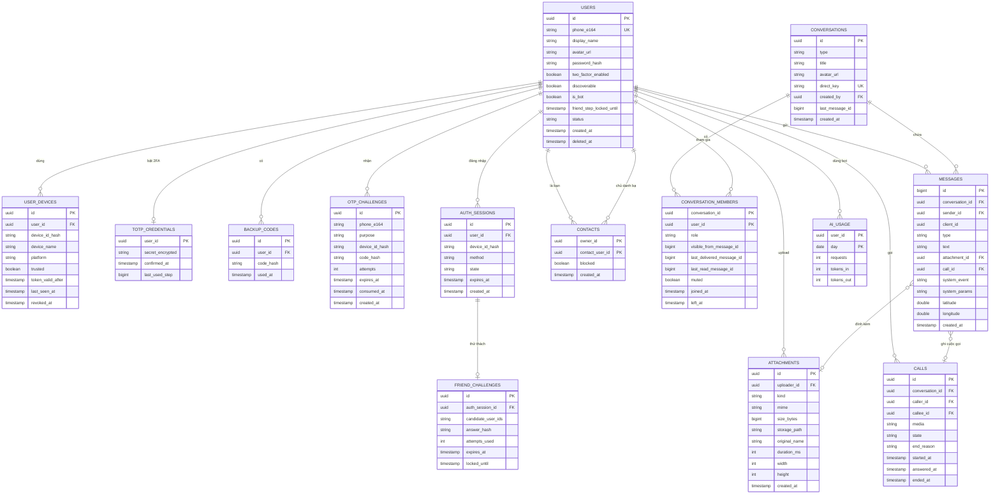

# UTEChat — ERD và lược đồ dữ liệu

> **Trạng thái:** ĐÃ CHỐT 2026-11-09 (đổi qua pull request). Chuẩn schema phía server là PostgreSQL do Supabase quản lý (ADR-007). Mermaid ERD chỉ rút gọn cột để dễ đọc; **bảng mô tả cột bên dưới là nguồn chính xác theo cột**. Mọi bảng bật Row Level Security không có policy, chỉ server truy cập.
>
> [!NOTE]
> **Phân loại bảng theo phạm vi triển khai:**
> - **Cốt lõi v1 (10 bảng server):** `USERS`, `USER_DEVICES`, `OTP_CHALLENGES`, `AUTH_SESSIONS`, `CONTACTS`, `CONVERSATIONS`, `CONVERSATION_MEMBERS`, `MESSAGES`, `ATTACHMENTS`, `CALLS`.
> - **Mở rộng v2 / Tùy chọn (4 bảng):** `FRIEND_CHALLENGES`, `TOTP_CREDENTIALS`, `BACKUP_CODES`, `AI_USAGE` (đã được thiết kế sẵn trong kiến trúc kiến trúc tổng thể, hoãn triển khai sang v2 để tập trung vào 15 yêu cầu cốt lõi theo Rubric).

## 1. Sơ đồ quan hệ phía server

Bảng chỉ dành cho môi trường `demo` (không có trong `prod`): `demo_sms_outbox(id, phone_e164, body, created_at)`.

## 2. Mô tả cột và ràng buộc (nguồn chính xác)

### 2.1 Tài khoản

| Bảng | Ràng buộc và ghi chú |
|---|---|
| `users` | `phone_e164` UNIQUE (cho phép NULL), định dạng `+` và 8 đến 15 chữ số. `status` ∈ `ACTIVE`, `LOCKED`, `DELETED`. Xoá tài khoản là **xoá mềm**: đặt `deleted_at`, ẩn tên và ảnh, **đặt `phone_e164 = NULL` để giải phóng số**, giữ khoá để tin cũ vẫn hợp lệ. Bot có `is_bot = true`, không đăng nhập được, không tính là bạn. `friend_step_locked_until` khoá bước bạn bè **theo tài khoản** (không theo phiên, để không né được bằng cách đăng nhập lại). |
| `user_devices` | UNIQUE (`user_id`, `device_id_hash`). `device_id_hash` là SHA-256 của `deviceId` do app tạo. `token_valid_after` là mốc: server **từ chối mọi JWT có `iat` sớm hơn mốc này** (đăng xuất, thu hồi hoặc đổi mật khẩu đặt mốc = bây giờ). `revoked_at` khác NULL là thiết bị đã bị thu hồi. Không có refresh token (ADR-018). |
| `otp_challenges` | Mỗi lần gửi OTP là một dòng. `purpose` ∈ `REGISTER`, `LOGIN`, `PASSWORD_RESET`. Giới hạn gửi lại tính bằng số dòng trong 60 giây và 1 giờ qua theo `phone_e164`. `consumed_at` khác NULL là đã dùng. Chỉ lưu `code_hash`. |
| `auth_sessions` | Giao dịch đăng nhập nhiều bước. `method` ∈ `PASSWORD`, `OTP`, `RESET` (sau khi đặt lại mật khẩu). `state` ∈ `NEED_OTP`, `NEED_2FA`, `NEED_FRIEND`, `COMPLETE`, `FAILED`, `LOCKED`. Hết hạn sau 10 phút. Token chỉ được cấp khi `state = COMPLETE`. |
| *[v2]* `friend_challenges` | `candidate_user_ids` là danh sách 15 id đã trộn (JSON). `answer_hash` là băm của 3 id đúng đã sắp xếp. Để chống tấn công giao thoa (intersection attack), **toàn bộ 15 ứng viên và 3 đáp án được tái sử dụng và giữ cố định trong suốt cửa sổ hiệu lực (15 phút) của tài khoản**, chỉ xáo trộn thứ tự hiển thị mỗi lần yêu cầu lại. `attempts_used` tối đa 3, **đếm dồn theo tài khoản trong 15 phút** chứ không reset khi mở phiên mới. Sai lần thứ 3 thì đặt `users.friend_step_locked_until = now + 15 phút`. |
| *[v2]* `totp_credentials` | `secret_encrypted` AES-GCM. `confirmed_at` NULL nghĩa là đang thiết lập, chưa bật. `last_used_step` để chống dùng lại cùng một mã. |
| *[v2]* `backup_codes` | 8 dòng mỗi lần bật. Dùng rồi đặt `used_at`. |

### 2.2 Danh bạ và hội thoại

| Bảng | Ràng buộc và ghi chú |
|---|---|
| `contacts` | PK (`owner_id`, `contact_user_id`). CHECK `owner_id <> contact_user_id`. Quan hệ **một chiều** (A thêm B không có nghĩa B thêm A). "Có từ 3 bạn" nghĩa là có ≥ 3 dòng `blocked = false` của chủ. |
| `conversations` | `type` ∈ `DIRECT`, `GROUP`, `BOT`. `direct_key` chỉ có ở `DIRECT` và `BOT`, bằng `min(idA,idB):max(idA,idB)`, UNIQUE để mỗi cặp có đúng một hội thoại. Nhóm có `title`. `last_message_id` tiện sắp xếp danh sách hội thoại. |
| `conversation_members` | PK (`conversation_id`, `user_id`). `role` ∈ `ADMIN`, `MEMBER` (hội thoại 1-1 luôn `MEMBER`). `last_delivered_message_id` và `last_read_message_id` là mốc (ADR-010). `left_at` khác NULL: đã rời hoặc bị xoá, **không đọc được tin mới sau mốc đó**. `visible_from_message_id` là id tin cuối cùng **trước** lúc được thêm (người mới chỉ xem tin có id lớn hơn). Thêm lại người đã rời thì đặt `left_at = NULL` và cập nhật `visible_from_message_id`. Mỗi nhóm luôn có ít nhất một `ADMIN` còn ở lại (kiểm tra ở service). |

### 2.3 Tin nhắn

| Cột | Ghi chú |
|---|---|
| `id` | `bigint` tự tăng, **tăng đơn điệu toàn cục**, dùng làm con trỏ đồng bộ (`GET /sync?after=`) |
| `client_id` | UUID do app tạo. UNIQUE (`sender_id`, `client_id`) để chống trùng khi gửi lại |
| `type` | `TEXT`, `IMAGE`, `AUDIO`, `VIDEO`, `FILE`, `LOCATION`, `SYSTEM`, `CALL` |
| `text` | Có với `TEXT`, và là chú thích ngắn với ảnh/video nếu cần. Tối đa 4000 ký tự |
| `attachment_id` | Có với `IMAGE`, `AUDIO`, `VIDEO`, `FILE` |
| `call_id` | Có với `CALL` |
| `system_event`, `system_params` | Có với `SYSTEM`. Lưu mã sự kiện (`MEMBER_ADDED`, `MEMBER_REMOVED`, `MEMBER_LEFT`, `GROUP_RENAMED`, `ADMIN_CHANGED`, `GROUP_CREATED`) và tham số JSON. **App tự dịch theo ngôn ngữ**, server không lưu câu chữ |
| `latitude`, `longitude` | Có với `LOCATION` |
| Chỉ mục | (`conversation_id`, `id` DESC) để phân trang lịch sử. (`sender_id`, `client_id`) UNIQUE |

CHECK: đúng một trong các nhóm dữ liệu khớp `type` (ví dụ `TEXT` phải có `text`, `IMAGE` phải có `attachment_id`). Kiểm tra ở service và có ràng buộc CHECK ở CSDL.

### 2.4 File, cuộc gọi, AI

| Bảng | Ghi chú |
|---|---|
| `attachments` | `kind` ∈ `IMAGE`, `AUDIO`, `VIDEO`, `FILE`. `storage_path` là đường dẫn tương đối trong thư mục upload, **không bao giờ** dùng tên người dùng đặt làm đường dẫn. `mime` lấy từ kiểm tra server. API không lộ `attachments.id` mà lộ `mediaUrl` = `/api/media/{id}` (có bảo vệ bằng token), đúng mẫu slide Session 5. |
| `calls` | `media` ∈ `VOICE`, `VIDEO`. `state` ∈ `RINGING`, `ACTIVE`, `ENDED`, `MISSED`, `REJECTED`, `BUSY`, `FAILED`. `end_reason` ∈ `HANGUP`, `TIMEOUT`, `REJECT`, `BUSY`, `OFFLINE`, `ERROR`. |
| *[v2]* `ai_usage` | PK (`user_id`, `day`). Tăng khi bot trả lời. Quá hạn mức thì từ chối. |

## 3. Quy tắc nhất quán dữ liệu

1. Cặp người dùng chỉ có **một** hội thoại `DIRECT` (nhờ `direct_key`).
2. Tạo tin nhắn, cập nhật `conversations.last_message_id` và (nếu có) `conversation_members` cho người gửi chạy trong **cùng một giao dịch**.
3. Mốc `last_delivered_message_id` và `last_read_message_id` không bao giờ giảm; luôn thỏa `last_delivered_message_id >= last_read_message_id`. Khi nhận báo đọc (`POST /read`), server tự động nâng cả `last_delivered_message_id` nếu mốc delivered hiện tại nhỏ hơn mốc read.
4. Rời nhóm hoặc bị xoá chỉ đặt `left_at`, không xoá dòng, để giữ lịch sử và vẫn hiển thị tên người gửi cũ.
5. Thu hồi thiết bị đặt `revoked_at` và `token_valid_after = now` trong một giao dịch.
6. Xoá tài khoản (xoá mềm) thu hồi mọi thiết bị, gỡ khỏi mọi nhóm (chuyển quản trị nếu cần), xoá danh bạ hai chiều trong cùng giao dịch (`DELETE FROM contacts WHERE owner_id = :deleted_user_id OR contact_user_id = :deleted_user_id;`), đặt `phone_e164 = NULL` và `status = DELETED`. Loại tài khoản `DELETED` khỏi danh sách bạn thật/mồi khi tạo thử thách. Tin nhắn cũ tiếp tục trỏ UUID cũ (không nối quan hệ sang tài khoản mới đăng ký số này).
7. Thiết bị đã thu hồi đăng nhập lại thì **coi như thiết bị lạ**. Thành công thì đặt `revoked_at = NULL` và `trusted = true`.
8. `messages.attachment_id` chỉ được trỏ tới file **do chính người gửi upload** và chưa gắn vào tin nào khác. Server tách `mediaUrl` thành id file và kiểm tra điều này.

## 4. Schema phía app (Room)

Room là bản lưu cục bộ phục vụ offline-first (ADR-009). **Server là nguồn sự thật**, Room là bản sao kèm các trạng thái chỉ có ở máy.

| Bảng Room | Cột chính | Ghi chú |
|---|---|---|
| `user_cache` | `id`, `phone`, `displayName`, `avatarUrl`, `isBot` | Hồ sơ người dùng đã gặp (danh bạ, thành viên nhóm) |
| `contact` | `contactUserId`, `blocked` | Danh bạ của chính mình |
| `conversation` | `id`, `type`, `title`, `avatarUrl`, `lastMessageId`, `lastMessageAt`, `unreadCount`, `muted` | Danh sách hội thoại |
| `member` | `conversationId`, `userId`, `role`, `lastDeliveredId`, `lastReadId`, `left` | Thành viên và mốc |
| `message` | `localId` (PK tự tăng), `serverId` (null khi chưa gửi), `clientId` UNIQUE, `conversationId`, `senderId`, `type`, `text`, `attachmentJson`, `createdAt`, `status` | `status` ∈ `SENDING`, `SENT`, `DELIVERED`, `READ`, `FAILED` (suy ra từ mốc của người nhận, trừ `SENDING`/`FAILED`) |
| `attachment_transfer` | `clientId`, `localUri`, `state`, `progress`, `mediaUrl` | Trạng thái upload/tải xuống, tiếp tục được sau khi mất mạng |
| `message_fts` | FTS4 trên `message.text` và `normalized_text` | Tìm kiếm tin nhắn offline (ADR-016). Cột `normalized_text` được chuẩn hóa (loại bỏ dấu tiếng Việt kết hợp, đổi đ/Đ → d, chuyển chữ thường); truy vấn tìm kiếm cũng áp dụng cùng phép chuẩn hóa để hỗ trợ tìm cả tiếng Việt có dấu và không dấu |
| `message_translation` | `messageKey`, `targetLang`, `translatedText` | Bản dịch lưu cục bộ (ADR-014) |
| `sync_state` | `lastMessageId`, `lastSyncAt` | Con trỏ cho `GET /sync` |

Hàng đợi gửi dùng **WorkManager** (một chuỗi duy nhất `send-messages`, ADR-009), mỗi việc chỉ mang `clientId`, không mang nội dung tin.

## 5. Dữ liệu mẫu cho demo

Script nạp mẫu (chỉ profile `demo`): ít nhất **30 tài khoản** (để bước nhận diện bạn bè có đủ mồi), một vài người có ≥ 3 bạn và một vài người có ít hơn, một nhóm ba người, tài khoản bot, và vài tin nhắn mẫu. Mật khẩu demo đặt bằng biến môi trường, **không** để mặc định công khai trong repo.
