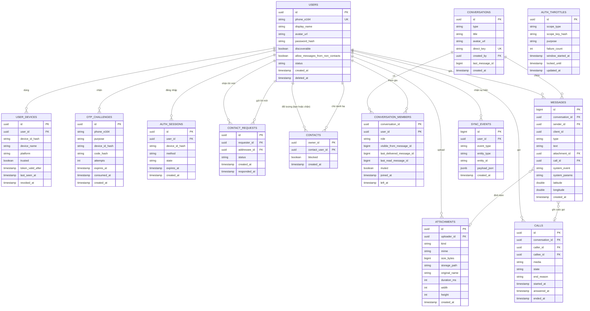

# UTEChat — ERD và lược đồ dữ liệu

> **Trạng thái:** ĐÃ CHỐT 2026-11-09, cập nhật chuẩn hóa V1 2026-11-10. Chuẩn schema phía server là PostgreSQL do Supabase quản lý (ADR-007). Mermaid ERD chỉ rút gọn cột để dễ đọc; **bảng mô tả cột bên dưới là nguồn chính xác theo cột**. Mọi bảng bật Row Level Security không có policy, chỉ server truy cập qua service role.
>
> [!NOTE]
> **Phạm vi CSDL server V1 (đúng 13 bảng cốt lõi):**
> 1. `users`: Tài khoản người dùng (định danh SĐT E.164, soft delete, quyền nhận tin nhắn người lạ)
> 2. `user_devices`: Thiết bị người dùng và mốc hiệu lực JWT
> 3. `otp_challenges`: Thử thách mã OTP demo
> 4. `auth_sessions`: Phiên đăng nhập nhiều bước
> 5. `auth_throttles`: Kiểm soát giới hạn tần suất và khóa tạm đăng nhập/OTP (PHONE, DEVICE, PHONE_DEVICE)
> 6. `contact_requests`: Lời mời kết bạn (PENDING, ACCEPTED, REJECTED, CANCELED; chống trùng ngược chiều)
> 7. `contacts`: Quan hệ bạn bè đã chấp nhận (blocked = false) và danh sách chặn (blocked = true)
> 8. `conversations`: Hội thoại 1-1 (DIRECT) và nhóm (GROUP)
> 9. `conversation_members`: Thành viên hội thoại và mốc biên nhận (watermarks)
> 10. `messages`: Tin nhắn (phân trang lịch sử bằng messageId)
> 11. `attachments`: Tệp đính kèm đa phương tiện (ảnh, voice, video file, tài liệu)
> 12. `calls`: Nhật ký cuộc gọi thoại WebRTC 1-1 giữa bạn bè đã kết bạn
> 13. `sync_events`: Sự kiện đồng bộ bù cho client qua `syncEventId` (JSONB, retention 30 ngày)
>
> *Hướng phát triển V2 (không thuộc schema triển khai V1):* Các bảng mở rộng `friend_challenges`, `totp_credentials`, `backup_codes`, `ai_usage` chỉ là ý tưởng kiến trúc tương lai, hoàn toàn không tạo bảng hay cột trong V1.

## 1. Sơ đồ quan hệ phía server

Bảng chỉ dành cho môi trường `demo` (không có trong `prod`): `demo_sms_outbox(id, phone_e164, body, created_at)`.

## 2. Mô tả cột và ràng buộc (nguồn chính xác)

### 2.1 Tài khoản và bảo mật xác thực

| Bảng | Ràng buộc và ghi chú |
|---|---|
| `users` | `phone_e164` UNIQUE (cho phép NULL), định dạng `+` và 8 đến 15 chữ số. `status` ∈ `ACTIVE`, `LOCKED`, `DELETED`. Cột `allow_messages_from_non_contacts BOOLEAN NOT NULL DEFAULT TRUE`: kiểm soát quyền nhắn tin từ người lạ (không tạo bảng privacy mới). • `TRUE`: người tìm thấy qua SĐT được phép mở hội thoại và nhắn tin 1-1. • `FALSE`: chỉ người có quan hệ `ACCEPTED` (trong bảng `contacts` với `blocked = false`) mới được gửi tin. • Gửi lời mời kết bạn vẫn được phép dù tắt nhận tin từ người lạ. • Xoá tài khoản là **xoá mềm**: đặt `deleted_at`, ẩn tên/ảnh, **đặt `phone_e164 = NULL`**, xóa toàn bộ dòng liên quan trong `contacts`, thu hồi mọi thiết bị. Không có cột V2 (`two_factor_enabled`, `is_bot`, `friend_step_locked_until`). |
| `user_devices` | UNIQUE (`user_id`, `device_id_hash`). `device_id_hash` là SHA-256 của `deviceId` do app tạo. `token_valid_after` là mốc: server **từ chối mọi JWT có `iat` sớm hơn mốc này** (đăng xuất, thu hồi hoặc đổi mật khẩu đặt mốc = bây giờ). `revoked_at` khác NULL là thiết bị đã bị thu hồi. Không có refresh token (ADR-018). Người dùng có thể thu hồi thiết bị bị mất qua `/account/devices`. |
| `otp_challenges` | Mỗi lần gửi OTP là một dòng. `purpose` ∈ `REGISTER`, `LOGIN`, `PASSWORD_RESET`. Giới hạn gửi lại tính bằng số dòng trong 60 giây và 1 giờ qua theo `phone_e164`. `consumed_at` khác NULL là đã dùng. Chỉ lưu `code_hash`. Password reset bằng OTP thành công phải thu hồi token của mọi thiết bị khác (`token_valid_after = now`). |
| `auth_sessions` | Giao dịch đăng nhập nhiều bước. `method` ∈ `PASSWORD`, `OTP`, `RESET`. `state` ∈ `NEED_OTP`, `COMPLETE`, `FAILED`, `LOCKED`. Hết hạn sau 10 phút. Token chỉ được cấp khi `state = COMPLETE`. Không có trạng thái V2 (`NEED_2FA`, `NEED_FRIEND`). |
| `auth_throttles` | Quản lý giới hạn tần suất thử sai và khóa tạm thời chống tấn công brute-force. Cột: `id` (UUID PK), `scope_type` (`PHONE`, `DEVICE`, hoặc `PHONE_DEVICE`), `scope_key_hash` (chuỗi băm SHA-256, không lưu phone hoặc device key thô), `purpose` (`PASSWORD_LOGIN`, `OTP_VERIFY`, `PASSWORD_RESET`), `failure_count` (int), `window_started_at` (timestamptz), `locked_until` (timestamptz, cho phép NULL), `updated_at` (timestamptz). Ràng buộc UNIQUE: `(scope_type, scope_key_hash, purpose)`. • `PHONE_DEVICE`: khóa theo cặp (SĐT, thiết bị) với `scope_key_hash = SHA-256(phone_e164 + ":" + device_id_hash)`. Thiết bị mới có `deviceId` mới nên không bị kế thừa khóa của thiết bị cũ. • `PHONE`: khóa toàn tài khoản theo SĐT khi tổng số lần sai vượt ngưỡng lớn (chống bot đổi deviceId liên tục). `PHONE` vẫn bảo vệ tài khoản khi mất thiết bị. |

### 2.2 Danh bạ, lời mời kết bạn và danh sách chặn

| Bảng | Ràng buộc và ghi chú |
|---|---|
| `contact_requests` | Quản lý vòng đời lời mời kết bạn. Cột: `id` (UUID PK), `requester_id` (UUID FK users), `addressee_id` (UUID FK users), `status` ∈ `PENDING`, `ACCEPTED`, `REJECTED`, `CANCELED`, `created_at` (timestamptz), `responded_at` (timestamptz, NULL khi đang chờ). Ràng buộc CHECK: `requester_id <> addressee_id`. • **Chống trùng ngược chiều:** Nếu đã có lời mời A $\rightarrow$ B ở trạng thái `PENDING`, hệ thống không cho phép tạo thêm lời mời B $\rightarrow$ A (service trả về lời mời hiện có hoặc lỗi `REQUEST_ALREADY_PENDING` 409). • Khi trạng thái thay đổi (`ACCEPTED`, `REJECTED`, `CANCELED`), server tạo `sync_events` và đẩy WebSocket `contact_request.updated` cho cả 2 bên liên quan. Khi `ACCEPTED`, transaction chèn đồng thời 2 dòng `contacts` (`blocked = false`). |
| `contacts` | PK (`owner_id`, `contact_user_id`). CHECK `owner_id <> contact_user_id`. • **Semantics của contacts:**   - Dòng có `blocked = false`: Quan hệ bạn bè chính thức đã được chấp nhận (`ACCEPTED`). `GET /contacts` chỉ trả về các dòng này.   - Dòng có `blocked = true`: Hành vi chặn một chiều. Có thể phát sinh giữa hai người bạn (bạn bè bị chặn) hoặc giữa hai người lạ chưa từng kết bạn (dòng block-only do `POST /contacts/{userId}/block`). • **Hành vi Unblock:** Nếu là dòng block-only (chưa kết bạn), server xoá hẳn dòng; nếu hai người vốn là bạn bè trước đó, server cập nhật `blocked = false`. • Xoá tài khoản (soft delete) xóa toàn bộ mọi dòng `contacts` liên quan (cả chiều `owner_id` và `contact_user_id`). |

### 2.3 Hội thoại và thành viên

| Bảng | Ràng buộc và ghi chú |
|---|---|
| `conversations` | `type` ∈ `DIRECT`, `GROUP` (không có loại `BOT`). `direct_key` chỉ có ở `DIRECT`, bằng `min(idA,idB):max(idA,idB)`, UNIQUE để mỗi cặp người dùng có đúng một hội thoại 1-1. Nhóm có `title`. `last_message_id` dùng để sắp xếp danh sách hội thoại gần nhất và hỗ trợ hiển thị. Chỉ người đã `ACCEPTED` mới được thêm vào nhóm chat. |
| `conversation_members` | PK (`conversation_id`, `user_id`). `role` ∈ `ADMIN`, `MEMBER` (hội thoại 1-1 luôn `MEMBER`). `last_delivered_message_id` và `last_read_message_id` là mốc biên nhận (watermarks theo ADR-010). `left_at` khác NULL: đã rời hoặc bị xoá khỏi nhóm. `visible_from_message_id` là id tin cuối cùng trước thời điểm được thêm vào nhóm (thành viên mới không xem được tin cũ). Thêm lại người đã rời thì đặt `left_at = NULL` và cập nhật `visible_from_message_id`. Mỗi nhóm luôn có ít nhất một `ADMIN`. |

### 2.4 Tin nhắn, tệp đính kèm, cuộc gọi và đồng bộ

| Bảng | Ràng buộc và ghi chú |
|---|---|
| `messages` | `id` `bigint` tự tăng toàn cục, **chỉ dùng cho phân trang lịch sử tin nhắn** (`?before=<messageId>&limit=50`), **không dùng làm cursor đồng bộ**. `client_id` UUID do app tạo, UNIQUE (`sender_id`, `client_id`) để chống trùng tin khi gửi lại. `type` ∈ `TEXT`, `IMAGE`, `AUDIO`, `VIDEO`, `FILE`, `LOCATION`, `SYSTEM`, `CALL`. Ghi chú: `VIDEO` là tệp video đính kèm, không phải cuộc gọi video. `text` tối đa 4000 ký tự. `system_event` và `system_params` dùng cho tin hệ thống nhóm (app tự dịch i18n). Chỉ mục composite: (`conversation_id`, `id` DESC) để phân trang lịch sử. • **Kiểm tra chính sách tin nhắn người lạ:** Nếu người gửi bị người nhận chặn, server từ chối với HTTP 403 `BLOCKED`. Nếu không bị chặn nhưng người nhận có `allow_messages_from_non_contacts = false` và người gửi chưa có quan hệ bạn bè `ACCEPTED`, server từ chối với HTTP 403 `CONTACT_REQUIRED`. |
| `attachments` | `kind` ∈ `IMAGE`, `AUDIO`, `VIDEO`, `FILE`. `storage_path` là đường dẫn tương đối trong thư mục lưu trữ, không dùng tên gốc của người dùng. `mime`, `size_bytes`, `original_name`, `duration_ms`, `width`, `height`. Tải xuống qua `GET /api/media/{id}` bảo vệ bằng Bearer token; mở app ngoài dùng `FileProvider`. |
| `calls` | `media` chỉ gồm `VOICE` (cuộc gọi thoại 1-1 qua WebRTC; không có video call trong V1). `state` ∈ `RINGING`, `ACTIVE`, `ENDED`, `MISSED`, `REJECTED`, `BUSY`, `FAILED`. `end_reason` ∈ `HANGUP`, `TIMEOUT`, `REJECT`, `BUSY`, `OFFLINE`, `ERROR`. • **Điều kiện cuộc gọi V1:** Chỉ được phép tạo cuộc gọi giữa hai người dùng đã có quan hệ bạn bè `ACCEPTED` và không bị `blocked`. Người lạ hoặc người bị chặn không được phép gọi điện (HTTP 403 `CONTACT_REQUIRED` hoặc `BLOCKED`). |
| `sync_events` | Bảng hàng đợi sự kiện đồng bộ toàn diện cho client. Cột: `id` (BIGSERIAL PK tăng đơn điệu), `user_id` (UUID FK users, người nhận sự kiện), `event_type` (`MESSAGE_CREATED`, `CONVERSATION_UPDATED`, `CONTACT_REQUEST_CREATED`, `CONTACT_REQUEST_UPDATED`, `CONTACT_UPDATED`, `RECEIPT_UPDATED`, `CALL_UPDATED`, `DEVICE_REVOKED`), `entity_type` (`MESSAGE`, `CONVERSATION`, `CONTACT_REQUEST`, `CONTACT`, `RECEIPT`, `CALL`, `DEVICE`), `entity_id` (UUID hoặc chuỗi), `payload_json` (JSONB chứa dữ liệu thay đổi), `created_at` (timestamptz). • **Chỉ mục:** B-tree `(user_id, id)`. • **Chính sách dọn dữ liệu cũ:** Các bản ghi sự kiện được lưu giữ tối đa 30 ngày, sau đó được xóa tự động thông qua tác vụ bảo trì định kỳ trên server. • **Quy chế cursor:** Client lưu `lastSyncEventId` trong Room; gọi `GET /api/sync?after=<syncEventId>`. Nếu không có sự kiện mới hơn, `nextCursor` giữ nguyên giá trị `after` (không tự ý tăng). Realtime WebSocket event mang kèm `syncEventId` khớp với `sync_events.id`. |

## 3. Quy tắc nhất quán dữ liệu

1. Cặp người dùng chỉ có **một** hội thoại `DIRECT` (nhờ `direct_key`).
2. Tạo tin nhắn, cập nhật `conversations.last_message_id`, tạo sự kiện tương ứng trong `sync_events` cho từng thành viên nhận tin và cập nhật mốc cho người gửi chạy trong **cùng một giao dịch**.
3. Mốc `last_delivered_message_id` và `last_read_message_id` không bao giờ giảm; luôn thỏa mãn `last_delivered_message_id >= last_read_message_id`. Khi nhận báo đọc (`POST /api/conversations/{id}/read`), server tự động nâng cả `last_delivered_message_id` nếu mốc delivered hiện tại nhỏ hơn mốc read, đồng thời sinh sự kiện `RECEIPT_UPDATED` trong `sync_events` mang `syncEventId`.
4. Lời mời kết bạn (`contact_requests`): Khi addressee chấp nhận (`ACCEPTED`), server cập nhật trạng thái và chèn đồng thời 2 bản ghi `contacts` (`blocked = false`) trong cùng transaction, đồng thời sinh sự kiện đồng bộ `CONTACT_REQUEST_UPDATED` và `CONTACT_UPDATED` cho cả hai phía. Khi từ chối (`REJECTED`) hoặc hủy (`CANCELED`), server cũng sinh `sync_events` và đẩy WebSocket `contact_request.updated` cho cả 2 bên.
5. Kiểm tra quyền riêng tư: `allow_messages_from_non_contacts` kiểm soát việc tạo hội thoại và gửi tin 1-1 từ người lạ; chỉ bạn bè `ACCEPTED` mới được thêm vào nhóm hoặc gọi thoại WebRTC.
6. Thu hồi thiết bị đặt `revoked_at` và `token_valid_after = now` trong một giao dịch, đồng thời sinh sự kiện đồng bộ `DEVICE_REVOKED` mang `syncEventId`.
7. Xoá tài khoản (xoá mềm) thu hồi mọi thiết bị, gỡ khỏi mọi nhóm (chuyển quản trị nếu cần), xoá sạch toàn bộ dòng liên quan trong bảng `contacts` hai chiều trong cùng giao dịch (`DELETE FROM contacts WHERE owner_id = :deleted_user_id OR contact_user_id = :deleted_user_id;`), đặt `phone_e164 = NULL` và `status = DELETED`.
8. Thiết bị đã thu hồi đăng nhập lại thì coi như thiết bị lạ. Thành công thì đặt `revoked_at = NULL` và `trusted = true`.
9. `messages.attachment_id` chỉ được trỏ tới file do chính người gửi upload và chưa gắn vào tin nào khác.

10. Mọi thay đổi trạng thái của `calls` đều tạo `sync_events` với `event_type = CALL_UPDATED`, `entity_type = CALL` và được gửi tới các thiết bị liên quan. Các gói báo hiệu WebRTC (`offer`, `answer`, `ice`) không ghi vào `sync_events` vì chỉ là sự kiện tạm thời.

## 4. Schema phía app (Room)

Room là bản lưu cục bộ phục vụ offline-first (ADR-009). **Server là nguồn sự thật**, Room là bản sao kèm các trạng thái chỉ có ở máy.

| Bảng Room | Cột chính | Ghi chú |
|---|---|---|
| `user_cache` | `id`, `phone`, `displayName`, `avatarUrl`, `allowMessagesFromNonContacts` | Hồ sơ người dùng đã gặp (danh bạ, thành viên nhóm) |
| `contact_request` | `id`, `requesterId`, `addresseeId`, `status`, `createdAt` | Danh sách lời mời kết bạn gửi đến và gửi đi |
| `contact` | `contactUserId`, `blocked` | Danh bạ bạn bè (`blocked = false`) và danh sách chặn (`blocked = true`) |
| `conversation` | `id`, `type`, `title`, `avatarUrl`, `lastMessageId`, `lastMessageAt`, `unreadCount`, `muted` | Danh sách hội thoại |
| `member` | `conversationId`, `userId`, `role`, `lastDeliveredId`, `lastReadId`, `left` | Thành viên và mốc biên nhận |
| `message` | `localId` (PK tự tăng), `serverId` (null khi chưa gửi), `clientId` UNIQUE, `conversationId`, `senderId`, `type`, `text`, `attachmentJson`, `createdAt`, `status` | `status` ∈ `SENDING`, `SENT`, `DELIVERED`, `READ`, `FAILED` (suy ra từ mốc của người nhận, trừ `SENDING`/`FAILED`) |
| `attachment_transfer` | `clientId`, `localUri`, `state`, `progress`, `mediaUrl` | Trạng thái upload/tải xuống, tiếp tục được sau khi mất mạng |
| `message_fts` | FTS4 trên `message.text` và `normalized_text` | Tìm kiếm tin nhắn offline (ADR-016). Cột `normalized_text` được chuẩn hóa (loại bỏ dấu tiếng Việt kết hợp, đổi đ/Đ → d, chuyển chữ thường); hỗ trợ tìm kiếm cả tiếng Việt có dấu và không dấu |
| `message_translation` | `messageKey`, `targetLang`, `translatedText` | Bản dịch lưu cục bộ (ADR-014) |
| `sync_state` | `lastSyncEventId`, `lastSyncAt` | Con trỏ đồng bộ sự kiện qua `GET /api/sync?after=<lastSyncEventId>` |

- Hàng đợi gửi dùng **WorkManager** (một chuỗi duy nhất `send-messages`, ADR-009), mỗi việc chỉ mang `clientId`, không mang nội dung tin.
- `fallbackToDestructiveMigration()` được phép bật trong giai đoạn phát triển (build variant Debug); migration cụ thể sẽ được hoàn thiện trước bản demo.

## 5. Dữ liệu mẫu cho demo

Script nạp mẫu (profile `demo`): cung cấp dữ liệu vừa đủ (khoảng 5 đến 10 tài khoản thử nghiệm) để diễn tập đầy đủ các kịch bản:
- Gửi, nhận, chấp nhận, từ chối và hủy lời mời kết bạn giữa các tài khoản.
- Chặn người dùng lạ và chặn bạn bè, bỏ chặn (unblock).
- Thử nghiệm tắt quyền nhận tin từ người lạ (`allow_messages_from_non_contacts = false`) và nhận lỗi `CONTACT_REQUIRED`.
- Chat trực tiếp 1-1, chat nhóm 3 người, mốc đã nhận/đã đọc.
- Gửi ảnh, ghi âm giọng nói, video file, tệp tài liệu và vị trí.
- Thực hiện cuộc gọi thoại 1-1 WebRTC giữa bạn bè qua coturn.
- Dịch tin nhắn Anh - Việt bằng ML Kit.

Mật khẩu demo đặt bằng biến môi trường, không để mặc định công khai trong repo.
