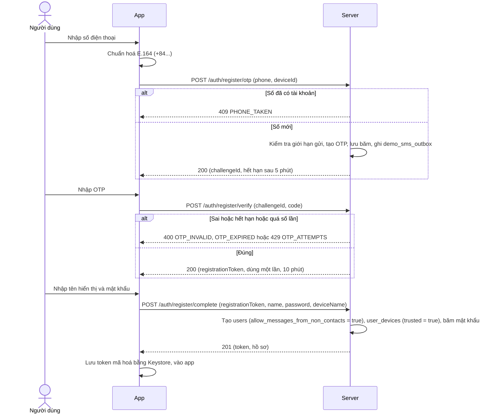
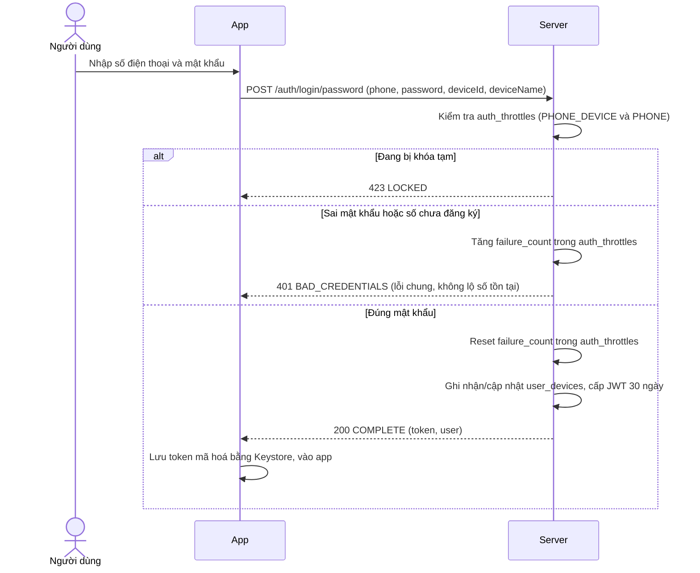
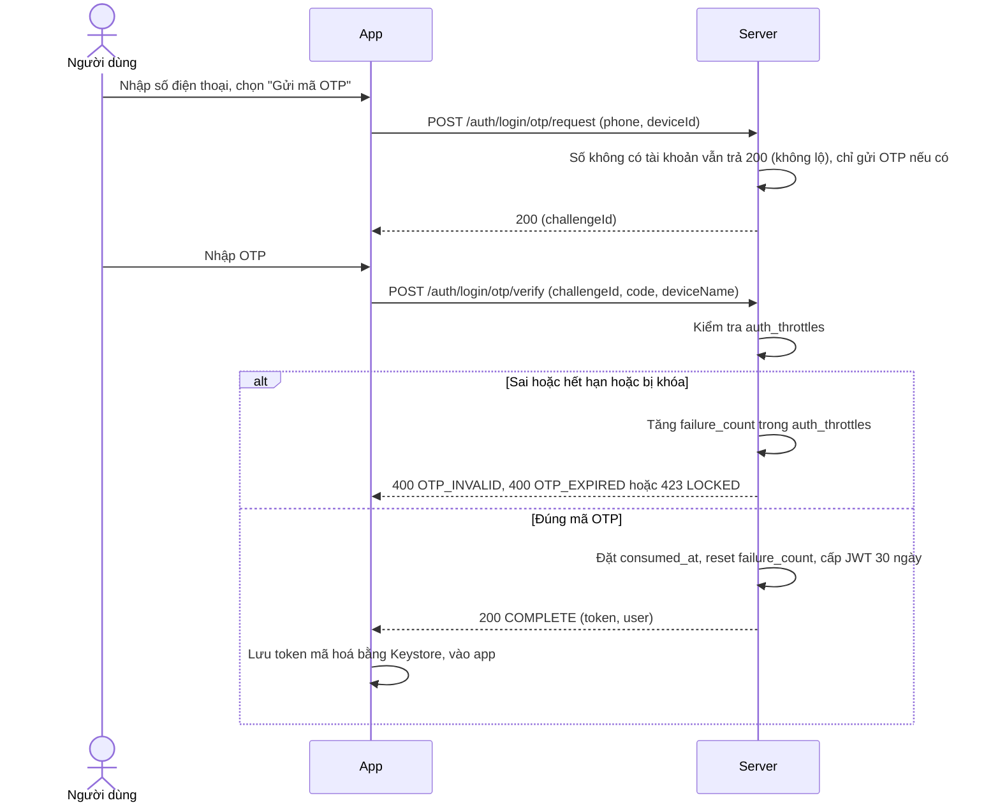
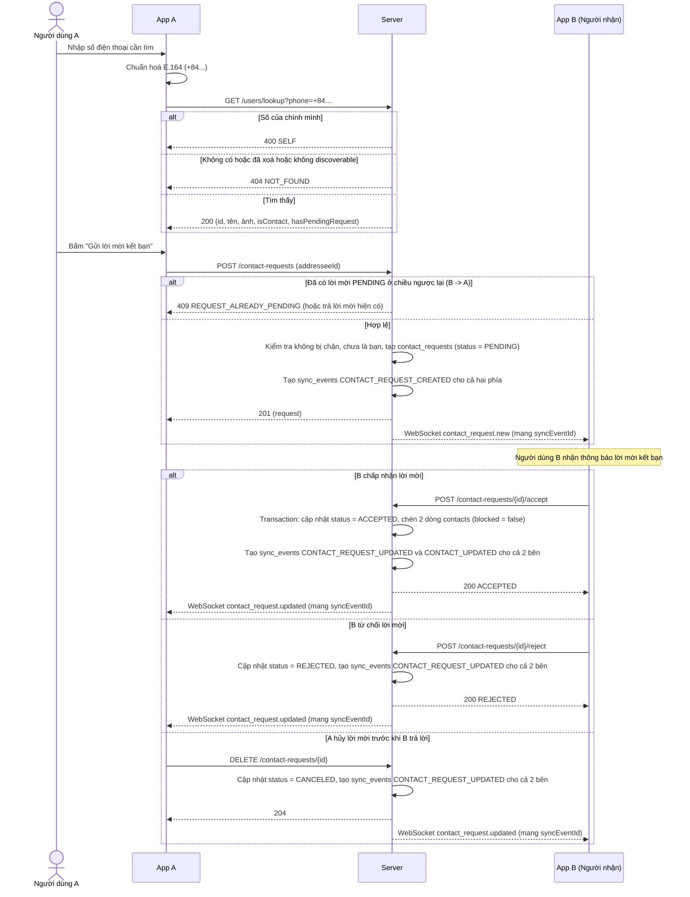
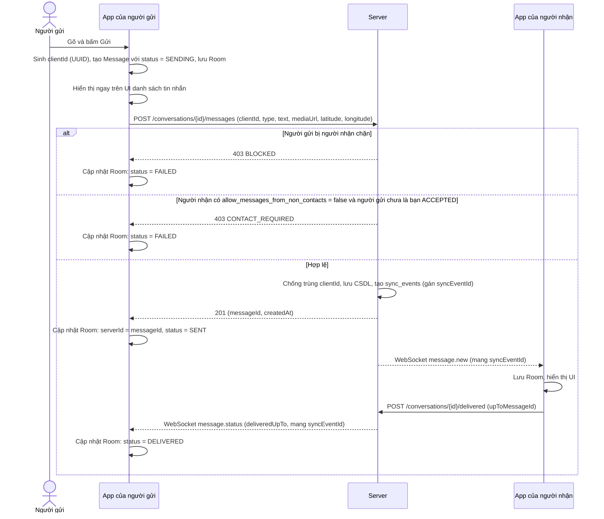
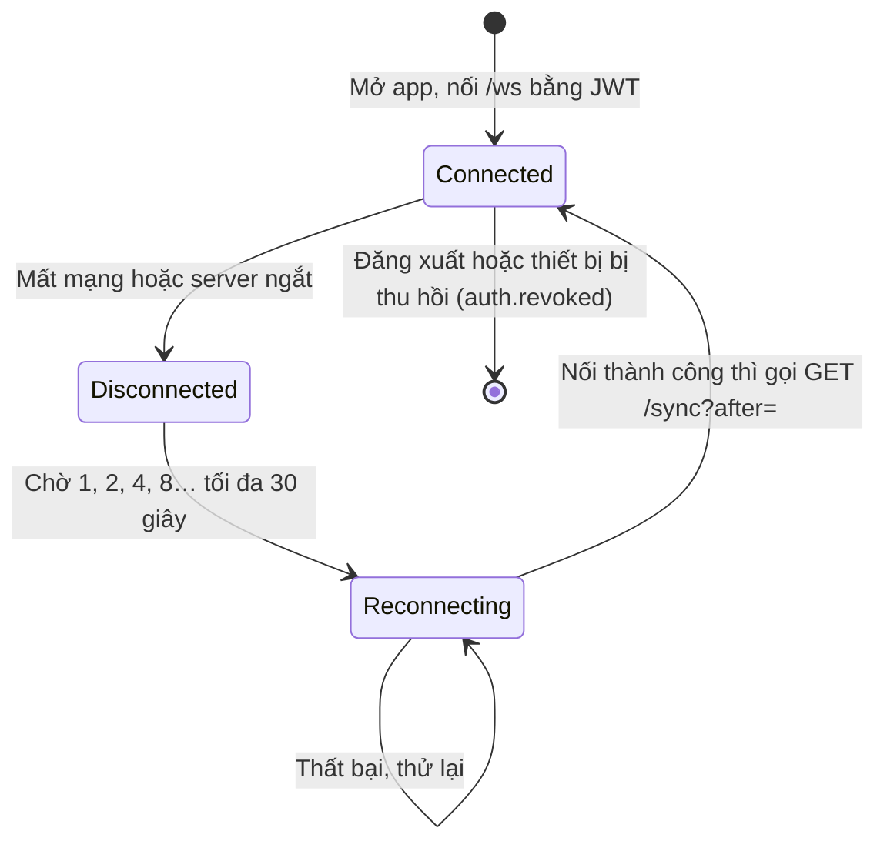
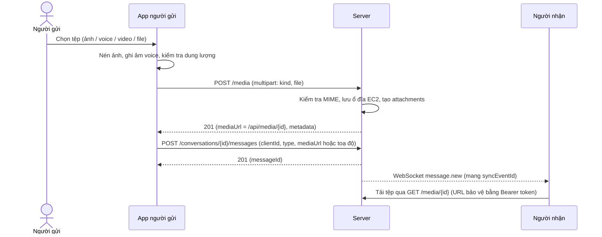
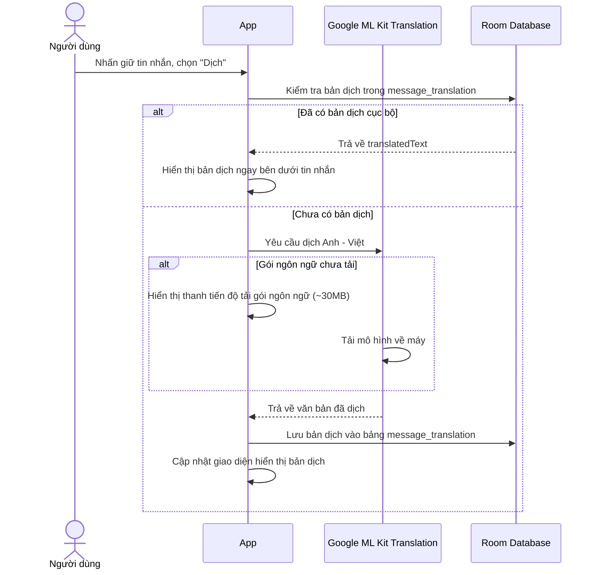
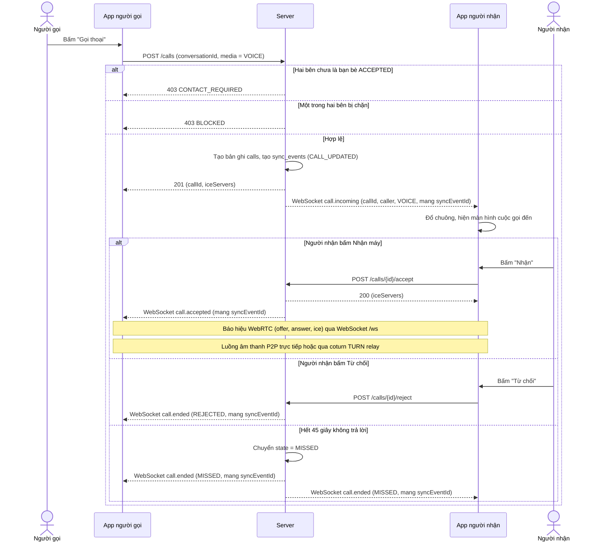
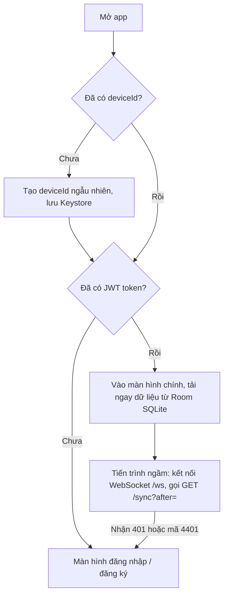

# UTEChat — Các luồng hoạt động (Flows)

> **Trạng thái:** ĐÃ CHỐT 2026-11-09, cập nhật chuẩn hóa V1 2026-11-10 (đổi qua pull request). Tài liệu này mô tả chi tiết các luồng hoạt động chính của hệ thống V1, làm căn cứ để cài đặt giao diện (Fragment, ViewModel), tầng dữ liệu (Repository, Room, Retrofit), hàng đợi nền (WorkManager) và logic server.
>
> [!NOTE]
> Các tính năng mở rộng V2 (xác thực 2FA TOTP, thử thách bạn bè, trợ lý ảo bot AI, cuộc gọi video) đã được đưa ra ngoài luồng triển khai V1 để tập trung tối đa vào 15 yêu cầu chuẩn Rubric.

---

## 1. Xác thực và tài khoản

### F-01 Đăng ký (ADR-001, ADR-002)

**Ràng buộc:** mật khẩu ≥ 8 ký tự. Tên hiển thị 1 đến 50 ký tự. Kiểm tra dữ liệu ở cả hai đầu. **Lỗi cần xử lý:** số sai định dạng, mất mạng, OTP sai, hết hạn, quá số lần, gửi lại quá nhanh (đếm ngược 60 giây trên giao diện).

### F-02 Đăng nhập bằng mật khẩu (ADR-003)

**Quy tắc khóa chống Brute-force (`auth_throttles`):**
- **`PHONE_DEVICE`:** 5 lần sai mật khẩu cho cặp (SĐT, thiết bị) với `scope_key_hash = SHA-256(phone_e164 + ":" + device_id_hash)` thì khoá 15 phút cho riêng thiết bị đó.
- **`PHONE`:** Tổng 20 lần sai mỗi giờ cho một số điện thoại (bất kể thiết bị) thì khoá toàn tài khoản số đó 1 giờ để chống bot đổi deviceId liên tục.
- **Xử lý khi mất thiết bị:** Thiết bị mới có `deviceId` mới nên không bị kế thừa khóa của thiết bị cũ. Khóa `PHONE` bảo vệ tài khoản khỏi tấn công diện rộng. Người dùng sau khi đăng nhập lại có thể thu hồi thiết bị cũ bị mất qua `DELETE /account/devices/{id}`.

### F-03 Đăng nhập bằng OTP

### F-04 Quên và đặt lại mật khẩu

1. Nhập số điện thoại, gửi OTP với `purpose = PASSWORD_RESET` (số không có tài khoản vẫn trả 200 để tránh dò số).
2. Nhập đúng OTP: server trả `resetToken` dùng một lần, hiệu lực 10 phút.
3. Nhập mật khẩu mới (≥ 8 ký tự): `POST /auth/password-reset/complete` đổi mật khẩu, **thu hồi toàn bộ token của các thiết bị khác** (`token_valid_after = now`), cấp token mới cho thiết bị hiện tại.

### F-05 Quản lý thiết bị

- `GET /account/devices`: xem danh sách thiết bị kèm thời gian hoạt động gần nhất (`lastSeenAt`) và đánh dấu thiết bị hiện tại (`current`).
- `DELETE /account/devices/{id}`: thu hồi một thiết bị khác (hữu ích khi mất máy). Thiết bị đó nhận WebSocket `auth.revoked` (mang `syncEventId`, nếu đang nối) hoặc nhận `401` ở yêu cầu tiếp theo và bị đưa về màn hình đăng nhập.

### F-06 Đăng xuất

- `POST /auth/logout`: server đặt `token_valid_after = now` cho thiết bị này, đóng kết nối WebSocket.
- App xoá token trong Keystore/SharedPreferences, chuyển về màn hình đăng nhập.

### F-07 Token hết hạn hoặc bị thu hồi

`AuthInterceptor` bắt mã `401` từ bất kỳ request REST nào:
1. Phát sự kiện `SessionEvents.notifyExpired()`.
2. App xoá token đã lưu, đóng WebSocket.
3. Điều hướng về màn hình đăng nhập và hiển thị thông báo "Phiên đăng nhập đã hết hạn hoặc thiết bị đã bị đăng xuất".

### F-08 Hồ sơ cá nhân và Quyền riêng tư

- **Xem hồ sơ:** `GET /me` trả về thông tin cá nhân và cài đặt `allowMessagesFromNonContacts`.
- **Sửa hồ sơ & quyền riêng tư:** `PATCH /me` cập nhật tên hiển thị, avatar URL, trạng thái khám phá `discoverable`, và cờ `allowMessagesFromNonContacts` (cho phép/chặn người lạ nhắn tin).
- **Đổi mật khẩu:** `POST /me/password` (nhập mật khẩu cũ và mới; thành công thu hồi token của mọi thiết bị khác).
- **Xoá tài khoản (Soft delete):** `DELETE /me` (nhập mật khẩu xác nhận). Server thu hồi mọi thiết bị, gỡ khỏi mọi nhóm, **xoá sạch toàn bộ dòng liên quan trong bảng `contacts` hai chiều** (`DELETE FROM contacts WHERE owner_id = :id OR contact_user_id = :id;`), giải phóng số điện thoại (`phone_e164 = NULL`) và đặt `status = DELETED`.

---

## 2. Danh bạ, lời mời kết bạn và chặn người dùng

### F-09 Lời mời kết bạn và quản lý danh bạ

**Quy tắc quản lý danh bạ và Semantics của `contacts`:**
- **Tìm kiếm:** Chỉ khớp chính xác số điện thoại E.164 (10 lượt/phút). Gửi lời mời kết bạn luôn được phép kể cả khi người nhận tắt quyền nhận tin từ người lạ.
- **Chống trùng ngược chiều:** Nếu A $\rightarrow$ B đang `PENDING`, B $\rightarrow$ A không được tạo mới; server trả về lời mời đang chờ hoặc mã lỗi 409 `REQUEST_ALREADY_PENDING`.
- **Bảng `contacts`:**
  - Dòng có `blocked = false`: Đại diện cho quan hệ bạn bè chính thức đã được chấp nhận (`ACCEPTED`). `GET /contacts` chỉ trả về các dòng này.
  - Dòng có `blocked = true`: Hành vi chặn một chiều. Có thể phát sinh khi chặn một người bạn bè, hoặc chặn một người lạ chưa từng kết bạn (dòng block-only).
- **Tải danh sách chặn:** `GET /contacts/blocked` trả về các dòng block-only và các quan hệ bạn bè đang bị chặn, để thiết bị mới có thể khôi phục danh sách chặn và người dùng có thể bỏ chặn.
- **Hành vi Unblock:** Nếu là dòng block-only người lạ, server xoá hẳn dòng khỏi `contacts`. Nếu hai người vốn là bạn bè trước đó, server cập nhật `blocked = false`.
- **Hủy kết bạn (Unfriend):** `DELETE /contacts/{userId}` xóa sạch quan hệ hai chiều trong cùng một transaction.

---

## 3. Nhắn tin cốt lõi và Offline-first

### F-10 Gửi tin khi có mạng (ADR-008, ADR-009)

**Quy tắc kiểm tra chính sách người lạ (`allowMessagesFromNonContacts`):**
- Server kiểm tra chính sách khi: `POST /conversations/direct` và `POST /conversations/{id}/messages`.
- Nếu người gửi bị người nhận chặn, yêu cầu gửi tin bị từ chối với HTTP 403 `BLOCKED`.
- Nếu không bị chặn nhưng người nhận đã tắt quyền này (`false`) và người gửi chưa có quan hệ bạn bè `ACCEPTED`, yêu cầu gửi tin bị từ chối với HTTP 403 `CONTACT_REQUIRED`.
- Nếu cài đặt này bị tắt sau khi cuộc hội thoại 1-1 đã được mở từ trước, các tin nhắn tiếp theo từ người chưa kết bạn vẫn phải bị từ chối với `CONTACT_REQUIRED`.

### F-11 Gửi tin khi mất mạng (Hàng đợi offline WorkManager)

- Một chuỗi duy nhất tên `send-messages` (`enqueueUniqueWork`, `ExistingWorkPolicy.APPEND_OR_REPLACE`) để đảm bảo mọi tin gửi **đúng thứ tự**.
- `SendMessageWorker` chỉ nhận `clientId`, trả `success` hoặc `retry`, `MAX_ATTEMPTS = 3`. Ràng buộc `NetworkType.CONNECTED`, backoff lũy tiến bắt đầu từ 10 giây.
- Khi có mạng lại, hàng đợi tự động chạy tuần tự và server chống trùng nhờ `clientId`.
- Tin có đính kèm: upload file xong (F-18) mới gửi tin; nếu upload lỗi thì tin đánh dấu `FAILED`.

### F-12 Nhận tin và trạng thái đã nhận, đã đọc

- **Nhận khi đang nối:** Sự kiện `message.new` qua WebSocket (mang `syncEventId`). App ghi vào Room, cập nhật `lastSyncEventId`, UI tự động cập nhật qua LiveData.
- **Đã nhận (DELIVERED):** Khi app nhận tin (kể cả khi chưa mở hội thoại), gọi `POST /conversations/{id}/delivered`. Server nâng `last_delivered_message_id` và đẩy `message.status` (mang `syncEventId`) cho các thành viên khác. **Định nghĩa mốc:** `DELIVERED` nghĩa là *ít nhất một thiết bị của người nhận đã lưu thành công tin nhắn vào dữ liệu cục bộ*.
- **Đã đọc (READ):** Khi hội thoại đang mở trên màn hình và tin nhắn hiển thị, app gọi `POST /conversations/{id}/read`. Server nâng `last_read_message_id` và đẩy trạng thái. **Định nghĩa mốc:** `READ` nghĩa là *người nhận đã đọc tin nhắn trên ít nhất một thiết bị*.
- Luôn đảm bảo bất biến: `last_delivered_message_id >= last_read_message_id`.

### F-13 Chỉ báo đang nhập (Typing Indicator)

App gửi WebSocket `typing.start` khi người dùng bắt đầu gõ (giới hạn tối đa 1 lần mỗi 3 giây) và `typing.stop` khi dừng gõ hoặc gửi tin. Server chuyển tiếp cho các thành viên còn lại đang kết nối (không mang `syncEventId` vì không làm thay đổi trạng thái dữ liệu lưu trữ). Chỉ báo tự động tắt sau 5 giây nếu không nhận thêm tín hiệu.

### F-14 Mất kết nối, nối lại, đồng bộ (ADR-008)

**Quy chế đồng bộ (`GET /sync?after=<syncEventId>`):**
- Con trỏ đồng bộ duy nhất là `syncEventId` (lưu tại `sync_state.lastSyncEventId` trong Room).
- Server trả về danh sách các sự kiện `sync_events` có `id > syncEventId` liên quan đến người dùng: tin nhắn mới, cập nhật hội thoại, lời mời kết bạn, thay đổi danh bạ, cập nhật mốc đã nhận/đã đọc, thu hồi thiết bị.
- `nextCursor` là `syncEventId` lớn nhất trong đợt trả về. Nếu không có sự kiện mới, `nextCursor` giữ nguyên giá trị `after`.
- Client chỉ tăng con trỏ `lastSyncEventId` khi đã xử lý lưu trữ thành công sự kiện tương ứng. Xử lý sự kiện realtime từ WebSocket và sự kiện nhận bù từ `/sync` đều tuân thủ nguyên tắc **idempotent** (chống trùng lặp).
- `messages.id` **chỉ được dùng cho phân trang lịch sử tin nhắn** (`GET /conversations/{id}/messages?before=<messageId>`), tuyệt đối không dùng làm cursor đồng bộ.

---

## 4. Quản lý hội thoại nhóm

### F-15 Tạo nhóm

1. Người dùng chọn ≥ 2 người từ danh bạ bạn bè và đặt tên nhóm (1 đến 50 ký tự).
2. `POST /conversations/group (title, memberIds)`. Server kiểm tra: **chỉ những người dùng đã có quan hệ bạn bè `ACCEPTED` với người tạo mới được thêm vào nhóm**. Người lạ hoặc người chặn bị từ chối với lỗi 403 `CONTACT_REQUIRED` hoặc `BLOCKED`. Giới hạn nhóm tối đa 50 thành viên.

### F-16 Quản lý thành viên, rời nhóm, chuyển quản trị

- **Thêm thành viên:** `POST /conversations/{id}/members (userIds)`. Chỉ `ADMIN` được thêm, và chỉ thêm người đã kết bạn `ACCEPTED`. Thành viên mới chỉ xem tin nhắn từ mốc `visible_from_message_id`.
- **Xoá thành viên:** `DELETE /conversations/{id}/members/{userId}` (yêu cầu quyền `ADMIN`).
- **Rời nhóm:** Chính thành viên gọi `DELETE /conversations/{id}/members/{myUserId}`. Nếu là `ADMIN` duy nhất, phải chuyển quyền `ADMIN` cho thành viên khác trước khi rời.
- **Chuyển hoặc phân quyền quản trị:** `PUT /conversations/{id}/members/{userId}/role (role: ADMIN)`.
- Mọi thay đổi nhóm đều sinh `sync_events` `CONVERSATION_UPDATED` và đẩy WebSocket `conversation.updated` (mang `syncEventId`).

---

## 5. Tìm kiếm nội dung

### F-17 Tìm kiếm offline (ADR-016)

Tìm kiếm tin nhắn chạy hoàn toàn trên thiết bị thông qua bảng ảo Room SQLite FTS4 (`message_fts`).
- Cột `normalized_text` được chuẩn hóa tự động (loại bỏ dấu tiếng Việt kết hợp, đổi `đ/Đ` $\rightarrow$ `d`, chuyển chữ thường).
- Truy vấn tìm kiếm áp dụng cùng phép chuẩn hóa để hỗ trợ tìm kiếm cả tiếng Việt có dấu và không dấu tốc độ cao mà không cần kết nối mạng.

---

## 6. Đa phương tiện

### F-18 Gửi ảnh, voice, video, file, vị trí (ADR-011)

| Loại | Cách lấy | Giới hạn và xử lý |
|---|---|---|
| Ảnh | Photo picker hoặc camera | Nén về cạnh dài ≤ 1600 px, dung lượng ≤ 10 MB |
| Voice | `MediaRecorder` (`RECORD_AUDIO`) | ≤ 5 phút, dung lượng ≤ 10 MB. Tệp `.m4a` (AAC) |
| Video | Photo picker | Dung lượng ≤ 50 MB. Phát bằng trình phát trong app (`Media3 ExoPlayer`). Khi chọn mở bằng ứng dụng ngoài: app tải file về bộ nhớ tạm bằng token rồi chia sẻ `content://` qua `FileProvider` kèm cờ `FLAG_GRANT_READ_URI_PERMISSION` (tuyệt đối không đưa JWT vào URL) |
| File | Trình chọn file hệ thống | Dung lượng ≤ 25 MB, MIME nằm trong danh sách cho phép |
| Vị trí | `FusedLocationProviderClient` | Một lần toạ độ `(lat, lng)`, hiển thị bản đồ `SupportMapFragment` |

---

## 7. Thông báo và Dịch tin nhắn

### F-19 Chính sách thông báo tin mới (ADR-012)

- V1 **không dùng Firebase Cloud Messaging (FCM)**. FCM được quy hoạch cho Future/V2.
- **Khi ứng dụng đang mở hoặc WebSocket đang kết nối:** Thông báo hiển thị tức thời qua `NotificationChannel` (`messages`) với quyền `POST_NOTIFICATIONS` trên Android 13+.
- **Khi ứng dụng ở nền và WebSocket bị ngắt:** `PeriodicWorkRequest` (chu kỳ tối thiểu 15 phút của WorkManager) định kỳ gọi `GET /api/sync?after=<lastSyncEventId>` và phát thông báo theo cơ chế **best-effort** (không cam kết tức thời).
- **Khi ứng dụng bị người dùng hoặc hệ điều hành force-stop hoàn toàn:** Hệ thống Android đình chỉ mọi tác vụ nền của ứng dụng, do đó **không cam kết nhận được thông báo ngay lập tức** cho đến khi người dùng khởi động lại ứng dụng.

### F-20 Dịch tin nhắn offline on-device (ADR-014)

---

## 8. Cuộc gọi thoại WebRTC 1-1

### F-21 Cuộc gọi thoại (ADR-013)

### F-22 Cuộc gọi nhỡ

Khi cuộc gọi kết thúc ở trạng thái `MISSED`, `REJECTED`, `BUSY`, hoặc `FAILED`, server tự động chèn một tin nhắn loại `CALL` vào hội thoại để cả hai bên theo dõi lịch sử cuộc gọi.

---

## 9. Giao diện và Đa ngôn ngữ

### F-23 Ngôn ngữ, chế độ tối, xoay màn hình (ADR-021)

- **Ngôn ngữ:** Hỗ trợ tiếng Việt (`vi`) và tiếng Anh (`en`). Mọi chuỗi lưu trong `strings.xml`, không viết cứng trong mã nguồn.
- **Chế độ tối:** Theme Material 3 `DayNight`, tự động thích ứng với cấu hình hệ thống.
- **Xoay màn hình:** ViewModel và `SavedStateHandle` bảo toàn trạng thái cuộn, văn bản nháp và cuộc gọi đang diễn ra mà không bị gián đoạn.

---

## 10. Vận hành và Mở ứng dụng

### F-24 Triển khai và CI/CD (ADR-019)

CI/CD tự động kiểm thử và build bản phát hành qua GitHub Actions, kiểm tra endpoint `/api/health/ready` sau khi triển khai lên máy chủ AWS EC2.

### F-25 Mở hội thoại và tải lịch sử

1. Fragment chat nhận `conversationId` qua Safe Args, ViewModel quan sát `observeMessages(conversationId)` từ Room.
2. Gọi `GET /api/conversations/{id}/messages?limit=50` để lấy tin nhắn mới nhất và cập nhật vào Room.
3. Cuộn lên đầu danh sách để phân trang lịch sử: `GET /api/conversations/{id}/messages?before=<minMessageId>&limit=50`.

### F-26 Mở ứng dụng (Khởi động Offline-first)

---

## 11. Các quy tắc hệ thống xuyên suốt

### 11.1 Nhiều thiết bị cùng lúc
Một tài khoản có thể đăng nhập đồng thời trên nhiều thiết bị. Server quản lý kết nối WebSocket độc lập theo từng thiết bị.

### 11.2 Chặn và Bỏ chặn người dùng
- Chặn người lạ tạo một dòng `owner_id -> contact_user_id` với `blocked = true` (dòng block-only).
- Chặn bạn bè cập nhật dòng quan hệ đó thành `blocked = true`.
- Khi bị chặn: đối phương không thể tìm thấy số điện thoại (`404`), không thể gửi tin nhắn (`403 BLOCKED`), và không thể gọi điện cho người chặn (`403 BLOCKED`).
- Bỏ chặn (unblock): nếu là dòng block-only người lạ thì xoá dòng; nếu vốn là bạn bè thì đặt `blocked = false`.

### 11.3 Quyền xem tin trong nhóm
Thành viên mới chỉ xem được tin nhắn kể từ mốc thời gian gia nhập (`visible_from_message_id`).

### 11.4 Khóa chống dò (Bảng `auth_throttles`)
Kiểm soát tần suất thử sai theo `(scope_type, scope_key_hash, purpose)`:
- `PHONE_DEVICE`: Khóa theo cặp (SĐT, thiết bị) với `scope_key_hash = SHA-256(phone_e164 + ":" + device_id_hash)`. Ví dụ: 5 lần đăng nhập sai mật khẩu khóa 15 phút riêng trên thiết bị đó.
- `PHONE`: Khóa toàn tài khoản theo SĐT khi tổng số lần sai vượt ngưỡng lớn (20 lần/giờ) nhằm ngăn chặn kẻ tấn công đổi thiết bị liên tục.
- `DEVICE`: Khóa theo thiết bị.

### 11.5 Xóa tài khoản (Soft Delete)
Xóa mềm tài khoản thu hồi mọi thiết bị, gỡ khỏi các nhóm, **xóa sạch toàn bộ mọi dòng liên quan trong bảng `contacts` hai chiều** (kể cả dòng bạn bè và dòng block-only), giải phóng số điện thoại (`phone_e164 = NULL`) và đặt `status = DELETED`.

### 11.6 Xem OTP demo
Chỉ khả dụng ở profile `demo`: `GET /api/demo/sms?phone=` (kèm secret header) để lấy mã OTP phục vụ kiểm thử nhanh.
