# UTEChat — Các luồng hoạt động

> **Trạng thái:** ĐÃ CHỐT 2026-11-09 (đổi qua pull request). Mỗi luồng có mã `F-xx` để báo cáo, test và công việc dẫn chiếu. Luồng bám các ADR trong `ARCHITECTURE_DECISIONS.md`. Cột/bảng xem `ERD.md`, endpoint xem `API_CONTRACT.md`.

## Mục lục

| Nhóm | Luồng |
|---|---|
| Tài khoản và bảo mật | F-01 Đăng ký · F-02 Đăng nhập bằng mật khẩu · F-03 Đăng nhập bằng OTP · F-04 Bước nhận diện bạn bè · F-05 Bật 2FA · F-06 Tắt 2FA · F-07 Quên và đặt lại mật khẩu · F-08 Thiết bị · F-09 Đăng xuất · F-10 Token hết hạn hoặc bị thu hồi · F-11 Hồ sơ, đổi mật khẩu, xoá tài khoản |
| Danh bạ | F-12 Thêm bạn bằng số điện thoại |
| Khởi động | F-30 Mở app (lần đầu và các lần sau) |
| Chat | F-29 Mở hội thoại và tải lịch sử · F-13 Gửi tin khi có mạng · F-14 Gửi tin khi mất mạng (hàng đợi) · F-15 Nhận tin và trạng thái đã nhận, đã đọc · F-16 Đang nhập · F-17 Mất kết nối, nối lại, đồng bộ |
| Quy tắc chung | Mục 11: nhiều thiết bị, chặn, quyền xem lịch sử nhóm, khoá chống dò, xoá tài khoản, xem OTP demo |
| Nhóm | F-18 Tạo nhóm · F-19 Quản lý thành viên, rời nhóm, chuyển quản trị |
| Tìm kiếm | F-20 Tìm kiếm |
| Đa phương tiện | F-21 Gửi ảnh, voice, video, file, vị trí |
| Thông báo | F-22 Thông báo tin mới |
| Mở rộng | F-23 Dịch tin nhắn · F-24 Trợ lý AI · F-25 Gọi thoại · F-26 Cuộc gọi nhỡ |
| Giao diện | F-27 Ngôn ngữ, chế độ tối, xoay màn hình |
| Vận hành | F-28 Triển khai và CI/CD |

Quy ước lỗi chung: mọi lỗi trả `{ "error": { "code", "message" } }` (xem `API_CONTRACT.md`). Thông báo cho người dùng lấy từ chuỗi tài nguyên `en` và `vi`, không viết cứng.

---

## 1. Tài khoản và bảo mật

### F-01 Đăng ký (ADR-001, ADR-002)

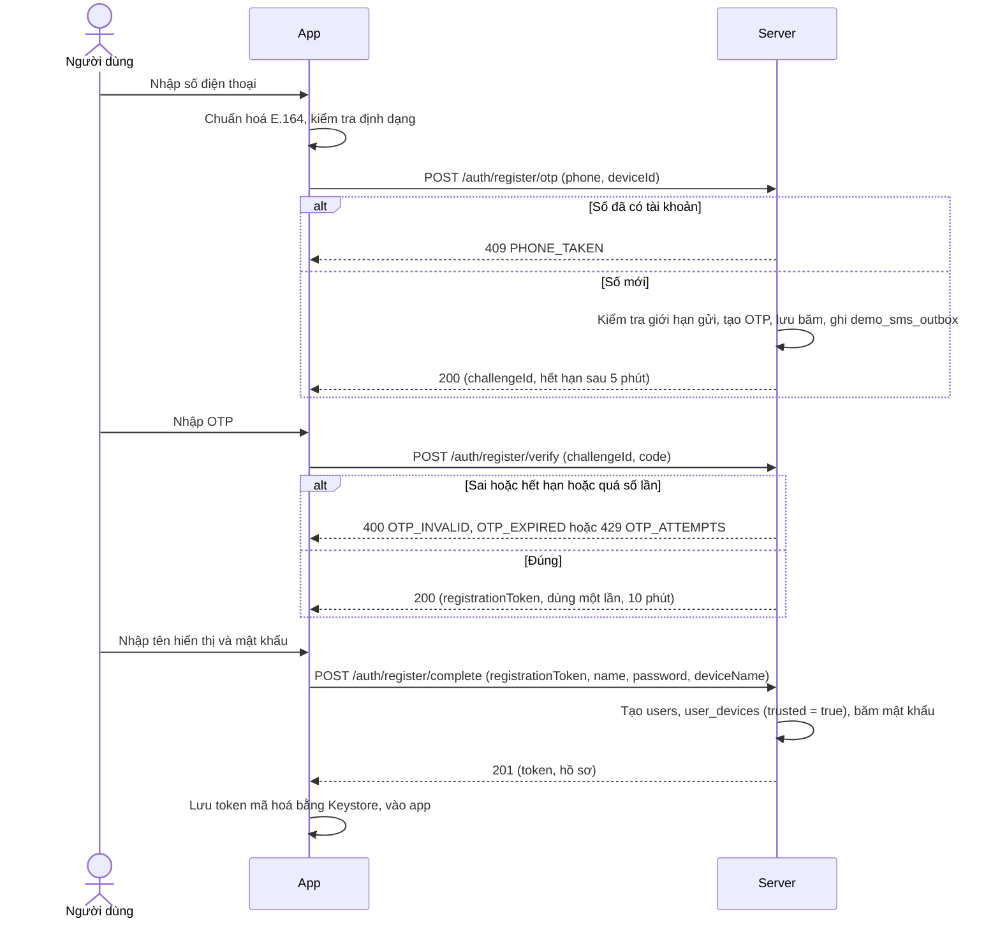

**Ràng buộc:** mật khẩu ≥ 8 ký tự. Tên hiển thị 1 đến 50 ký tự. Kiểm tra dữ liệu **ở cả hai đầu**. **Lỗi cần xử lý:** số sai định dạng, mất mạng, OTP sai, hết hạn, quá số lần, gửi lại quá nhanh (đếm ngược 60 giây trên giao diện).

### F-02 Đăng nhập bằng mật khẩu (ADR-003)

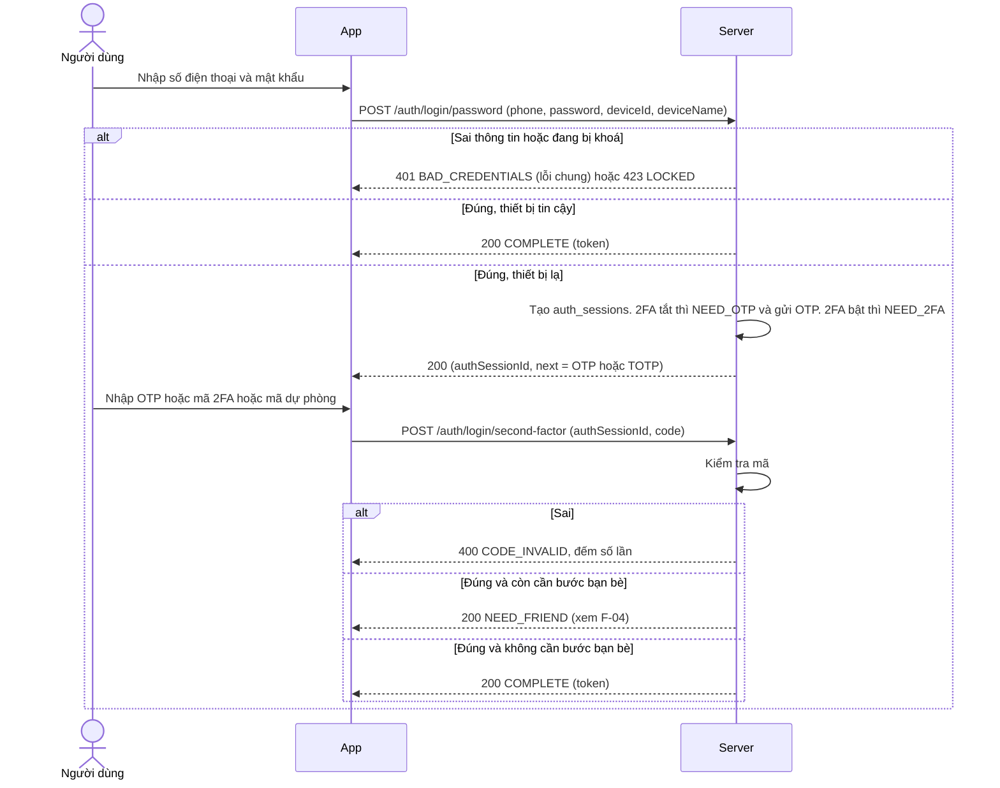

**Quy tắc khoá:** 5 lần sai mật khẩu cho một (số điện thoại, thiết bị) thì khoá 15 phút, **và** tổng 20 lần sai mỗi giờ cho một số điện thoại (bất kể thiết bị) thì khoá số đó 1 giờ, để kẻ đổi `deviceId` liên tục không né được. Thông báo lỗi sai thông tin **không lộ** số có tồn tại hay không.
**Gửi lại OTP** trong bước này: `POST /auth/login/second-factor/resend` (cùng giới hạn gửi OTP).

### F-03 Đăng nhập bằng OTP

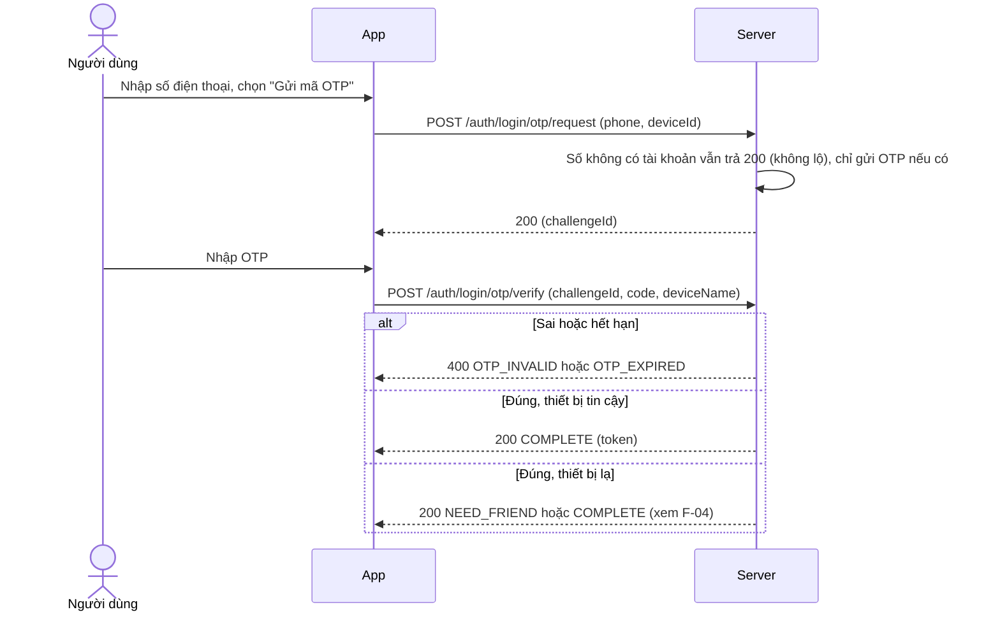

OTP đăng nhập là **đủ** ở cả thiết bị lạ, kể cả khi tài khoản bật 2FA (đã chốt). Riêng bước bạn bè (F-04) áp dụng cho thiết bị lạ.

### F-04 Bước nhận diện bạn bè (ADR-005)

Áp dụng sau khi qua OTP hoặc 2FA trên **thiết bị lạ**.

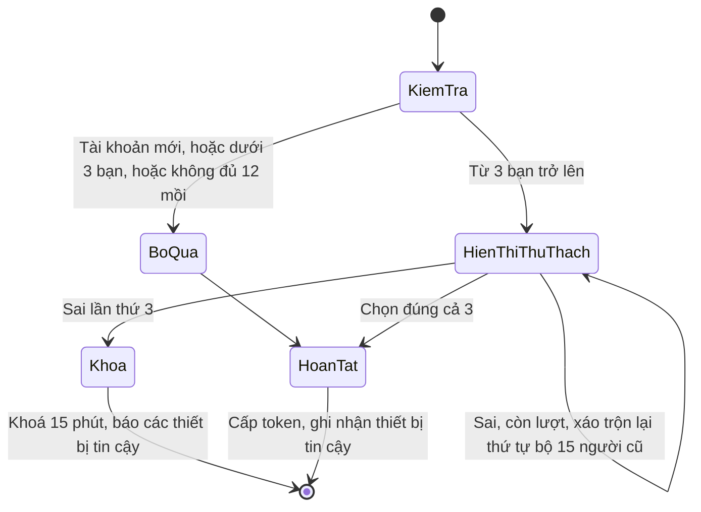

**Cách sinh bộ 15 người:** chọn ngẫu nhiên 3 bạn thật (ưu tiên người đã nhắn tin), thêm 12 mồi (người dùng khác: không phải bạn, không bị chặn, không phải bot, `discoverable = true`, không phải tài khoản đã xoá), trộn ngẫu nhiên, chỉ trả `id` và tên hiển thị. Đáp án lưu bản băm. **Chống tấn công giao thoa (intersection attack):** Toàn bộ 15 ứng viên (3 bạn thật + 12 mồi) và 3 đáp án được tái sử dụng và giữ cố định trong suốt cửa sổ hiệu lực (15 phút) của tài khoản/cửa sổ chống dò (đồng bộ với ERD.md). Mỗi lần sai chỉ xáo trộn lại thứ tự hiển thị và tăng `attempts_used` (tối đa 3 lần). Thông báo sai không nói đúng bao nhiêu người.
**Lỗi và biên:** hết hạn bộ thì yêu cầu bộ mới (không tính là lần thử). Phiên `auth_sessions` hết hạn sau 10 phút thì đăng nhập lại từ đầu.

### F-05 Bật 2FA (ADR-004)

1. Người dùng vào Cài đặt, Bảo mật, **Bật xác thực hai lớp**. Server yêu cầu nhập lại **mật khẩu**.
2. `POST /account/2fa/setup` tạo khoá bí mật, lưu `totp_credentials` (chưa xác nhận), trả đường dẫn `otpauth://totp/UTEChat:+84…?secret=…&issuer=UTEChat`.
3. App hiện mã QR (ZXing) và khoá để nhập tay. Người dùng quét bằng ứng dụng authenticator.
4. Người dùng nhập thử một mã. `POST /account/2fa/enable` kiểm tra (cho lệch ±1 nhịp, chống dùng lại bằng `last_used_step`).
5. Đúng thì `confirmed_at` được đặt, `users.two_factor_enabled = true`, server trả **8 mã dự phòng** (chỉ hiện một lần). Người dùng phải bấm xác nhận đã lưu.

### F-06 Tắt 2FA

Người dùng nhập **mật khẩu** và **một mã 2FA hợp lệ** (hoặc một mã dự phòng) rồi `POST /account/2fa/disable`. Xoá `totp_credentials` và `backup_codes`, đặt `two_factor_enabled = false`.

### F-07 Quên và đặt lại mật khẩu

1. Nhập số điện thoại, gửi OTP với `purpose = PASSWORD_RESET` (số không có tài khoản vẫn trả 200).
2. Nhập OTP đúng thì nhận `resetToken` một lần.
3. Nhập mật khẩu mới. Server cập nhật mật khẩu và **thu hồi mọi thiết bị** khác (đặt `revoked_at` và `token_valid_after`, đóng WebSocket).
4. Sau đó **đi tiếp như đăng nhập bằng OTP (F-03)**: thiết bị đang dùng mà là thiết bị lạ thì vẫn phải qua **bước bạn bè (F-04)**. Nếu không, kẻ chỉ cần OTP có thể đi đường "quên mật khẩu" để né bước bạn bè.

### F-08 Thiết bị

- `GET /account/devices` liệt kê thiết bị (tên máy, lần dùng gần nhất, đang dùng hay không).
- `DELETE /account/devices/{id}` thu hồi: đặt `revoked_at` và `token_valid_after = now`, gửi WebSocket `auth.revoked` rồi đóng kết nối. Token của thiết bị đó bị từ chối **ngay** ở yêu cầu kế tiếp (server kiểm tra mốc này ở mỗi yêu cầu và khi nối WebSocket).
- Không được tự thu hồi thiết bị đang dùng bằng nút này (dùng đăng xuất).

### F-09 Đăng xuất

App gọi `POST /auth/logout`. Server đặt `token_valid_after = now` cho thiết bị đó nên token cũ bị từ chối (thiết bị **vẫn là thiết bị tin cậy**, đăng nhập lại không cần OTP). App xoá token, đóng WebSocket, xoá Room của người dùng (hoặc giữ nếu chọn "nhớ tài khoản", mặc định xoá), quay về màn hình đăng nhập. Nếu hàng đợi còn tin **chưa gửi**, app hỏi xác nhận trước ("Còn n tin chưa gửi sẽ bị mất").

### F-10 Token hết hạn hoặc bị thu hồi

Theo slide Session 5 và 6, **không có refresh token**. App gửi `Authorization: Bearer <token>` ở mọi yêu cầu qua `AuthInterceptor` (token đọc từ bộ nhớ, đã giải mã bằng Keystore một lần). Khi server trả `401` (token hết hạn 30 ngày, thiết bị bị thu hồi hoặc đã đăng xuất), `AuthInterceptor` gọi `SessionEvents.notifyExpired()`. App lắng nghe sự kiện này, **xoá token**, đóng WebSocket (không nối lại khi bị từ chối token) và đưa người dùng về màn hình đăng nhập (`popUpTo` hết back stack). WebSocket đóng với mã `4401` cũng đi theo đường này.

### F-11 Hồ sơ, đổi mật khẩu, xoá tài khoản

- **Sửa tên và ảnh đại diện:** `PATCH /me`. Ảnh chọn bằng photo picker (không cần quyền), nén, upload (F-21), gán `avatar_url`. Lỗi: ảnh quá lớn hoặc sai định dạng.
- **Đổi mật khẩu:** bắt buộc nhập mật khẩu cũ. Thành công thì thu hồi các thiết bị khác.
- **Đổi ngôn ngữ:** phía app (F-27).
- **Xoá tài khoản:** nhập mật khẩu để xác nhận. Xoá mềm theo `ERD.md` mục 3 (quy tắc 6).

---

## 2. Danh bạ

### F-12 Thêm bạn bằng số điện thoại

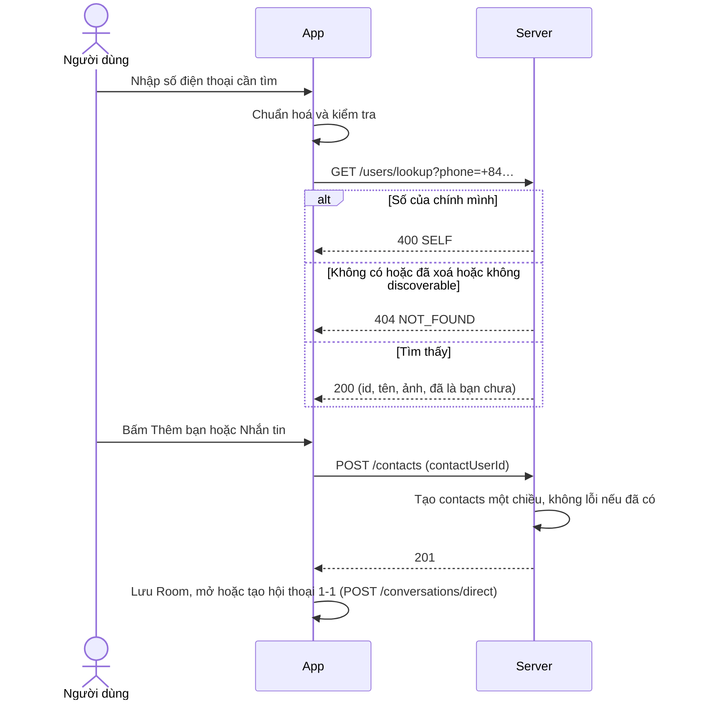

**Quy tắc:** chỉ khớp chính xác số điện thoại. Giới hạn 10 lượt tra mỗi phút mỗi người dùng (chống dò). Người bị chặn không thấy hồ sơ nhau. Có thể chặn và bỏ chặn (`blocked`).

---

## 3. Chat

### F-13 Gửi tin khi có mạng (ADR-008, ADR-009)

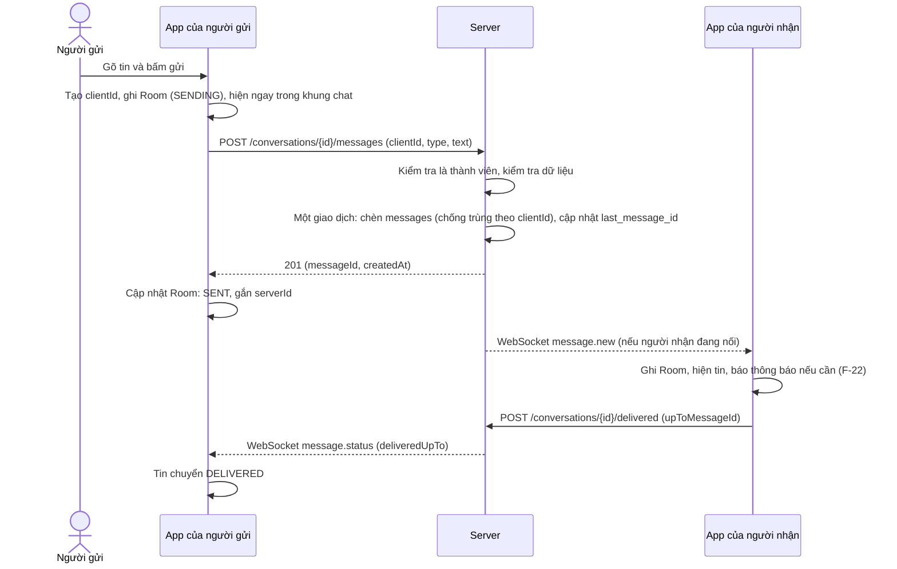

**Trạng thái tin của người gửi:** `SENDING → SENT → DELIVERED → READ`, hoặc `FAILED` (F-14). `DELIVERED` và `READ` suy ra từ mốc của người nhận (ADR-010).
**Gửi trùng:** server nhận lại cùng `clientId` thì trả cùng `messageId` và không tạo dòng mới.
**Bị chặn:** trong hội thoại 1-1, nếu người nhận đã chặn người gửi thì server trả `403 BLOCKED` và tin thành `FAILED`. Chặn không ảnh hưởng chat nhóm.
**Nhiều thiết bị:** `message.new` được đẩy tới **mọi thiết bị đang nối** của mọi thành viên, **kể cả các thiết bị khác của chính người gửi** (để máy kia cũng thấy tin mình vừa gửi).

### F-14 Gửi tin khi mất mạng (hàng đợi)

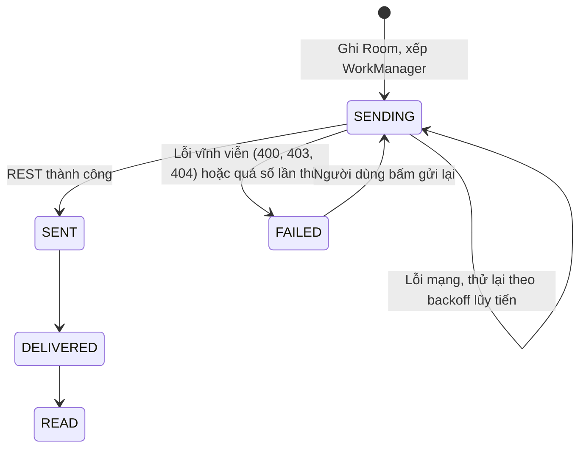

- **Một chuỗi duy nhất tên `send-messages`** (`enqueueUniqueWork`, `ExistingWorkPolicy.APPEND_OR_REPLACE`) để mọi tin gửi **đúng thứ tự**, như slide Session 5.
- `SendMessageWorker` chỉ nhận `clientId`, trả `success` hoặc `retry`, `MAX_ATTEMPTS = 3`. Ràng buộc `NetworkType.CONNECTED`, backoff lũy tiến (`EXPONENTIAL`) bắt đầu 10 giây.
- Việc chỉ mang `clientId`, nội dung đọc lại từ Room (kể cả sau khi app bị tắt).
- Khi có mạng lại, hàng đợi tự chạy và server chống trùng nhờ `clientId`.
- Tin có đính kèm: upload xong (F-21) mới gửi tin; nếu upload lỗi thì tin `FAILED`.

### F-15 Nhận tin và trạng thái đã nhận, đã đọc

- **Nhận khi đang nối:** `message.new` qua WebSocket. App ghi Room, UI tự cập nhật nhờ LiveData.
- **Đã nhận:** khi app nhận tin (dù chưa mở hội thoại), gọi `POST /conversations/{id}/delivered` với tin mới nhất. Server nâng `last_delivered_message_id` (không bao giờ giảm) và đẩy `message.status` cho các thành viên khác.
- **Đã đọc:** khi hội thoại đang mở trên màn hình và tin hiển thị, app gọi `POST /conversations/{id}/read`. Server nâng `last_read_message_id` và đẩy trạng thái. Số tin chưa đọc về 0.
- **Nhóm:** "đã đọc" khi mọi thành viên còn lại có mốc ≥ id tin, hoặc hiện số người đã xem.
- **Nhận qua đồng bộ:** tin nhận được qua `GET /sync` (lúc app vừa mở lại) cũng phải báo `delivered` như tin nhận qua WebSocket.
- **Nhiều thiết bị:** mốc là **theo người dùng**, không theo thiết bị. **Định nghĩa mốc:** `DELIVERED` nghĩa là *ít nhất một thiết bị của người nhận đã lưu thành công tin nhắn vào dữ liệu cục bộ*. `READ` nghĩa là *người nhận đã đọc tin nhắn trên ít nhất một thiết bị*. Đọc ở máy này thì máy kia cũng hết số chưa đọc (server đẩy `message.status` cho cả các thiết bị của chính người đó). Thiết bị khác đang tắt sẽ đồng bộ bù sau qua `GET /sync` mà không ảnh hưởng tới trạng thái đã xác nhận trước đó. Luôn đảm bảo `last_delivered_message_id >= last_read_message_id`.

### F-16 Đang nhập

App gửi WebSocket `typing.start` khi người dùng bắt đầu gõ (giới hạn 1 lần mỗi 3 giây) và `typing.stop` khi dừng hoặc gửi. Server chuyển tiếp cho các thành viên còn lại đang nối (không lưu). Chỉ báo tự tắt sau 5 giây không có tín hiệu mới.

### F-17 Mất kết nối, nối lại, đồng bộ (ADR-008)

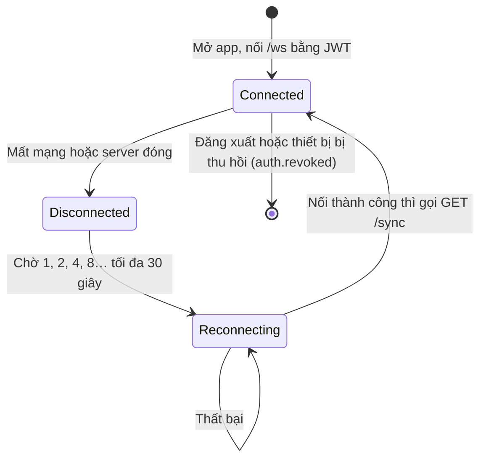

`GET /sync?after=<lastMessageId>` trả: (1) các tin có id lớn hơn con trỏ **trong khoảng người dùng được xem** (mục 11.3), (2) các hội thoại có thay đổi (nhóm mới, đổi tên, đổi thành viên: những thay đổi này luôn sinh tin `SYSTEM` nên không bị bỏ sót), (3) **mốc đã nhận/đã đọc hiện tại** của các thành viên trong mọi hội thoại của người dùng (mốc không sinh tin nên phải gửi trạng thái hiện tại). Kết quả nhiều thì phân trang bằng `nextCursor`. App gọi nó: (a) sau mỗi lần nối lại, (b) khi mở app, (c) trong tác vụ định kỳ WorkManager. Server trả `401` khi token sai và app chạy F-10.

---

## 4. Nhóm

### F-18 Tạo nhóm

1. Người dùng chọn ≥ 2 người từ danh bạ và đặt tên nhóm (1 đến 50 ký tự).
2. `POST /conversations/group (title, memberIds)`. Server kiểm tra: mỗi người **có trong danh bạ của người tạo** và **không chặn người tạo**, không phải bot, tài khoản còn hoạt động. Giới hạn nhóm tối đa **50 thành viên**. Thêm thành viên sau này dùng đúng quy tắc này.
3. Người tạo là `ADMIN`, những người còn lại `MEMBER`. Server chèn tin `SYSTEM` `GROUP_CREATED` và đẩy `conversation.updated` cho mọi thành viên.

### F-19 Quản lý thành viên, rời nhóm, chuyển quản trị

| Hành động | Ai được làm | Kết quả |
|---|---|---|
| Thêm thành viên | `ADMIN` | Thêm dòng `conversation_members`, tin `SYSTEM` `MEMBER_ADDED`. Người mới không thấy tin trước lúc vào |
| Xoá thành viên | `ADMIN` | Đặt `left_at`, tin `SYSTEM` `MEMBER_REMOVED`. Người bị xoá giữ tin cũ nhưng không nhận tin mới |
| Đổi tên nhóm | `ADMIN` | Tin `SYSTEM` `GROUP_RENAMED` |
| Cấp hoặc bỏ quyền quản trị | `ADMIN` | Tin `SYSTEM` `ADMIN_CHANGED` |
| Rời nhóm | Bất kỳ thành viên | Đặt `left_at`, tin `SYSTEM` `MEMBER_LEFT` |

**Thêm lại người đã rời:** đặt lại `left_at = NULL` và mở **khoảng xem mới** bắt đầu từ lúc được thêm lại (mục 11.3). Tin trong thời gian vắng mặt không xem được. Tin của lần tham gia trước vẫn còn trên máy họ nếu chưa xoá.
**Người bị xoá** nhận được đúng tin `SYSTEM` báo mình bị xoá (để app biết và khoá ô nhập), sau đó không nhận gì thêm.

**Quy tắc quản trị:** nếu quản trị viên **cuối cùng** rời đi, server tự nâng thành viên **vào nhóm sớm nhất** lên `ADMIN` trong cùng giao dịch. Nhóm không bao giờ không có `ADMIN` khi còn người. Nhóm hết người thì đánh dấu đã đóng. Tin `SYSTEM` lưu mã sự kiện và tham số, app dịch theo ngôn ngữ.

---

## 5. Tìm kiếm

### F-20 Tìm kiếm (ADR-016)

| Loại | Nơi chạy | Cách làm |
|---|---|---|
| Hội thoại và bạn bè theo tên | Room | `LIKE` trên `conversation.title` và `user_cache.displayName` |
| Tin nhắn trong một hội thoại hoặc toàn bộ | Room | Bảng FTS4 `message_fts`. Kết quả hiển thị hội thoại, đoạn trích có tô sáng từ khoá. Bấm kết quả thì mở hội thoại và **cuộn tới đúng tin** |
| Người mới | Server | `GET /users/lookup` chỉ theo số điện thoại chính xác (F-12) |

Gõ xong dừng khoảng 300 ms mới tìm (debounce). Có trạng thái "đang tìm", "không có kết quả". Tin chưa được tải về máy thì chưa tìm thấy (kéo lịch sử xuống để tải thêm).

---

## 6. Đa phương tiện

### F-21 Gửi ảnh, voice, video, file, vị trí (ADR-011)

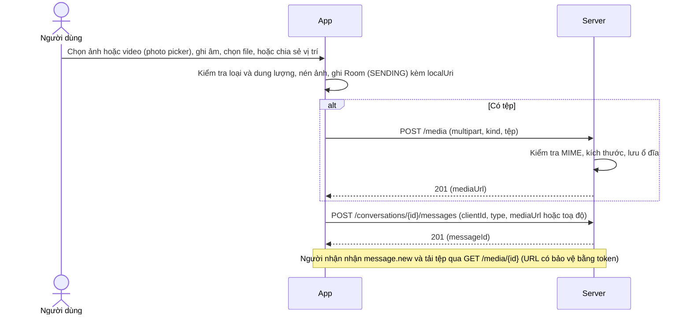

| Loại | Cách lấy | Giới hạn và ghi chú |
|---|---|---|
| Ảnh | Photo picker hoặc camera | Nén về cạnh dài ≤ 1600 px, ≤ 10 MB |
| Voice | `MediaRecorder` (xin quyền `RECORD_AUDIO` khi bấm ghi) | ≤ 5 phút, ≤ 10 MB. Chạm nhanh quá thì bỏ ("quá ngắn"). Luôn `release()` |
| Video | Photo picker | ≤ 50 MB. Phát bằng trình phát trong app (`Media3 ExoPlayer`). Khi chọn mở bằng ứng dụng ngoài: app tải file về bộ nhớ tạm rồi chia sẻ `content://` qua `FileProvider` kèm quyền đọc tạm thời, hoặc xin `ticket` tạm thời từ server (xem API_CONTRACT.md), tuyệt đối không đưa JWT vào URL |
| File | Trình chọn file hệ thống | ≤ 25 MB, MIME nằm trong danh sách cho phép |
| Vị trí | `FusedLocationProviderClient.getCurrentLocation` một lần, ưu tiên `BALANCED_POWER_ACCURACY`, **kiểm tra `null`**, huỷ ở `onDestroyView`. Xin quyền bằng `PermissionRequester` khi bấm chia sẻ (đồng ý quyền xấp xỉ là đủ) | Bấm vào tin vị trí mở **màn hình bản đồ** (`SupportMapFragment`, marker, Safe Args truyền toạ độ) kèm nút "Mở trong bản đồ" bằng `geo:`. Khoá Maps API trong `local.properties`, không commit |

Mất mạng giữa chừng: tin ở trạng thái `SENDING` và `attachment_transfer` giữ tiến độ, WorkManager thử lại. Từ chối quyền: tính năng đó báo lý do, phần còn lại của app vẫn dùng được.

---

## 7. Thông báo

### F-22 Thông báo tin mới (ADR-012)

1. Lần đầu (Android 13+) xin quyền `POST_NOTIFICATIONS`. Từ chối thì app vẫn chạy, chỉ không báo.
2. Có `NotificationChannel` `messages` (độ ưu tiên cao). Một thông báo gộp theo hội thoại.
3. Khi app nhận `message.new` mà hội thoại đó **không đang mở**, hiển thị thông báo (tên người gửi, đoạn tin, hoặc "Đã gửi một ảnh"). Hội thoại bị tắt tiếng (`muted`) thì không báo.
4. Bấm thông báo mở thẳng hội thoại đó (deep link bằng Navigation). `PendingIntent` dùng `FLAG_IMMUTABLE`.
5. Khi app bị hệ thống dừng: `WorkManager` định kỳ 15 phút gọi `/sync` và báo tin mới. **Không có tin tức thời khi app đã tắt hẳn** (cần FCM nếu muốn).

---

## 8. Mở rộng

### F-23 Dịch tin nhắn (ADR-014)

1. Nhấn giữ tin văn bản của người khác rồi chọn **Dịch**.
2. Nếu chưa có gói ngôn ngữ thì tải (hiện tiến độ, chỉ qua Wi-Fi nếu người dùng chọn).
3. ML Kit dịch trên máy sang ngôn ngữ app hiện tại. Bản dịch hiện **dưới tin gốc**, lưu `message_translation`. Có nút "Ẩn bản dịch".
4. Lỗi: gói chưa tải được, ngôn ngữ nguồn không nhận ra, tin quá dài (cắt hoặc báo).

### F-24 Trợ lý AI (ADR-015)

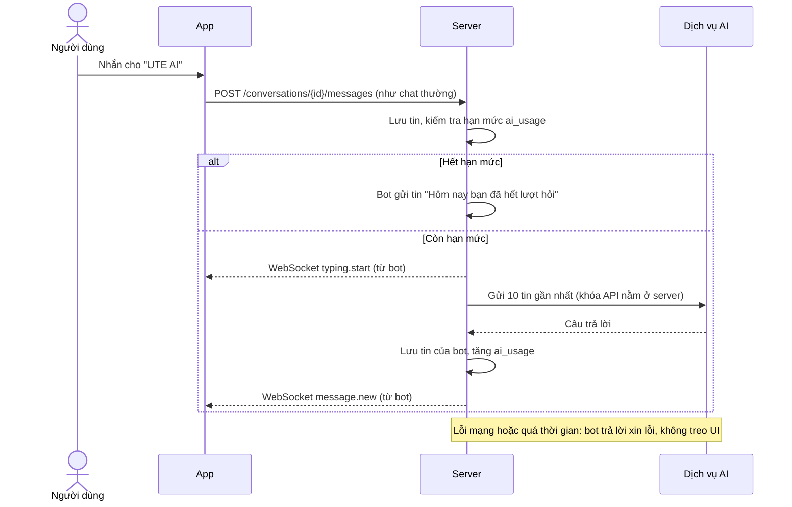

Bot là `users.is_bot`, không đăng nhập được, không bị coi là mồi trong F-04 và **không tính là "bạn"** khi đếm "từ 3 bạn" (đều loại `is_bot`). Hội thoại với bot có `type = BOT`, tạo khi người dùng mở bot lần đầu (`POST /conversations/direct` với id của bot). Bot không vào được nhóm. Tin gửi cho bot là ảnh, voice, file thì bot trả lời "Hiện mình chỉ đọc được tin văn bản". Tin gửi cho bot đi ra bên thứ ba và giao diện có dòng thông báo.

### F-25 Gọi thoại (ADR-013)

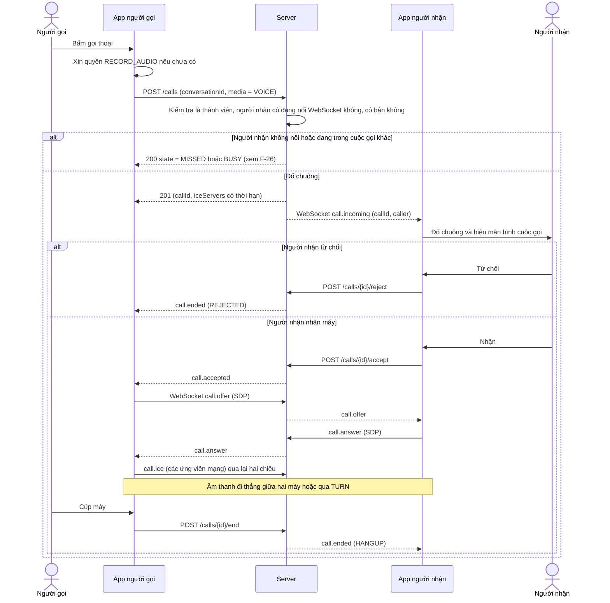

**Máy trạng thái cuộc gọi (phía server)**

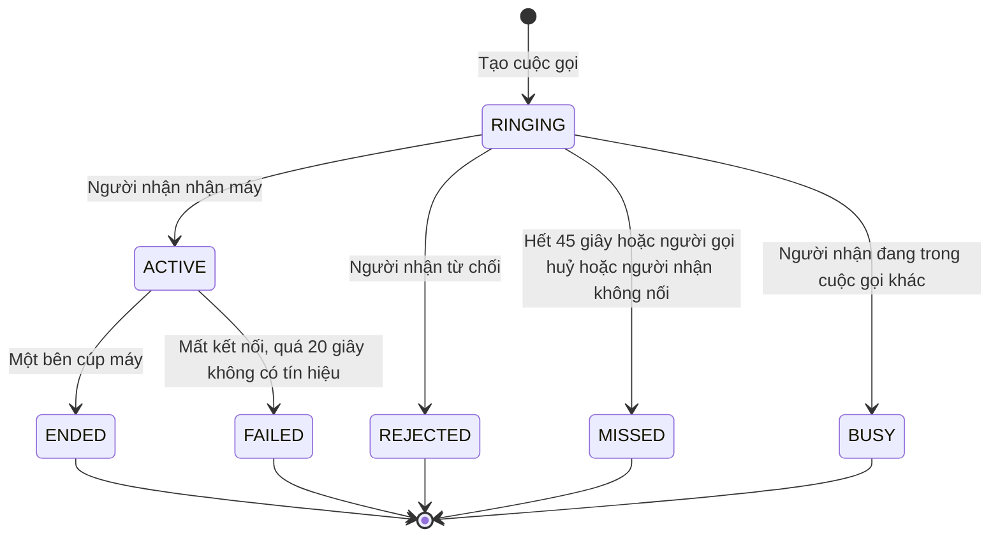

**Phạm vi:** chỉ gọi trong hội thoại 1-1 (`DIRECT`). Gọi trong nhóm hay gọi bot trả `400 CALL_UNSUPPORTED`. Người nhận đã chặn người gọi thì trả `403 BLOCKED`.
**Nhiều thiết bị:** `call.incoming` đổ chuông **mọi thiết bị đang nối** của người nhận. Thiết bị nào nhận máy trước thì thắng, các thiết bị còn lại nhận `call.handled_elsewhere` và tắt chuông.
**Trên màn hình:** đổ chuông, đang gọi, nút tắt mic, loa ngoài, cúp máy, đồng hồ thời lượng. Một người chỉ có **một cuộc gọi tại một thời điểm**. Cần dịch vụ foreground (kiểu `microphone`) khi đang gọi và app có thể ở nền. **Dự phòng khi demo:** nút `ACTION_DIAL` mở trình gọi điện thoại.

### F-26 Cuộc gọi nhỡ

Khi cuộc gọi kết thúc ở `MISSED`, `REJECTED`, `BUSY`, `FAILED` hoặc `ENDED`, server chèn một tin loại `CALL` vào hội thoại (kèm `call_id`) để cả hai thấy "Cuộc gọi nhỡ", "Cuộc gọi đã kết thúc 02:13", v.v. Người gọi thấy "Không trả lời", người nhận thấy "Cuộc gọi nhỡ". Bấm vào tin gọi lại.

---

## 9. Giao diện

### F-27 Ngôn ngữ, chế độ tối, xoay màn hình (ADR-021)

- **Ngôn ngữ:** mặc định theo hệ thống, chọn lại được trong Cài đặt (`en`, `vi`). Mọi chuỗi trong tài nguyên, không viết cứng. Thiếu chuỗi `vi` thì rơi về `en`.
- **Chế độ tối:** theme Material 3 `DayNight`, `values-night`. Kiểm tra mọi màn hình không có chữ biến mất.
- **Xoay màn hình:** Activity bị tạo lại. ViewModel giữ trạng thái. Nội dung đang gõ và vị trí cuộn được khôi phục (`SavedStateHandle`). Màn chat có layout `layout-land` hợp lý. Cuộc gọi đang diễn ra và upload đang chạy **không bị gián đoạn** khi xoay.
- **Trạng thái màn hình:** mọi màn hình danh sách đều có đủ ba trạng thái: đang tải, trống, lỗi (có nút thử lại).

---

## 10. Vận hành

### F-28 Triển khai và CI/CD (ADR-019)

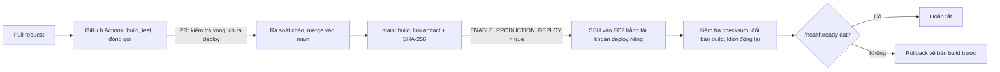

Rollback chỉ đổi bản build, **không hoàn tác migration**, nên bản cũ phải tương thích schema mới. Sao lưu CSDL Supabase trước khi chạy migration mới.

---

## 11. Luồng bổ sung và quy tắc xuyên suốt

### F-29 Mở hội thoại và tải lịch sử

1. Fragment chat nhận `conversationId` qua Safe Args, ViewModel quan sát `observeMessages(conversationId)` từ Room (hiện ngay những gì đã có).
2. Đồng thời gọi `refreshLatest` (`GET /conversations/{id}/messages?limit=50`) và ghi vào Room bằng `upsertByClientId`.
3. Cuộn lên gần đầu danh sách thì gọi `loadOlder` (`?before=<id nhỏ nhất đang có>`). Trả về ít hơn 50 tin nghĩa là hết lịch sử.
4. Tin hiển thị thì báo `read` (F-15). Thoát màn hình thì huỷ các việc đang chạy gắn với màn hình.
5. Lỗi mạng: **giữ danh sách đang có** và hiện Snackbar, không thay cả màn hình bằng lỗi (đúng slide Session 5).

### F-30 Mở app

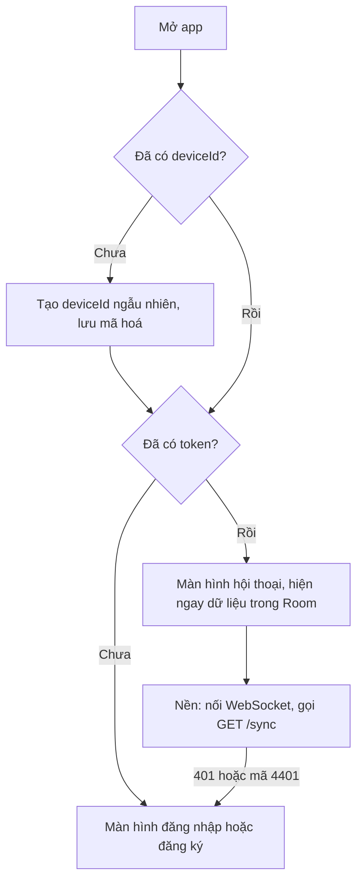

Có token thì **không chờ mạng** mới vào màn hình chính: dữ liệu cũ trong Room hiện ngay, mạng cập nhật sau (offline-first). Token chỉ bị coi là hỏng khi server trả `401`.

### 11.1 Nhiều thiết bị cùng lúc

Một tài khoản đăng nhập được trên **nhiều thiết bị tin cậy cùng lúc** (như Telegram). Server giữ danh sách kết nối WebSocket theo **thiết bị**. Tin mới, mốc đã đọc, thay đổi nhóm và cuộc gọi đến được đẩy tới mọi thiết bị đang nối. Mỗi thiết bị có hàng đợi gửi và Room riêng, đồng bộ qua `/sync`.

### 11.2 Chặn người dùng

| Tình huống | Kết quả |
|---|---|
| Người bị chặn tra số điện thoại của người chặn | `404` như không tồn tại |
| Người bị chặn nhắn trong hội thoại 1-1 | `403 BLOCKED` |
| Người bị chặn gọi | `403 BLOCKED` |
| Người bị chặn thêm người chặn vào nhóm | Bị từ chối |
| Cùng ở trong một nhóm có sẵn | Vẫn thấy tin của nhau trong nhóm |
| Bỏ chặn | Mọi thứ như cũ, tin bị từ chối lúc chặn **không** được gửi lại |

### 11.3 Quyền xem tin trong nhóm

Mỗi thành viên có một **khoảng được xem**: từ tin đầu tiên sau lúc được thêm (`visible_from_message_id`) tới tin báo mình rời hoặc bị xoá (nếu có). Server áp khoảng này cho **mọi** đường đọc tin: lịch sử, `/sync`, WebSocket, tải file đính kèm. Người ngoài khoảng nhận `403`.

### 11.4 Khoá chống dò

Mọi khoá tạm gắn với **tài khoản hoặc số điện thoại**, không gắn với phiên đăng nhập, để không thể né bằng cách bắt đầu đăng nhập lại:

| Khoá | Gắn với |
|---|---|
| Sai mật khẩu | (số, thiết bị) và (số) |
| Sai OTP | mỗi mã, cộng giới hạn gửi theo số |
| Sai mã 2FA | tài khoản |
| Sai bước bạn bè 3 lần | tài khoản (`users.friend_step_locked_until`) |

### 11.5 Xoá tài khoản

Xoá mềm: ẩn tên và ảnh (hiện "Tài khoản đã xoá"), thu hồi mọi thiết bị, rời mọi nhóm (chuyển quản trị nếu cần), xoá danh bạ hai chiều trong cùng giao dịch (`DELETE FROM contacts WHERE owner_id = :id OR contact_user_id = :id`), loại khỏi danh sách bạn/mồi khi tạo thử thách, và **giải phóng số điện thoại** (`phone_e164 = NULL`) để số đó đăng ký lại được thành tài khoản mới. Tin cũ vẫn còn trong hội thoại của người khác và tiếp tục trỏ UUID cũ (không nối quan hệ sang tài khoản mới đăng ký lại bằng số này).

### 11.6 Xem OTP demo

Chỉ ở profile `demo`: `GET /demo/sms?phone=` (kèm header khoá demo riêng, đặt bằng biến môi trường) trả các tin OTP gần nhất từ `demo_sms_outbox`. App bản debug có màn hình "Hộp thư SMS giả" gọi endpoint này. Bản release và profile `prod` **không có** endpoint và màn hình này.
