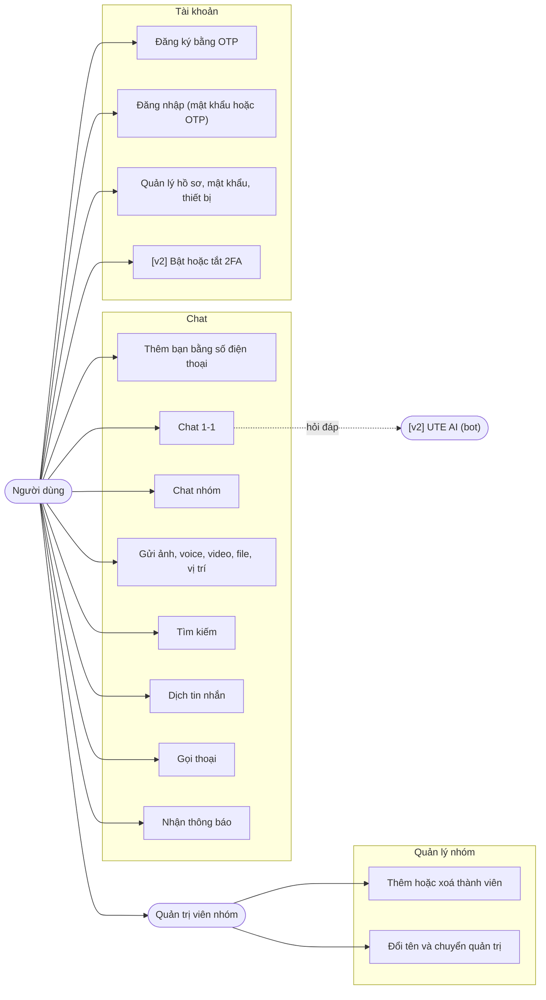

# UTEChat — Tài liệu thiết kế (chốt trước khi code)

> **Trạng thái:** **Kiến trúc và luồng hoạt động ĐÃ CHỐT ngày 2026-11-09** (người phụ trách xác nhận). Công nghệ và cấu hình còn các mục `PROPOSED`, đổi được mà không đổi kiến trúc hay luồng. Đây là bộ tài liệu thiết kế cho đồ án cuối kỳ "Ứng dụng Chat" (môn Lập trình di động Android). Tên "UTEChat" là tên tạm.
> **Thay đổi sau khi chốt:** mọi thay đổi kiến trúc, luồng, ERD hay hợp đồng API phải qua pull request và được người giữ hợp đồng chung duyệt.
> **Quy ước:** `ACCEPTED` là điều người phụ trách đã xác nhận. `PROPOSED` là đề xuất, **chờ nhóm duyệt**, có thể đổi trước khi code.

## 1. Các tài liệu

| File | Nội dung | Dùng để |
|---|---|---|
| [`ARCHITECTURE_DECISIONS.md`](ARCHITECTURE_DECISIONS.md) | Kiến trúc tổng thể và 24 quyết định (ADR) | Quyền cao nhất. Giải quyết mâu thuẫn |
| [`FLOWS.md`](FLOWS.md) | 30 luồng hoạt động (F-01 đến F-30) với sơ đồ trình tự và máy trạng thái, cộng quy tắc xuyên suốt (nhiều thiết bị, chặn, quyền xem nhóm, khoá chống dò, xoá tài khoản) | Biết hệ thống phải làm gì, từng bước |
| [`COURSE_ALIGNMENT.md`](COURSE_ALIGNMENT.md) | **Đối chiếu từng phần với slide Session 1 đến 7** và rubric: Khớp, Điều chỉnh, Mở rộng | Bảo đảm app bám tài liệu giảng dạy |
| [`ERD.md`](ERD.md) | ERD phía server, mô tả cột, ràng buộc, schema Room | Thiết kế CSDL, migration |
| [`API_CONTRACT.md`](API_CONTRACT.md) | REST, WebSocket, mã lỗi, giới hạn tần suất | Hợp đồng chung giữa app và server |

**Thứ tự ưu tiên khi các tài liệu khác nhau:** ADR > FLOWS > ERD > API_CONTRACT > code. Mâu thuẫn chưa có quyết định thì **dừng lại ghi nhận và hỏi**, không tự đoán.

Mọi sơ đồ dùng **Mermaid**, xem trực tiếp trên GitHub hoặc trong VS Code (cần tiện ích Mermaid). Chưa được kiểm tra hiển thị: xem mục 6.

**Bám tài liệu giảng dạy:** phần **app Android** dùng đúng công nghệ và mẫu code của slide (Java, View Binding, một Activity + Navigation + Safe Args, MVVM với LiveData, `AppExecutors`, Room, Retrofit + OkHttp + Gson, WebSocket OkHttp, WorkManager `send-messages`, Keystore, Espresso/Mockito/Fake). Chi tiết ở `COURSE_ALIGNMENT.md`, ADR-023 và ADR-024. Phần mở rộng ngoài slide (WebRTC, TOTP, ML Kit, bot AI, bước chọn bạn bè) đi qua cùng các lớp đó.

## 2. Phạm vi

**Bắt buộc theo rubric (100 điểm):** chat 1-1, chat nhóm, tìm kiếm, thêm bạn bằng số điện thoại, quản lý tài khoản, đa ngôn ngữ (en, vi), tin nhắn đa phương tiện và file (ảnh, voice, video, file, vị trí), xoay màn hình, chức năng sáng tạo, giao diện rõ ràng, unit test đạt toàn bộ, nộp bài đúng cấu trúc, thuyết trình và demo.

**Nhóm đã chọn cho v1 (bám sát Rubric 100đ):** đăng ký OTP demo, đăng nhập hai cách (mật khẩu và OTP), quản lý tài khoản & thiết bị, offline-first và hàng đợi gửi tin Room/WorkManager, chỉ báo đang nhập và mốc đã nhận/đã đọc (watermarks), thông báo tin mới, chế độ tối DayNight, cùng 2 tính năng sáng tạo song song (Gọi thoại 1-1 WebRTC ưu tiên chính, và Dịch tin nhắn on-device bằng Google ML Kit dự phòng an toàn).

**Tùy chọn mở rộng v2:** 2FA TOTP, bước nhận diện bạn bè trên thiết bị lạ, trợ lý ảo bot AI, cuộc gọi video (xem `ARCHITECTURE_DECISIONS.md`).

**Ngoài phạm vi:** xem `ARCHITECTURE_DECISIONS.md` mục 3.

## 3. Sơ đồ use-case

## 4. Quyết định nghiệp vụ đã chốt (2026-11-09)

| Mã | Quyết định |
|---|---|
| B-01 | Bước đăng ký báo rõ "số đã có tài khoản" (`409`), có giới hạn tần suất. Chấp nhận việc lộ số đã đăng ký, như Telegram |
| B-02 | Một tài khoản đăng nhập được trên **nhiều thiết bị cùng lúc** (FLOWS mục 11.1) |
| B-03 | Được nhắn tin cho người **không có trong danh bạ** nếu tìm được bằng số điện thoại. Tạo nhóm và thêm vào nhóm chỉ với người trong danh bạ |
| B-04 | Người được **thêm lại vào nhóm không xem được tin trong thời gian vắng mặt** (FLOWS mục 11.3) |

Cùng với các ADR `ACCEPTED`, luồng F-01 đến F-30 và quy tắc ở FLOWS mục 11, đây là phần kiến trúc đã chốt.

## 4b. Ma trận quyết định công nghệ v1 và định hướng v2

Toàn bộ các quyết định công nghệ cho v1 đã được chốt (`ACCEPTED`). Các tính năng nâng cao không bắt buộc trong Rubric đã được hoãn sang v2 (`DEFERRED_TO_V2`).

| Mã | Quyết định | Trạng thái v1 | Chi tiết kỹ thuật |
|---|---|---|---|
| D-01 | Back end | ✅ **ĐÃ CHỐT** (ADR-006) | Java (Spring Boot 3, Java 21), Spring Web, Spring Security (JWT), Spring Data JPA, Spring WebSocket thuần JSON (không STOMP) |
| D-02 | CSDL server | ✅ **ĐÃ CHỐT** (ADR-007) | Supabase PostgreSQL chỉ làm CSDL (mô hình M2), kết nối bằng JDBC/Flyway qua Transaction Pooler port 6543 |
| D-03 | Thông báo khi app đã tắt | ✅ **ĐÃ CHỐT** (ADR-012) | Không dùng FCM. Dùng `NotificationChannel` (`messages`) khi online, `WorkManager` định kỳ gọi `/api/sync` khi app ở nền |
| D-04 | Gọi trong app | ✅ **ĐÃ CHỐT v1** (ADR-013) | Thoại 1-1 bằng WebRTC qua WebSocket signaling, coturn trên EC2 có secondary IP để chiếm TCP 443 và UDP 3478/443 |
| D-05 | 2FA | ⏸️ **Hoãn v2** (ADR-004) | TOTP kèm mã dự phòng (thiết kế kiến trúc giữ nguyên, không triển khai ở v1) |
| D-06 | Dịch tin nhắn | ✅ **ĐÃ CHỐT v1** (ADR-014) | Dịch tin nhắn Anh–Việt bằng Google ML Kit Translation (chạy on-device sau khi tải gói ngôn ngữ lần đầu, lưu Room `message_translation`) |
| D-07 | Trợ lý AI | ⏸️ **Hoãn v2** (ADR-015) | Bot UTE AI phía server (thiết kế kiến trúc giữ nguyên, không triển khai ở v1) |
| D-08 | Lưu file | ✅ **ĐÃ CHỐT** (ADR-011) | Ổ đĩa EC2 qua Nginx bảo vệ Bearer token, tải về máy và mở ứng dụng ngoài bằng `FileProvider` (không dùng query ticket) |
| D-09 | Tìm kiếm tin nhắn | ✅ **ĐÃ CHỐT** (ADR-016) | Tìm kiếm tin nhắn cục bộ trên Room (bảng FTS4), tìm người dùng mới theo SĐT chính xác qua server |
| D-10 | Mã hoá đầu cuối | ✅ **ĐÃ CHỐT** (ADR-017) | Không dùng E2EE. Tin mã hoá khi truyền (HTTPS/WSS) và lưu bản rõ trên server như mô hình cloud chat |

**Thông tin vận hành và chuẩn bị triển khai:**

| Mục | Tình trạng | Giải pháp |
|---|---|---|
| **Hạn nộp và ngày Session 8** | Chờ lịch chính thức của trường | Kế hoạch 7 Phase tuần tự (Phase 1 → Phase 7) sẵn sàng thực thi linh hoạt |
| **Phân công 5 người** | Đã chốt mô hình phối hợp | Trưởng nhóm phụ trách Phase 1 (Database/Supabase) kiêm điều phối; các thành viên làm theo từng phase/mảng dựa trên hợp đồng chung |
| **Tên miền & AWS** | EC2 Ubuntu 24.04 chung | Cần cấu hình SSL/TLS (Let's Encrypt), secondary IP cho coturn (`turn.utechat.live`) |
| **Hợp đồng API & Schema** | ✅ Đã khóa cứng | `API_CONTRACT.md` (prefix `/api`) và `ERD.md` (10 bảng v1) là chuẩn duy nhất |

## 5. Kế hoạch bước tiếp theo

1. Toàn bộ các mục kiến trúc và công nghệ đã được chốt (`ACCEPTED`), các mục mở rộng (2FA, AI, Challenge) đã hoãn sang v2 (`DEFERRED_TO_V2`).
2. Người giữ hợp đồng chung khóa bản đầu của `ERD.md` (10 bảng v1 + 4 bảng v2) và `API_CONTRACT.md` (prefix `/api`).
3. Lập PLAN và thực thi **Phase 1: Hạ tầng Cơ sở Dữ liệu & Supabase** theo chuẩn GSD.
4. Lập PLAN và thực thi **Phase 2: Nền tảng Ứng dụng & Kiến trúc Chống Xung đột** (khung Retrofit, Room, fake repositories, walking skeleton).
5. Phân công các thành viên thực hiện các Phase chức năng tiếp theo (Phase 3: Auth & Profile, Phase 4: Contacts & Friends, Phase 5: Messaging & Realtime, Phase 6: Media, Calls & Creative, Phase 7: Testing & Release).
6. Viết báo cáo (use-case, class diagram, ERD đã có sẵn ở đây), ảnh chụp, xuất APK và diễn tập demo.

Class diagram sẽ vẽ **sau khi có khung code** (để bám sát lớp thật) và đưa vào báo cáo cùng ERD ở đây.

## 6. Giới hạn của bộ tài liệu này

- Là **bản thiết kế kiến trúc chuẩn**, làm căn cứ triển khai cho các Phase kế tiếp.
- Các sơ đồ Mermaid được kiểm tra cú pháp và hiển thị thống nhất.
- Các giới hạn (dung lượng file, số lần thử, thời gian hết hạn) đã được chuẩn hóa trong `API_CONTRACT.md`.
- Hai tính năng sáng tạo v1 (WebRTC và ML Kit Translation) sẽ được tích hợp và kiểm thử trong **Phase 6** với các thư viện: WebRTC (`io.getstream:stream-webrtc-android:1.1.4` hoặc `org.webrtc:google-webrtc:1.0.32006`) và ML Kit (`com.google.mlkit:translate:17.0.3`). Các thư viện TOTP và AI được chuyển sang v2.
- 15 yêu cầu v1 bám sát 100% chuẩn Rubric 10.0 của môn học (xem `COURSE_ALIGNMENT.md` và `.planning/REQUIREMENTS.md`).
