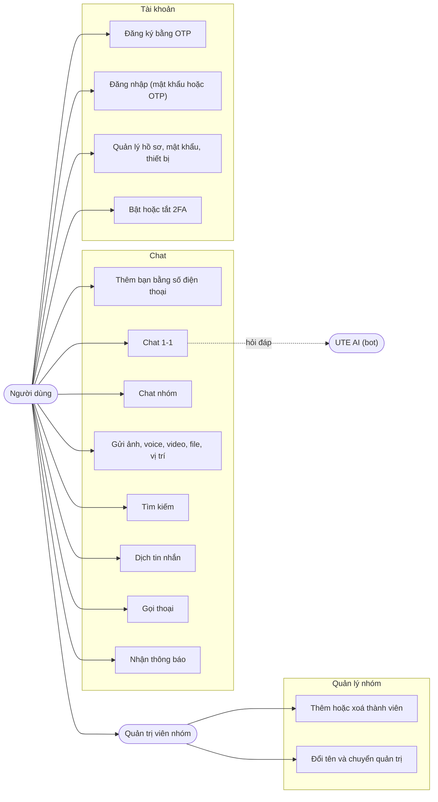

# UTEChat — Tài liệu thiết kế (chốt trước khi code)

> **Trạng thái:** **Kiến trúc và luồng hoạt động ĐÃ CHỐT ngày 2026-11-09** (người phụ trách xác nhận). Công nghệ và cấu hình còn các mục `PROPOSED`, đổi được mà không đổi kiến trúc hay luồng. Đây là bộ tài liệu thiết kế cho đồ án cuối kỳ "Ứng dụng Chat" (môn Lập trình di động Android). Tên "UTEChat" là tên tạm.
> **Thay đổi sau khi chốt:** mọi thay đổi kiến trúc, luồng, ERD hay hợp đồng API phải qua pull request và được người giữ hợp đồng chung duyệt.
> **Quy ước:** `ACCEPTED` là điều người phụ trách đã xác nhận. `PROPOSED` là đề xuất, **chờ nhóm duyệt**, có thể đổi trước khi code.

## 1. Các tài liệu

| File | Nội dung | Dùng để |
|---|---|---|
| [`ARCHITECTURE_DECISIONS.md`](ARCHITECTURE_DECISIONS.md) | Kiến trúc tổng thể và 24 quyết định (ADR) | Quyền cao nhất. Giải quyết mâu thuẫn |
| [`FLOWS.md`](FLOWS.md) | 30 luồng hoạt động (F-01 đến F-30) với sơ đồ trình tự và máy trạng thái, cộng quy tắc xuyên suốt (nhiều thiết bị, chặn, quyền xem nhóm, khoá chống dò, xoá tài khoản) | Biết hệ thống phải làm gì, từng bước |
| [`COURSE_ALIGNMENT.md`](COURSE_ALIGNMENT.md) | **Đối chiếu từng phần với slide Session 1 đến 7** và rubric: Khớp, Điều chỉnh, Mở rộng | Bảo đảm app bám tài liệu giảng dạy |
| [`ERD.md`](ERD.md) | ERD phía server, mô tả cột, ràng buộc, schema Room | Thiết kế CSDL, migration |
| [`API_CONTRACT.md`](API_CONTRACT.md) | REST, WebSocket, mã lỗi, giới hạn tần suất | Hợp đồng chung giữa app và server |

**Thứ tự ưu tiên khi các tài liệu khác nhau:** ADR > FLOWS > ERD > API_CONTRACT > code. Mâu thuẫn chưa có quyết định thì **dừng lại ghi nhận và hỏi**, không tự đoán.

Mọi sơ đồ dùng **Mermaid**, xem trực tiếp trên GitHub hoặc trong VS Code (cần tiện ích Mermaid). Chưa được kiểm tra hiển thị: xem mục 6.

**Bám tài liệu giảng dạy:** phần **app Android** dùng đúng công nghệ và mẫu code của slide (Java, View Binding, một Activity + Navigation + Safe Args, MVVM với LiveData, `AppExecutors`, Room, Retrofit + OkHttp + Gson, WebSocket OkHttp, WorkManager `send-messages`, Keystore, Espresso/Mockito/Fake). Chi tiết ở `COURSE_ALIGNMENT.md`, ADR-023 và ADR-024. Phần mở rộng ngoài slide (WebRTC, TOTP, ML Kit, bot AI, bước chọn bạn bè) đi qua cùng các lớp đó.

## 2. Phạm vi

**Bắt buộc theo rubric (100 điểm):** chat 1-1, chat nhóm, tìm kiếm, thêm bạn bằng số điện thoại, quản lý tài khoản, đa ngôn ngữ (en, vi), tin nhắn đa phương tiện và file (ảnh, voice, video, file, vị trí), xoay màn hình, chức năng sáng tạo, giao diện rõ ràng, unit test đạt toàn bộ, nộp bài đúng cấu trúc, thuyết trình và demo.

**Nhóm đã chọn cho v1 (bám sát Rubric 100đ):** đăng ký OTP demo, đăng nhập hai cách (mật khẩu và OTP), quản lý tài khoản & thiết bị, offline-first và hàng đợi gửi tin Room/WorkManager, chỉ báo đang nhập và mốc đã nhận/đã đọc (watermarks), thông báo tin mới, chế độ tối DayNight, cùng 2 tính năng sáng tạo song song (Gọi thoại 1-1 WebRTC ưu tiên chính, và Dịch tin nhắn on-device bằng Google ML Kit dự phòng an toàn).

**Tùy chọn mở rộng v2:** 2FA TOTP, bước nhận diện bạn bè trên thiết bị lạ, trợ lý ảo bot AI, cuộc gọi video (xem `ARCHITECTURE_DECISIONS.md`).

**Ngoài phạm vi:** xem `ARCHITECTURE_DECISIONS.md` mục 3.

## 3. Sơ đồ use-case

## 4. Quyết định nghiệp vụ đã chốt (2026-11-09)

| Mã | Quyết định |
|---|---|
| B-01 | Bước đăng ký báo rõ "số đã có tài khoản" (`409`), có giới hạn tần suất. Chấp nhận việc lộ số đã đăng ký, như Telegram |
| B-02 | Một tài khoản đăng nhập được trên **nhiều thiết bị cùng lúc** (FLOWS mục 11.1) |
| B-03 | Được nhắn tin cho người **không có trong danh bạ** nếu tìm được bằng số điện thoại. Tạo nhóm và thêm vào nhóm chỉ với người trong danh bạ |
| B-04 | Người được **thêm lại vào nhóm không xem được tin trong thời gian vắng mặt** (FLOWS mục 11.3) |

Cùng với các ADR `ACCEPTED`, luồng F-01 đến F-30 và quy tắc ở FLOWS mục 11, đây là phần kiến trúc đã chốt.

## 4b. Quyết định công nghệ đang chờ (để sau)

Những mục này mình đề xuất nhưng bạn và nhóm **chưa xác nhận**. Mỗi mục có phương án thay thế đã nêu trong ADR.

| Mã | Quyết định | Đề xuất | Thay thế | Ảnh hưởng nếu đổi |
|---|---|---|---|---|
| D-01 | Back end | Java (Spring Boot) hoặc Node.js, **nhóm chọn** (ADR-006) | Ngôn ngữ khác | Cách đóng gói, CI/CD, thư viện |
| D-02 | CSDL server | ✅ **Đã chốt M2:** server riêng + Supabase PostgreSQL chỉ làm CSDL (ADR-007) | — | — |
| D-03 | Thông báo khi app đã tắt | Không dùng FCM (ADR-012) | Thêm FCM | Thêm Firebase, mảng việc lớn |
| D-04 | Gọi trong app | Thoại 1-1 bằng WebRTC, tự dựng coturn (ADR-013) | SDK có sẵn, thêm video | Công sức, chi phí, phụ thuộc bên ngoài |
| D-05 | 2FA | TOTP kèm mã dự phòng (ADR-004) | Mật khẩu thứ hai | Giao diện, bảng dữ liệu |
| D-06 | Dịch tin nhắn | ML Kit trên máy (ADR-014) | API dịch của server | Chi phí, khoá API |
| D-07 | Trợ lý AI | Bot phía server, nhà cung cấp cắm được (ADR-015) | Bỏ | Công sức, chi phí |
| D-08 | Lưu file | Ổ đĩa EC2 (ADR-011) | S3 | Chi phí, tải xuống |
| D-09 | Tìm kiếm tin nhắn | Chỉ trên máy (ADR-016) | Có cả server | Công sức server |
| D-10 | Mã hoá đầu cuối | Không (ADR-017) | Có | Rất lớn, nên không |

**Thông tin còn thiếu, chưa có trong tài liệu:**

| Mục | Vì sao cần |
|---|---|
| **Hạn nộp và ngày Session 8** (xem LMS) | Để gắn mốc ngày cho kế hoạch |
| **Phân công 5 người** | Để chia lát cắt dọc và người giữ hợp đồng chung |
| **Nhà cung cấp AI và ai giữ tài khoản, hạn mức chi** | Cho ADR-015 |
| **Tên miền** cho HTTPS | Bắt buộc cho WSS và cuộc gọi trên thiết bị thật |
| **Ai giữ tài khoản AWS** | Cho ADR-019 |
| **Mô tả đồ án nhóm trên LMS** và có hay không **reference server hoặc đặc tả API** của giảng viên | Slide nhắc hai thứ này, mình chưa thấy (xem `COURSE_ALIGNMENT.md` mục 3) |

## 5. Kế hoạch bước tiếp theo

1. Nhóm đọc, góp ý, và chốt các mục `PROPOSED` ở mục 4.
2. Người giữ hợp đồng chung khoá bản đầu của `ERD.md` và `API_CONTRACT.md` (đóng băng, đổi qua pull request).
3. Chia việc: người phụ trách làm toàn bộ server và một mảng Android, bốn người còn lại chia các mảng Android (ADR-022).
4. Dựng khung chạy được: project Android rỗng, server rỗng, CSDL Supabase và migration, CI/CD, `/health/ready`, một tin nhắn đi từ app lên server và về lại ("walking skeleton").
5. Làm các mảng song song, rà soát chéo theo vòng.
6. Viết báo cáo (use-case, class diagram, ERD đã có sẵn ở đây), ảnh chụp, APK, diễn tập demo.

Class diagram sẽ vẽ **sau khi có khung code** (để bám sát lớp thật) và đưa vào báo cáo cùng ERD ở đây.

## 6. Giới hạn của bộ tài liệu này

- Là **bản nháp thiết kế**, chưa có dòng code nào chạy. Chưa kiểm thử bất kỳ luồng nào.
- Các sơ đồ Mermaid **chưa được kiểm tra hiển thị**. Nếu có sơ đồ nào hỏng, kiểm tra cú pháp Mermaid.
- Các giới hạn (dung lượng file, số lần thử, thời gian hết hạn, hạn mức AI) là **giá trị đề xuất**, điều chỉnh được.
- ML Kit, WebRTC, thư viện TOTP, nhà cung cấp AI và giá dịch vụ AWS **chưa được kiểm tra** phiên bản hiện hành.
- Rubric chỉ ghi tên chức năng, không có thang chi tiết, nên cách chia nhỏ yêu cầu là cách hiểu của mình.
