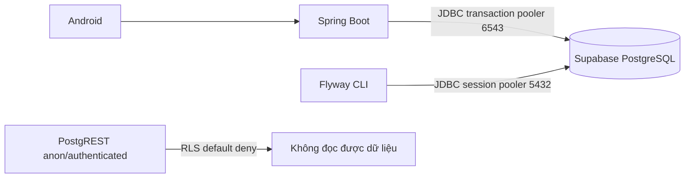

# UTEChat — Thiết lập Supabase

> **Trạng thái:** hướng dẫn và migration local sẵn sàng; chưa xác minh project Supabase thật.
> Nguồn thiết kế: [ERD](ERD.md), [ADR-007, ADR-020](ARCHITECTURE_DECISIONS.md).

## 1. Mô hình M2

Supabase chỉ cung cấp PostgreSQL. Spring Boot quản lý nghiệp vụ, phân quyền và transaction.
Android chỉ gọi REST/WSS của Spring Boot; không nhận Supabase key hay mật khẩu CSDL.
Dữ liệu nghiệp vụ có 13 bảng. Bảng `demo_sms_outbox` chỉ có ở môi trường demo.
`flyway_schema_history` là bảng kỹ thuật của Flyway, không tính vào 13 bảng.



## 2. Tạo project và lấy kết nối

1. Đăng nhập Supabase Dashboard, tạo project riêng cho đồ án.
2. Chọn Singapore (`ap-southeast-1`) nếu khả dụng. Đo độ trễ thực tế; không cam kết RTT.
3. Đặt mật khẩu CSDL ngẫu nhiên tối thiểu 16 ký tự, lưu trong trình quản lý mật khẩu.
4. Mở **Connect**, chọn Session pooler và Transaction pooler; sao chép chính xác hostname,
   username, database và port. Không suy đoán hostname từ tên vùng.
5. Sao chép `.env.example` thành `.env`, điền dữ liệu trên máy cá nhân.

> [!IMPORTANT]
> `.env` bị Git bỏ qua. Không dán nội dung file, mật khẩu, key hoặc JWT vào log/chat.
> Hai Supabase API key chỉ dùng cho chẩn đoán Data API; JDBC cần DB_USER/DB_PASSWORD,
> không dùng service-role key làm mật khẩu PostgreSQL.

## 3. Hai cổng kết nối

| Kết nối | Mục đích | Thiết lập |
|---|---|---|
| Session pooler 5432 | Flyway DDL, giữ session/advisory lock | TLS, FLYWAY_URL |
| Transaction pooler 6543 | JDBC runtime của Spring Boot/HikariCP | TLS, `prepareThreshold=0` |
| Direct 5432 (nếu mạng hỗ trợ) | Thay thế session pooler cho migration | Host/user riêng lấy từ Dashboard |

`prepareThreshold=0` tắt prepared statement phía server của PGJDBC khi dùng transaction pooling.
Port 6543 không giữ session giữa các transaction. Cấu hình pool Hikari nhỏ theo giới hạn gói,
không coi pooler là bảo đảm hàng nghìn kết nối ứng dụng.
Backend tích hợp sẵn Flyway trong `backend/pom.xml` để **tự động áp dụng `classpath:db/migration` (`V1`, `V3`, `V4`, ...) khi khởi động** qua `FLYWAY_URL` (Session pooler / Direct **5432**), tách biệt khỏi `SPRING_DATASOURCE_URL` runtime (Transaction pooler **6543**, `prepareThreshold=0`). Nếu `.env` thiếu `FLYWAY_URL`, `FlywaySessionPoolerConfig` tự chuyển cổng `:6543/` sang `:5432/` cho bước migration; có thể tắt bằng `FLYWAY_ENABLED=false`.

## 4. Row Level Security (RLS)

Migration bật Row Level Security trên 13 bảng core, không tạo policy.
V2 demo bật thêm RLS cho outbox. Với role `anon`/`authenticated`, RLS default deny
chặn đọc/ghi các dòng; không có nghĩa toàn bộ HTTP Data API bị tắt.
Role quản trị/owner hoặc BYPASSRLS vẫn truy cập được qua JDBC. Không dùng FORCE RLS
trong bộ migration này. Kiểm tra bằng SQL và request anon trên project đã có seed;
HTTP 200 với `[]` khi database rỗng chưa đủ chứng minh bảo mật.

## 5. Nạp biến môi trường và kiểm tra local

```powershell
Copy-Item .env.example .env
powershell -NoProfile -ExecutionPolicy Bypass -File backend/scripts/test-db-connection.ps1 -Quick
```

`-Quick` chỉ kiểm tra cấu hình mẫu, cú pháp và file local; PASS không có nghĩa đã kết nối Supabase.
`-Full` yêu cầu `.env` đã thay placeholder và kiểm tra TCP + HTTP PostgREST:

```powershell
powershell -NoProfile -ExecutionPolicy Bypass -File backend/scripts/test-db-connection.ps1 -Full -EnvFile .env
```

Spring Boot/Flyway CLI không tự đọc `.env`. Có thể nạp vào phiên PowerShell theo thứ tự
các biến trong file; đoạn dưới chỉ đọc dữ liệu, không thực thi nội dung file:

```powershell
Get-Content -LiteralPath .env | ForEach-Object {
    if ($_ -match '^([A-Z][A-Z0-9_]*)=(.*)$') {
        $name = $Matches[1]
        $value = $Matches[2]
        $value = [regex]::Replace($value, '\$\{([A-Z][A-Z0-9_]*)\}', {
            param($match)
            $resolved = [Environment]::GetEnvironmentVariable($match.Groups[1].Value)
            if ($null -eq $resolved) { throw 'Missing referenced environment variable' }
            $resolved
        })
        [Environment]::SetEnvironmentVariable($name, $value, 'Process')
    }
}
```

Không dùng `Invoke-Expression` hoặc `source` với file env.

## 6. Chạy migration

Backend đã tích hợp `flyway-core` + `flyway-database-postgresql` (`application.yml`: `locations=classpath:db/migration`, `baseline-on-migrate=true`, `baseline-version=1`, `ignore-migration-patterns="*:missing"`). Khi khởi động `BackendApplication` hoặc `LocalDevServer`, Flyway tự động kiểm tra và chạy các migration cấu trúc còn thiếu qua cổng 5432 (bao gồm nâng cấp an toàn từ DB cũ từng chạy tay `V1`/`V2` hoặc DB demo đã có bản ghi `V2`).
Nếu muốn chạy thủ công bằng Flyway CLI (hoặc nạp seed demo `V2` ở bảng bên dưới) từ thư mục gốc repo sau khi nạp biến môi trường:

```powershell
# Production: CHỈ 13 bảng core, không có tài khoản hay outbox demo.
$env:FLYWAY_LOCATIONS = 'filesystem:backend/src/main/resources/db/migration'
flyway migrate
flyway info
```

Demo dùng project/database riêng, chọn mật khẩu cá nhân và tạo BCrypt hash bằng công cụ
BCrypt tin cậy trên máy (backend sẽ dùng BCryptPasswordEncoder). Lưu hash vào
`DEMO_PASSWORD_HASH`, không đưa mật khẩu cố định vào source:

```powershell
if ($env:DEMO_PASSWORD_HASH -notmatch '^\$2[aby]\$(1[0-9]|2[0-9]|3[01])\$[./A-Za-z0-9]{53}$') {
    throw 'Set a valid BCrypt demo password hash (cost >= 10)'
}
$env:FLYWAY_PLACEHOLDERS_DEMOPASSWORDHASH = $env:DEMO_PASSWORD_HASH
$env:FLYWAY_LOCATIONS = 'filesystem:backend/src/main/resources/db/migration,filesystem:backend/src/main/resources/db/demo'
flyway migrate
flyway info
```

V1 tạo core; V2 (số thứ tự migration, không phải phạm vi sản phẩm V2) tạo outbox và seed demo;
V3 thêm cột `users.deletion_scheduled_at` cho xoá tài khoản chờ 15 ngày (Phase 3, F-08).
V4 thêm `contacts.is_friend BOOLEAN NOT NULL DEFAULT FALSE` để giữ tình bạn độc lập với chặn.
Production chạy **V1 → V3 → V4**; demo mới chạy **V1 → V2 → V3 → V4**.
V4 đã được cung cấp trên nền `main`; khi triển khai Phase 4, tái sử dụng file này, không tạo lại hay sửa nội dung sau khi đã áp dụng.
Giữ nguyên locations của một database sau lần migrate đầu. Không chạy Flyway clean trên
database dùng chung. Không sửa migration đã áp dụng; thêm migration mới.
Seed demo `V2` (`db/demo`) vẫn chỉ chạy bằng Flyway CLI khi cần khởi tạo môi trường demo, không đóng gói chạy tự động cùng backend để bảo vệ dữ liệu production.

### 6.1 Nâng cấp database đã có V1/V2

**Database do Flyway quản lý:** nạp lại các biến môi trường, xác nhận `FLYWAY_URL` là Session pooler/Direct **5432**.
Giữ nguyên `FLYWAY_LOCATIONS` đã dùng với database đó (demo phải giữ cả `db/migration` và `db/demo`, cùng placeholder hash).
Chạy từ gốc repository:

```powershell
# Kiểm lịch sử, áp dụng riêng các migration còn thiếu (V3/V4), rồi xác minh checksum và kết quả.
flyway info
flyway migrate
flyway validate
flyway info
```

Không chỉnh V1/V2/V3, không `repair` để che checksum mismatch và không đổi locations để bỏ seed đã áp dụng.

**Database từng nạp thủ công, không có lịch sử Flyway:** mở Supabase SQL Editor bằng role quản trị.
Nếu chỉ có V1/V2, chạy transaction dưới đây trước khi dùng tính năng Phase 4.
Nếu đã có V3/V4 vẫn chạy được: backfill chỉ điền giá trị NULL, không ghi đè quan hệ Phase 4 đã lưu.
Không chạy SQL thủ công rồi `flyway migrate` trên cùng database có lịch sử Flyway: SQL Editor không ghi `flyway_schema_history`.

```sql
BEGIN;
-- V3: thêm lịch xóa nullable; các tài khoản hiện có không tự bị lên lịch xóa.
ALTER TABLE public.users ADD COLUMN IF NOT EXISTS deletion_scheduled_at TIMESTAMPTZ;
-- Chỉ lập chỉ mục cho tài khoản ACTIVE đang chờ xóa, khớp truy vấn của AccountService.
CREATE INDEX IF NOT EXISTS idx_users_deletion_scheduled ON public.users (deletion_scheduled_at)
    WHERE deletion_scheduled_at IS NOT NULL AND status = 'ACTIVE';

-- V4: thêm cột tạm nullable để nhận diện dữ liệu cũ chưa được backfill.
ALTER TABLE public.contacts ADD COLUMN IF NOT EXISTS is_friend BOOLEAN;
-- Dữ liệu V2 gồm 6 dòng bạn chuyển true, Alice chặn Eve chuyển false; không sửa giá trị đã được Phase 4 lưu.
UPDATE public.contacts SET is_friend = (NOT blocked) WHERE is_friend IS NULL;
-- Dòng mới chưa kết bạn có mặc định false; không còn giá trị NULL sau backfill.
ALTER TABLE public.contacts ALTER COLUMN is_friend SET DEFAULT FALSE;
ALTER TABLE public.contacts ALTER COLUMN is_friend SET NOT NULL;
-- Lưu ý nghĩa của cờ mới ngay trong catalog Supabase.
COMMENT ON COLUMN public.contacts.is_friend IS 'Quan hệ bạn bè đã chấp nhận; độc lập với blocked, chỉ hủy kết bạn mới xóa cờ';
COMMIT;
```

V4 backfill đúng dữ liệu V2. Nếu database đã có **bạn bè bị chặn trước V4**, cột `blocked` cũ không đủ
để suy ra quan hệ trước đó (đặc biệt khi cả hai cùng chặn). Rà lại các cặp này trước nâng cấp;
không dùng toàn bộ lịch sử lời mời `ACCEPTED` để tự phục hồi vì họ có thể đã unfriend.
Không chạy lại V2 hoặc dùng backfill không có điều kiện `WHERE is_friend IS NULL` để phục hồi tình bạn sau khi đã sử dụng Phase 4.

### 6.2 Kiểm chứng sau migration

Kiểm tra `flyway_schema_history` có trạng thái thành công. Dùng SQL Editor chạy toàn bộ
`backend/scripts/verify-schema.sql` với `utechat.verify_demo = false` cho production
(mặc định) hoặc `true` cho demo. Script báo FAIL bằng exception để CLI/CI nhận mã lỗi.
Mode demo kiểm cả fixture ban đầu (6 dòng bạn `is_friend = true`, Alice–Eve `is_friend = false`);
sau khi diễn tập block/unfriend làm đổi fixture, dùng mode này có thể FAIL đúng theo dữ liệu đã đổi.
Mode production kiểm cấu trúc mà không có outbox demo. Script chỉ đọc, không tự migrate hoặc reset dữ liệu.
Với psql:

```powershell
# Nhập URI PostgreSQL session vào biến môi trường PG* riêng, không đưa password vào command line.
psql -v ON_ERROR_STOP=1 -f backend/scripts/verify-schema.sql
# Demo trong cùng một session:
psql -v ON_ERROR_STOP=1 -c "SET utechat.verify_demo = 'true'" -f backend/scripts/verify-schema.sql
```

## 7. Năm tài khoản demo

| Tên | SĐT | Kịch bản |
|---|---|---|
| Alice Nguyễn | +84901111111 | Quản trị nhóm, bạn Bob/Charlie, chặn Eve |
| Bob Trần | +84902222222 | Chat với Alice, gửi lời mời David |
| Charlie Lê | +84903333333 | Nhóm ba người |
| David Phạm | +84904444444 | Tắt nhận tin từ người lạ |
| Eve Hoàng | +84905555555 | Block-only từ Alice |

Mật khẩu là giá trị bạn chọn khi tạo DEMO_PASSWORD_HASH. Avatar mặc định NULL để demo
không phụ thuộc nguồn ảnh ngoài. Seed có TEXT, CALL, LOCATION, lời mời PENDING và event ban đầu.
Ảnh/audio/video/file phải được upload qua API khi module media đã triển khai; không seed
storage_path giả. Workflows soft-delete, quyền gửi tin và phát WebRTC sẽ được kiểm ở các phase nghiệp vụ.

## 8. Retention sự kiện

Có index trên `sync_events.created_at`. Backend Phase 5 phải lập lịch hằng ngày:
`DELETE FROM public.sync_events WHERE created_at < now() - interval '30 days';`
Chưa có server scheduler trong Phase 1 nên chưa tuyên bố retention tự động đang chạy.
Trước khi xóa event cũ cần hoàn thiện phục hồi cursor hết hạn theo hợp đồng sync.

## 9. Khắc phục sự cố và nghiệm thu

- Timeout: kiểm tra hostname pooler, DNS, firewall, TCP 5432/6543 và TLS.
- `prepared statement "S_1" does not exist`: kiểm tra `prepareThreshold=0`.
- Advisory lock mất kết nối: dùng session pooler/direct cho Flyway.
- RLS: kiểm tra toàn bộ bảng core/demo có relrowsecurity=true, không có policy;
  anon/authenticated không được đọc/ghi, quản trị vẫn truy cập.
- PASS local không thay thế nghiệm thu cloud: chạy migration, SQL assertions và Full trên
  đúng project, lưu chỉ kết quả PASS/FAIL đã che thông tin nhạy cảm vào báo cáo Phase 1.

## 10. Kiểm thử PostgreSQL cục bộ, không cần cloud

Cần Node.js và npm. Cài hai dependency kiểm thử vào thư mục tạm ngoài repository:

```powershell
$testDeps = Join-Path $env:TEMP 'utechat-phase1-verify'
npm install --prefix $testDeps --no-save --no-package-lock @electric-sql/pglite@0.3.7 bcryptjs@3.0.2
node backend/scripts/test-schema.mjs (Join-Path $testDeps 'node_modules')
```

Bộ kiểm thử chạy PostgreSQL WASM (PGlite) trong bộ nhớ: production V1 + V3 + V4, demo V1 + V2 + V3 + V4,
BCrypt, FK/CHECK/UNIQUE, seed chạy lại không lùi watermark, RLS với role không đặc quyền,
backfill `is_friend`, lịch xóa Phase 3 và khả năng phát hiện cột/kiểu/nullability/default/index/RLS/policy bị sửa sai. Mật khẩu kiểm thử ngẫu nhiên
chỉ tồn tại trong bộ nhớ. Không thêm dependency vào Android hoặc runtime backend.
PGlite không thay thế Flyway CLI, Supabase PostgREST, TLS hay pooler thật.
