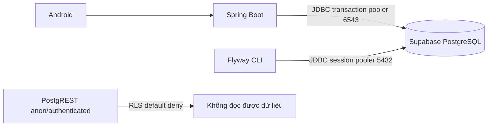

# UTEChat — Thiết lập Supabase

> **Trạng thái:** hướng dẫn và migration local sẵn sàng; chưa xác minh project Supabase thật.
> Nguồn thiết kế: [ERD](ERD.md), [ADR-007, ADR-020](ARCHITECTURE_DECISIONS.md).

## 1. Mô hình M2

Supabase chỉ cung cấp PostgreSQL. Spring Boot quản lý nghiệp vụ, phân quyền và transaction.
Android chỉ gọi REST/WSS của Spring Boot; không nhận Supabase key hay mật khẩu CSDL.
Dữ liệu nghiệp vụ có 13 bảng. Bảng `demo_sms_outbox` chỉ có ở môi trường demo.
`flyway_schema_history` là bảng kỹ thuật của Flyway, không tính vào 13 bảng.



## 2. Tạo project và lấy kết nối

1. Đăng nhập Supabase Dashboard, tạo project riêng cho đồ án.
2. Chọn Singapore (`ap-southeast-1`) nếu khả dụng. Đo độ trễ thực tế; không cam kết RTT.
3. Đặt mật khẩu CSDL ngẫu nhiên tối thiểu 16 ký tự, lưu trong trình quản lý mật khẩu.
4. Mở **Connect**, chọn Session pooler và Transaction pooler; sao chép chính xác hostname,
   username, database và port. Không suy đoán hostname từ tên vùng.
5. Sao chép `.env.example` thành `.env`, điền dữ liệu trên máy cá nhân.

> [!IMPORTANT]
> `.env` bị Git bỏ qua. Không dán nội dung file, mật khẩu, key hoặc JWT vào log/chat.
> Hai Supabase API key chỉ dùng cho chẩn đoán Data API; JDBC cần DB_USER/DB_PASSWORD,
> không dùng service-role key làm mật khẩu PostgreSQL.

## 3. Hai cổng kết nối

| Kết nối | Mục đích | Thiết lập |
|---|---|---|
| Session pooler 5432 | Flyway DDL, giữ session/advisory lock | TLS, FLYWAY_URL |
| Transaction pooler 6543 | JDBC runtime của Spring Boot/HikariCP | TLS, `prepareThreshold=0` |
| Direct 5432 (nếu mạng hỗ trợ) | Thay thế session pooler cho migration | Host/user riêng lấy từ Dashboard |

`prepareThreshold=0` tắt prepared statement phía server của PGJDBC khi dùng transaction pooling.
Port 6543 không giữ session giữa các transaction. Cấu hình pool Hikari nhỏ theo giới hạn gói,
không coi pooler là bảo đảm hàng nghìn kết nối ứng dụng.
Spring Boot cần cấu hình `spring.flyway.url/user/password` riêng qua các biến tương ứng ở Phase 2.

## 4. Row Level Security (RLS)

Migration bật Row Level Security trên 13 bảng core, không tạo policy.
V2 demo bật thêm RLS cho outbox. Với role `anon`/`authenticated`, RLS default deny
chặn đọc/ghi các dòng; không có nghĩa toàn bộ HTTP Data API bị tắt.
Role quản trị/owner hoặc BYPASSRLS vẫn truy cập được qua JDBC. Không dùng FORCE RLS
trong bộ migration này. Kiểm tra bằng SQL và request anon trên project đã có seed;
HTTP 200 với `[]` khi database rỗng chưa đủ chứng minh bảo mật.

## 5. Nạp biến môi trường và kiểm tra local

```powershell
Copy-Item .env.example .env
powershell -NoProfile -ExecutionPolicy Bypass -File backend/scripts/test-db-connection.ps1 -Quick
```

`-Quick` chỉ kiểm tra cấu hình mẫu, cú pháp và file local; PASS không có nghĩa đã kết nối Supabase.
`-Full` yêu cầu `.env` đã thay placeholder và kiểm tra TCP + HTTP PostgREST:

```powershell
powershell -NoProfile -ExecutionPolicy Bypass -File backend/scripts/test-db-connection.ps1 -Full -EnvFile .env
```

Spring Boot/Flyway CLI không tự đọc `.env`. Có thể nạp vào phiên PowerShell theo thứ tự
các biến trong file; đoạn dưới chỉ đọc dữ liệu, không thực thi nội dung file:

```powershell
Get-Content -LiteralPath .env | ForEach-Object {
    if ($_ -match '^([A-Z][A-Z0-9_]*)=(.*)$') {
        $name = $Matches[1]
        $value = $Matches[2]
        $value = [regex]::Replace($value, '\$\{([A-Z][A-Z0-9_]*)\}', {
            param($match)
            $resolved = [Environment]::GetEnvironmentVariable($match.Groups[1].Value)
            if ($null -eq $resolved) { throw 'Missing referenced environment variable' }
            $resolved
        })
        [Environment]::SetEnvironmentVariable($name, $value, 'Process')
    }
}
```

Không dùng `Invoke-Expression` hoặc `source` với file env.

## 6. Chạy migration

Cần cài Flyway CLI có hỗ trợ PostgreSQL (hoặc dùng Flyway trong backend ở Phase 2).
Chạy từ thư mục gốc repo sau khi nạp biến môi trường:

```powershell
# Production: CHỈ 13 bảng core, không có tài khoản hay outbox demo.
$env:FLYWAY_LOCATIONS = 'filesystem:backend/src/main/resources/db/migration'
flyway migrate
flyway info
```

Demo dùng project/database riêng, chọn mật khẩu cá nhân và tạo BCrypt hash bằng công cụ
BCrypt tin cậy trên máy (backend sẽ dùng BCryptPasswordEncoder). Lưu hash vào
`DEMO_PASSWORD_HASH`, không đưa mật khẩu cố định vào source:

```powershell
if ($env:DEMO_PASSWORD_HASH -notmatch '^\$2[aby]\$(1[0-9]|2[0-9]|3[01])\$[./A-Za-z0-9]{53}$') {
    throw 'Set a valid BCrypt demo password hash (cost >= 10)'
}
$env:FLYWAY_PLACEHOLDERS_DEMOPASSWORDHASH = $env:DEMO_PASSWORD_HASH
$env:FLYWAY_LOCATIONS = 'filesystem:backend/src/main/resources/db/migration,filesystem:backend/src/main/resources/db/demo'
flyway migrate
flyway info
```

V1 tạo core; V2 (số thứ tự migration, không phải phạm vi sản phẩm V2) tạo outbox và seed demo.
Giữ nguyên locations của một database sau lần migrate đầu. Không chạy Flyway clean trên
database dùng chung. Không sửa migration đã áp dụng; thêm migration mới.
Hiện chưa có `pom.xml`/backend executable: `mvn flyway:migrate` chưa được cấu hình,
không dùng lệnh đó để nghiệm thu Phase 1.

Kiểm tra `flyway_schema_history` có trạng thái thành công. Dùng SQL Editor chạy toàn bộ
`backend/scripts/verify-schema.sql` với `utechat.verify_demo = false` cho production
(mặc định) hoặc `true` cho demo. Script báo FAIL bằng exception để CLI/CI nhận mã lỗi.
Với psql:

```powershell
# Nhập URI PostgreSQL session vào biến môi trường PG* riêng, không đưa password vào command line.
psql -v ON_ERROR_STOP=1 -f backend/scripts/verify-schema.sql
# Demo trong cùng một session:
psql -v ON_ERROR_STOP=1 -c "SET utechat.verify_demo = 'true'" -f backend/scripts/verify-schema.sql
```

## 7. Năm tài khoản demo

| Tên | SĐT | Kịch bản |
|---|---|---|
| Alice Nguyễn | +84901111111 | Quản trị nhóm, bạn Bob/Charlie, chặn Eve |
| Bob Trần | +84902222222 | Chat với Alice, gửi lời mời David |
| Charlie Lê | +84903333333 | Nhóm ba người |
| David Phạm | +84904444444 | Tắt nhận tin từ người lạ |
| Eve Hoàng | +84905555555 | Block-only từ Alice |

Mật khẩu là giá trị bạn chọn khi tạo DEMO_PASSWORD_HASH. Avatar mặc định NULL để demo
không phụ thuộc nguồn ảnh ngoài. Seed có TEXT, CALL, LOCATION, lời mời PENDING và event ban đầu.
Ảnh/audio/video/file phải được upload qua API khi module media đã triển khai; không seed
storage_path giả. Workflows soft-delete, quyền gửi tin và phát WebRTC sẽ được kiểm ở các phase nghiệp vụ.

## 8. Retention sự kiện

Có index trên `sync_events.created_at`. Backend Phase 5 phải lập lịch hằng ngày:
`DELETE FROM public.sync_events WHERE created_at < now() - interval '30 days';`
Chưa có server scheduler trong Phase 1 nên chưa tuyên bố retention tự động đang chạy.
Trước khi xóa event cũ cần hoàn thiện phục hồi cursor hết hạn theo hợp đồng sync.

## 9. Khắc phục sự cố và nghiệm thu

- Timeout: kiểm tra hostname pooler, DNS, firewall, TCP 5432/6543 và TLS.
- `prepared statement "S_1" does not exist`: kiểm tra `prepareThreshold=0`.
- Advisory lock mất kết nối: dùng session pooler/direct cho Flyway.
- RLS: kiểm tra toàn bộ bảng core/demo có relrowsecurity=true, không có policy;
  anon/authenticated không được đọc/ghi, quản trị vẫn truy cập.
- PASS local không thay thế nghiệm thu cloud: chạy migration, SQL assertions và Full trên
  đúng project, lưu chỉ kết quả PASS/FAIL đã che thông tin nhạy cảm vào báo cáo Phase 1.

## 10. Kiểm thử PostgreSQL cục bộ, không cần cloud

Cần Node.js và npm. Cài hai dependency kiểm thử vào thư mục tạm ngoài repository:

```powershell
$testDeps = Join-Path $env:TEMP 'utechat-phase1-verify'
npm install --prefix $testDeps --no-save --no-package-lock @electric-sql/pglite@0.3.7 bcryptjs@3.0.2
node backend/scripts/test-schema.mjs (Join-Path $testDeps 'node_modules')
```

Bộ kiểm thử chạy PostgreSQL WASM (PGlite) trong bộ nhớ: DDL production, seed demo,
BCrypt, FK/CHECK/UNIQUE, seed chạy lại không lùi watermark, RLS với role không đặc quyền,
và khả năng script phát hiện index/RLS/policy bị sửa sai. Mật khẩu kiểm thử ngẫu nhiên
chỉ tồn tại trong bộ nhớ. Không thêm dependency vào Android hoặc runtime backend.
PGlite không thay thế Flyway CLI, Supabase PostgREST, TLS hay pooler thật.
