# Báo cáo kiểm thử chức năng Plan 08-04 (TV4)

- **Ngày thực hiện:** 27/11/2026
- **Người thực hiện:** Thành viên 4 (TV4)
- **Phạm vi:** Phase 5 (`NewChat`, Chat 1-1/Nhóm, Đổi tên/Quyền Admin, Offline, Tin `FAILED`, FTS4, Sync) & 1/4 Phase 6 (Đính kèm Ảnh, Voice note, Video, File tài liệu, Vị trí `geo:` và Media Offline)
- **Nhánh gốc:** `main` (`dac135d`) · **Nhánh nộp báo cáo & bản vá:** `test/phase-8-04-tv4`
- **Môi trường kiểm thử:**
  - **Backend:** Spring Boot chạy cục bộ cổng `8080`, kết nối Supabase (Flyway `V9`, profile `dev`).
  - **Android build:** `.\gradlew.bat installDebug -PuseFakeData=false` (kết nối Backend thật).
  - **Thiết bị:** 2 Emulator chạy song song — **Pixel 8 API 36.0** (tài khoản Alice Nguyễn `+84901111111`) và **Medium Phone API 37.0** (tài khoản Bob Trần `+84902222222`), kết hợp tài khoản mẫu Charlie Lê (`+84903333333`), David Phạm (`+84904444444`), Eve Hoàng (`+84905555555`).
- **Kết quả tổng thể:** **11/11 Test Case đạt (`PASS`)** sau khi tái hiện và sửa dứt điểm **2 lỗi** ngay trong phiên kiểm thử (đã kiểm chứng lại bằng cả unit test JVM và chạy thực tế trên 2 Emulator).

---

## 1. Bảng tổng hợp kết quả (`TC-8.4.01` → `TC-8.4.11`)

| Mã TC | Nội dung kiểm thử | Mức spam / stress đã chạy | Kết quả | Ghi chú |
| --- | --- | --- | --- | --- |
| **TC-8.4.01** | Tạo hội thoại mới (`NewChatFragment`) & mở chat 1-1 không tạo trùng | Mở từ danh sách bạn bè & tra SĐT lặp lại nhiều lần | **PASS** | Tái sử dụng đúng hội thoại 1-1 cũ |
| **TC-8.4.02** | Chat 1-1 Realtime `/ws`, `Typing` & chính sách `CONTACT_REQUIRED` | Spam 10+ tin emoji/text liên tiếp; tra SĐT David (`+84904444444`) | **PASS** | Tin lên tức thì đúng thứ tự; hiện đúng `CONTACT_REQUIRED` + nút gửi lời mời |
| **TC-8.4.03** | Vòng đời trạng thái `SENDING → SENT → DELIVERED → READ` | Spam 10+ tin lúc đối phương tắt mạng → bật ở `ChatList` → mở phòng | **PASS** | Nhãn tăng tiến chuẩn, không tụt ngược |
| **TC-8.4.04** | Banner mất WS, Gửi Offline (`SendMessageWorker`) & tin `FAILED` | Tắt mạng spam `Off1`–`off5` + 2 emoji; gửi vào phòng bị chặn Eve, kill app mở lại | **PASS** | Tự đẩy đúng thứ tự khi có mạng; tin `Not sent` / `Resend` giữ bền vững |
| **TC-8.4.05** | Tạo nhóm, Đổi tên & Phân quyền Admin (`GroupCreate` / `GroupInfo`) | Tạo nhóm 3 người; nâng/hạ quyền Admin cho Bob liên tiếp 4 lần | **PASS** *(sau fix Bug #2)* | Đã sửa lỗi ngữ pháp `You is now/no longer an admin` → `You are...`; ghi nhận 1 lỗi hiển thị nhỏ ở chữ viết tắt avatar |
| **TC-8.4.06** | Thêm/Xóa thành viên, `visible_from_message_id` & Bàn giao Admin | Nhắn `T1–T3` → xóa Bob → nhắn `T4–T6` → thêm lại Bob → nhắn `T7` → Admin rời nhóm | **PASS** | Chế độ read-only, lọc mốc `visible_from_message_id` và dialog `Choose a new admin` chuẩn xác |
| **TC-8.4.07** | Đồng bộ bù `/api/sync` & tự tải lịch sử cũ khi mở phòng sau bootstrap | Tắt mạng spam 10 tin `1`→`10`; Clear Storage đăng nhập lại Alice mở phòng 30+ tin | **PASS** *(sau fix Bug #1)* | Đã tái hiện lỗi chỉ hiện 1 tin và sửa tự động gọi tải trang lịch sử đầu tiên |
| **TC-8.4.08** | Tìm kiếm FTS4 tiếng Việt không dấu (toàn cục & trong phòng, Offline) | Nhắn 3 câu có dấu, bật Chế độ máy bay, tìm `bao cao` & bấm mũi tên nhảy kết quả | **PASS** | Tìm chuẩn không dấu khi offline, highlight + bộ đếm `1/3` nhảy mượt |
| **TC-8.4.09** | Gửi/nhận Ảnh nén & phóng to `ImageViewerFragment` | Spam gửi nhiều ảnh liên tiếp (`17:13`), mở phóng to trên `ZoomableImageView` | **PASS** | Ảnh nén gửi/nhận đầy đủ, zoom mượt không crash |
| **TC-8.4.10** | Ghi âm & phát Voice note (`VoiceBubblePlayer`) | Spam 4 voice note (`0:03`, `0:02`, `0:12`, `0:09`), phát & kéo tua `SeekBar` | **PASS** | Phát ổn định, kéo tua `SeekBar` chính xác |
| **TC-8.4.11** | Video (`Range`), File (`FileProvider`), Vị trí `geo:` & Media Offline | 2 video MP4 tua giữa (`00:03/00:06`), `rubric_vn.pdf`, tọa độ Google Maps, tắt mạng gửi 2 ảnh + 1 voice | **PASS** | Tua video mượt, gửi file/mở bản đồ không crash, media offline upload 2 pha thành công |

---

## 2. Lỗi phát hiện & đã xử lý trong ca `08-04`

### Bug #1 (High — Đã tái hiện, đã sửa & kiểm chứng)
- **Hiện tượng:** Sau khi `Clear storage` trên Pixel và đăng nhập lại Alice (Room chỉ bootstrap đúng 1 tin nhắn cuối `lastMessage`), khi mở phòng chat giữa Alice và Bob (vốn có 30+ tin nhắn) chỉ hiện đúng 1 tin nhắn mới nhất và không tải lịch sử cũ vì danh sách quá ngắn nên `OnScrollListener` (`dy < 0`) không kích hoạt.
- **Nguyên nhân:** `ChatRoomFragment` chỉ gọi `vm.loadOlder(readOnly)` bên trong `RecyclerView.OnScrollListener`, chưa tự gọi tải trang lịch sử đầu tiên khi mở phòng.
- **Cách sửa:**
  - Thêm `ChatRoomViewModel.ensureInitialHistory(boolean readOnly)` trong `app/src/main/java/com/utechat/ui/chat/ChatRoomViewModel.java`: tự tải 1 trang lịch sử cũ (`GET /api/conversations/{id}/messages?before=...`) đúng 1 lần mỗi hội thoại khi cache hiện có `< window()`, bỏ qua nếu `readOnly`, và tự cho phép thử lại khi kết nối WS hồi phục nếu lần đầu gặp lỗi `"NETWORK"`.
  - Nối `tryLoadInitialHistory()` trong `app/src/main/java/com/utechat/ui/chat/ChatRoomFragment.java` khi `members`, `messages` sẵn sàng và khi `WsConnectionState.CONNECTED`.
  - Bổ sung unit test `ensureInitialHistoryLoadsOlderMessagesOnceForShortBootstrappedRoom` trong `app/src/test/java/com/utechat/ui/chat/ChatViewModelTest.java`.
- **Kiểm chứng:** `.\gradlew.bat :app:testDebugUnitTest --tests "com.utechat.ui.chat.*"` **PASS**; cài lại lên 2 Emulator, thực hiện Clear Storage + đăng nhập lại Alice → phòng chat tự động kéo đủ lịch sử tin cũ (ảnh `21` & `22`).

### Bug #2 (Low / UX — Đã tái hiện, đã sửa & kiểm chứng)
- **Hiện tượng:** Khi Admin nâng hoặc hạ quyền Admin cho một thành viên, tin `SYSTEM` hiển thị trên máy người được đổi quyền (ngôn ngữ tiếng Anh) bị sai ngữ pháp: **`"You is now an admin"`** và **`"You is no longer an admin"`** (ảnh `16`).
- **Nguyên nhân:** `SystemMessageFormatter` ghép `chat_you` (`"You"`) vào mẫu chung `%1$s is now an admin` / `%1$s is no longer an admin`.
- **Cách sửa:**
  - Thêm tài nguyên chuỗi riêng cho ngôi thứ hai `chat_sys_role_admin_you` (`You are now an admin` / `Bạn đã trở thành quản trị viên`) và `chat_sys_role_member_you` (`You are no longer an admin` / `Bạn không còn là quản trị viên`) tại `values/strings_chat.xml` và `values-vi/strings_chat.xml`.
  - Cập nhật nhánh `ROLE_CHANGED` trong `app/src/main/java/com/utechat/ui/chat/SystemMessageFormatter.java` để chọn chuỗi riêng khi `targetUserId.equals(meId)`.
  - Bổ sung unit test `roleChangedUsesDedicatedSelfStringForGrammar` trong `app/src/test/java/com/utechat/ui/chat/ChatTextTest.java`.
- **Kiểm chứng:** Unit test **PASS**; xác nhận thực tế trên Emulator sau bản vá hiển thị đúng **`"You are no longer an admin"`** (ảnh `21`).

### Quan sát UI nhỏ (Cosmetic — Đề xuất polish ở đợt sau)
- Trên màn `GroupInfoFragment` (ảnh `15`), avatar chữ viết tắt của thành viên hiện tại hiển thị **`A(`** (`Alice Nguyễn (You)`) và **`B(`** (`Bob Trần (You)`), do hàm tách ký tự đầu của từ đầu và từ cuối chạy trên chuỗi đã gắn hậu tố `"(You)"`. Chưa gây ảnh hưởng chức năng, ghi nhận để polish UI.

---

## 3. Chi tiết từng Test Case & Ảnh minh chứng

### Phần A — Phase 5: Tạo hội thoại mới, Chat 1-1 Realtime, Trạng thái & Kết nối WS

#### TC-8.4.01 — Tạo hội thoại mới (`NewChatFragment`) & Mở chat 1-1
- **Kết quả:** **PASS**. Màn `New message` hiển thị đủ nút *Create new group*, ô tìm theo tên/SĐT và danh sách bạn bè; mở chat với Bob Trần từ danh sách hay từ tra SĐT đều vào đúng hội thoại 1-1 cũ, không tạo trùng.

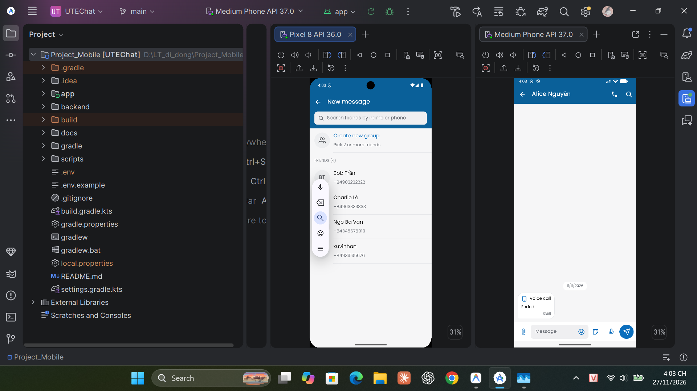

#### TC-8.4.02 — Chat 1-1 Realtime qua WebSocket, `Typing` & Chặn người lạ `CONTACT_REQUIRED`
- **Kết quả:** **PASS**. Nhắn tin & spam liên tiếp 10+ tin emoji/text giữa 2 máy đồng bộ tức thì, đủ số lượng và đúng thứ tự. Khi Medium (Bob) tra SĐT `+84904444444` (David Phạm — đã tắt nhận tin người lạ), app chặn đúng chính sách với thông báo *"This user only accepts messages from friends"* kèm nút **Send friend request**.

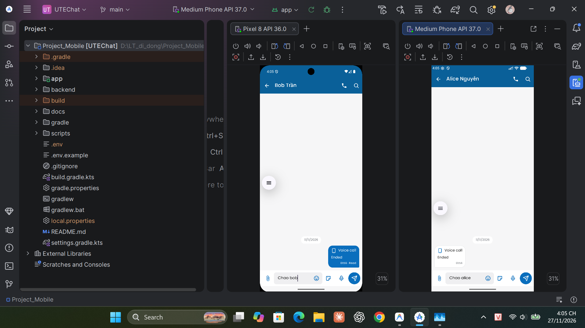
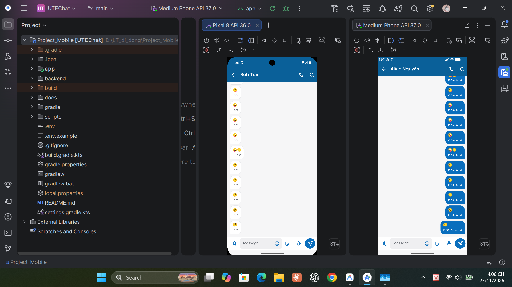
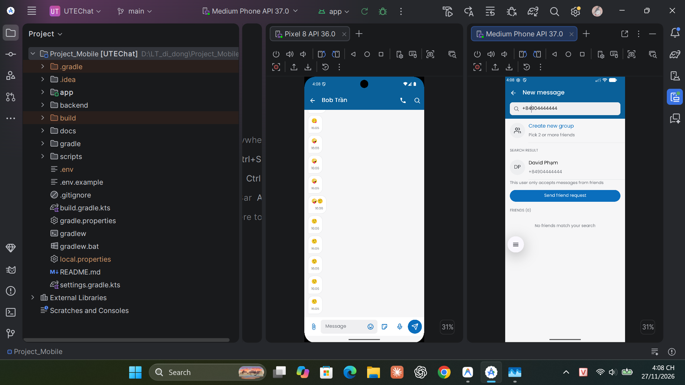
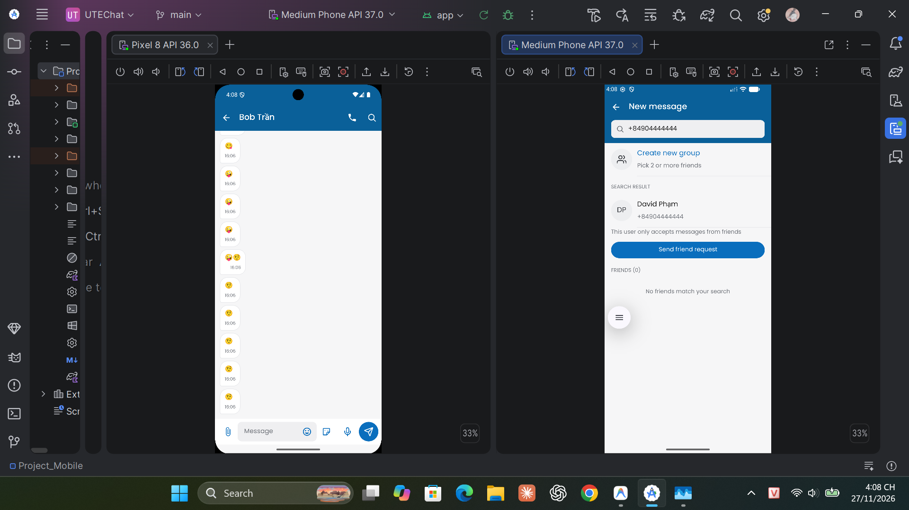

#### TC-8.4.03 — Vòng đời trạng thái (`SENDING → SENT → DELIVERED → READ`)
- **Kết quả:** **PASS**. Khi Pixel bật Chế độ máy bay, loạt 10+ tin `hey`/`heyhey` từ Medium hiển thị `Sent`; khi Pixel bật mạng lại ở màn `ChatList` (badge `20`, chưa mở phòng), nhãn tự chuyển sang `Delivered`; khi Pixel mở phòng chat, nhãn chuyển sang `Read` và không tụt ngược.

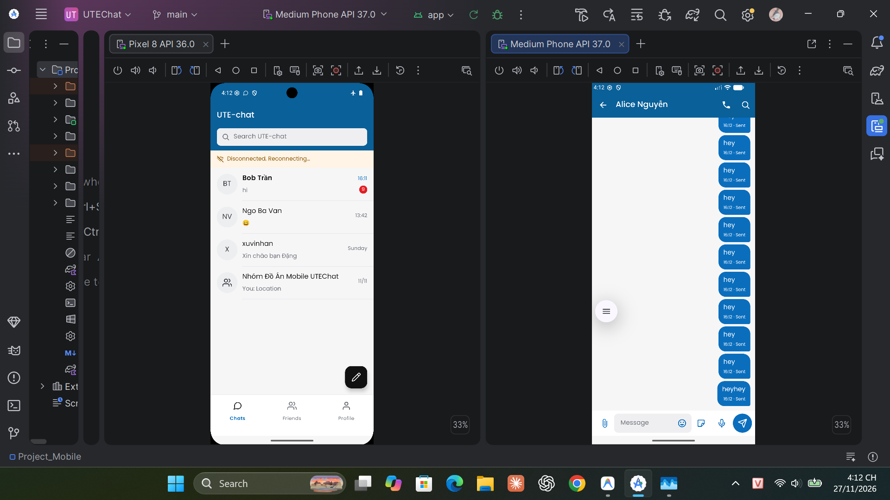
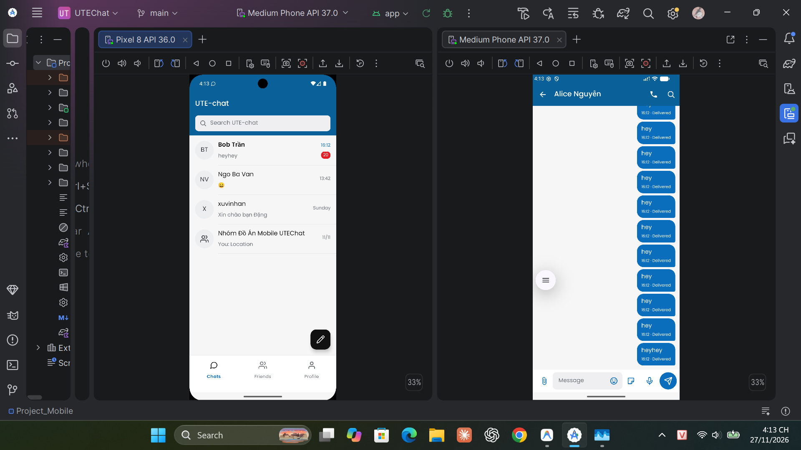
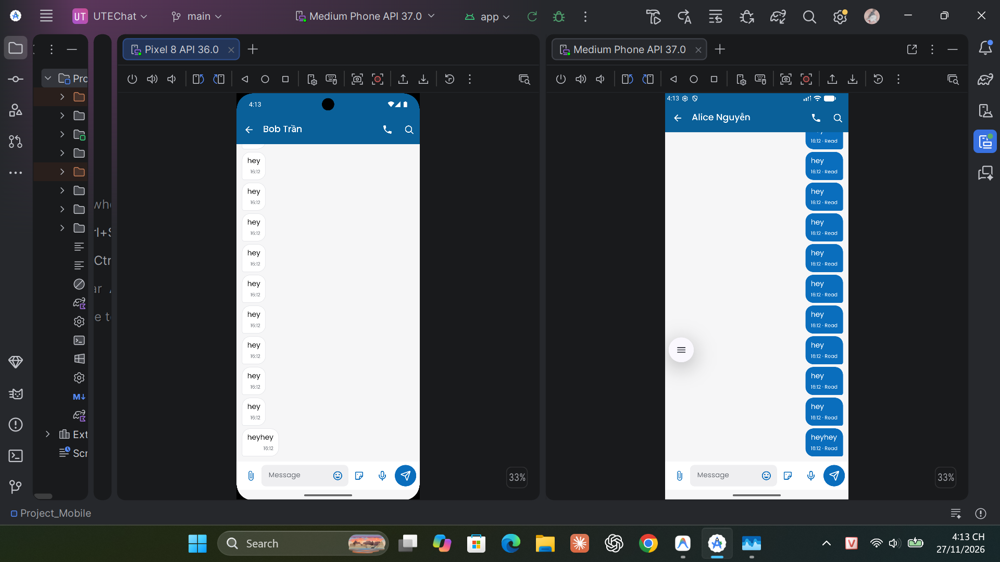

#### TC-8.4.04 — Biểu ngữ mất WS, Gửi Offline (`SendMessageWorker`) & Xử lý tin `FAILED`
- **Kết quả:** **PASS**.
  - Khi tắt mạng, banner `Disconnected. Reconnecting...` hiện rõ ở cả `ChatList` và `ChatRoom` rồi tự biến mất khi có mạng lại.
  - Spam gửi offline 5 tin `Off1`–`off5` + 2 emoji ở trạng thái `Sending`, sau khi tắt Chế độ máy bay `SendMessageWorker` tự đẩy tuần tự đúng thứ tự `Off1 → off5` sang máy nhận.
  - Khi gửi tin vào phòng bị chặn (Eve Hoàng), tin chuyển trạng thái `Not sent` kèm chữ đỏ `You can't message this person. · Resend` và biểu ngữ chính sách, được giữ bền vững sau khi tắt mở lại app.

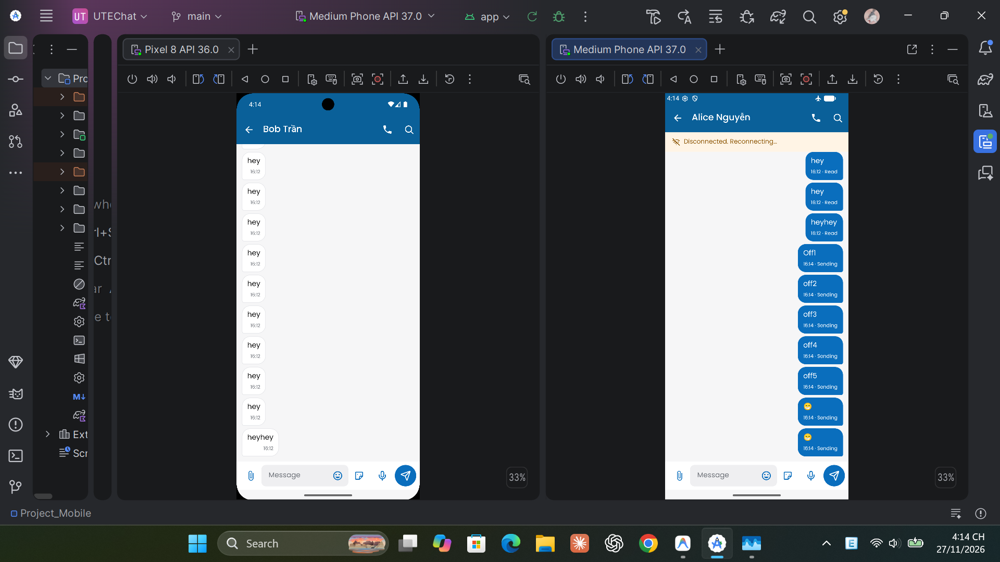
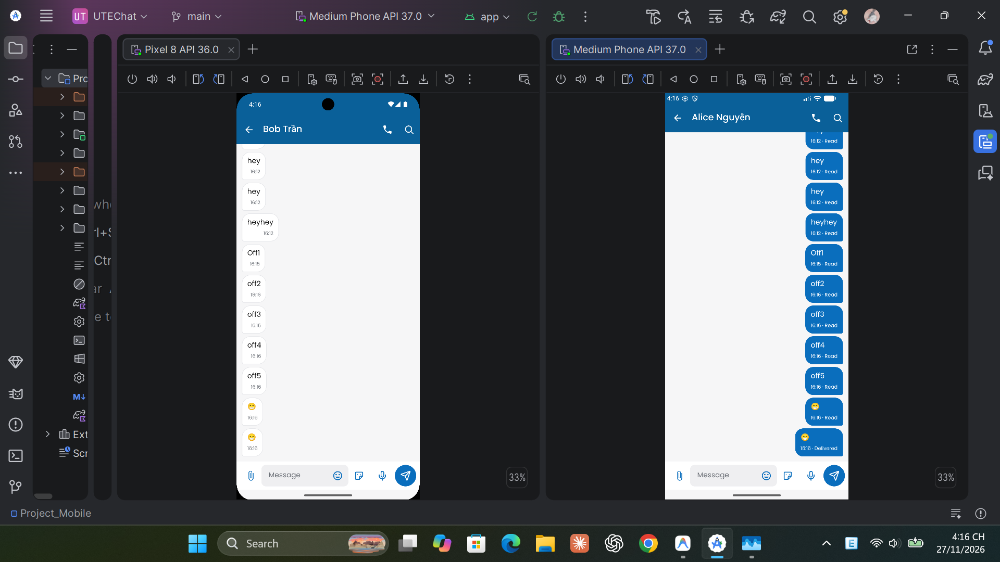
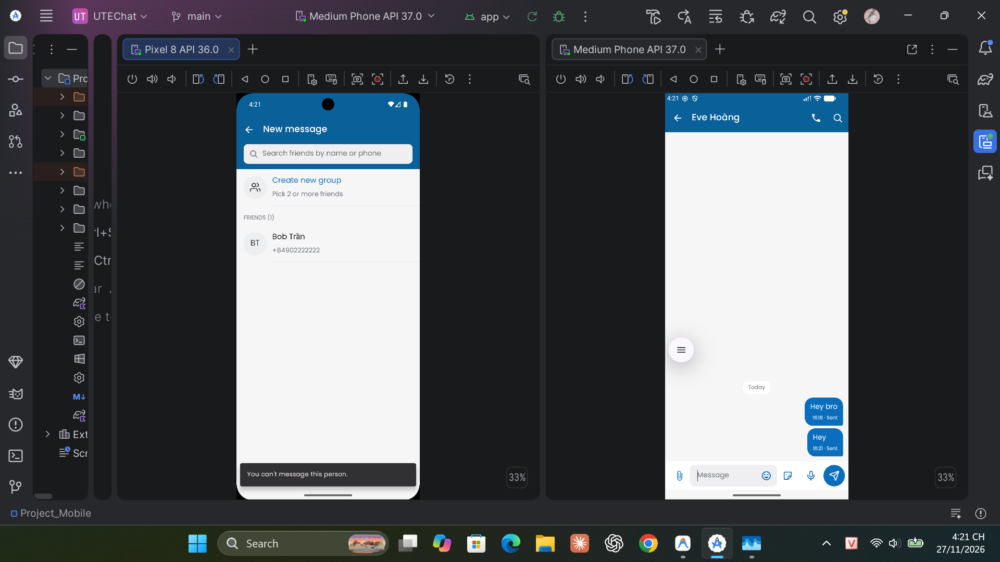
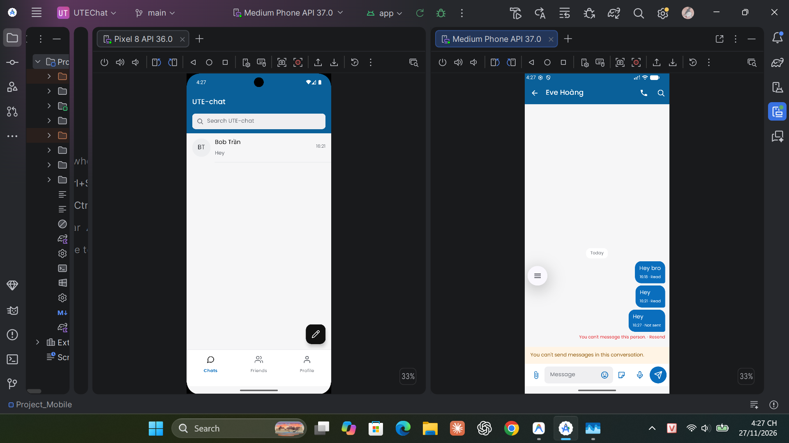

---

### Phần B — Phase 5: Chat nhóm, Quản trị nhóm, `visible_from_message_id` & Đồng bộ

#### TC-8.4.05 — Tạo nhóm (`GroupCreateFragment`), Đổi tên & Phân quyền (`GroupInfoFragment`)
- **Kết quả:** **PASS** *(sau khi fix Bug #2)*. Tạo nhóm `"Nhom test do an mobile"` với 3 thành viên (`ACCEPTED`), chỉ `Admin` (Alice) thấy nút `Rename group`, `Add members` và menu đổi quyền; `Member` (Bob) bị ẩn toàn bộ thao tác quản trị. Lỗi ngữ pháp `"You is now/no longer an admin"` chụp ở ảnh `16` đã được sửa và xác nhận đúng `"You are no longer an admin"` ở ảnh `21`.

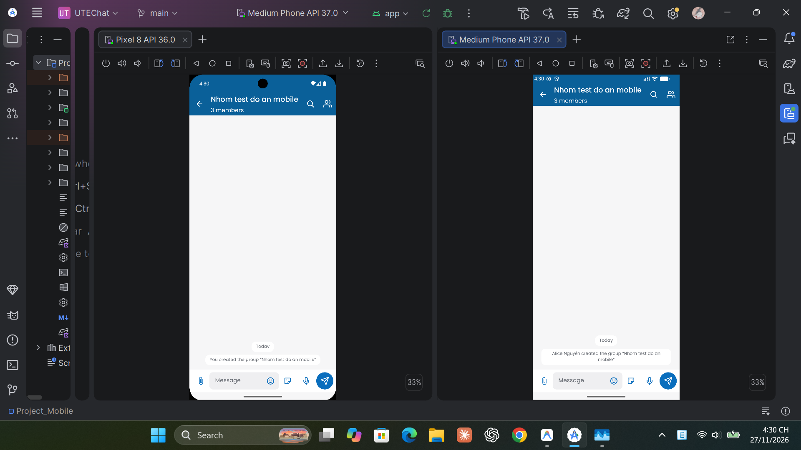
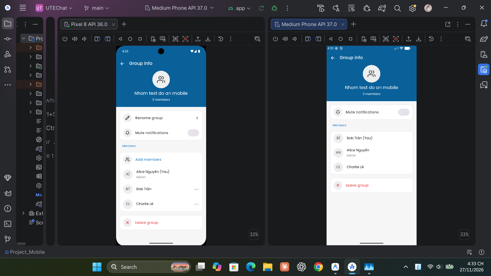
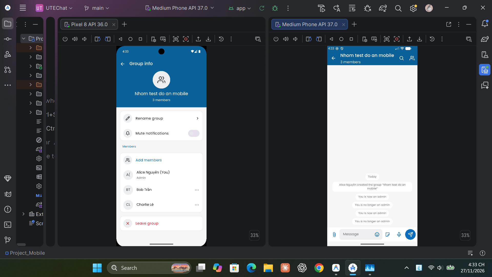

#### TC-8.4.06 — Thêm/Xóa thành viên, `visible_from_message_id` & Bàn giao Admin khi rời nhóm
- **Kết quả:** **PASS**.
  - Sau khi Alice nhắn `T1, T2, T3` và xóa Bob khỏi nhóm, máy Bob khóa ô soạn với biểu ngữ `You are no longer a member of this group` nhưng vẫn xem lại được `T1–T3`.
  - Alice nhắn `T4, T5, T6` rồi thêm lại Bob và nhắn `T7`: máy Bob chỉ thấy từ tin hệ thống `Alice Nguyễn added You to the group` và `T7`, không bị lộ `T4–T6`.
  - Khi Alice (Admin duy nhất) bấm `Leave group`, app mở hộp thoại `Choose a new admin` (`Bob Trần` / `Charlie Lê`) cùng nút `Transfer & leave`.

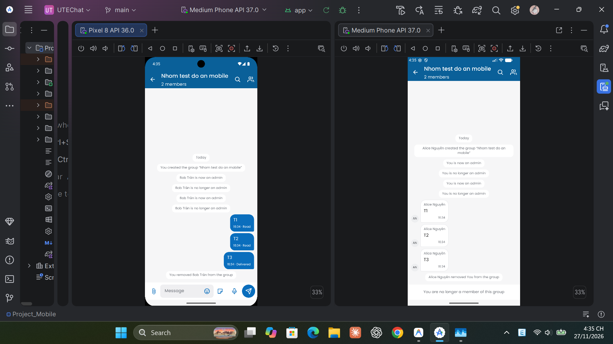
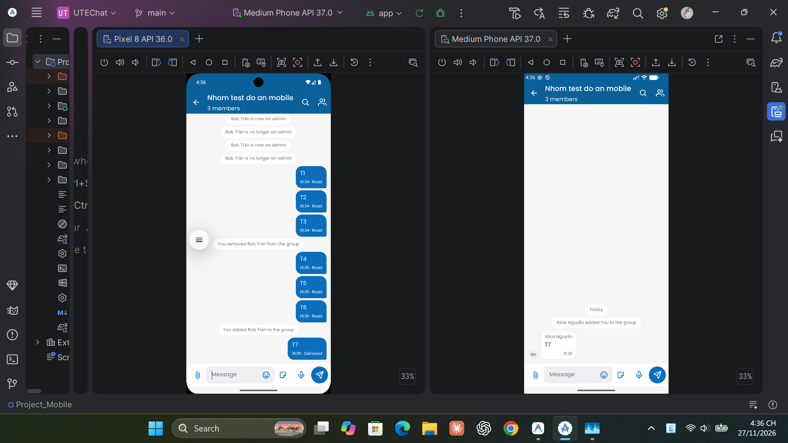
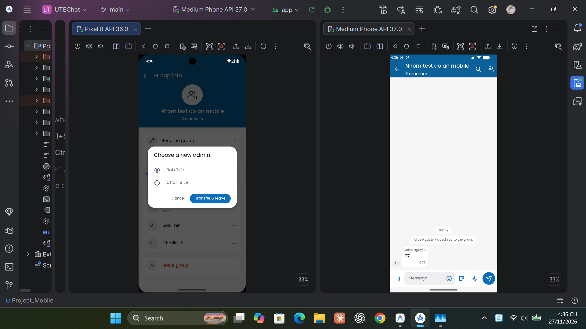

#### TC-8.4.07 — Đồng bộ bù `/api/sync` & Tải lại lịch sử cũ khi mở phòng sau bootstrap
- **Kết quả:** **PASS** *(sau khi fix Bug #1)*.
  - Tắt mạng Medium, Alice spam 10 tin `1`→`10`, bật mạng lại Medium kéo bù đủ 10/10 tin đúng thứ tự.
  - Sau khi tái hiện lỗi Clear Storage + đăng nhập lại chỉ hiện 1 tin và áp bản vá `ensureInitialHistory`, Pixel thực hiện Clear Storage → đăng nhập lại Alice → mở phòng chat với Bob đã tự động tải đầy đủ lịch sử tin cũ (`1..9`, emoji 16:16...).

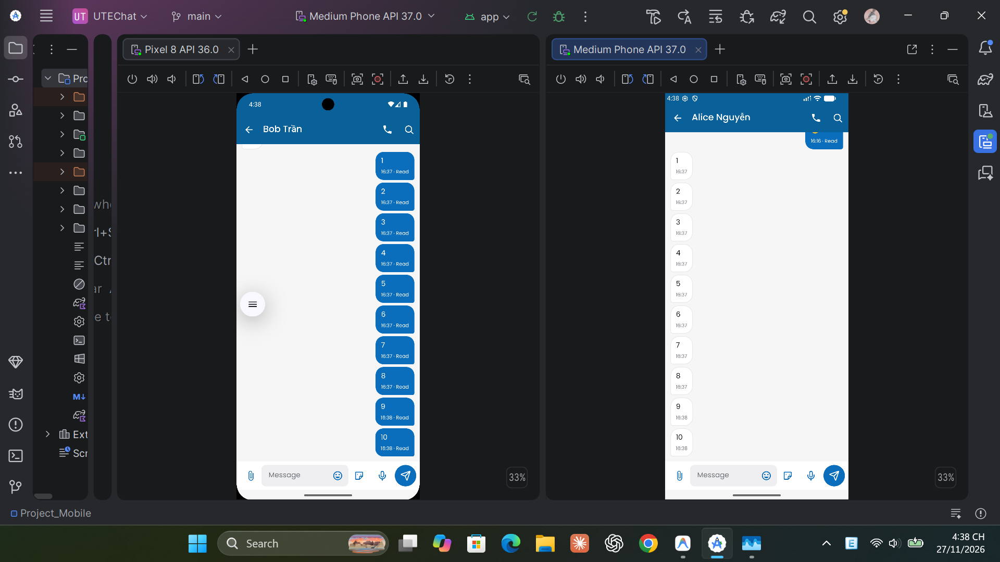
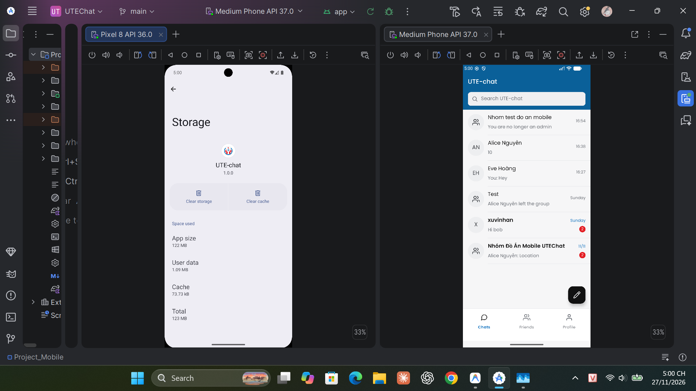
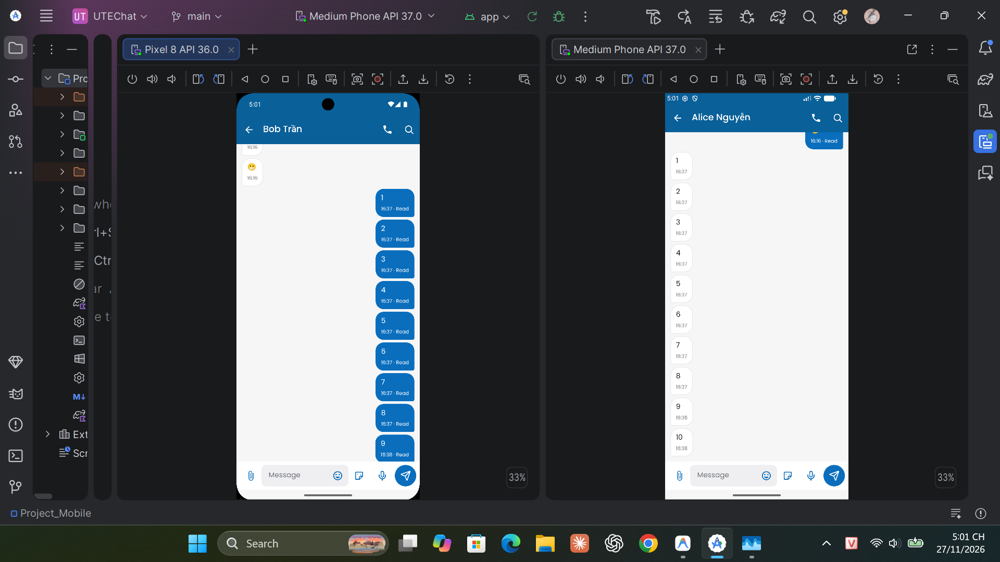

---

### Phần C — Phase 5: Tìm kiếm FTS4 Tiếng Việt không dấu (Offline)

#### TC-8.4.08 — Tìm kiếm toàn cục & Tìm kiếm trong phòng chat (Offline)
- **Kết quả:** **PASS**. Bật Chế độ máy bay trên Pixel (lộ icon máy bay và banner mất kết nối), gõ từ khóa không dấu `bao cao`:
  - Tại `ChatListFragment`: trả đủ 3 tin có dấu (`Họp báo cáo tối nay`, `Báo cáo đồ án di động`, `Báo cáo tiến độ chiều nay`) với phần khớp tô đậm màu xanh.
  - Tại `ChatRoomFragment`: hiển thị bộ đếm `1/3`, highlight dòng kết quả và cuộn nhảy mượt qua các nút `↑` / `↓`.

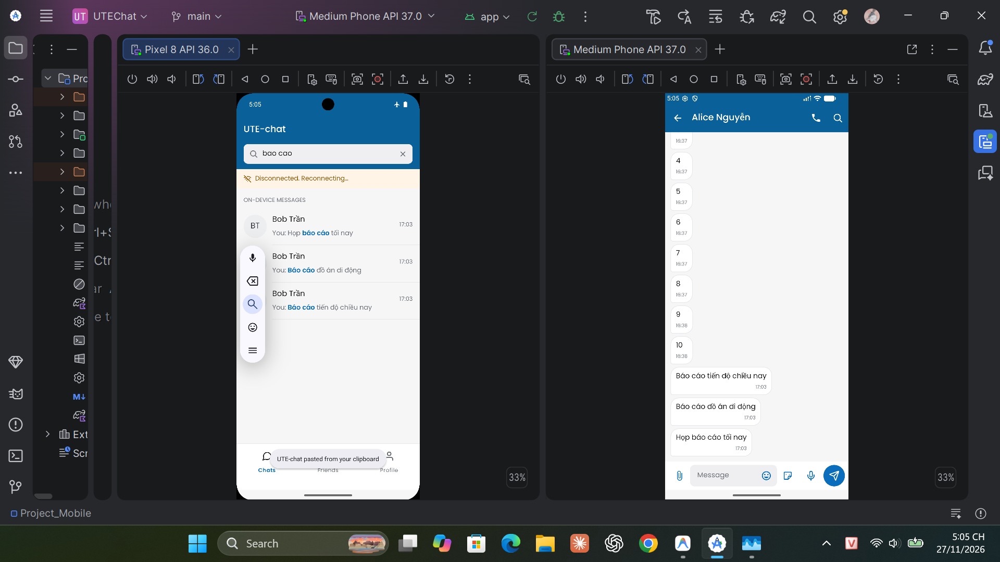
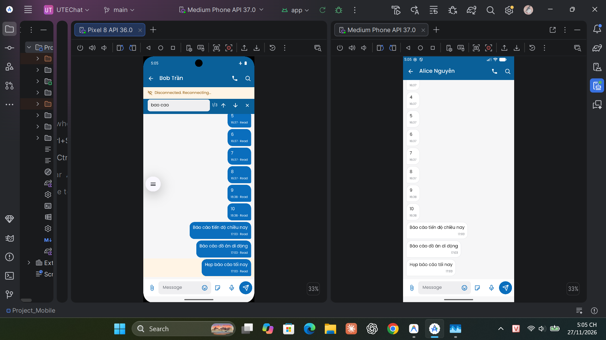

---

### Phần D — Gánh 1/4 Phase 6: Media Đính kèm & Vị trí (`geo:`)

#### TC-8.4.09 — Gửi/nhận Ảnh nén & Trình xem ảnh `ImageViewerFragment`
- **Kết quả:** **PASS**. Spam gửi nhiều ảnh liên tiếp sang Medium đầy đủ, mở `21.jpg` trong `ImageViewerFragment` phóng to/thu nhỏ mượt trên `ZoomableImageView`, không vỡ layout hay OOM.

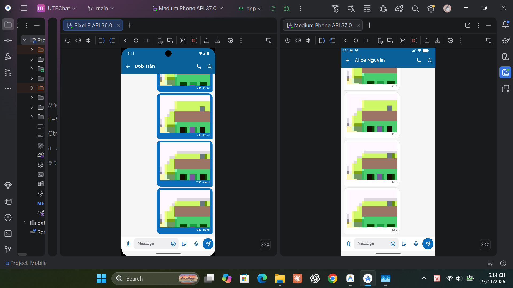
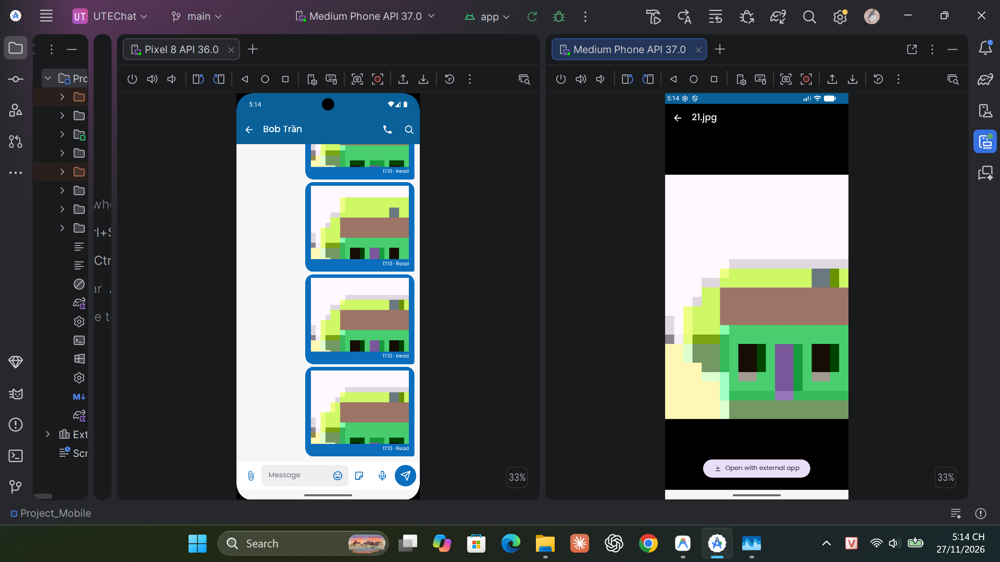

#### TC-8.4.10 — Ghi âm & phát Voice note (`VoiceBubblePlayer`)
- **Kết quả:** **PASS**. Gửi liên tiếp 4 voice note (`0:03`, `0:02`, `0:12`, `0:09`); phát âm thanh rõ và kéo tua `SeekBar` (minh chứng trên bong bóng `0:12`) phản hồi đúng vị trí.

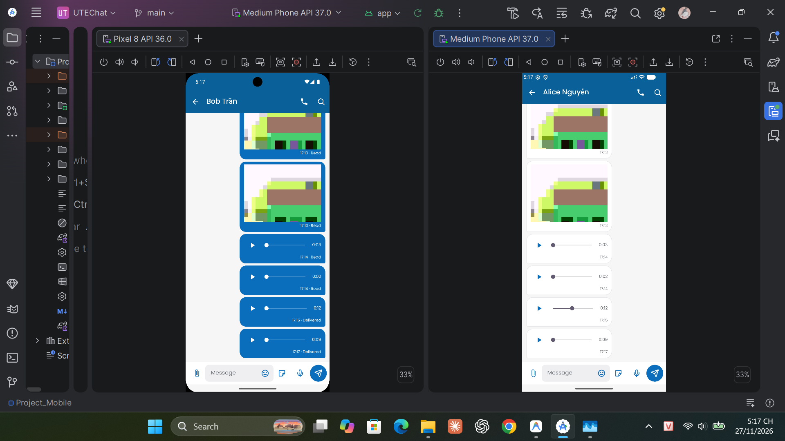

#### TC-8.4.11 — Video (`Range`), File (`FileProvider`), Vị trí `geo:` & Media Offline
- **Kết quả:** **PASS**.
  - Gửi 2 video MP4 (`0:06`), mở `24.mp4` trong `VideoPlayerFragment` và kéo tua tới `00:03 / 00:06` mượt (xác nhận HTTP `Range`).
  - Gửi tệp `rubric_vn.pdf (287.7 KB)` nhận đủ dung lượng và mở bằng app ngoài qua `FileProvider` không crash.
  - Gửi thẻ Vị trí (`37.3173, -121.9164`), chạm thẻ trên Medium mở chính xác Google Maps tại đúng ghim tọa độ.
  - Tắt mạng gửi 2 ảnh + 1 voice (`0:06` lúc `17:30`), bật mạng lại `SendMessageWorker` tự hoàn tất upload + gửi 2 pha sang Medium.

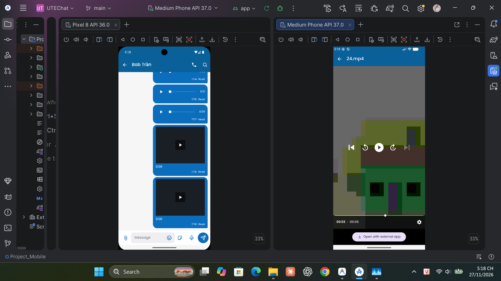
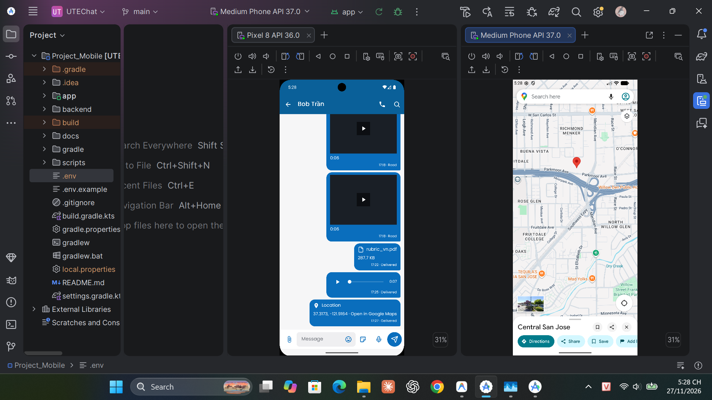
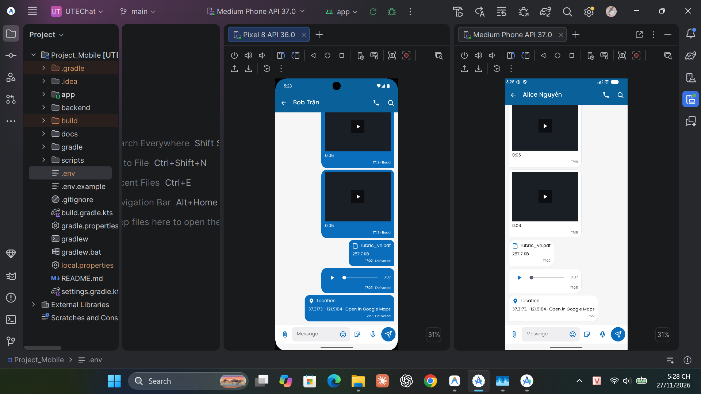
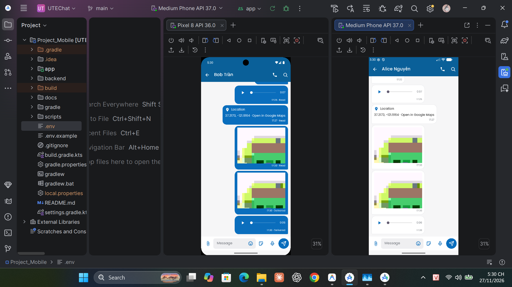
